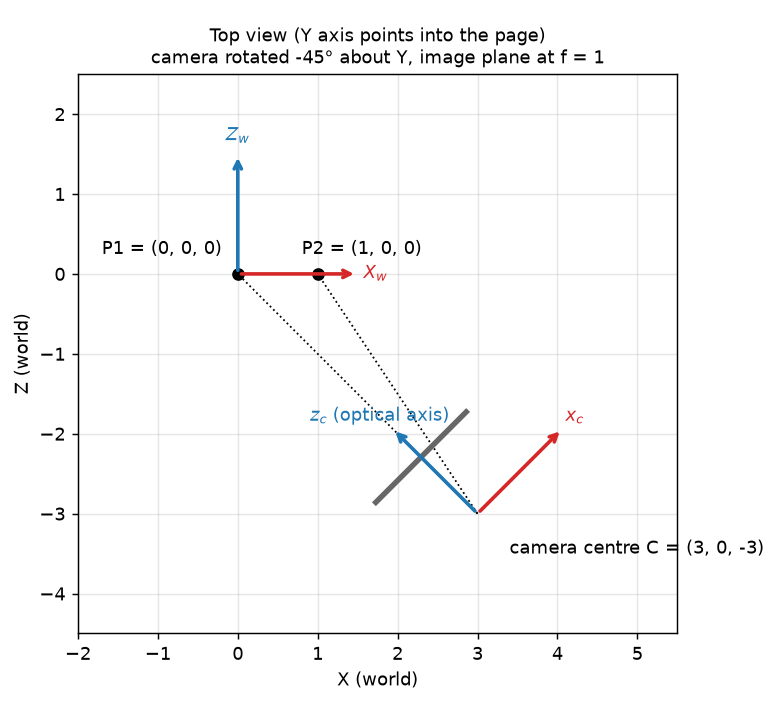

Before a camera can draw a 3D point on the image, it needs to know one thing: where is that point *relative to me*? Points usually live in some shared world frame (a map, a room, a drone survey). But projecting onto the image only works in the camera's own frame, where the optical axis points straight ahead. The **extrinsic matrix** does that switch. It's just a rotation and a translation, but I kept getting the order and the direction of the two wrong. I worked through it with Neeraj Krishna's tutorial series on image formation, and this is my own summary.

## Rotating a point in 2D

Start small. Rotate a point $(x, y)$ around the origin by an angle $\theta$, counter-clockwise. Write the point in polar form, $x = r\cos\alpha$ and $y = r\sin\alpha$. After the rotation it sits at angle $\alpha + \theta$:

$$
x' = r\cos(\alpha + \theta) = r\cos\alpha\cos\theta - r\sin\alpha\sin\theta = x\cos\theta - y\sin\theta,
$$

$$
y' = r\sin(\alpha + \theta) = r\sin\alpha\cos\theta + r\cos\alpha\sin\theta = x\sin\theta + y\cos\theta.
$$

Both lines are linear in $x$ and $y$, so we can write them as one matrix product:

$$
\begin{bmatrix}x'\\y'\end{bmatrix} =
\underbrace{\begin{bmatrix}\cos\theta & -\sin\theta\\ \sin\theta & \cos\theta\end{bmatrix}}_{R(\theta)}
\begin{bmatrix}x\\y\end{bmatrix}.
$$

In 3D you get one of these for each axis. For example, a rotation around the $Y$ axis is

$$
R_y(\theta) = \begin{bmatrix}\cos\theta & 0 & \sin\theta\\ 0 & 1 & 0\\ -\sin\theta & 0 & \cos\theta\end{bmatrix}.
$$

Rotation matrices are orthogonal, which just means $R^{-1} = R^\top$. Also $\det R = 1$.

## Moving the point vs. moving the axes

This was the part that confused me. The same matrix can be read in two ways.

- **Moving the point**: the axes stay where they are and the point moves. $R(\theta)$ turns a point by $+\theta$.
- **Moving the axes (change of basis)**: the point stays put and the axes turn. If the axes turn by $+\theta$, the point's new coordinates look as if the point had turned by $-\theta$. So the change-of-basis matrix is $R(-\theta) = R(\theta)^{-1} = R(\theta)^\top$.

Translation works the same way. Moving a point by $t$ adds $t$. Moving the origin of the axes by $t$ subtracts $t$ from every coordinate.

So the rule I keep in my head is: **the change-of-basis matrix is the inverse of the matrix that moves the frame.** If we know how the camera was turned and moved in the world, undoing that motion tells us how world points look from the camera.

## Homogeneous coordinates

There's a small annoyance here. Rotation is a matrix product, but translation is an addition, so you can't just multiply them together. The trick is to add a fourth coordinate that's always 1: the point $(X, Y, Z)$ becomes $(X, Y, Z, 1)$. These are called homogeneous coordinates. Now a translation by $t$ is also a $4 \times 4$ matrix,

$$
T(t) = \begin{bmatrix}I & t\\ 0^\top & 1\end{bmatrix},
\qquad
\text{and a rotation is}\quad
\begin{bmatrix}R & 0\\ 0^\top & 1\end{bmatrix}.
$$

So any chain of rotations and translations becomes one matrix product.

## Building the extrinsic matrix

The camera's **pose** (where it is and which way it faces in the world) is described by:

- $R_c$: a rotation whose columns are the camera's $x$, $y$ and $z$ axes, written in world coordinates;
- $C$: the camera centre in world coordinates.

To place the camera, you first rotate it by $R_c$ and then move it to $C$. So its pose matrix is $T(C)\,R_c$ (the rightmost matrix acts first). The extrinsic matrix is just the inverse of the pose:

$$
\big(T(C)\,R_c\big)^{-1} = R_c^{-1}\,T(-C) = \begin{bmatrix}R_c^\top & -R_c^\top C\\ 0^\top & 1\end{bmatrix}.
$$

If you drop the last row, you get the usual $3 \times 4$ form,

$$
E = \big[\,R \mid t\,\big], \qquad R = R_c^\top, \qquad t = -R_c^\top C,
$$

and a world point maps to camera coordinates like this:

$$
X_{\text{cam}} = E\begin{bmatrix}X_w\\1\end{bmatrix} = R_c^\top (X_w - C).
$$

So basically: subtract the camera centre, then write the result in the camera's axes. One thing that tripped me up: $t$ is **not** the camera position. The camera position is $C = -R^\top t$. Mixing these two up is an easy bug to make in camera code.

## A worked example

Put the camera at $C = (3, 0, -3)$ and rotate it by $-45°$ around $Y$, so its optical axis ($z_c$) points back at the world origin.



```python
import numpy as np

def rot_y(theta):
    c, s = np.cos(theta), np.sin(theta)
    return np.array([[c, 0, s], [0, 1, 0], [-s, 0, c]])

R_c = rot_y(-np.pi / 4)                 # camera axes in world coordinates
C = np.array([3.0, 0.0, -3.0])          # camera centre in world coordinates

E = np.hstack([R_c.T, (-R_c.T @ C)[:, None]])     # 3x4 extrinsic matrix [R | t]

for P_w in ([0, 0, 0], [1, 0, 0]):
    X_cam = E @ np.append(P_w, 1.0)               # homogeneous world point
    x_img = X_cam[:2] / X_cam[2]                  # pinhole projection, f = 1
    print(P_w, X_cam.round(3), x_img.round(3))
# [0, 0, 0] [0. 0. 4.243] [0. 0.]      -> straight ahead, 4.24 units away
# [1, 0, 0] [0.707 0. 3.536] [0.2 0.]  -> a little to the right
```

The world origin lands right on the optical axis at depth $\sqrt{3^2 + 3^2} \approx 4.24$, just like the picture shows, so it ends up in the centre of the image. The point $(1, 0, 0)$ is a little to the right and a little closer.

In the tutorial notebook I followed, the camera was rotated by $\pi/4$ around $Y$, moved by $(0, -8, 0)$, and the extrinsic matrix was computed as `np.linalg.inv(R_ @ T_)`. Same idea. One thing to watch out for: libraries don't agree on whether their rotation helpers give you the active matrix (turn the point) or the passive one (turn the axes), and that flips the sign of the angle. I'd always check one point by hand.

## From camera coordinates to pixels

The extrinsic matrix is only half of the camera model. The other half is the **intrinsic matrix** $K$, which maps camera coordinates to pixels:

$$
\lambda\begin{bmatrix}u\\v\\1\end{bmatrix} = K\,[\,R \mid t\,]\begin{bmatrix}X_w\\1\end{bmatrix},
\qquad
K = \begin{bmatrix}f_x & s & c_x\\ 0 & f_y & c_y\\ 0 & 0 & 1\end{bmatrix},
$$

Here $f_x, f_y$ are the focal lengths in pixels, $(c_x, c_y)$ is the principal point (where the optical axis hits the image), $s$ is the skew (usually 0), and $\lambda$ is the depth, which you divide out at the end. Real lenses also bend the picture a bit on top of this (see [Radial lens distortion](/notes/radial-lens-distortion/)).

## Key takeaways

- A rotation matrix moves points. The matrix that moves the axes instead (change of basis) is its inverse, which for rotations is just the transpose.
- Homogeneous coordinates (adding a 1 at the end) turn translation into a matrix product, so you can chain it with rotation.
- The extrinsic matrix is the inverse of the camera pose: $E = [R_c^\top \mid -R_c^\top C]$, so $X_{\text{cam}} = R_c^\top(X_w - C)$.
- The $t$ in $[R \mid t]$ is not where the camera is. The camera position is $C = -R^\top t$.
- The full projection is $K[R \mid t]$, then divide by depth.

## Resources

- Neeraj Krishna, "Camera Extrinsic Matrix with Example in Python", Towards Data Science, part 2 of the series "Image Formation and Camera Calibration" (the 2D rotation and change-of-basis derivations and the worked example my notebook followed): <https://towardsdatascience.com/camera-extrinsic-matrix-with-example-in-python-cfe80acab8dd>
- Companion code repository: <https://github.com/wingedrasengan927/Image-formation-and-camera-calibration>
- Antonio Torralba, Phillip Isola and William T. Freeman, *Foundations of Computer Vision*, MIT Press, 2024, Chapter 38 "Representing Images and Geometry" (homogeneous coordinates) and Chapter 39 "Camera Modeling and Calibration" (intrinsic and extrinsic parameters): <https://visionbook.mit.edu/imaging_geometry.html>
- Richard Hartley and Andrew Zisserman, *Multiple View Geometry in Computer Vision*, 2nd ed., Cambridge University Press, 2004, Chapter 6 "Camera Models".
