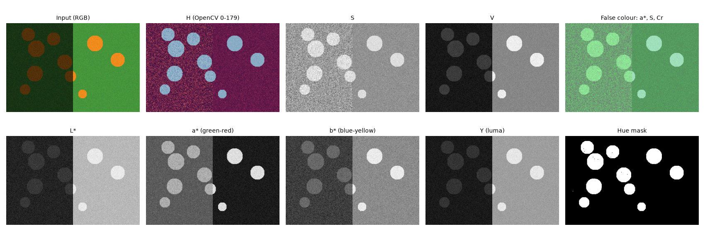

A colour image is three numbers per pixel, but *which* three numbers is a choice. In RGB, brightness and colour are tangled together: a shadow lowers all three channels at once, so a simple rule like "the red channel is high" breaks as soon as the light changes. Other colour spaces separate **how bright** a pixel is from **what colour** it is. Choosing the right one often turns a hard problem (find orange things under uneven light, boost contrast without shifting colours, measure how different two colours look) into an easy one. I went through these spaces by splitting images into channels and looking at each one; this note collects what matters.

## RGB: the device space

RGB says how much red, green and blue light a display should emit. It is what cameras and screens use, so every pipeline starts and ends there. Its problems for analysis:

- The channels are strongly correlated in natural images, because most of the variation is brightness.
- Distances are not perceptual: the same step in RGB can look small or large depending on where you are in the space.
- 8-bit sRGB values are gamma-encoded, not proportional to light. That matters for physics (mixing light, haze models) and less for simple thresholds.

A practical trap: **OpenCV loads images as BGR**, while most other libraries (PIL, matplotlib, scikit-image) use RGB. Every `cv2.COLOR_BGR2...` conversion assumes BGR input. Feed it RGB and red and blue swap roles silently.

## HSV and HSL: hue as an angle

HSV re-describes RGB as **hue** (which colour, an angle around the colour wheel), **saturation** (how pure versus greyish) and **value** (the largest of R, G, B). HSL is similar, with lightness $(\max + \min)/2$ instead of value. They are simple non-linear transforms of RGB, not perceptual spaces, but hue has a useful property: it depends on the *ratios* between channels, so it changes little when a surface goes into shadow.

Two caveats:

- **Hue is circular.** Red sits at both 0° and 360°. Two hues of 2 and 178 in OpenCV units (4° and 356°) are 8° apart, not 352°. Use a circular distance, and segment red with two ranges.
- **Hue is undefined when saturation is near zero.** Greys, white, black and very dark pixels have a meaningless, noisy hue. Always add a minimum saturation and value to a hue rule.

```python
def hue_dist_deg(h1, h2):        # OpenCV hue units, 0..179
    d = abs(int(h1) - int(h2)) % 180
    return 2 * min(d, 180 - d)    # 2 vs 178 -> 8 degrees
```

## CIELAB: a space built around perception

CIELAB (often written L\*a\*b\*) was designed so that equal distances look roughly equally different to a human observer. $L^*$ is lightness from 0 (black) to 100 (white). $a^*$ runs from green (negative) to red (positive) and $b^*$ from blue (negative) to yellow (positive), so these are the opponent axes of human vision. Converting from RGB needs a reference white (OpenCV assumes D65, the sRGB white point), because "white" is defined relative to the light source.

The distance between two colours in Lab is called $\Delta E$. The simplest version, CIE76, is the Euclidean distance

$$
\Delta E_{76} = \sqrt{(\Delta L^*)^2 + (\Delta a^*)^2 + (\Delta b^*)^2},
$$

and a $\Delta E$ of about 2 is a just-noticeable difference. (Later formulas, CIE94 and CIEDE2000, correct remaining non-uniformities.) Here is what a fixed RGB step of 40 means perceptually:

```python
import cv2, numpy as np
def lab(bgr):   # float input in 0..1 gives true CIELAB ranges
    return cv2.cvtColor(np.float32(bgr).reshape(1, 1, 3) / 255, cv2.COLOR_BGR2LAB).ravel()
pairs = {"black -> dark blue": ((0, 0, 0), (40, 0, 0)),     # BGR, every step is 40
         "black -> dark green": ((0, 0, 0), (0, 40, 0)),
         "grey -> greener": ((128, 128, 128), (128, 168, 128)),
         "bright blue -> less": ((255, 0, 0), (215, 0, 0))}
for n, (a, b) in pairs.items():
    print(n, round(float(np.linalg.norm(lab(a) - lab(b))), 1))
# 24.8, 32.4, 29.3, 17.3
```

The same RGB distance gives $\Delta E$ values from 17 to 32: almost a factor of two. If you cluster colours, compare a pixel to a reference colour, or measure colour drift, do it in Lab.

## YCbCr and YUV: luma plus two colour differences

YCbCr comes from video. **Luma** $Y$ is a weighted sum of the (gamma-encoded) channels, with weights that follow how sensitive the eye is to each primary. For standard-definition video (ITU-R BT.601):

$$
Y = 0.299\,R + 0.587\,G + 0.114\,B,
$$

and $C_b \propto B - Y$, $C_r \propto R - Y$ are the blue and red colour differences. These are the same weights OpenCV uses for `COLOR_BGR2GRAY`: for the BGR pixel (30, 200, 90) both give 148. (HD video, BT.709, uses 0.2126, 0.7152, 0.0722.) JPEG compresses in YCbCr and stores the two chroma channels at lower resolution, because the eye is much less sensitive to fine colour detail than to fine brightness detail.

## How OpenCV stores these in 8 bits

With `uint8` images every channel must fit in 0–255, so OpenCV rescales:

| Space | 8-bit encoding in OpenCV | True range |
|---|---|---|
| HSV / HLS | H = hue/2 (0–179), S and V 0–255 | H 0–360° |
| Lab | L = $L^* \times 255/100$, a = $a^* + 128$, b = $b^* + 128$ | $L^*$ 0–100, $a^*, b^*$ about −128…127 |
| YCrCb | Y, Cr, Cb in 0–255, chroma centred at 128 | — |

For example pure red (BGR 0, 0, 255) becomes HSV (0, 255, 255), Lab (136, 208, 195) in 8 bits and (53.2, 80.1, 67.2) as float, and a neutral grey has a = b = 128 and Cr = Cb = 128. Note also the channel order: OpenCV's conversion is called `YCrCb`, not `YCbCr`. If you need real Lab values (for $\Delta E$, for colour transfer), convert a float image in 0–1.

## Which space for which job



- **Changing brightness or contrast without shifting colours:** work on $L^*$ or $Y$ only and keep the chroma channels. This is how histogram equalisation and CLAHE are usually applied to colour images; see [contrast enhancement](/notes/contrast-enhancement-he-clahe-gamma/).
- **Segmenting by colour under uneven light:** use hue with minimum S and V. On the synthetic scene above, a rule tuned on the sunlit side ("red channel > 180") finds only 30% of the disc pixels because the shadowed discs are dark. A hue rule (10–50°, S ≥ 80, V ≥ 30) finds all of them with no false positives. Notice in the figure that $a^*$ and $b^*$ also change in the shadow: Lab separates lightness, but its chroma values still scale with brightness, so it is not shadow-invariant.
- **Measuring colour difference or clustering colours:** use CIELAB and $\Delta E$.
- **Matching colour statistics between images:** use a decorrelated opponent space such as Lab; see [colour transfer and histogram matching](/notes/colour-transfer-and-histogram-matching/).
- **Augmenting training data:** hue, saturation and brightness jitter are natural in HSV; see [photometric colour augmentation](/notes/photometric-colour-augmentation/).

## A visual trick: false-colour composites

One experiment I enjoyed was merging single channels from *different* spaces into one three-channel image, for example $a^*$, S and Cr shown as R, G and B. The result is not a "true" colour, but it can make a target stand out because each channel was picked for contrast between the classes. It is the same idea as false-colour composites in remote sensing, and a quick way to see which features a classifier could use. It is a visual aid, not something to feed a pretrained CNN, which expects ordinary RGB statistics.

## Key takeaways

- RGB mixes brightness and colour; most analysis is easier after separating them.
- Hue is an angle and is meaningless at low saturation; use circular distances and S/V limits.
- CIELAB is approximately perceptually uniform; use $\Delta E$ to compare colours. Equal RGB steps can differ by about 2× in perceived size.
- Luma $Y = 0.299R + 0.587G + 0.114B$ (BT.601) is also OpenCV's greyscale.
- OpenCV uses BGR input and squeezes H into 0–179 and Lab into 0–255 with an offset of 128 for a and b.

## Resources

- Gonzalez, R. C., Woods, R. E. *Digital Image Processing*, 4th ed., Chapter 6 (colour models, colour image processing).
- Szeliski, R. *Computer Vision: Algorithms and Applications*, 2nd ed., Section 2.3.2 (colour): https://szeliski.org/Book/
- OpenCV documentation, *Color conversions* (exact formulas and 8-bit scalings): https://docs.opencv.org/4.x/de/d25/imgproc_color_conversions.html
- ITU-R Recommendation BT.601 (luma weights): https://www.itu.int/rec/R-REC-BT.601
- Sharma, G., Wu, W., Dalal, E. N. (2005). *The CIEDE2000 color-difference formula: implementation notes*. Color Research & Application 30(1).
