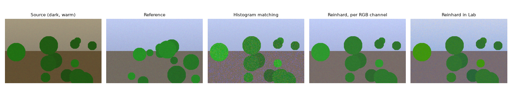
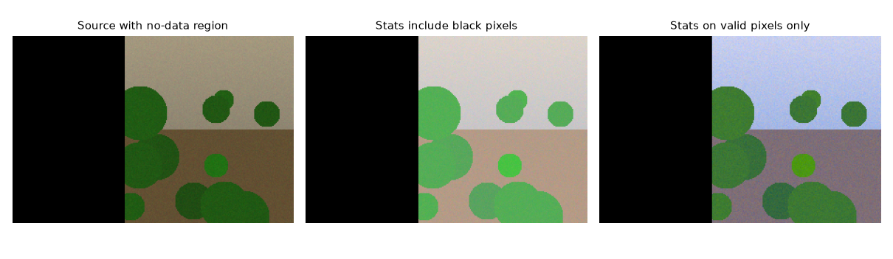

Two photos of the same kind of scene almost never have the same colours. The light changes, the camera's white balance changes, the exposure changes, and a season can turn green ground white. A model trained on one set of images then sees the other set as a different "domain". A cheap first fix is to nudge an image's colour statistics towards those of a reference image. There are two classic ways to do that: **histogram matching**, which copies the whole distribution of each channel, and **Reinhard colour transfer**, which copies only the mean and the standard deviation. I tried both while looking for a way to make difficult images (snow-covered scenes, for example) look more like ordinary ones.

## Histogram matching: copy the whole distribution

Think of the pixel values of one channel as samples of a random variable. Its cumulative distribution function (CDF) $F_s(v)$ tells you what fraction of source pixels have a value of at most $v$. The reference has its own CDF $F_r$. Histogram matching sends each source value to the reference value that sits at the same quantile:

$$
v' = F_r^{-1}\big(F_s(v)\big).
$$

So a source pixel at the 30th percentile becomes the reference's 30th-percentile value. Histogram equalisation is just the special case where the reference CDF is a straight line (a flat histogram); see [contrast enhancement](/notes/contrast-enhancement-he-clahe-gamma/).

The mapping only ever goes up, so the brightness order inside the channel stays the same: if pixel A was brighter than pixel B, it still is. Only the spacing between levels changes. Here's the whole algorithm for one channel:

```python
import numpy as np

def match_channel(src, ref):
    # unique levels, the index of each pixel's level, and level counts
    s_vals, s_idx, s_counts = np.unique(src.ravel(), return_inverse=True, return_counts=True)
    r_vals, r_counts = np.unique(ref.ravel(), return_counts=True)
    s_cdf = np.cumsum(s_counts) / src.size      # quantile of each source level
    r_cdf = np.cumsum(r_counts) / ref.size
    mapped = np.interp(s_cdf, r_cdf, r_vals)    # invert the reference CDF
    return mapped[s_idx].reshape(src.shape)

matched = np.stack([match_channel(src[..., c], ref[..., c]) for c in range(3)], -1)
```

This gives the same result as `skimage.exposure.match_histograms(src, ref, channel_axis=-1)`, within one grey level (scikit-image converts its float result back to the input's `uint8` type, while this version returns floats).

**Where the per-channel version falls short.** Matching R, G and B separately gets each channel's histogram right, but it ignores how the channels move together. So you can end up with a colour that never appears in the reference, built from three channels that are each "correct" on their own. Matching is also heavy-handed: it stretches the sparse parts of the histogram, which boosts noise and can cause banding in smooth areas. You can see the extra grain in the third panel of the figure below.

## Reinhard transfer: copy the mean and the spread

Reinhard et al. (2001) suggested something much simpler. For each channel, standardise the source and then give it the reference's mean and standard deviation:

$$
v' = \frac{\sigma_r}{\sigma_s}\,(v - \mu_s) + \mu_r,
$$

where $\mu_s, \sigma_s$ are the source channel's mean and standard deviation and $\mu_r, \sigma_r$ are the reference's. It's a straight-line map per channel, so it can't cause banding, and it only scales noise by $\sigma_r/\sigma_s$.

The key detail in the paper is the **colour space**. In RGB the three channels are strongly correlated: a brighter pixel is usually brighter in all three. So changing one channel alone also shifts the colour in a way that's hard to control. Reinhard et al. worked in $l\alpha\beta$, a space from Ruderman et al. that was designed to decorrelate the cone responses of natural images. It has one brightness axis and two opponent colour axes (yellow–blue and red–green). In that space you can treat the three channels separately with much less cross-talk. In practice people often use CIELAB instead, since it also splits lightness from two opponent colour axes. See [colour spaces for image processing](/notes/colour-spaces-for-image-processing/).

```python
import cv2, numpy as np

def reinhard_lab(src, ref, mask_src=None, mask_ref=None):
    # src, ref: RGB uint8. Masks: True where a pixel is valid.
    s = cv2.cvtColor(src.astype(np.float32) / 255, cv2.COLOR_RGB2LAB)
    r = cv2.cvtColor(ref.astype(np.float32) / 255, cv2.COLOR_RGB2LAB)
    ms = np.ones(s.shape[:2], bool) if mask_src is None else mask_src
    mr = np.ones(r.shape[:2], bool) if mask_ref is None else mask_ref
    mu_s, sd_s = s[ms].mean(0), s[ms].std(0)
    mu_r, sd_r = r[mr].mean(0), r[mr].std(0)
    sd_s = np.where(sd_s < 1e-6, 1.0, sd_s)        # guard a flat channel
    out = (s - mu_s) * (sd_r / sd_s) + mu_r
    out = cv2.cvtColor(out, cv2.COLOR_LAB2RGB) * 255
    return np.clip(out, 0, 255).astype(np.uint8)
```

If you convert float images (values in 0–1) to Lab, you get the real CIELAB ranges ($L^*$ from 0 to 100, $a^*$ and $b^*$ roughly −128 to 127). Doing the maths on the 8-bit Lab encoding also works, but every value gets rounded twice.

My first version did the transfer straight on the BGR channels. That's actually a fair white-balance-style fix when the difference is mostly a global colour cast, because scaling each channel separately is the classic von Kries model of a lighting change. It's riskier when the two images show different things, because the correlated channels get pushed separately and hues can drift.



On this synthetic example all three methods bring the mean colour close to the reference (mean RGB about 129, 149, 146 for the reference, and within about 2 levels for each method). The differences are in the details: histogram matching adds visible grain, while the two Reinhard versions are smooth and differ mostly in how saturated the vegetation gets.

## The trap: only use valid pixels for the statistics

Lots of real images have pixels that aren't part of the scene: black borders after a warp, areas outside a mask, no-data regions in a raster. In my snow experiment, the input was an image where one class of pixels had been masked out and set to black, and I computed the mean and standard deviation over the whole image. The black pixels drag the mean down and blow up the spread, so the transfer over-brightens and washes out the real pixels.



The numbers show it clearly. With 40% of the image set to black, the mean of the valid pixels after transfer was about (164, 181, 147) when the black pixels were included in the statistics, vs. (130, 148, 145) when they were left out. The reference mean is (129, 149, 146). Same rule for histogram matching: build both CDFs from valid pixels only, and don't touch the no-data pixels in the output.

Two smaller guards I'd keep:

- **Flat channels.** If a channel has zero spread (a constant image, or a fully masked tile), $\sigma_s = 0$ and the formula divides by zero. Swap it for 1 or skip the channel.
- **Clipping.** The linear map can push values out of range. Clip after converting back, and expect to lose some highlights if the reference is much brighter.

## When it helps and when it doesn't

Colour transfer is useful when the difference between two sets of images is mostly global: a camera with a different white balance, a different time of day, a different exposure. It's a quick preprocessing step to shrink that kind of domain gap before training or inference. You can also use it the other way round, as an augmentation that pushes training images towards many different references (see [photometric colour augmentation](/notes/photometric-colour-augmentation/)).

It doesn't help when the content itself is different. A snowy forest and a summer forest differ because of what's on the ground, not because of the light. Forcing the snowy image to have summer statistics turns the snow a weird grey-green and changes the very evidence a model needs. Global methods also can't fix effects that change across the image, like haze that gets thicker with distance (see [haze and the dark channel prior](/notes/haze-model-and-dark-channel-prior/)) or a darkened corner from vignetting. For those you need a local or physical model.

## Key takeaways

- Histogram matching maps each value through $F_r^{-1}(F_s(v))$. It copies the full per-channel distribution, but can boost noise and ignores how the channels relate to each other.
- Reinhard transfer copies only the mean and standard deviation per channel. It's smooth and hard to break, and works best in a decorrelated opponent space like $l\alpha\beta$ or CIELAB.
- Compute all statistics on valid pixels only. Black or no-data pixels badly skew the result.
- Guard against zero standard deviation, and clip after converting back.
- Use it for global differences in how images were taken, not for real changes in what's in the scene.

## Resources

- Reinhard, E., Ashikhmin, M., Gooch, B., Shirley, P. (2001). *Color Transfer between Images*. IEEE Computer Graphics and Applications 21(5). https://doi.org/10.1109/38.946629
- Ruderman, D. L., Cronin, T. W., Chiao, C.-C. (1998). *Statistics of cone responses to natural images: implications for visual coding*. JOSA A 15(8). (The $l\alpha\beta$ space.)
- Gonzalez, R. C., Woods, R. E. *Digital Image Processing*, 4th ed., Section 3.3: histogram equalisation and histogram matching.
- scikit-image documentation, `exposure.match_histograms`: https://scikit-image.org/docs/stable/api/skimage.exposure.html#skimage.exposure.match_histograms
