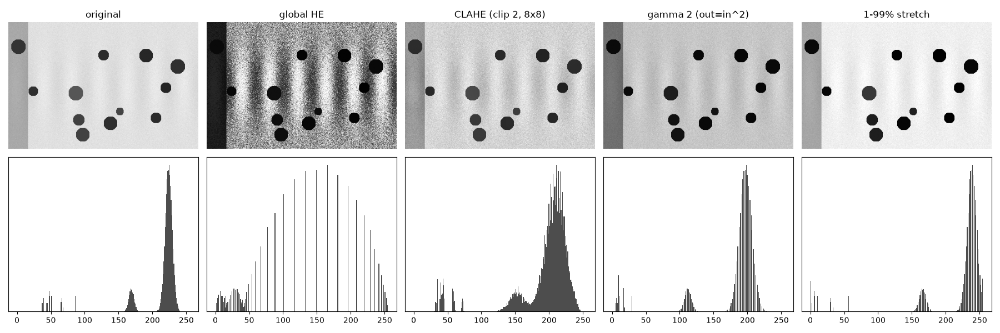
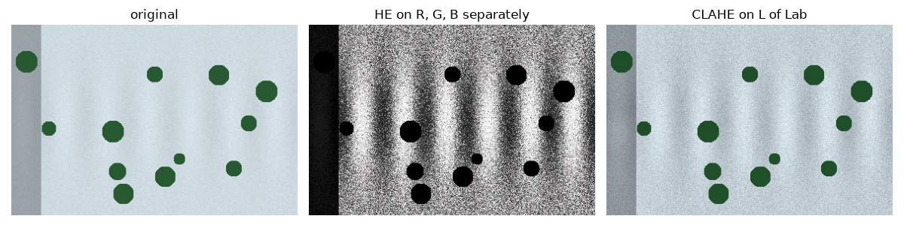

Some images use only a narrow slice of the available grey levels. A snowy landscape is the classic case: most pixels sit between 210 and 240, so the faint ski tracks and the texture of the snow are almost invisible, and any model looking at the image gets little signal from it. Contrast enhancement remaps pixel values so that the useful differences get more of the range. Each method below is a different answer to "how should the mapping look?". I compared them in 2022 and 2023 while looking at overexposed and snowy images.

All of them are **point operations**: the new value of a pixel depends only on its old value (and, for CLAHE, on its neighbourhood's histogram). So they can be written as a lookup table (LUT) of 256 entries for 8-bit images, which is why they are so fast.

## A synthetic snowy test image

To keep things reproducible, I use a synthetic scene: bright snow around 225 with faint stripe-shaped tracks of ±8 grey levels, some dark round "trees" near 60, and a shaded strip on the left. Its histogram (bottom-left of the figure below) has a big narrow peak near the top of the range. That narrow peak is exactly the problem: the details live inside it.



## Linear stretch with percentile clipping

The simplest fix maps the darkest value to 0 and the brightest to 255 with a straight line. Plain min–max stretching does almost nothing when a few pixels are already near 0 and 255, so clip first: use the 1st and 99th percentiles $p_{lo}, p_{hi}$ instead of the extremes, and saturate anything outside.

$$
\text{out} = \operatorname{clip}\left(255\,\frac{\text{in} - p_{lo}}{p_{hi} - p_{lo}},\ 0,\ 255\right)
$$

This keeps the order and the relative spacing of grey levels, so it never invents structure. Its weakness is that it treats the whole range the same. In the snow image, the dark trees use part of the range, so the snow peak only widened from a standard deviation of 8.5 to 11.1.

## Global histogram equalisation

Histogram equalisation (HE) chooses the mapping that makes the output histogram as flat as possible. The tool is the cumulative distribution function (CDF). If $h(k)$ is the number of pixels with value $k$ and $N$ the total number of pixels,

$$
\operatorname{cdf}(k) = \frac{1}{N}\sum_{j=0}^{k} h(j), \qquad
\text{out}(k) = \operatorname{round}\left(255\,\frac{\operatorname{cdf}(k) - \operatorname{cdf}_{\min}}{1 - \operatorname{cdf}_{\min}}\right).
$$

Here $\operatorname{cdf}_{\min}$ is the CDF at the darkest grey level that actually occurs, so that level maps to 0. (Using the plain minimum of the CDF is a common bug: it is 0 whenever the lowest levels are empty, and then the output never reaches 0.) The CDF rises steeply where many pixels are packed together, so crowded grey levels are pulled apart and empty ones are squeezed. For a continuous variable, applying its own CDF gives a uniform distribution; with discrete levels the result is only roughly flat, which is why the equalised histogram looks like a comb.

```python
import numpy as np

def equalize(gray):                      # gray: uint8 image
    hist = np.bincount(gray.ravel(), minlength=256)
    cdf = hist.cumsum() / gray.size
    cdf_min = cdf[hist > 0][0]           # CDF at the darkest level present
    lut = np.round(255 * (cdf - cdf_min) / (1 - cdf_min)).clip(0, 255).astype(np.uint8)
    return lut[gray]                     # same result as cv2.equalizeHist (within 1 level)
```

HE is aggressive. On the snow image the snow's standard deviation jumped from 8.5 to 74: the faint tracks become strong bands, but the sensor noise inside the snow is amplified just as much, and the shaded strip turns almost black. Global HE uses one mapping for the whole image, so a region that is bright in one corner and shaded in another cannot be treated well in both.

## CLAHE: local and limited

**Adaptive** histogram equalisation (AHE, Pizer et al., 1987) computes a separate mapping for each neighbourhood, so each region uses the full range. Done naively, it has two problems: it is slow, and in flat regions it amplifies noise wildly, because a tile whose histogram is a single narrow peak gets stretched over 0–255.

**Contrast Limited AHE** (CLAHE, described by Zuiderveld, 1994) fixes both:

1. **Tiles.** Split the image into a grid (OpenCV's default is 8×8 tiles) and compute one histogram and one LUT per tile.
2. **Clip limit.** Before building each CDF, cut every histogram bin at a limit and redistribute the excess evenly over all bins. Since the slope of the mapping is proportional to the histogram height, this caps the contrast gain. A clip limit of 1 means no enhancement; values of 2 to 4 are common. A higher limit means stronger contrast and more noise.
3. **Bilinear interpolation.** A pixel's output is a blend of the LUTs of the four nearest tile centres, weighted by distance. This removes the visible tile borders that a plain per-tile mapping would create.

On the snow image, CLAHE with clip limit 2 raised the snow's standard deviation to 18.7 (more than double) while keeping the noise moderate, and the shaded strip kept its detail. For most "make it readable" jobs, CLAHE is the first method I try. The tile size matters: the tile should be larger than the structures you want to keep, otherwise CLAHE flattens them into the background.

## Gamma correction

Gamma correction applies a power law to values normalised to $[0, 1]$:

$$
\text{out} = \text{in}^{\gamma}.
$$

With $\gamma < 1$ the curve lies above the diagonal: dark values are lifted and shadows open up. With $\gamma > 1$ it lies below: the image gets darker, and the curve is steeper near the top, so **bright values are spread apart**. That makes $\gamma > 1$ the right direction for snow and overexposed images. With $\gamma = 2$, the snow moved down from a mean of 224 to 197 and its spread grew from 8.5 to 13.5, while the overall look stayed natural.

Watch out for the convention, because libraries disagree:

- `skimage.exposure.adjust_gamma(img, gamma)` computes $\text{in}^{\gamma}$, so $\gamma > 1$ **darkens**.
- The popular LUT recipe (also used in many tutorials) computes $\text{in}^{1/\gamma}$, so $\gamma > 1$ **brightens**.

The same number gives opposite results. Always check on a test value, for example that 0.5 maps to 0.25 or to 0.71.

```python
def gamma_lut(gray, gamma):              # out = in ** gamma, skimage convention
    lut = (255 * (np.arange(256) / 255.0) ** gamma).round().astype(np.uint8)
    return lut[gray]
```

Gamma correction is global and smooth. It never reorders values and never creates bands, but it cannot fix an image that needs different treatment in different places.

## Work on luminance, not on R, G and B

All these methods are defined for one channel. Applying them to R, G and B independently changes the ratio between the channels, and that ratio is what we see as hue. The safe way is to convert to a colour space that separates brightness from colour, enhance only the brightness channel, and convert back: the L channel of CIELAB or the Y channel of YUV/YCrCb (see [colour spaces](/notes/colour-spaces-for-image-processing/)).

```python
import cv2

def clahe_on_luminance(rgb, clip=2.0, tiles=(8, 8)):
    lab = cv2.cvtColor(rgb, cv2.COLOR_RGB2LAB)
    lab[..., 0] = cv2.createCLAHE(clipLimit=clip, tileGridSize=tiles).apply(lab[..., 0])
    return cv2.cvtColor(lab, cv2.COLOR_LAB2RGB)
```



In the colour version of the test scene, equalising each RGB channel separately removed the slight blue tint of the snow and turned the green trees black (their hue moved by 66 of OpenCV's 180 hue steps). CLAHE on L left their hue unchanged and only changed brightness.

## A note on sharpening

Sharpening is often used next to these methods, but it is a linear filter, not an intensity remap. The classic kernels add a scaled Laplacian to the identity, for example

$$
\begin{bmatrix} 0 & -1 & 0 \\ -1 & 5 & -1 \\ 0 & -1 & 0 \end{bmatrix}.
$$

Any sharpening kernel should **sum to 1**, so that flat regions keep their brightness. When it is applied to 8-bit data with an 8-bit output, overshoots at edges are clipped to 0 or 255. Filter in floating point and clip once at the end. The relationship to blurring is covered in [linear filters and the Gaussian blur](/notes/linear-filters-and-gaussian-blur/).

## Choosing a method

- **Narrow histogram, no strong lighting differences:** percentile stretch or gamma. They are predictable and never create artefacts.
- **Bright, washed-out image such as snow:** gamma with $\gamma > 1$ (in the $\text{in}^{\gamma}$ convention), or CLAHE on L if local detail matters.
- **Uneven lighting, shadows and bright areas together:** CLAHE.
- **Global HE:** mainly for visualisation; it is usually too strong for data you will feed to a model.
- **Preprocessing for a neural network:** apply the same method at training and at inference time, or the model will see a different input distribution. Often random gamma and contrast changes during training (augmentation) are a better choice than a fixed enhancement.

## Key takeaways

- Contrast enhancement is a remapping of grey levels, usually implemented as a 256-entry lookup table.
- Histogram equalisation maps each value through the image's CDF; it is strong, global and amplifies noise.
- CLAHE equalises tiles, clips each histogram to cap the gain, and blends neighbouring tiles bilinearly; it is the best general-purpose choice.
- Gamma $>1$ in the $\text{in}^{\gamma}$ convention spreads highlights, which helps snow and overexposure; check which convention your library uses.
- Enhance the luminance channel (L or Y) only, so hues stay the same.

## Resources

- Zuiderveld, K. "Contrast Limited Adaptive Histogram Equalization." In *Graphics Gems IV*, Academic Press, 1994.
- Pizer, S. M. et al. "Adaptive histogram equalization and its variations." *Computer Vision, Graphics, and Image Processing* 39, 1987.
- Gonzalez, R. C., Woods, R. E. *Digital Image Processing*, 4th ed., Chapter 3 (intensity transformations, histogram processing).
- scikit-image documentation, `skimage.exposure` (`adjust_gamma`, `equalize_adapthist`, `rescale_intensity`): https://scikit-image.org/docs/stable/api/skimage.exposure.html
- OpenCV tutorial, "Histograms 2: Histogram Equalization" (includes CLAHE): https://docs.opencv.org/4.x/d5/daf/tutorial_py_histogram_equalization.html
