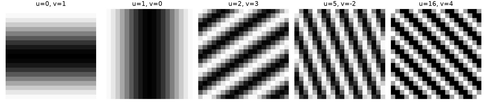
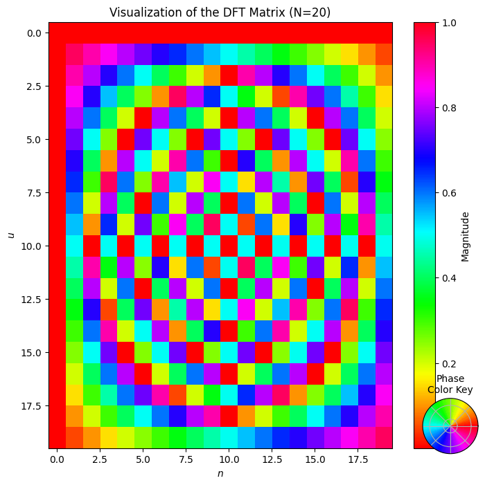
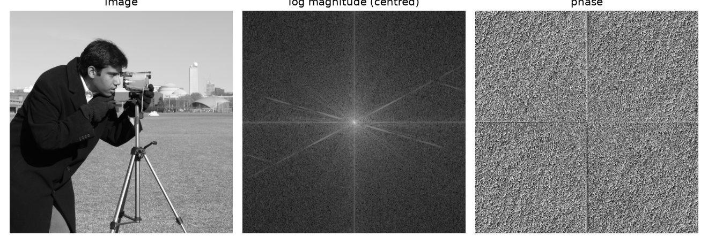
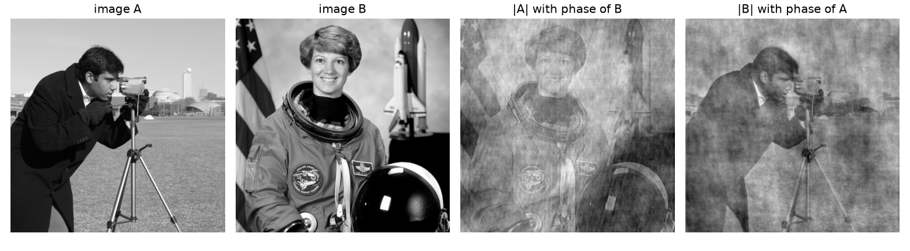
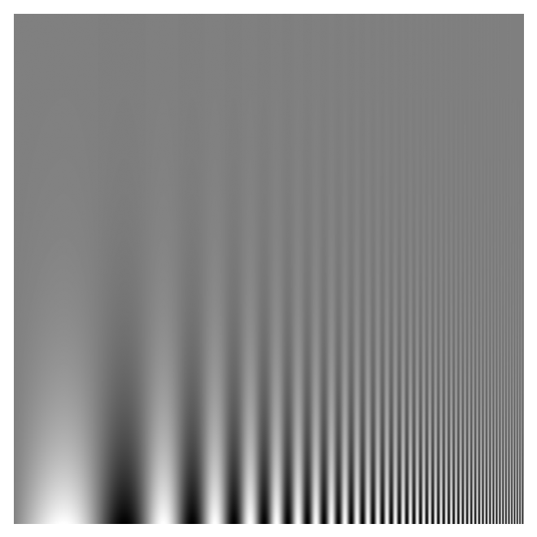

The Fourier transform describes an image by how much of each spatial frequency it contains: slow changes such as smooth shading, and fast changes such as edges and texture. It is also the natural language for linear, shift-invariant filters like blurring. I worked through this while reading Chapter 16 of *Foundations of Computer Vision* (Torralba, Isola and Freeman). This note collects the parts that made it click for me.

## Images as sums of waves

In one dimension, a signal of $N$ samples can be written as a sum of $N$ complex sinusoids. In two dimensions, the building blocks are 2D waves. A real 2D wave on an $N \times M$ grid looks like

$$
s[n, m] = A\cos\left(2\pi\left(\frac{u\,n}{N} + \frac{v\,m}{M}\right) + \theta\right),
$$

where $n, m$ are pixel coordinates, $u$ and $v$ are the number of cycles across the image in each direction, $A$ is the amplitude and $\theta$ the phase. The pair $(u, v)$ sets both how fast the wave oscillates and in which direction its stripes run.



The Fourier transform uses complex exponentials instead, $e^{\,j2\pi(un/N + vm/M)}$. Their real part is a cosine and their imaginary part is a sine, so one complex number per frequency stores both amplitude and phase. Note the last panel, $(u, v) = (16, 4)$ on a 20-pixel grid: it looks identical to $(-4, 4)$, because frequencies above $N/2$ wrap around. That is aliasing, covered in [Sampling and aliasing](/notes/sampling-and-aliasing/).

## The 2D DFT

The discrete Fourier transform of an image $\ell[n, m]$ is

$$
\mathcal{L}[u, v] = \sum_{n=0}^{N-1}\sum_{m=0}^{M-1} \ell[n, m]\, e^{-j2\pi\left(\frac{un}{N} + \frac{vm}{M}\right)},
$$

and the inverse is

$$
\ell[n, m] = \frac{1}{NM}\sum_{u=0}^{N-1}\sum_{v=0}^{M-1} \mathcal{L}[u, v]\, e^{\,j2\pi\left(\frac{un}{N} + \frac{vm}{M}\right)}.
$$

The inverse says the image is a weighted sum of complex exponentials, and $\mathcal{L}[u, v]$ is the weight of each one.

In one dimension the DFT is just a matrix product, $\mathcal{L} = F\ell$, with $F[u, n] = e^{-j2\pi un/N}$. Every entry has magnitude 1; only the angle changes. Row $u$ rotates by $2\pi u/N$ per step, so row 0 is constant, low rows rotate slowly, and rows near $N/2$ rotate fastest.



```python
import numpy as np

N = 20
n = np.arange(N)
F = np.exp(-2j * np.pi * np.outer(n, n) / N)   # F[u, n]

x = np.random.rand(N)
print(np.allclose(F @ x, np.fft.fft(x)))       # True: the FFT computes F @ x
```

The FFT gives the same result in $O(N\log N)$ time instead of $O(N^2)$.

## Magnitude and phase

Each DFT value is complex, so we write it in polar form:

$$
\mathcal{L}[u, v] = A[u, v]\, e^{\,j\theta[u, v]}, \qquad A = |\mathcal{L}|, \quad \theta = \angle\mathcal{L}.
$$

In the inverse transform, $A$ says how strongly each sinusoid contributes and $\theta$ says how it is positioned. To display the spectrum we move the zero frequency to the centre with `np.fft.fftshift` and show $\log(1 + A)$, since the low frequencies are many orders of magnitude stronger than the high ones.



The magnitude looks structured: it is bright in the centre and falls off with frequency, and strong straight edges in the image appear as lines through the centre, perpendicular to the edges. The phase looks like noise. Yet the phase is the more important of the two for what we see.

## Translation changes only the phase

Shift the image by $(n_0, m_0)$ pixels (circularly, since the DFT treats the image as periodic). Then

$$
\ell[n - n_0, m - m_0] \;\longleftrightarrow\; \mathcal{L}[u, v]\, e^{-j2\pi\left(\frac{un_0}{N} + \frac{vm_0}{M}\right)}.
$$

The extra factor has magnitude 1, so the magnitude spectrum does not change at all. The phase gets a term that is linear in frequency. This is the 2D version of the linear phase shift from seismic wavelets (see [Seismic wavelets: amplitude and phase spectra](/notes/wavelet-amplitude-and-phase-spectra/)).

```python
img = np.zeros((5, 5)); img[1:4, 1:4] = 1; img[2, 2] = 0   # small square ring
L = np.fft.fft2(img)
N, M = img.shape
u = np.fft.fftfreq(N).reshape(-1, 1) * N    # integer frequencies in FFT order
v = np.fft.fftfreq(M).reshape(1, -1) * M

n0, m0 = 1, 2
shifted = np.fft.ifft2(L * np.exp(-2j*np.pi*(u*n0/N + v*m0/M))).real
print(np.allclose(shifted, np.roll(img, (n0, m0), axis=(0, 1))))  # True
print(np.allclose(np.abs(np.fft.fft2(shifted)), np.abs(L)))       # True
```

One mistake I made at first: I multiplied the *centred* spectrum (after `fftshift`) by an exponential built from `fftfreq`, which is in *uncentred* order. The frequencies then do not line up and the result is not a clean shift. Either work with the uncentred spectrum, as above, or shift both.

## Phase carries the structure

A classic experiment: take two images, swap their phase spectra, and invert.



Each result looks like the image its **phase** came from. The phase decides where edges and contours are, because edges appear where many sinusoids line up. The magnitude mostly sets overall contrast and the balance between coarse and fine detail. A short way to say it: location goes into the phase, intensity scaling goes into the magnitude.

This does not mean the magnitude is useless. It is a good description of strongly periodic patterns and textures, and it does not change when the image is translated. But for natural images, most of the recognisable structure lives in the phase.

## Why Fourier is the right tool for linear filters

Complex exponentials are **eigenfunctions** of every linear shift-invariant system. Feed one in and the output is the same complex exponential, only multiplied by a complex number: a new amplitude and a new phase. So a filter is fully described by one complex number per frequency, its frequency response $H[u, v]$, and filtering becomes multiplication:

$$
\ell * h \;\longleftrightarrow\; \mathcal{L}[u, v]\, H[u, v].
$$

A low-pass filter keeps the centre of the spectrum and removes the rest, which blurs the image. More on this in [Linear filters and Gaussian blur](/notes/linear-filters-and-gaussian-blur/).

## How sensitive are we to each frequency?

The Campbell–Robson chart shows a sinusoid whose frequency rises from left to right and whose contrast falls from bottom to top. Where the stripes seem to fade into grey traces your own **contrast sensitivity function**: we see middle frequencies at lower contrast than very low or very high ones.



## Key takeaways

- The 2D DFT writes an image as a weighted sum of complex sinusoids; each weight has a magnitude and a phase.
- The 1D DFT is a matrix product with unit-magnitude entries; the FFT is a fast way to compute it.
- Translating an image changes only the phase, by a term linear in frequency.
- Phase carries most of the visible structure (edges and their positions); magnitude carries contrast and texture energy.
- Complex exponentials are eigenfunctions of linear shift-invariant filters, so filtering is multiplication in the frequency domain.

## Resources

- Antonio Torralba, Phillip Isola and William T. Freeman, *Foundations of Computer Vision*, MIT Press, 2024, Chapter 16 "Fourier Analysis" (DFT, shift property in 16.7, magnitude and phase as an image representation in 16.9, Campbell–Robson chart in 16.10): <https://visionbook.mit.edu/image_processing_fourier.html>
- NumPy `numpy.fft` documentation (FFT conventions, `fftfreq`, `fftshift`): <https://numpy.org/doc/stable/reference/routines.fft.html>
- A. V. Oppenheim and J. S. Lim, "The importance of phase in signals", *Proceedings of the IEEE* 69(5), 1981 (the classic magnitude/phase swap experiment).
- Test images in the figures: `camera` and `astronaut` from scikit-image's `skimage.data`: <https://scikit-image.org/docs/stable/api/skimage.data.html>
