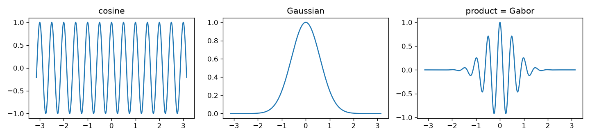
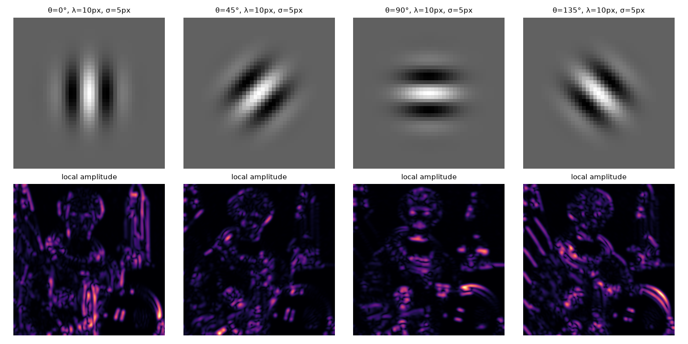

The Fourier transform tells you which frequencies an image has, but not where they are. A zebra's stripes or the joints in a brick wall only repeat in some regions and at some angles. Gabor filters answer the local question: what frequency and orientation is there *right here*? They're also a good model of the "simple cells" in the first visual area of the brain (V1), and the first layer of a trained CNN often learns filters that look a lot like them. I played with them in the same notebook as sampling, following Section 22.2 of *Foundations of Computer Vision*.

## A wave under a Gaussian window

A Gabor function is just a sinusoid multiplied by a Gaussian. The sinusoid sets the frequency. The Gaussian keeps the filter to a small patch, so it only "listens" to one region at a time.



In 2D, with a centre frequency $(u_0, v_0)$ in radians per pixel:

$$
\psi(x, y; u_0, v_0) = \frac{1}{2\pi\sigma^2}\exp\left(-\frac{x^2 + y^2}{2\sigma^2}\right)\exp\big(j(u_0x + v_0y)\big).
$$

It's complex. Its real and imaginary parts are the **cosine-phase** and **sine-phase** Gabor filters:

$$
\psi_r = \frac{1}{2\pi\sigma^2}e^{-\frac{x^2+y^2}{2\sigma^2}}\cos(u_0x + v_0y),
\qquad
\psi_i = \frac{1}{2\pi\sigma^2}e^{-\frac{x^2+y^2}{2\sigma^2}}\sin(u_0x + v_0y).
$$

Each parameter has a clear job:

- $(u_0, v_0)$ sets the frequency, $\sqrt{u_0^2 + v_0^2}$, and the direction of the stripes. The stripes run at right angles to the vector $(u_0, v_0)$.
- $\sigma$ sets the size of the window. A big $\sigma$ means a wide patch in space and a narrow band in frequency. A small $\sigma$ means the opposite.

## Compact in space and in frequency

The Fourier transform of a Gabor function is a Gaussian centred at $(u_0, v_0)$ with width $1/\sigma$. So the filter is compact in both domains at the same time. You can't make a filter as narrow as you like in both (that's the uncertainty principle of signal processing), but the Gabor function hits the best possible trade-off: it has the smallest product of spread in space and spread in frequency.

The way I picture it, it sits between two extremes. A single pixel (an impulse) is perfectly local in space but contains every frequency. A pure sinusoid is one exact frequency but covers the whole image. With a very large $\sigma$, a set of Gabor filters behaves like the Fourier transform.

One small detail: the cosine-phase Gabor has a small non-zero mean, $e^{-\sigma^2(u_0^2+v_0^2)/2}$ times the window's sum, so it reacts a little to plain flat brightness. Either pick $\sigma$ big enough compared with the wavelength (at least about one wavelength) or subtract the mean, so it acts as a zero-mean band-pass filter (one that only lets a band of frequencies through).

## Quadrature pairs and local amplitude

Convolving an image with $\psi$ gives a complex output that depends on the position and on the filter's frequency:

$$
\ell_\psi(x, y; u_0, v_0) = (\ell * \psi)(x, y).
$$

The cosine and sine filters form a **quadrature pair**, which just means they're $90°$ out of phase. Their outputs are the real and imaginary parts of $\ell_\psi$, so

$$
A(x, y) = \sqrt{(\ell * \psi_r)^2 + (\ell * \psi_i)^2}, \qquad \phi(x, y) = \operatorname{atan2}(\ell * \psi_i,\ \ell * \psi_r).
$$

$A$ is the **local amplitude** (or energy): how much of that frequency and orientation there is around each pixel, no matter whether the pattern is a thin line or an edge. $\phi$ is the **local phase**, and that's what tells you which one it is: a bright line, a dark line, or an edge going one way or the other.



Each orientation lights up different things. A filter with vertical stripes reacts to vertical edges and lines, and one with horizontal stripes reacts to horizontal ones. A set of Gabor filters at several orientations and scales is called a **Gabor filter bank**, and it's a classic way to describe texture.

```python
import numpy as np
from scipy import ndimage as ndi

def gabor_pair(sigma, theta, wavelength, size=None):
    """Cosine and sine Gabor kernels; stripes vary along direction theta."""
    r = size // 2 if size else int(3 * sigma)
    y, x = np.mgrid[-r:r + 1, -r:r + 1]
    xr = x * np.cos(theta) + y * np.sin(theta)        # coordinate along theta
    env = np.exp(-(x**2 + y**2) / (2 * sigma**2))
    g_cos = env * np.cos(2 * np.pi * xr / wavelength)
    g_sin = env * np.sin(2 * np.pi * xr / wavelength)
    return g_cos - g_cos.mean(), g_sin               # make the cosine part zero-mean

# test image: vertical stripes with period 10 px on the left half only
img = np.zeros((100, 100))
img[:, :50] = np.cos(2 * np.pi * np.arange(50) / 10)
gc, gs = gabor_pair(sigma=5, theta=0, wavelength=10)
amp = np.hypot(ndi.convolve(img, gc), ndi.convolve(img, gs))
print(amp[50, 25].round(1), amp[50, 75].round(1))   # strong on the left, ~0 on the right
```

## A mistake I made with OpenCV's parameters

In my notebook I used `cv2.getGaborKernel(ksize, sigma, theta, frequency, phase)` and swept a "frequency" from 0 to 10. That was wrong. The real signature is

```python
cv2.getGaborKernel(ksize, sigma, theta, lambd, gamma, psi)
```

where `lambd` is the **wavelength** in pixels (not the frequency), `gamma` is the aspect ratio of the Gaussian (how stretched it is), and `psi` is the phase offset. So my "frequency = 0.3" was really a wavelength of 0.3 pixels, way below the Nyquist limit of 2 pixels, and my "phase = 0" was actually `gamma = 0`, an endlessly stretched envelope. Sensible values are a wavelength of a few pixels or more, `gamma` around 0.5 to 1, and `psi = 0` (cosine) or `psi = np.pi/2` (sine).

## Key takeaways

- A Gabor filter is a sinusoid under a Gaussian window. It measures one frequency and orientation in a small neighbourhood.
- $\sigma$ trades sharpness in space against sharpness in frequency. Gabor functions get the best possible balance of the two.
- The cosine and sine Gabors form a quadrature pair. Together they give the local amplitude and local phase.
- Banks of Gabor filters at several orientations and scales describe texture, and they look like both V1 simple cells and early CNN filters.

## Resources

- Antonio Torralba, Phillip Isola and William T. Freeman, *Foundations of Computer Vision*, MIT Press, 2024, Chapter 22 "Filter Banks", Section 22.2 "Gabor Filters" (quadrature pairs, local amplitude and phase, Gabor filter banks): <https://visionbook.mit.edu/spatial_filter_sets.html>
- OpenCV documentation, image filtering, `getGaborKernel`: <https://docs.opencv.org/4.x/d4/d86/group__imgproc__filter.html>
- John G. Daugman, "Uncertainty relation for resolution in space, spatial frequency, and orientation optimized by two-dimensional visual cortical filters", *Journal of the Optical Society of America A* 2(7), 1985.
- Test images in the figures: `camera` and `astronaut` from scikit-image's `skimage.data`: <https://scikit-image.org/docs/stable/api/skimage.data.html>
