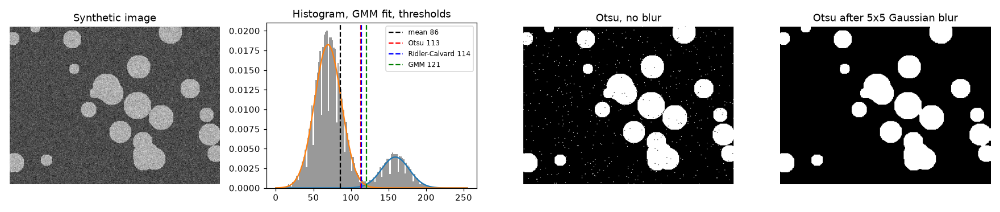
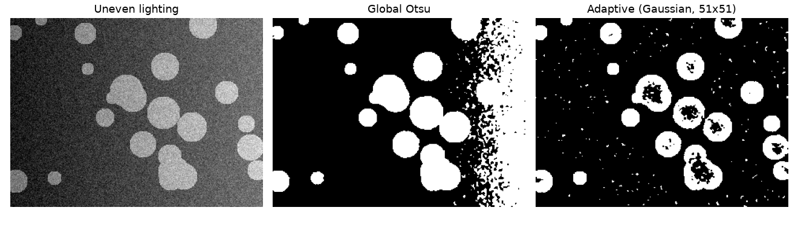

Thresholding is the simplest segmentation there is: every pixel brighter than $t$ is foreground, everything else is background. It's still handy for coins on a table, text on paper, bright snow on dark ground, or as a quick baseline before training a model. The whole difficulty is picking $t$. I'll start with the naive choice (the mean), then go through three more careful ways to read $t$ off the histogram, and end with adaptive thresholds for images where one number just can't work.

All the examples use a synthetic image: bright discs (grey level 160) on a dark background (70), with Gaussian noise of standard deviation 18. The discs cover 18% of the pixels.

## The naive start: threshold at the mean

My first segmentation notebook simply compared each pixel to the image mean. It runs, but it only works when the two classes are about the same size. The mean gets pulled towards the bigger class. Here the background is 82% of the image, so the mean is 86. That's much closer to the background peak (70) than to the middle of the gap, so lots of noisy background pixels end up as foreground. Only 84.8% of the pixels get the right label.

## Otsu: pull the two classes as far apart as possible

Otsu (1979) asks a cleaner question: which threshold splits the histogram into two groups that are as different as possible? Let $p_i$ be the fraction of pixels at level $i$. For a threshold $t$, the two classes have weights and means

$$
\omega_0(t) = \sum_{i \le t} p_i, \quad \omega_1 = 1 - \omega_0, \quad
\mu_0(t) = \frac{1}{\omega_0}\sum_{i \le t} i\,p_i, \quad \mu_1(t) = \frac{1}{\omega_1}\sum_{i > t} i\,p_i.
$$

The **between-class variance** is $\sigma_B^2(t) = \omega_0\,\omega_1\,(\mu_0 - \mu_1)^2$. Here's the part that made it make sense to me: the total variance of the image doesn't depend on $t$, and it equals the between-class variance plus the within-class variance. So making $\sigma_B^2$ as big as possible is the same as making each class as tight as possible. With cumulative sums you can test every threshold in one pass:

```python
import numpy as np

def otsu(gray):                                   # gray: uint8 image
    p = np.bincount(gray.ravel(), minlength=256) / gray.size
    w0 = np.cumsum(p)                             # weight of the class below t
    mu = np.cumsum(p * np.arange(256))            # cumulative mean
    mu_T = mu[-1]                                 # global mean
    with np.errstate(divide="ignore", invalid="ignore"):
        sigma_b = (mu_T * w0 - mu) ** 2 / (w0 * (1 - w0))
    return int(np.nanargmax(sigma_b))
```

(The formula in the code is the same $\sigma_B^2$, just rewritten with cumulative sums.) On the synthetic image it gives $t = 113$, the same as `skimage.filters.threshold_otsu` and OpenCV's `THRESH_OTSU`, and 99.3% of pixels come out right.

## Ridler–Calvard: keep averaging the two means

Ridler and Calvard (1978), also called the *isodata* method, just repeat a simple step until it settles:

1. Start with a guess, like the global mean.
2. Split the pixels at $t$ and compute the mean of each side, $m_0$ and $m_1$.
3. Set $t \leftarrow (m_0 + m_1)/2$ and repeat until $t$ stops changing.

```python
def ridler_calvard(gray, tol=0.5):
    t = gray.mean()
    while True:
        t_new = (gray[gray <= t].mean() + gray[gray > t].mean()) / 2
        if abs(t_new - t) < tol:
            return t_new
        t = t_new
```

Here it settles at 114, almost the same as Otsu. That's not a coincidence: at a stationary point of Otsu's criterion you (roughly) have $t = (\mu_0 + \mu_1)/2$, so the two methods usually end up in the same place. Ridler–Calvard is just a cheap way to get there. In my original script I used the `mahotas` versions of both (`otsu` and `rc`) and got almost identical results too.

## A Gaussian mixture: a threshold based on probability

Otsu and Ridler–Calvard quietly treat both classes as equally likely. A **two-component Gaussian mixture** models the histogram as

$$
p(v) = \pi_0\,\mathcal{N}(v;\,\mu_0, \sigma_0^2) + \pi_1\,\mathcal{N}(v;\,\mu_1, \sigma_1^2),
$$

where $\pi_k$ are the class proportions and $\mu_k, \sigma_k$ are the class means and standard deviations. The parameters are fitted with the expectation–maximisation (EM) algorithm. A natural threshold is where the probability of "bright class" crosses 0.5. That's the Bayes decision boundary:

```python
from sklearn.mixture import GaussianMixture

x = gray.reshape(-1, 1).astype(float)             # one sample per PIXEL
gmm = GaussianMixture(n_components=2, random_state=0).fit(x)
levels = np.arange(256).reshape(-1, 1)
bright = np.argmax(gmm.means_.ravel())
t_gmm = int(np.argmax(gmm.predict_proba(levels)[:, bright] > 0.5))
```

The fit finds means of 69.5 and 159.1 and weights of 0.82 and 0.18, very close to the truth. The threshold is 121, higher than Otsu. That makes sense once you think about it: the background is much more common, so a pixel in the gap is more likely to be background. Unlike Otsu, the mixture also gives you a probability for each pixel and lets each class have its own variance.

I used this idea on bright, snowy images to split pixels into a "snow" group and an "everything else" group. One mistake worth pointing out: an early draft fitted the mixture to the **histogram counts** (the 256 bar heights) instead of to the pixel values. That fits a distribution to the heights of the bars, which has nothing to do with grey levels. Fit on the pixels themselves (or on bin centres weighted by counts).



## Blur first

Every method above looks at pixels one at a time, so noise near the threshold turns into salt-and-pepper speckle. A small Gaussian blur before thresholding averages each pixel with its neighbours. That narrows both histogram peaks and deepens the valley between them. Here a 5×5 blur barely moves the threshold (112) but raises accuracy from 99.3% to 99.9%, and the speckle is gone (right panel). See [linear filters and the Gaussian blur](/notes/linear-filters-and-gaussian-blur/).

## When one threshold isn't enough: adaptive thresholding

A global threshold assumes "bright" means the same thing everywhere. Add a lighting ramp (left side darker, right side brighter, 90 grey levels in total) and that breaks: the dark discs on the left and the bright background on the right now overlap in grey level. Global Otsu drops to 86.7% accuracy and the right edge fills with noise.

**Adaptive thresholding** works out a separate threshold for every pixel from its neighbourhood: $T(x, y) = \text{local mean}(x, y) - C$, where the local mean is a box or Gaussian average over a $b \times b$ window and $C$ is a small offset.

```python
import cv2
blur = cv2.GaussianBlur(uneven, (5, 5), 0)
mask = cv2.adaptiveThreshold(blur, 255, cv2.ADAPTIVE_THRESH_GAUSSIAN_C,
                             cv2.THRESH_BINARY, 51, -10)   # block size 51, C = -10
```



The adaptive mask follows the lighting and gets 96.4%. It also shows the method's main weak spot: inside a disc bigger than the window, the local mean is just the disc itself, so the centre gets compared against its own brightness and breaks up. So the window has to be clearly bigger than the objects, but smaller than the distance over which the lighting changes. A negative $C$ (foreground must be at least 10 levels above the local mean) stops flat background from being called foreground. Another option for uneven lighting is to remove the lighting first (divide by a heavily blurred copy, or use [CLAHE](/notes/contrast-enhancement-he-clahe-gamma/)) and then use a global method.

## Key takeaways

- Thresholding at the mean leans towards the bigger class. Use a histogram-based method instead.
- Otsu maximises the between-class variance. Ridler–Calvard repeats $t = (m_0 + m_1)/2$ and usually ends up in the same place.
- A two-component Gaussian mixture, fitted on pixel values, gives a Bayes threshold that handles unequal class sizes and spreads, plus a probability for each pixel.
- Blur before thresholding to get rid of speckle.
- Use adaptive thresholds for uneven lighting, with a window bigger than the objects.

## Resources

- Otsu, N. (1979). *A Threshold Selection Method from Gray-Level Histograms*. IEEE Trans. SMC 9(1). https://doi.org/10.1109/TSMC.1979.4310076
- Ridler, T. W., Calvard, S. (1978). *Picture Thresholding Using an Iterative Selection Method*. IEEE Trans. SMC 8(8). https://doi.org/10.1109/TSMC.1978.4310039
- Gonzalez, R. C., Woods, R. E. *Digital Image Processing*, 4th ed., Chapter 10 (thresholding, Otsu's method, variable thresholding).
- Bishop, C. M. *Pattern Recognition and Machine Learning*, Section 9.2 (mixtures of Gaussians and EM).
- OpenCV tutorial, *Image Thresholding*: https://docs.opencv.org/4.x/d7/d4d/tutorial_py_thresholding.html
- Rosebrock, A. *Practical Python and OpenCV* (PyImageSearch), thresholding chapter: the style of exercise where I first practised adaptive, Otsu and Ridler–Calvard thresholds with OpenCV and `mahotas`.
