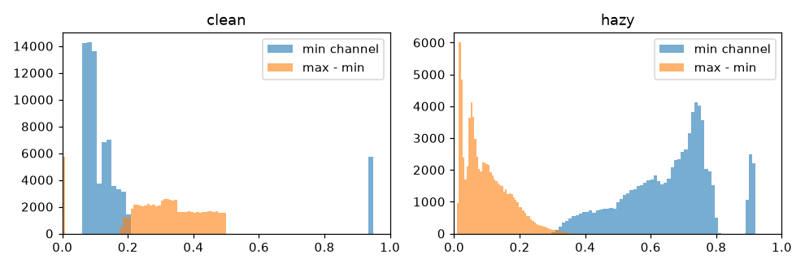
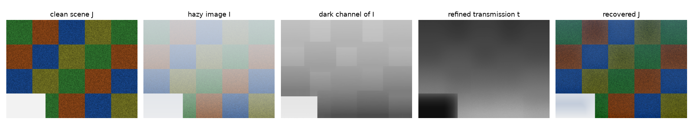

Haze and fog wash an image out: far-away things turn pale, lose contrast and take on the colour of the sky. It isn't random noise, though. It follows a simple physical model, and once you write that model down, removing haze becomes an inverse problem with two unknowns per pixel. The dark channel prior is a surprisingly simple trick for solving it from just one image. I implemented it, along with the guided filter it uses, while playing with foggy images in 2022.

## How haze forms

Light from a point in the scene travels to the camera through air full of tiny particles. Two things happen on the way. Some of the object's light gets scattered out of the path, so the direct signal fades. At the same time, light from around (the sky, the sun, the fog itself) gets scattered *into* the path and adds a veil. The standard model, from Koschmieder's work on atmospheric visibility and made popular in vision by Narasimhan and Nayar, is

$$
I(x) = J(x)\,t(x) + A\,\big(1 - t(x)\big), \qquad t(x) = e^{-\beta d(x)}.
$$

- $I(x)$ is the hazy colour we actually see at pixel $x$ (an RGB vector in $[0,1]$).
- $J(x)$ is the scene radiance we want: the colour without haze.
- $A$ is the **atmospheric light** (airlight), the colour of the haze infinitely far away. It's one RGB vector for the whole image.
- $t(x) \in [0,1]$ is the **transmission**: the fraction of the object's light that makes it to the camera.
- $\beta$ is the scattering coefficient of the air and $d(x)$ is the distance to the scene point.

So basically, every hazy pixel is a mix of the true colour and the haze colour, and how much of each depends only on depth. Close objects ($t \approx 1$) look normal. Far objects ($t \to 0$) fade into $A$. This also explained two things I noticed when I looked at the minimum and maximum of the three colour channels in foggy images. Mixing every pixel towards a nearly grey $A$ raises the minimum channel (dark pixels disappear), and it shrinks the gap between the largest and smallest channel, which is a rough measure of saturation.



On a synthetic scene, the median of the min channel went from 0.10 to 0.68 after adding haze, while the median of max − min dropped from 0.32 to 0.08.

## The dark channel prior

If all you have is $I$, the model has too many unknowns: $J$ and $t$ at every pixel, plus $A$. He, Sun and Tang (2009) noticed a pattern in outdoor images without haze. In almost every small patch that isn't sky, at least one pixel is very dark in at least one colour channel. Shadows, dark objects and strongly coloured surfaces make sure of that (green leaves have low red, blue water has low red and green). They define the **dark channel**

$$
J^{\text{dark}}(x) = \min_{y \in \Omega(x)} \; \min_{c \in \{r,g,b\}} J^c(y),
$$

where $\Omega(x)$ is a small square patch around $x$ (they used 15×15). The prior says $J^{\text{dark}}(x) \approx 0$ for outdoor images without haze. In a hazy image, the airlight fills in those dark pixels, so the dark channel of $I$ gets bright where the haze is thick. The way I think about it: the dark channel of a hazy image is roughly a map of how thick the haze is.

## From the prior to the transmission

Divide the model by $A$ channel by channel, take the minimum over colours and over the patch, and assume $t$ is constant inside the patch:

$$
\min_{y\in\Omega(x)}\min_c \frac{I^c(y)}{A^c} = t(x)\,\min_{y\in\Omega(x)}\min_c \frac{J^c(y)}{A^c} + 1 - t(x).
$$

The prior says the first term on the right is about zero, so

$$
\tilde t(x) = 1 - \omega \min_{y\in\Omega(x)}\min_c \frac{I^c(y)}{A^c}.
$$

The factor $\omega$ (0.95 in the paper) leaves a little haze on purpose. Without it, distant objects look flat and fake, because we use haze as a hint for depth.

The **atmospheric light** also comes from the dark channel. Take the 0.1% brightest pixels of the dark channel (where the haze is thickest) and, among those, pick the pixel that's brightest in the input. That's much less easily fooled than just taking the brightest pixel in the image, which is often a white car or a lamp.

Finally, flip the model around:

$$
J(x) = \frac{I(x) - A}{\max\big(t(x), t_0\big)} + A.
$$

The floor $t_0$ (usually 0.1) is important. Where $t$ is tiny, dividing by it blows up noise and JPEG artefacts.

## Cleaning up the transmission with a guided filter

Because $\tilde t$ comes from patch minimums, it's blocky and spills across object edges, which leaves halos in the result. The original paper fixed this with soft matting, which is slow. The later **guided filter** (He et al., 2010) does the same job in linear time. The idea: inside each window, assume the output $q$ is a straight-line function of a guide image $G$ (here the grey hazy image), $q = a\,G + b$. Solving a small least-squares problem per window gives

$$
a = \frac{\operatorname{cov}(G, p)}{\operatorname{var}(G) + \epsilon}, \qquad b = \bar p - a\,\bar G,
$$

where $p$ is the input you want to filter (the rough transmission) and $\epsilon$ controls how much smoothing happens in flat areas. The coefficients are then averaged over overlapping windows. It's all built from box filters, so the cost doesn't depend on the window size. Where the guide has an edge, $\operatorname{var}(G)$ is large, $a \approx 1$, and the edge gets copied into $t$. In flat areas $a \approx 0$ and $t$ just gets smoothed.

## The whole method in a few lines

```python
import numpy as np, cv2

def dark_channel(img, size=15):
    m = img.min(axis=2)                                   # min over colours
    return cv2.erode(m, np.ones((size, size), np.uint8))  # min over a patch

def estimate_A(img, dc):
    n = max(1, dc.size // 1000)                           # brightest 0.1 %
    idx = np.argsort(dc.ravel())[-n:]
    cand = img.reshape(-1, 3)[idx]
    return cand[cand.sum(1).argmax()]

def guided_filter(guide, p, r=30, eps=1e-3):
    box = lambda x: cv2.boxFilter(x, cv2.CV_64F, (r, r))
    mI, mp = box(guide), box(p)
    a = (box(guide * p) - mI * mp) / (box(guide * guide) - mI * mI + eps)
    b = mp - a * mI
    return box(a) * guide + box(b)

def dehaze(I, omega=0.95, t0=0.1):                        # I: float RGB in [0, 1]
    A = estimate_A(I, dark_channel(I))
    t = 1 - omega * dark_channel(I / A)
    t = guided_filter(I.mean(axis=2), t)
    J = (I - A) / np.maximum(t, t0)[..., None] + A
    return np.clip(J, 0, 1), t, A
```

I tested it on a synthetic scene: coloured textured blocks, a depth that grows from bottom to top, and haze added with the model above ($\beta = 0.7$, slightly bluish $A$). The RMSE against the clean image went from 0.42 for the hazy input down to 0.07 after dehazing.



## Where the prior breaks

The white patch in the bottom left of the figure was the real lesson for me. It's a bright, almost colourless surface close to the camera, like snow. Its dark channel is high *even without haze*, so the method decides it's far away in thick fog. The estimated transmission there was 0.09 vs. a true 0.59, and the "recovered" colour is wrong. In this example the bright patch also dragged the airlight estimate towards white. The same thing happens with:

- **Sky**, which has no dark pixels. The $t_0$ floor and $\omega$ limit the damage, but sky often ends up with colour shifts or noise.
- **White or grey objects** (buildings, roads, vehicles) that look like haze to the prior.
- **Snowy scenes**, where most of the image breaks the prior at once. For those, plain contrast enhancement on the brightness channel is often the safer choice (see [contrast enhancement](/notes/contrast-enhancement-he-clahe-gamma/)).
- **Uneven light**, like night fog with street lamps, where one global $A$ is just wrong.

## Learned dehazing

Deep networks swap the hand-made prior for one learned from data. DehazeNet (Cai et al., 2016) predicts the transmission and still uses the physical model to recover the image. AOD-Net (Li et al., 2017) folds $t$ and $A$ into one learned map and outputs $J$ directly. GCANet (Chen et al., 2019) is an end-to-end encoder–decoder with smoothed dilated convolutions and gated fusion of features from several levels; it predicts the difference (residual) between the hazy and clean images. CycleGAN-based methods learn from unpaired hazy and clear images.

The catch is training data. Real pairs of hazy and clean photos of the same scene are rare, so most models are trained on fake haze made with exactly the formula above plus a depth map (for example the RESIDE benchmark). They can do great on benchmarks and disappoint on real fog whose colour, thickness or texture is different. The dark channel prior has no training set to mismatch, which is why it's still a strong baseline and a good first thing to try.

## Key takeaways

- Haze follows $I = J\,t + A(1-t)$ with $t = e^{-\beta d}$: a depth-dependent mix of the scene and the haze colour.
- Haze raises the minimum colour channel and lowers saturation. The dark channel of a hazy image is a rough haze-thickness map.
- The dark channel prior gives $t = 1 - \omega\,\text{dark}(I/A)$. Recovery divides by $\max(t, t_0)$ so noise doesn't explode.
- A guided filter cheaply turns the blocky transmission into one that follows edges, using only box filters.
- The prior fails on sky, white objects and snow. Learned methods skip hand-made priors but suffer from the gap between fake and real haze.

## Resources

- He, K., Sun, J., Tang, X. "Single Image Haze Removal Using Dark Channel Prior." CVPR 2009; extended version in IEEE TPAMI 33(12), 2011.
- He, K., Sun, J., Tang, X. "Guided Image Filtering." ECCV 2010; extended version in IEEE TPAMI 35(6), 2013.
- Narasimhan, S. G., Nayar, S. K. "Vision and the Atmosphere." IJCV 48(3), 2002.
- Tan, R. T. "Visibility in Bad Weather from a Single Image." CVPR 2008.
- Cai, B. et al. "DehazeNet: An End-to-End System for Single Image Haze Removal." IEEE TIP, 2016.
- Li, B. et al. "AOD-Net: All-in-One Dehazing Network." ICCV 2017.
- Chen, D. et al. "Gated Context Aggregation Network for Image Dehazing and Deraining." WACV 2019. Code: https://github.com/cddlyf/GCANet
- Zhao, J. et al. "Image dehazing method via a cycle generative adversarial network." IET Image Processing, 2021.
- Li, B. et al. "Benchmarking Single-Image Dehazing and Beyond" (RESIDE). IEEE TIP, 2019.
