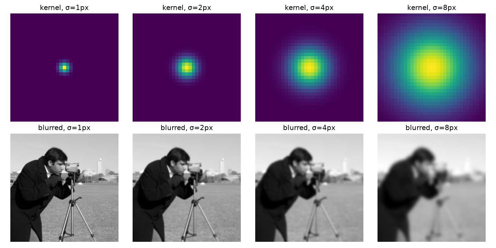
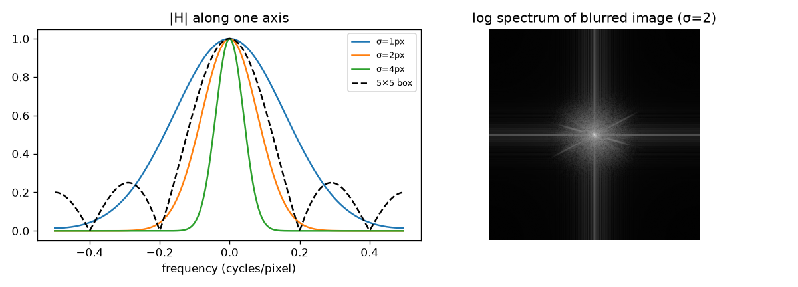

Blurring, sharpening, edge detection and the first layer of a convolutional network are all the same operation: a linear filter slid across the image. Understanding one filter well, the Gaussian, makes all the others easier. My notebook for this was short (I plotted Gaussian kernels for many widths), so this note fills in the ideas around it, following Chapters 15 and 17 of *Foundations of Computer Vision*.

## Linear and shift-invariant

A filter is a function that takes an image $\ell$ and returns an image. Two properties make filters easy to analyse:

- **Linear**: filtering $a\ell_1 + b\ell_2$ gives $a$ times the filtered $\ell_1$ plus $b$ times the filtered $\ell_2$.
- **Shift-invariant**: if you shift the input, the output shifts by the same amount and does not otherwise change. The filter treats every location the same way.

Any filter with both properties can be written as a **convolution** with a small array $h$, called the kernel or impulse response:

$$
(\ell * h)[n, m] = \sum_{k}\sum_{l} \ell[n - k,\, m - l]\; h[k, l].
$$

In words: each output pixel is a weighted sum of the input pixels around it, with the same weights everywhere. The kernel is what you get out if you feed in a single bright pixel (an impulse), which is why it is called the impulse response.

Many libraries actually compute **correlation**, $\sum \ell[n + k, m + l]\,h[k, l]$, which is convolution with a flipped kernel. For symmetric kernels such as the Gaussian the two are identical. For derivative kernels like $[-1, 1]$ the sign flips, so check which one your library uses (OpenCV's `filter2D` and SciPy's `correlate` compute correlation; `scipy.ndimage.convolve` computes convolution).

## The box filter and its problem

The simplest blur averages a square neighbourhood: a $5 \times 5$ kernel with every entry $1/25$. It works, but its frequency response is a 2D sinc. The sinc has side lobes, so some high frequencies pass through with flipped sign. In practice this can leave faint ringing and makes the box a poor anti-aliasing filter.

## The Gaussian kernel

The 2D Gaussian is

$$
g(x, y; \sigma) = \frac{1}{2\pi\sigma^2}\exp\left(-\frac{x^2 + y^2}{2\sigma^2}\right),
$$

where $(x, y)$ is the offset from the kernel centre and $\sigma$ (in pixels) sets the width. The factor $1/(2\pi\sigma^2)$ makes the continuous kernel integrate to 1, so blurring does not change the average brightness. For a sampled kernel we simply divide by the sum.



Bigger $\sigma$ means a wider kernel and a stronger blur. A practical rule is to make the kernel about $6\sigma$ wide (three $\sigma$ on each side), since the Gaussian is almost zero beyond that.

```python
import numpy as np
from scipy import ndimage as ndi

def gaussian_kernel(sigma):
    r = int(np.ceil(3 * sigma))                # half-width: 3 sigma
    x = np.arange(-r, r + 1)
    g = np.exp(-(x[:, None]**2 + x[None, :]**2) / (2 * sigma**2))
    return g / g.sum()                         # normalise to sum 1

img = np.random.rand(128, 128)
k = gaussian_kernel(2.0)
ours = ndi.convolve(img, k, mode="reflect")
ref = ndi.gaussian_filter(img, 2.0, mode="reflect", truncate=3.0)
print(k.shape, np.abs(ours - ref).max() < 1e-6)   # (13, 13) True
```

In my original notebook the kernel coordinates were divided by the image size, so $\sigma$ was a fraction of the image width rather than a number of pixels. Both work, but pixels are the usual unit and match library functions.

## Why the Gaussian is special

**It is separable.** $g(x, y) = g(x)\,g(y)$, so a 2D blur is a 1D blur along rows followed by a 1D blur along columns. For a kernel of width $K$ this costs $2K$ multiplications per pixel instead of $K^2$.

**Its Fourier transform is also a Gaussian.** A Gaussian of width $\sigma$ in space has a frequency response

$$
G(\omega_x, \omega_y) = \exp\left(-\frac{\sigma^2(\omega_x^2 + \omega_y^2)}{2}\right),
$$

with $\omega$ in radians per pixel. It falls smoothly to zero with no side lobes and never flips sign. Wider in space means narrower in frequency.



So the Gaussian is a clean **low-pass filter**. In the frequency domain, blurring is multiplication of the image spectrum by $G$, which shrinks the high frequencies that carry fine detail and edges. This is the convolution theorem at work: convolution in space equals multiplication in frequency (see [The discrete Fourier transform of images](/notes/discrete-fourier-transform-of-images/)).

**Blurs compose simply.** Blurring with $\sigma_1$ and then with $\sigma_2$ equals one blur with $\sqrt{\sigma_1^2 + \sigma_2^2}$. This is the basis of scale space and image pyramids.

**Small binomial kernels approximate it.** The kernels $[1, 2, 1]/4$ and $[1, 4, 6, 4, 1]/16$ are rows of Pascal's triangle and are close to sampled Gaussians. Their 2D versions are outer products, for example

$$
\frac{1}{16}\begin{bmatrix}1 & 2 & 1\\ 2 & 4 & 2\\ 1 & 2 & 1\end{bmatrix}.
$$

They are cheap and are the standard anti-aliasing filters before downsampling (see [Sampling and aliasing](/notes/sampling-and-aliasing/)).

## Filtering in the frequency domain

You can also filter by editing the spectrum directly: take the FFT, multiply by a mask, and invert. In my DFT notebook I kept only a $3 \times 3$ block around zero frequency of a tiny $5 \times 5$ image and got a smooth blob back. A hard-edged mask like that is an ideal low-pass filter, and its spatial kernel is a sinc, so on real images it causes ringing near edges. A Gaussian mask avoids this, which is another reason the Gaussian is the default.

## Key takeaways

- Linear shift-invariant filters are exactly the convolutions; the kernel is the filter's response to a single bright pixel.
- Many libraries compute correlation, which equals convolution only for symmetric kernels.
- The Gaussian blur is normalised, separable and smooth in both space and frequency, with no ringing.
- Larger $\sigma$ means more blur in space and a narrower pass band in frequency.
- Binomial kernels such as $[1, 2, 1]/4$ are cheap Gaussian approximations used before downsampling.

## Resources

- Antonio Torralba, Phillip Isola and William T. Freeman, *Foundations of Computer Vision*, MIT Press, 2024, Chapter 15 "Linear Image Filtering": <https://visionbook.mit.edu/linear_image_filtering.html>
- Same book, Chapter 17 "Blur Filters" (box, Gaussian and binomial filters): <https://visionbook.mit.edu/blurring_2.html>
- SciPy documentation, `scipy.ndimage.gaussian_filter`: <https://docs.scipy.org/doc/scipy/reference/generated/scipy.ndimage.gaussian_filter.html>
- Test images in the figures: `camera` and `astronaut` from scikit-image's `skimage.data`: <https://scikit-image.org/docs/stable/api/skimage.data.html>
