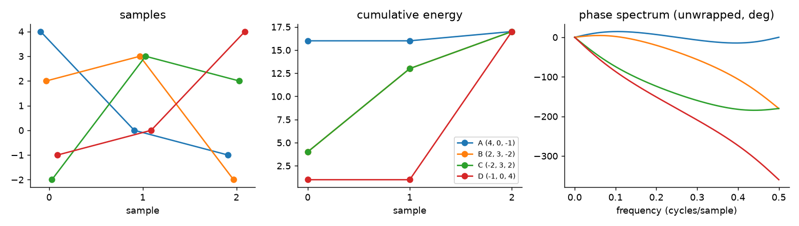
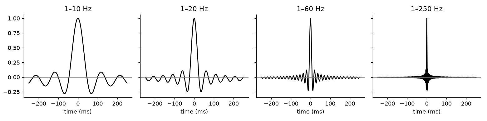

Two wavelets can contain exactly the same frequencies at the same strengths and still look very different, because their phase spectra are different. In seismic processing, the phase difference that matters most is minimum vs. maximum vs. mixed phase, because it decides whether a wavelet's energy shows up at its start or at its end. The second practical question is how many frequencies a wavelet contains, because that sets the thinnest layer we can see. I've rewritten this from my Persian notes from 2017, and it picks up where [Seismic wavelets: amplitude and phase spectra](/notes/wavelet-amplitude-and-phase-spectra/) left off.

## Where is the energy?

Take three wavelets with the same amplitude spectrum but different phase spectra. In the first, the biggest swing is near the start. In the second it's in the middle. In the third it's near the end. So their energy is bunched up at different times.

- A **minimum-phase** wavelet has its energy bunched at the start.
- A **maximum-phase** wavelet has its energy bunched at the end.
- Anything in between is **mixed phase**.

A minimum-phase wavelet is also **causal**, meaning it's zero for $t < 0$. A causal system only responds after something hits it, which is how real physical sources behave.

## A three-sample example

Here are four tiny wavelets, three samples each:

| Wavelet | Samples | Cumulative energy after sample 0, 1, 2 |
|---|---|---|
| A | (4, 0, −1) | 16, 16, 17 |
| B | (2, 3, −2) | 4, 13, 17 |
| C | (−2, 3, 2) | 4, 13, 17 |
| D | (−1, 0, 4) | 1, 1, 17 |

The cumulative energy is the running sum of the squared amplitudes. All four have total energy 17. Less obviously, all four have the **same amplitude spectrum**. You can check this with z-transforms: $A(z) = 4 - z^2 = (2-z)(2+z)$, $B(z) = (2-z)(1+2z)$, $C(z) = (2z-1)(z+2)$ and $D(z) = (2z-1)(2z+1)$. Each wavelet is built from the same two "dipoles" (two-sample pieces) or their time-reversed versions, and reversing a dipole doesn't change its magnitude on the unit circle.



What's different is how fast the energy builds up. Wavelet A has almost all its energy at the first sample, so it has the **least energy delay**. Wavelet D gets almost nothing until the last sample, so it has the **largest energy delay**. B and C sit in between and build up energy in exactly the same way. Out of all wavelets with the same amplitude spectrum, the one with the least energy delay is called **minimum delay**, and the one with the most is **maximum delay**.

This is Robinson's energy-delay theorem: **the minimum-phase wavelet is the one with the least energy delay**. A time delay is the same thing as a phase lag, so the two names describe one idea. You can see it in the phase spectra in the right panel: A's phase changes the least across frequency (minimum phase), D's changes the most (maximum phase), and B and C are mixed.

```python
import numpy as np

wavelets = {"A": [4, 0, -1], "B": [2, 3, -2], "C": [-2, 3, 2], "D": [-1, 0, 4]}
for name, w in wavelets.items():
    amp = np.abs(np.fft.fft(w, 8))           # amplitude spectrum
    energy = np.cumsum(np.square(w))         # energy build-up
    roots = np.roots(w[::-1])                # zeros of w0 + w1 z + w2 z^2
    kind = ("minimum" if np.all(np.abs(roots) > 1) else
            "maximum" if np.all(np.abs(roots) < 1) else "mixed")
    print(name, np.round(amp, 2), energy, kind)
```

All four rows print the same amplitude spectrum. A comes out as minimum phase (both zeros of its polynomial are outside the unit circle, with the $z$ convention above), D as maximum phase, and B and C as mixed.

## Wavelets in seismic acquisition

Every seismic source makes its own wavelet. That wavelet travels into the earth, bounces off layer boundaries, and what we see on a seismic section is the result. On land the two most common sources are:

- **Dynamite**, which gives a **minimum-phase** wavelet: a sudden, causal pulse.
- **Vibroseis** (a vibrator truck that sweeps through frequencies). After the recorded data are cross-correlated with the sweep, the effective wavelet is **zero phase** (often called the Klauder wavelet).

It matters which one you have for later steps like deconvolution, which usually assumes a minimum-phase wavelet.

## Bandwidth and resolution

A wavelet is a sum of frequency components. So what happens when we add more of them?



The wider the band of frequencies, the shorter the wavelet. With 1–10 Hz the central lobe is about 100 ms wide. With 1–250 Hz it's a few milliseconds, almost a single spike. This is a general rule in Fourier analysis: the longer something lasts in time, the narrower it is in frequency, and the other way round.

This matters directly for geology. The reflections from the top and bottom of a thin layer arrive very close together in time. If the wavelet is long, the two copies overlap and smear into one event. A shorter wavelet keeps them apart. So:

- A **narrow-band** wavelet can't separate thin layers or small faults.
- A **broad-band** wavelet shows more detail about how the layers change.
- In the extreme, a wavelet with all frequencies at equal strength is a **spike** (a unit impulse). That's the ideal wavelet for resolution, which is why so much of seismic processing tries to widen the bandwidth and squeeze the wavelet towards a spike.

The low end of the band matters too. Cutting out the low frequencies adds strong side lobes (ringing) around the main peak, and those can be mistaken for extra layers.

## Key takeaways

- Wavelets with the same amplitude spectrum can have different phase, and the phase decides where the energy sits in time.
- Minimum phase means least energy delay (energy at the start, causal). Maximum phase means energy at the end. Everything else is mixed.
- Dynamite gives a minimum-phase wavelet. Correlated Vibroseis data give a zero-phase wavelet.
- Wider bandwidth means a shorter wavelet and better vertical resolution. The ideal limit is a spike.

## Resources

- Öz Yilmaz, *Seismic Data Processing*, SEG Investigations in Geophysics No. 2, 1987, Chapter 1 (minimum, maximum and mixed phase; the four three-sample wavelets; bandwidth and resolution). The 2001 edition, *Seismic Data Analysis*, is free on the SEG Wiki: <https://wiki.seg.org/wiki/Seismic_Data_Analysis>.
- Enders A. Robinson and Sven Treitel, *Geophysical Signal Analysis*, Prentice-Hall, 1980 (the energy-delay theorem and minimum-delay wavelets).
