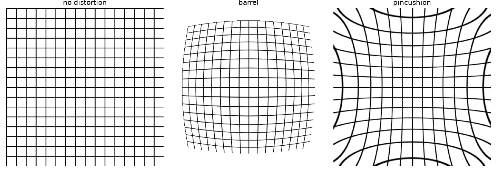

The pinhole camera model turns straight lines in the world into straight lines in the image. Real lenses don't quite manage that. Wide-angle lenses and cheap optics bend straight lines near the edges of the image, so the sides of a building bow outwards or inwards. For anything that measures geometry (calibration, stereo, SLAM, photogrammetry from drone images) this **radial distortion** has to be modelled and removed. In my notebook I simulated it on a photo. Here I write down the model and a cleaner way to apply it.

## What radial distortion looks like

Radial distortion moves each point towards or away from the image centre, and the further a point is from the centre, the more it moves. Points near the centre barely move; points in the corners move the most.

- **Barrel distortion**: things get less magnified further from the centre. Straight lines bow outwards, like the sides of a barrel. Common with wide-angle and fisheye lenses.
- **Pincushion distortion**: things get more magnified further from the centre. Straight lines bow inwards. Common with telephoto lenses.



## The polynomial model

Work in normalised image coordinates $(x, y)$: measured from the distortion centre (usually the principal point) and divided by the focal length, so they have no units. Let $r^2 = x^2 + y^2$. The standard radial model, from Brown (1966) and used by OpenCV, takes an ideal, undistorted point to where it ends up after distortion:

$$
x_d = x\,(1 + k_1 r^2 + k_2 r^4 + k_3 r^6), \qquad
y_d = y\,(1 + k_1 r^2 + k_2 r^4 + k_3 r^6).
$$

The coefficients $k_1, k_2, k_3$ come from calibration. Usually $k_1$ does most of the work, and for mild distortion one term is enough:

- $k_1 < 0$: points get pulled inwards, more so at large $r$: **barrel**.
- $k_1 > 0$: points get pushed outwards, more so at large $r$: **pincushion**.

The full model also has two **tangential** terms, $p_1$ and $p_2$, for lenses whose glass elements aren't perfectly centred. I'm ignoring them here.

## Warping an image: think backwards

To make a distorted image, the obvious idea is to take each input pixel and move it to its new spot. But that leaves holes and overlaps in the output. The usual way goes the other direction: for each **output** pixel, work out where it should come from in the **input**, and sample the input there (with interpolation). This is called **inverse mapping**, and it's what `cv2.remap` and `scipy.ndimage.map_coordinates` do.

That flip is easy to get confused by, and it confused me. In my notebook I used the formula $x(1 + k r^2)$ with $k > 0$ to compute *source* positions for a regular output grid, and I got barrel distortion, not pincushion. Both are correct: if output pixel $x$ looks up the input at $x(1 + kr^2)$, the output shows content from further out, so the picture gets squeezed towards the centre. The formula above with $k_1 > 0$ describes the forward direction; used as a lookup, it does the opposite.

```python
import numpy as np
from scipy import ndimage as ndi

def radial_remap(img, k):
    """Output pixel at normalised (x, y) samples the input at (x, y) * (1 + k r^2).
    k > 0 gives barrel distortion, k < 0 gives pincushion."""
    h, w = img.shape
    cy, cx = (h - 1) / 2, (w - 1) / 2
    s = max(cx, cy)                                   # normalise so r = 1 at the edge
    yy, xx = np.mgrid[0:h, 0:w].astype(float)
    x, y = (xx - cx) / s, (yy - cy) / s
    scale = 1 + k * (x**2 + y**2)
    src_rows, src_cols = y * scale * s + cy, x * scale * s + cx
    return ndi.map_coordinates(img, [src_rows, src_cols], order=1, cval=0)

grid = np.zeros((200, 200)); grid[::20, :] = 1; grid[:, ::20] = 1
barrel = radial_remap(grid, 0.25)
pincushion = radial_remap(grid, -0.2)
print(barrel.shape, pincushion.shape)
```

My original notebook did the same thing with PIL's `Image.transform(..., Image.MESH, ...)`, which warps the image piece by piece over a 100 × 100 grid of quads. It works, but the per-pixel remap above is shorter and avoids the small seams a coarse mesh can leave.

## Removing distortion

Fixing a real photo is the reverse problem. You know $k_1, k_2, \dots$ from calibration (for example, by photographing a checkerboard from several angles and running `cv2.calibrateCamera`). For each pixel of the corrected image, you work out its ideal normalised position, apply the forward model to find where that point landed in the distorted photo, and sample there. It's inverse mapping again, and this time the lookup uses the forward distortion formula directly. OpenCV wraps it all up:

```python
import cv2
import numpy as np

h, w = 480, 640
distorted_img = np.zeros((h, w), np.uint8); distorted_img[::40] = 255  # stand-in photo
# In practice K and dist come from cv2.calibrateCamera; these are example values.
K = np.array([[500., 0, w / 2], [0, 500., h / 2], [0, 0, 1]])
dist = np.array([-0.2, 0.05, 0, 0, 0])          # [k1, k2, p1, p2, k3]: mild barrel

undistorted = cv2.undistort(distorted_img, K, dist)
# or, for video, precompute the maps once and call cv2.remap per frame:
map1, map2 = cv2.initUndistortRectifyMap(K, dist, None, K, (w, h), cv2.CV_32FC1)
undistorted = cv2.remap(distorted_img, map1, map2, cv2.INTER_LINEAR)
```

When you correct a photo from a barrel-distorted lens, you get curved, empty borders, because the corners of the output map to points outside the original frame. `cv2.getOptimalNewCameraMatrix` lets you choose between keeping every pixel or cropping to the valid ones.

## Key takeaways

- Radial distortion moves points along lines through the image centre, and the shift grows with distance from the centre.
- The Brown model scales normalised coordinates by $1 + k_1r^2 + k_2r^4 + k_3r^6$. $k_1 < 0$ is barrel and $k_1 > 0$ is pincushion.
- Image warping uses inverse mapping: for each output pixel, find where it comes from and interpolate.
- Using a distortion formula as a lookup flips its visual effect, so always be clear which direction a formula describes.
- In practice, get the coefficients from calibration and remove the distortion with `cv2.undistort` or `cv2.remap`.

## Resources

- Antonio Torralba, Phillip Isola and William T. Freeman, *Foundations of Computer Vision*, MIT Press, 2024, Chapter 39 "Camera Modeling and Calibration" (Section 39.3.4 mentions radial distortion as a calibration parameter): <https://visionbook.mit.edu/imaging_geometry.html>
- OpenCV documentation, "Camera Calibration and 3D Reconstruction" (distortion coefficients $k_1, k_2, p_1, p_2, k_3$, `undistort`, `initUndistortRectifyMap`): <https://docs.opencv.org/4.x/d9/d0c/group__calib3d.html>
- Duane C. Brown, "Decentering distortion of lenses", *Photogrammetric Engineering* 32(3), 1966.
- Richard Szeliski, *Computer Vision: Algorithms and Applications*, 2nd ed., Springer, 2022, Section 2.1 (lens distortions): <https://szeliski.org/Book/>
