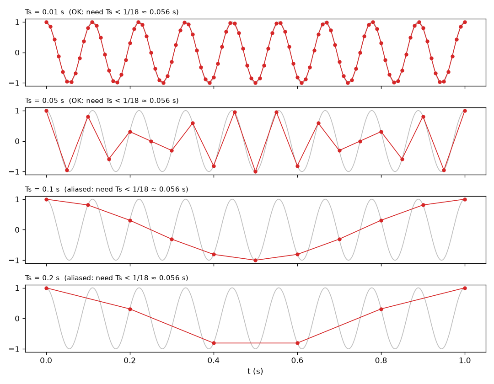
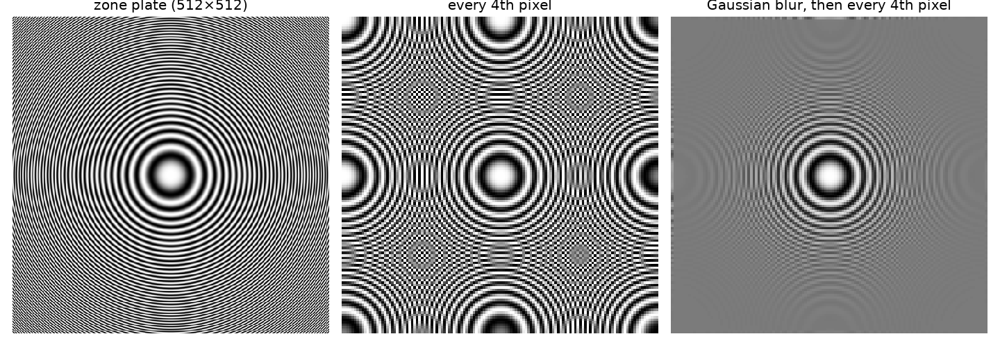
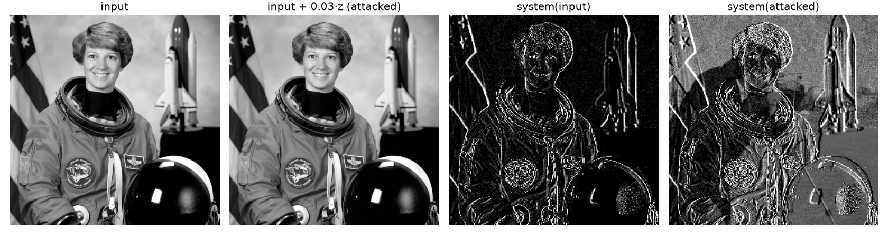

A digital image is a set of samples of a continuous scene. If the scene changes faster than we sample it, the samples lie: fine stripes turn into wide stripes at the wrong angle, and wheels in films spin backwards. That's aliasing. It matters every time we resize an image or use a stride in a neural network. I followed Chapters 20 and 21 of *Foundations of Computer Vision* for this and ran small experiments along the way.

## Seeing aliasing in 1D

Take $\ell(t) = \cos(18\pi t)$. Its angular frequency is $\omega = 18\pi$ rad/s, so it does 9 cycles per second (period $1/9$ s). Now sample it every $T_s$ seconds.



With $T_s = 0.01$ s the samples trace the cosine nicely. With $T_s = 0.05$ s they still roughly catch every cycle. With $T_s = 0.1$ s or $0.2$ s the samples describe a slow wave that isn't actually there. A high frequency is now pretending to be a low one: it has taken on an *alias*.

## The sampling theorem

The **Nyquist–Shannon sampling theorem** says that a signal whose highest angular frequency is $\omega_{\max}$ can be rebuilt exactly from its samples if the sampling frequency $\omega_s = 2\pi/T_s$ satisfies

$$
\omega_s > 2\,\omega_{\max} \quad\Longleftrightarrow\quad T_s < \frac{\pi}{\omega_{\max}}.
$$

For our cosine, $\omega_{\max} = 18\pi$, so we need $T_s < 1/18 \approx 0.056$ s. In plain words: at least two samples per cycle.

## Why it happens: copies of the spectrum

This is the part that made it click for me. A neat way to model sampling is to multiply the continuous signal by a **delta train** (Dirac comb), a row of spikes spaced $T_s$ apart:

$$
\ell_\delta(t) = \ell(t)\sum_{n=-\infty}^{\infty}\delta(t - nT_s) = \sum_{n=-\infty}^{\infty}\ell(nT_s)\,\delta(t - nT_s).
$$

This uses the sifting property of the delta, $\ell(t)\,\delta(t - a) = \ell(a)\,\delta(t - a)$. The result $\ell_\delta$ still lives on continuous time, but it holds exactly the information in the samples $\ell[n] = \ell(nT_s)$. Its Fourier transform matches the discrete-time transform of the samples, up to a rescaling of the frequency axis: $\mathcal{L}_s(\omega) = \mathcal{L}_\delta(\omega/T_s)$.

The Fourier transform of a delta train is another delta train, with spacing $2\pi/T_s$:

$$
\Delta_{T_s}(\omega) = \frac{2\pi}{T_s}\sum_{k=-\infty}^{\infty}\delta\left(\omega - k\frac{2\pi}{T_s}\right).
$$

Multiplying in time is convolving in frequency (with a factor $1/2\pi$ in this convention), so

$$
\mathcal{L}_\delta(\omega) = \frac{1}{T_s}\sum_{k=-\infty}^{\infty}\mathcal{L}\left(\omega - k\frac{2\pi}{T_s}\right).
$$

So the spectrum of the sampled signal is an endless row of copies of the original spectrum, one every $2\pi/T_s$. Sample fast and the copies are far apart. Sample slowly and they overlap: high frequencies from one copy land on top of low frequencies from the next. That overlap *is* aliasing. It starts when $\omega_{\max}$ reaches half the spacing, $\pi/T_s$, which is exactly the theorem above.

## Rebuilding the signal with the sinc

If the copies don't overlap, we can cut out the middle one with an ideal low-pass filter that lets $|\omega| < \pi/T_s$ through unchanged (zero phase) and blocks everything else. Its impulse response is

$$
h(t) = \operatorname{sinc}(t/T_s), \qquad \operatorname{sinc}(x) = \frac{\sin(\pi x)}{\pi x},\ \operatorname{sinc}(0) = 1.
$$

The sinc is symmetric, equals 1 at zero and 0 at every other integer, and wiggles with an amplitude that shrinks like $1/x$. The reconstruction is

$$
\tilde\ell(t) = \sum_{n=-\infty}^{\infty}\ell[n]\,\operatorname{sinc}\left(\frac{t - nT_s}{T_s}\right),
$$

so one shifted sinc per sample, each scaled by the sample value. Real resizing code uses short approximations of this: nearest neighbour (blocky), bilinear, bicubic and Lanczos (a windowed sinc, the sharpest of the common choices).

## Aliasing in images, and the anti-aliasing filter

Images are 2D signals, so the same rule applies along each axis. Downsampling by keeping every $k$-th pixel means sampling $k$ times more slowly, and any detail finer than the new Nyquist limit aliases. The fix is to remove those frequencies **before** you drop pixels, with a low-pass filter called the **anti-aliasing filter**. A Gaussian or a binomial kernel like $[1, 4, 6, 4, 1]/16$ is the usual pick (see [Linear filters and the Gaussian blur](/notes/linear-filters-and-gaussian-blur/)).



The zone plate's rings get finer towards the edge. Plain subsampling creates fake ring centres all over the image. Blurring first turns the fine rings, which can't be recovered anyway, into flat grey, and that's the honest answer. I saw the same thing with a photo of a zebra: plain resizing made the stripes change direction and width, while blurring first kept them sensible until they faded to grey.

```python
import numpy as np
from scipy import ndimage as ndi

def downsample(img, k, antialias=True):
    if antialias:
        img = ndi.gaussian_filter(img, sigma=k / 2)   # remove detail finer than the new grid
    return img[::k, ::k]

checker = np.indices((20, 20)).sum(0) % 2           # finest possible pattern
print(checker[::2, ::2].std())                     # 0.0: checkerboard became a flat colour
print(downsample(checker.astype(float), 2).std())  # small: blurred to grey, as it should
```

Look at the first print: downsampling a one-pixel checkerboard by 2 gives a constant image, all black or all white depending on where you start. The highest possible frequency has aliased all the way down to zero frequency.

## Using aliasing to attack a strided convolution

Aliasing isn't just a visual glitch. Chapter 21 of the book shows how to exploit it. Take a tiny "network layer":

1. **Edge filter**: $u[n, m] = \ell[n, m] - \ell[n, m-1]$, a horizontal derivative.
2. **Decimation**: $h[n, m] = u[2n, 2m]$, keeping one pixel in four. Steps 1 and 2 together are a **strided convolution**.
3. **ReLU**: $\ell_{\text{out}} = \max(0, h)$.

Now hide an image $\ell_{\text{hidden}}$ inside a perturbation that flips sign like a checkerboard,

$$
z[n, m] = (-1)^n(-1)^m\,\ell_{\text{hidden}}[n, m],
$$

and feed the system $\ell_{\text{in}} + \varepsilon z$ with a small $\varepsilon$ like $0.03$. Multiplying by $(-1)^{n+m}$ moves the hidden image up to the very highest frequencies, so we can't see it. But the derivative filter is a high-pass filter: on $z$ it gives $(-1)^{n+m}(\ell_{\text{hidden}}[n,m] + \ell_{\text{hidden}}[n,m-1]) \approx 2(-1)^{n+m}\ell_{\text{hidden}}$. At even rows and columns the sign factor is $+1$, so decimation keeps $+2\varepsilon\,\ell_{\text{hidden}}$. So basically, the high-frequency code gets aliased back into a normal, visible image.



```python
def system(img):
    u = img - np.roll(img, 1, axis=1)     # u[n,m] = l[n,m] - l[n,m-1]
    return np.maximum(0, u[::2, ::2])     # stride 2, then ReLU

n, m = np.indices((256, 256))
l_in = np.ones((256, 256)) * 0.5          # stand-in for a smooth photo
hidden = (np.hypot(n - 128, m - 128) < 60).astype(float)   # a disc
attacked = l_in + 0.03 * (-1.0)**(n + m) * hidden
print(np.abs(attacked - l_in).max())                      # 0.03: tiny change
print(system(l_in).max(), system(attacked)[64, 64])       # 0.0 vs 0.06: disc appears
```

The input barely changes, but the output contains the hidden disc. The defence is the same as before: blur before you subsample. Anti-aliased pooling and strided layers in CNNs (for example Zhang, 2019) make networks both more shift-invariant and harder to trick this way.

## Key takeaways

- Sampling makes copies of the spectrum every $2\pi/T_s$. Aliasing is when those copies overlap.
- To avoid it, sample faster than twice the highest frequency: $T_s < \pi/\omega_{\max}$.
- Perfect reconstruction is a sum of sinc functions. Everyday interpolators are approximations of it.
- Always low-pass filter (Gaussian or binomial) before downsampling an image.
- Strided convolutions are downsamplers too, and someone can hide an image in the high frequencies they alias.

## Resources

- Antonio Torralba, Phillip Isola and William T. Freeman, *Foundations of Computer Vision*, MIT Press, 2024, Chapter 20 "Image Sampling and Aliasing" (delta train, sampling theorem, sinc reconstruction, anti-aliasing filter, zebra example): <https://visionbook.mit.edu/sampling_and_aliasing.html>
- Same book, Chapter 21 "Downsampling and Upsampling Images", Section 21.2 "Example: Aliasing-Based Adversarial Attack": <https://visionbook.mit.edu/upsamplig_downsampling_2.html>
- Richard Zhang, "Making Convolutional Networks Shift-Invariant Again", ICML 2019: <https://arxiv.org/abs/1904.11486>
- Test images in the figures: `camera` and `astronaut` from scikit-image's `skimage.data`: <https://scikit-image.org/docs/stable/api/skimage.data.html>
