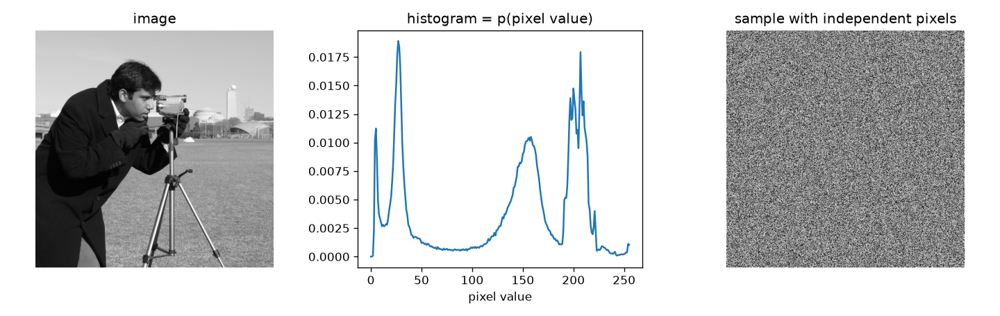
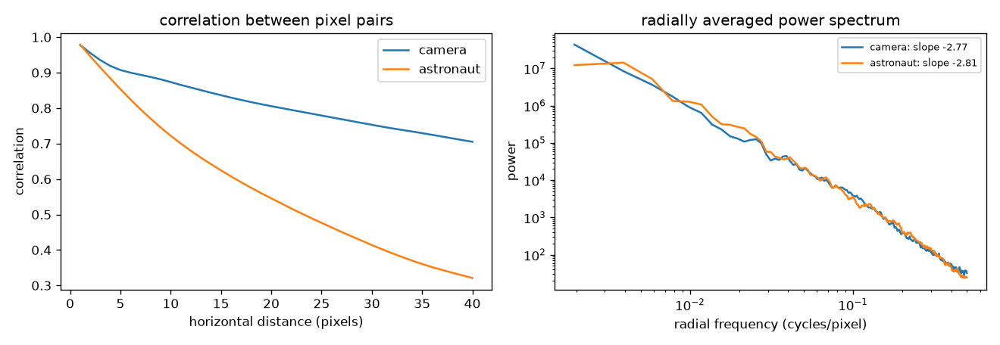
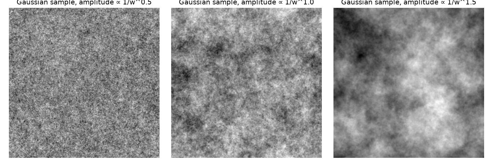

Natural images are a tiny, very structured corner of all possible pixel arrays. A random array of pixels basically never looks like a photo. A **statistical image model** tries to describe that corner with a probability distribution $p(\ell)$. With a good model you can generate images, remove noise, fill in missing parts and tell texture apart from noise. Modern generative models are the far end of this road. Here I only cover the first, simplest steps, following Chapter 27 of *Foundations of Computer Vision*.

## Model 1: every pixel on its own

The simplest model says each pixel is drawn independently from the same distribution. For an 8-bit grey image that distribution has 256 parameters:

$$
p_\theta(\ell[n, m] = k) = \theta_k, \qquad k = 0, \dots, 255, \qquad \sum_k \theta_k = 1.
$$

The maximum-likelihood estimate of $\theta_k$ is just the normalised histogram: the fraction of pixels with value $k$. To sample a new image, you draw every pixel from that histogram.

```python
import numpy as np

def fit_histogram(img):                       # img: uint8 array
    return np.bincount(img.ravel(), minlength=256) / img.size

def sample_independent(theta, shape, seed=0):
    rng = np.random.default_rng(seed)
    return rng.choice(256, size=shape, p=theta).astype(np.uint8)
```



The sample gets the overall brightness right and nothing else. I also tried averaging the histograms of seven different photos into one model, and the samples were the same kind of noise. Not surprising, really. The histogram doesn't care where pixels are, so shuffling all the pixels of a photo would give it exactly the same likelihood. The book points out that this model only fits a few kinds of images, like a star field. Histograms are still useful features, but they're not a model of images.

## Pixels aren't independent

Pick a pixel and look at another one a distance $d$ away. When $d$ is small, they almost always have similar values. As $d$ grows, the link gets weaker.



The left panel measures this over whole images: the correlation is about 0.98 for neighbours and drops slowly with distance. (My first attempt compared one pixel with a handful of others along a diagonal. It was noisy, and I also hit an overflow, because subtracting two `uint8` values wraps around. Convert to float before subtracting.)

## The power spectrum of natural images

Correlation vs. distance and the power spectrum hold the same information: by the Wiener–Khinchin theorem, the power spectrum is the Fourier transform of the autocorrelation. The power spectrum is just easier to read. For most natural images, the Fourier magnitude drops off roughly as a power of the radial frequency $w = \sqrt{u^2 + v^2}$:

$$
|\mathcal{L}(u, v)| \approx \frac{A}{w^{\alpha}}, \qquad \text{so the power } |\mathcal{L}|^2 \approx \frac{A^2}{w^{2\alpha}},
$$

with $\alpha$ close to 1 for typical scenes. On a log-log plot that's a straight line, and the right panel shows exactly that. For my two test images the fitted power slopes were about $-2.8$, so $\alpha \approx 1.4$. Values between 1 and 1.5 are common, depending on the scene and how you measure the spectrum. A spectrum like this has no favourite scale: zoom in on a natural scene and you get roughly the same statistics. That's why it's called **scale invariant**.

(In my notebook I first computed "power" as the square of the *log* magnitude. That's wrong: the power spectrum is the square of the magnitude itself. Only take the log for plotting.)

## Model 2: a Gaussian with a 1/f spectrum

Now let all the pixels be jointly Gaussian with mean $\mu$ and covariance $C$:

$$
p(\ell) \propto \exp\left(-\tfrac{1}{2}(\ell - \mu)^\top C^{-1}(\ell - \mu)\right),
$$

with the image flattened into one long vector. If the statistics are **stationary** (the same everywhere in the image) and the image wraps around at its borders, $C$ is circulant, and every circulant matrix is diagonalised by the Fourier basis:

$$
C = F D F^{H},
$$

where $F$ holds the Fourier basis vectors and $D$ is diagonal. The diagonal entries of $D$ are the power at each frequency, which we just measured: $D \propto 1/w^{2\alpha}$. So the whole model comes down to one number, $\alpha$. I found that pretty neat.

Sampling is easy in the Fourier domain: draw independent Gaussian noise at every frequency, scale it by $1/w^{\alpha}$, and transform back. That's the same as filtering white noise.

```python
def sample_gaussian_image(n=256, alpha=1.0, seed=0):
    rng = np.random.default_rng(seed)
    fy = np.fft.fftfreq(n)[:, None]
    fx = np.fft.fftfreq(n)[None, :]
    w = np.hypot(fx, fy)
    w[0, 0] = 1.0                                  # avoid dividing by zero at DC
    noise = np.fft.fft2(rng.standard_normal((n, n)))
    return np.fft.ifft2(noise / w**alpha).real     # amplitude falls as 1/w^alpha

img = sample_gaussian_image(alpha=1.5)
print(img.shape)
```



The samples look like clouds or rough terrain. They have the right correlations and the right mix of coarse and fine detail, which is a big step up from independent pixels. But there are no edges, objects or sharp boundaries. A Gaussian model only captures second-order statistics (the power spectrum), and its phases are random. As [the DFT note](/notes/discrete-fourier-transform-of-images/) shows, the phase is where edges and structure live.

I also tried a third model of my own: estimating a mean and spread for each pixel position from its four neighbours across a few photos, then sampling each pixel independently from its own Gaussian. All I got was a noisy blur of the average image, because it still treats the sampled pixels as independent. My spread estimate (the standard deviation of *squared* neighbour values) was also just wrong. Proper neighbourhood models, Markov random fields, sample each pixel *given the values already sampled* around it. That's what the later sections of the chapter are about.

## Where this goes next

The book moves on to better models that capture more than the spectrum: the dead-leaves model (images as overlapping opaque shapes, which naturally gives edges and a $1/w$ spectrum), the wavelet marginal model (filter outputs on natural images are sparse, with peaky, heavy-tailed histograms), and non-parametric Markov random fields, which lead to texture synthesis. Deep generative models are the modern version of the same goal.

## Key takeaways

- An independent-pixel model is just the histogram. It ignores all spatial structure and produces noise.
- Nearby pixels are strongly correlated, and the correlation drops slowly with distance.
- Natural images have a power-law spectrum, $|\mathcal{L}| \approx 1/w^{\alpha}$ with $\alpha$ around 1: a straight line on log-log axes.
- A stationary Gaussian model has covariance $C = FDF^H$ with $D \propto 1/w^{2\alpha}$. Sampling from it means shaping white noise in the Fourier domain.
- Gaussian samples get the soft light-and-shade texture right but have no edges, because structure lives in the phase.

## Resources

- Antonio Torralba, Phillip Isola and William T. Freeman, *Foundations of Computer Vision*, MIT Press, 2024, Chapter 27 "Statistical Image Models" (independent pixels, dead leaves, the Gaussian model, wavelet marginals, Markov random fields): <https://visionbook.mit.edu/stat_image_models_revised.html>
- Daniel L. Ruderman and William Bialek, "Statistics of natural images: Scaling in the woods", *Physical Review Letters* 73, 1994: <https://doi.org/10.1103/PhysRevLett.73.814>
- David J. Field, "Relations between the statistics of natural images and the response properties of cortical cells", *Journal of the Optical Society of America A* 4(12), 1987.
- Test images in the figures: `camera` and `astronaut` from scikit-image's `skimage.data`: <https://scikit-image.org/docs/stable/api/skimage.data.html>
