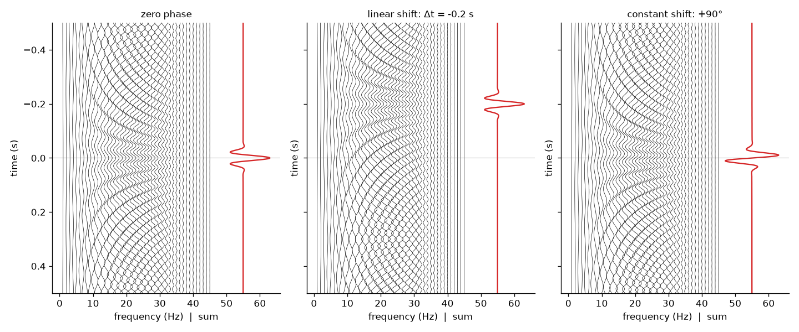
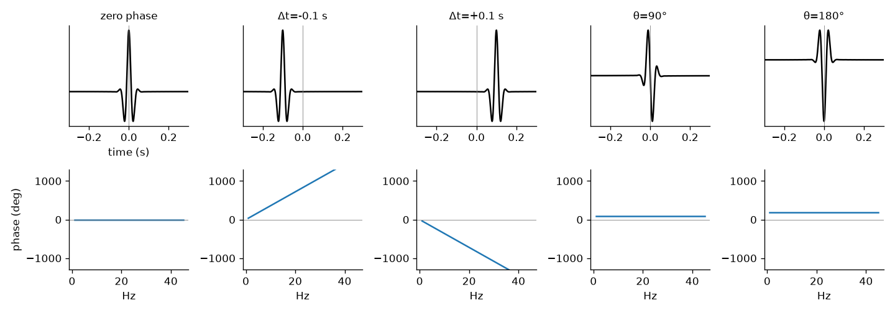

A seismic source does not send a single sine wave into the ground. It sends a short pulse, a **wavelet**, and every reflection we record is a copy of that pulse. To process seismic data well you must understand the wavelet's two spectra: amplitude and phase. This note, rewritten from my 2017 Persian notes, explains how the phase spectrum controls where a wavelet sits and what shape it has. It builds on [Waves and the Fourier spectrum](/notes/waves-and-the-fourier-spectrum/).

## A wavelet is a sum of sinusoids

Imagine many springs, each oscillating with its own amplitude, frequency and phase. Add all their motions together. Where the sinusoids line up they reinforce each other; elsewhere they cancel. The result is a signal that is large for a short time and almost zero outside it. That is a wavelet.

A wavelet is **transient**: it has a start and an end, and its energy is finite and packed between them. (In seismic language, "wavelet" means this pulse. It is related to, but not the same as, the wavelets of the wavelet transform.)

Building a wavelet from sinusoids is **synthesis**, and it is done by the inverse Fourier transform. Taking a wavelet apart into its sinusoids is **analysis**, done by the forward Fourier transform. The two are exact inverses, so nothing is lost either way. If $s(t)$ is the wavelet in time and $S(f)$ its spectrum:

$$
S(f) = \int_{-\infty}^{\infty} s(t)\,e^{-i2\pi f t}\,dt,
\qquad
s(t) = \int_{-\infty}^{\infty} S(f)\,e^{i2\pi f t}\,df.
$$

$S(f)$ is complex. We write it in polar form,

$$
S(f) = A(f)\,e^{i\phi(f)},
$$

where $A(f) = |S(f)|$ is the **amplitude spectrum** and $\phi(f)$ is the **phase spectrum**. The output of a Fourier analysis is exactly these two curves.

## Zero phase and linear phase



In the left panel every sinusoid has zero phase: each one has a peak exactly at $t = 0$. All of them reinforce each other there, so their sum is a sharp, symmetric wavelet with its largest peak at $t = 0$. This is a **zero-phase wavelet**. Its energy is concentrated at time zero.

A wavelet that is symmetric about some other time $t_0$ is called **linear phase**, because its phase spectrum is a straight line through the origin. Zero phase is the special case where the line is flat ($t_0 = 0$). A wavelet with no such symmetry has **non-linear phase**.

## Linear phase shift: moving the wavelet in time

Go back to the cosine $A\cos(2\pi f t + \theta)$. We can change its phase in two ways: change the time term, or change the phase constant $\theta$.

First, shift the whole wavelet by $\Delta t$ seconds. Every frequency component moves by the same $\Delta t$. For a component of frequency $f$, a delay of $\Delta t$ is a fraction $\Delta t / T = f\Delta t$ of its period, so its phase lag is $2\pi f\,\Delta t$. Phase is the negative of the phase lag, so the new phase spectrum is

$$
\phi_{\text{new}}(f) = \phi(f) - 2\pi f\,\Delta t.
$$

The added term is a straight line in $f$ with slope $-2\pi\Delta t$. That is why this is called a **linear phase shift**. In the middle panel above, $\Delta t = -0.2$ s (a shift towards earlier time), so each component gains $+2\pi(0.2)f$ of phase. Moving the wavelet earlier reduces its delay, so its phase increases.

What changes and what does not:

- The amplitude spectrum does not change.
- The wavelet's shape and symmetry do not change; only its centre moves.
- The phase spectrum stays a straight line; only its slope changes. A shift to earlier time makes the slope steeper upwards, a shift to later time tilts it down.

## Constant phase shift: changing the wavelet's shape

Now leave time alone and add the same angle $\theta$ to every component. The right panel above shows a $90°$ shift. The sinusoids are no longer symmetric about $t = 0$, and their sum is a different, antisymmetric wavelet, even though its amplitude spectrum is identical to the zero-phase one. On the spring picture this is like changing the starting angle of every spring by the same amount.



As the constant shift grows:

- $90°$ breaks the symmetry of the zero-phase wavelet.
- $180°$ flips the **polarity** (the wavelet turns upside down).
- $270°$ changes both symmetry and polarity.
- $360°$ brings back the original wavelet.

Again the amplitude spectrum is untouched. Only the shape changes.

## Both shifts together

In general a phase change has both parts:

$$
\Delta\phi(f) = a + b f,
$$

where $a$ is the constant shift and $b = -2\pi\Delta t$ is the slope that comes from a time shift. Applying a $90°$ constant shift and a $-0.2$ s linear shift to a zero-phase wavelet gives an antisymmetric wavelet centred at $t = -0.2$ s.

```python
import numpy as np

fs, n = 1000, 1000
t = (np.arange(n) - n//2) / fs                   # time axis centred on 0
f = np.fft.fftfreq(n, 1/fs)
A = np.exp(-((np.abs(f) - 20) / 12)**2)          # smooth band around 20 Hz
A[0] = 0                                         # no DC component

def wavelet(theta_deg=0.0, dt=0.0):
    # phase = constant shift (odd in f, so the result stays real) + linear shift
    phi = np.sign(f) * np.radians(theta_deg) - 2*np.pi*f*dt
    s = np.fft.ifft(A * np.exp(1j*phi)).real
    return np.fft.fftshift(s)                    # put t = 0 in the middle

w0 = wavelet()                  # zero phase, peak at t = 0
w1 = wavelet(dt=-0.2)           # same shape, peak at t = -0.2 s
w2 = wavelet(theta_deg=180)     # polarity reversed
print(t[w0.argmax()], t[w1.argmax()], np.allclose(w2, -w0))
```

This prints `0.0 -0.2 True`. Note the `np.sign(f)` factor: for a real signal the phase spectrum must be odd ($\phi(-f) = -\phi(f)$), so a constant shift of $+\theta$ at positive frequencies goes with $-\theta$ at negative ones.

## Key takeaways

- A seismic wavelet is a short, finite-energy pulse made by adding many sinusoids; the Fourier transform splits it into an amplitude spectrum $A(f)$ and a phase spectrum $\phi(f)$.
- A zero-phase wavelet has all components peaking together at $t = 0$, so its energy is concentrated there.
- A time shift $\Delta t$ adds $-2\pi f\Delta t$ to the phase: the wavelet moves but keeps its shape.
- A constant phase shift $\theta$ keeps the wavelet in place but changes its shape; $180°$ reverses polarity.
- Neither kind of phase shift changes the amplitude spectrum.

## Resources

- Öz Yilmaz, *Seismic Data Processing*, SEG Investigations in Geophysics No. 2, 1987, Chapter 1 (the sinusoid-to-wavelet, linear phase shift and constant phase shift examples that inspired the figures here). The 2001 edition, *Seismic Data Analysis*, is free on the SEG Wiki: <https://wiki.seg.org/wiki/Seismic_Data_Analysis>.
