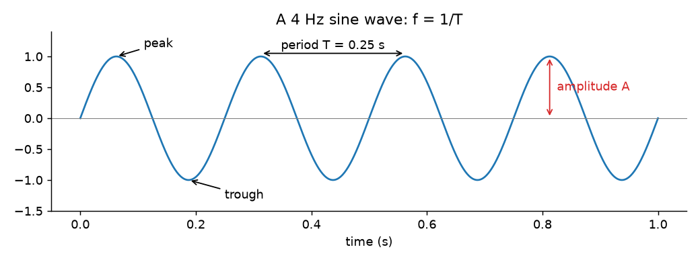
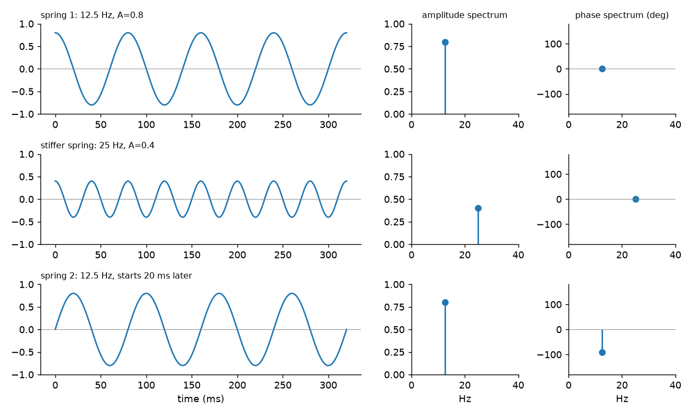

Seismic data, sound and images are all made of waves. Before getting into seismic wavelets or image filters, I wanted clear words for describing a single wave (amplitude, frequency, phase) and a tool that breaks any signal into lots of simple waves. That tool is Fourier analysis. I first wrote this in Persian in 2017, while working on seismic data quality control, and this is a rewritten English version.

## What a wave is

A wave is energy spread out in space that moves through it. There are three big families: mechanical waves, electromagnetic waves and matter waves. Seismic surveys use sound waves, which are mechanical. Mechanical waves follow Newton's laws and need some material to travel through, like air, water or rock layers.

You can describe a wave as a function of time (what one sensor records) or as a function of space (a snapshot along a line). A seismic section is a 2D wave field: one axis is time and the other is distance along the surface.

## The parts of a simple wave



For a sine wave recorded over time:

- **Amplitude** $A$ is the biggest distance from zero. A positive maximum is a **peak** and a negative one is a **trough**. In seismic recording, amplitude is often a voltage.
- **Period** $T$ is the time between two neighbouring peaks (or troughs), so the time for one full cycle. It's measured in seconds.
- **Frequency** $f$ is the number of full cycles per second, measured in hertz (Hz). It's just one over the period: $f = 1/T$.
- **Phase** tells you where in its cycle the wave is at some reference time, usually $t = 0$. It's an angle: one full cycle is $360°$, or $2\pi$ radians.

If you look at the wave along a line in space instead:

- **Wavelength** $\lambda$ is the distance between two neighbouring peaks, in metres.
- **Wavenumber** is the space version of frequency: the number of cycles per unit length, $k = 1/\lambda$. Geophysicists often give it in cycles per kilometre. Physicists often use the angular wavenumber $2\pi/\lambda$ instead, so check which one a text means.

A cosine wave with all these pieces is

$$
y(t) = A\cos(2\pi f t + \theta).
$$

There are two terms inside the cosine. The first, $2\pi f t$, is the angle the wave has gone through by time $t$. The second, $\theta$, is the **phase constant**: the angle the wave started at when $t = 0$. It's worth keeping these two terms apart in your head. In later notes, changing either one shifts the phase, but the two kinds of change behave differently.

## Phase as a time delay

Say a sine wave with period $T = 0.5$ s hits its first peak $0.12$ s later than a reference wave that peaks at $t = 0$. We say it has a **time lag** of $0.12$ s. One full cycle is $2\pi$ radians, so the **phase lag** is

$$
\frac{0.12}{0.5} \times 2\pi = 0.48\pi \text{ rad}.
$$

By convention, **phase is minus the phase lag**, so this wave has phase $-0.48\pi$. This sign confused me at first, and a simple picture helped: put the start time of each oscillator on a number line with zero at the origin. Starting late (to the right in time) gives a negative phase. Starting early gives a positive phase. Starting exactly at zero gives phase zero.

## A spring as a one-frequency system

Hang a weight on an ideal spring, pull it down by $0.8$ units and let go at $t = 0$. The position traces a cosine. With a period of $80$ ms, the frequency is $1/0.08 = 12.5$ Hz. A stiffer spring released from $0.4$ units might have a period of $40$ ms, so $25$ Hz.

Now take a second spring, identical to the first, and let it go at the moment the first spring passes through zero, $20$ ms later. Both have the same amplitude and frequency. The only difference is a $20$ ms delay, which is a quarter of the period, so the phase lag is $\pi/2$ ($90°$) and the phase is $-90°$.



If you plot each oscillation's amplitude against its frequency, you get its **amplitude spectrum**. If you plot its phase against frequency, you get its **phase spectrum**. The first and third springs have the same amplitude spectrum but different phase spectra. This is the main idea: the amplitude spectrum says *how much* of each frequency there is, and the phase spectrum says *when* each one sits in time.

## Fourier series: periodic functions as sums of sines

A function $f(x)$ is **periodic** with period $p$ if $f(x + p) = f(x)$ for every $x$. If $p$ is a period, then so are $2p$, $3p$, and so on.

A function with period $2L$ can be written as a **Fourier series**:

$$
f(x) = a_0 + \sum_{n=1}^{\infty}\left[a_n \cos\frac{n\pi x}{L} + b_n \sin\frac{n\pi x}{L}\right],
$$

with coefficients given by the Euler formulas

$$
a_0 = \frac{1}{2L}\int_{-L}^{L} f(x)\,dx,\quad
a_n = \frac{1}{L}\int_{-L}^{L} f(x)\cos\frac{n\pi x}{L}\,dx,\quad
b_n = \frac{1}{L}\int_{-L}^{L} f(x)\sin\frac{n\pi x}{L}\,dx.
$$

Why do these formulas work? Because the sines and cosines are **orthogonal** on any interval of length $2L$: if you multiply any two different ones together and integrate, you get zero. So when you multiply $f$ by one basis function and integrate, everything else drops out and you're left with exactly that function's coefficient.

With Euler's formula $e^{i\phi} = \cos\phi + i\sin\phi$, the same series has a shorter complex form:

$$
f(x) = \sum_{n=-\infty}^{\infty} c_n e^{i n\pi x/L}, \qquad
c_n = \frac{1}{2L}\int_{-L}^{L} f(x)\,e^{-i n\pi x/L}\,dx.
$$

## From series to the Fourier transform

You can think of a non-periodic function as a periodic one whose period is infinitely long. As $L \to \infty$, the separate frequencies $n\pi/L$ blend into a continuous variable $\omega$, and the sum turns into an integral. This works when $f$ is piecewise continuous, has left and right derivatives everywhere, and is absolutely integrable ($\int_{-\infty}^{\infty}|f(x)|\,dx$ exists). What you get is the Fourier transform pair:

$$
\hat f(\omega) = \frac{1}{\sqrt{2\pi}}\int_{-\infty}^{\infty} f(x)\,e^{-i\omega x}\,dx,
\qquad
f(x) = \frac{1}{\sqrt{2\pi}}\int_{-\infty}^{\infty} \hat f(\omega)\,e^{i\omega x}\,d\omega.
$$

Here $\omega$ is angular frequency and $\hat f(\omega)$ is a complex number for each $\omega$. Its size is the amplitude spectrum and its angle is the phase spectrum. (Other books put the $2\pi$ factors in different places, but the ideas are the same.)

## Why it's called a spectrum

Read the inverse transform from right to left. It says $f(x)$ is a stack of oscillations $e^{i\omega x}$, one for every frequency $\omega$, each weighted by $\hat f(\omega)$. A prism does the same thing with white light: it splits it into colours, and each colour is a frequency. White light is the sum of its colours. So in this picture $f$ is the white light, the Fourier transform is the prism, and $\hat f(\omega)$ is the set of colours with how strong each one is. That's why $\hat f$ is called the **spectral representation** of $f$.

The squared size $|\hat f(\omega)|^2$ is the **spectral density**. Its integral over all frequencies is proportional to the total energy of the signal, and its integral from $a$ to $b$ tells you how much the frequencies between $a$ and $b$ contribute.

The spring shows where this comes from. For a mass $m$ on a spring with constant $k$, Newton's law gives $m\ddot y + k y = 0$. Multiplying by $\dot y$ and integrating gives

$$
\tfrac{1}{2}m\dot y^2 + \tfrac{1}{2}k y^2 = E,
$$

so kinetic plus potential energy equals a constant $E$. The solution is $y = A\cos(\omega_0 t + \theta)$ with $\omega_0 = \sqrt{k/m}$. Plugging it in gives $E = \tfrac{1}{2}kA^2$: **energy is proportional to the amplitude squared**. A more complicated system whose motion is a Fourier series has one of these terms per frequency, so the total energy is a sum of squared amplitudes over a discrete spectrum. The Fourier transform stretches this idea to a continuous spectrum.

```python
import numpy as np

fs = 1000                       # sampling rate (Hz)
t = np.arange(0, 2, 1/fs)   # 2 s, so 12.5 Hz falls exactly on a frequency bin
# 12.5 Hz cosine, plus a 25 Hz cosine delayed by a quarter period
y = 0.8*np.cos(2*np.pi*12.5*t) + 0.4*np.cos(2*np.pi*25*t - np.pi/2)

Y = np.fft.rfft(y) / (len(y)/2)          # scale so peaks equal amplitudes
f = np.fft.rfftfreq(len(y), 1/fs)
for k in np.argsort(np.abs(Y))[-2:]:
    print(f"{f[k]:5.1f} Hz  amplitude {abs(Y[k]):.2f}  phase {np.degrees(np.angle(Y[k])):6.1f} deg")
```

The output finds both pieces again: $0.80$ at $12.5$ Hz with phase $0°$, and $0.40$ at $25$ Hz with phase $-90°$.

## Key takeaways

- Amplitude, frequency and phase are all you need to describe a single sinusoid. Frequency is $1/T$, and wavenumber is $1/\lambda$.
- Phase is minus the phase lag: a wave that starts late has a negative phase.
- Fourier series write periodic signals as sums of orthogonal sines and cosines. The Fourier transform extends this to signals that don't repeat.
- The size of the transform is the amplitude spectrum, its angle is the phase spectrum, and the squared size shows how the energy is spread over frequency.

## Resources

- Öz Yilmaz, *Seismic Data Processing*, SEG Investigations in Geophysics No. 2, 1987, Chapter 1 (fundamentals of signal processing). The expanded 2001 edition, *Seismic Data Analysis*, is free on the SEG Wiki: <https://wiki.seg.org/wiki/Seismic_Data_Analysis>.
- Erwin Kreyszig, *Advanced Engineering Mathematics*, Wiley, chapter "Fourier Analysis" (Fourier series, Euler formulas, orthogonality, Fourier integral and transform, and the spectrum and energy of a spring–mass system).
