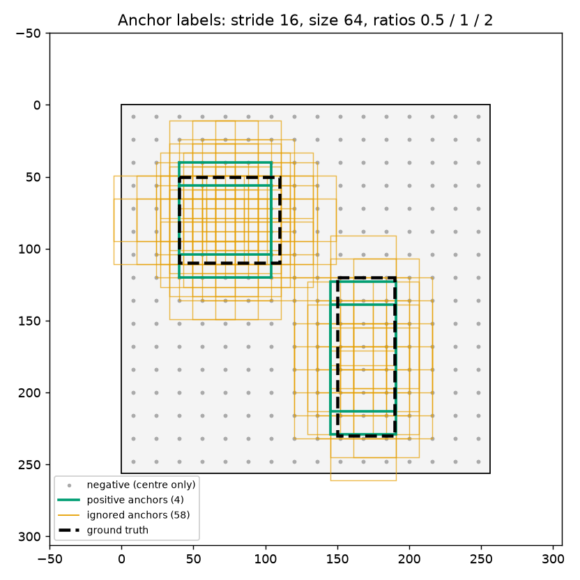

A convolutional network outputs a grid of feature vectors, one per cell. A detector must output a short list of boxes of any size and shape. Anchors are the bridge between the two: a fixed set of reference boxes placed on the grid, which the network only has to score and nudge. The Region Proposal Network (RPN) from Faster R-CNN does exactly that, and its output, a few hundred to a few thousand candidate boxes, is what the second stage of a two-stage detector classifies and refines.

## Why anchors exist

The naive idea is to let each grid cell predict one box from scratch. Two things go wrong. Objects come in very different sizes and shapes, and one box per cell cannot cover a tall person and a wide car centred at the same place. And regressing absolute pixel coordinates is hard to learn: the target range is huge and depends on image size.

An **anchor** is a box $(x_0, y_0, x_1, y_1)$ fixed in advance at a known position, size and aspect ratio. The network predicts, per anchor:

- an **objectness** score: does this anchor cover an object (of any class)?
- four **deltas**: how to shift and stretch this anchor to fit that object.

Learning a small correction to a sensible template is far easier than inventing a box, and having several templates per cell lets different shapes at the same location go to different anchors. Anchors themselves are not learned and do not depend on image content. They only depend on the feature map size, the stride and the chosen sizes and ratios.

## Placing anchors on the grid

A feature map with stride $s$ has cells every $s$ input pixels. At each cell we place $A$ anchors: one per aspect ratio $r = h/w$, all with the same area $S^2$:

$$
w = \frac{S}{\sqrt{r}}, \qquad h = S\sqrt{r}
$$

so $wh = S^2$ and $h/w = r$.

```python
import numpy as np

def make_anchors(feat_h, feat_w, stride, size, ratios=(0.5, 1.0, 2.0), offset=0.5):
    r = np.asarray(ratios, dtype=float)              # aspect ratio = height / width
    w, h = size / np.sqrt(r), size * np.sqrt(r)      # every anchor has area size**2
    base = np.stack([-w, -h, w, h], axis=1) / 2      # (A, 4), centred on (0, 0)
    xs = (np.arange(feat_w) + offset) * stride       # cell centres in image pixels
    ys = (np.arange(feat_h) + offset) * stride
    cx, cy = np.meshgrid(xs, ys)                      # (H, W) each
    shifts = np.stack([cx, cy, cx, cy], axis=-1).reshape(-1, 1, 4)
    return (shifts + base).reshape(-1, 4)            # (H*W*A, 4), all anchors of one cell together

img = 512
levels = {"P2": (4, 32), "P3": (8, 64), "P4": (16, 128), "P5": (32, 256), "P6": (64, 512)}
total = 0
for name, (stride, size) in levels.items():
    a = make_anchors(img // stride, img // stride, stride, size)
    total += len(a)
    print(f"{name}: stride {stride:2d}, size {size:3d} -> {len(a):6d} anchors")
print("total:", total)
print("first cell of P4:\n", make_anchors(32, 32, 16, 128)[:3].round(1))
```

```
P2: stride  4, size  32 ->  49152 anchors
P3: stride  8, size  64 ->  12288 anchors
P4: stride 16, size 128 ->   3072 anchors
P5: stride 32, size 256 ->    768 anchors
P6: stride 64, size 512 ->    192 anchors
total: 65472
first cell of P4:
 [[-82.5 -37.3  98.5  53.3]
 [-56.  -56.   72.   72. ]
 [-37.3 -82.5  53.3  98.5]]
```

Some details:

- **Centre offset.** Cell $(i, j)$ can be centred at $((j + 0.5)s, (i + 0.5)s)$ or at $(js, is)$. Libraries differ on this. It hardly matters for accuracy, but anchors and deltas must use the same convention at training and test time.
- **Single-scale map vs pyramid.** The original Faster R-CNN used one stride-16 map with 3 sizes × 3 ratios = 9 anchors per cell. With an [FPN](/notes/feature-pyramid-networks/), each level gets one size and 3 ratios, because the level itself already encodes scale.
- **Anchors can stick out of the image.** Near the border, large anchors extend past the edges. They are still valid; the decoded boxes are clipped later.
- About 65,000 anchors for a $512\times512$ image, and 75% of them on $P_2$. The finest level dominates the cost.



## The RPN head

The head is tiny: a $3\times3$ convolution (a small sliding window over the features), then two $1\times1$ convolutions. One gives $A$ objectness logits per cell, the other gives $4A$ deltas. With an FPN the same head runs on every level.

```python
import torch, torch.nn as nn, torch.nn.functional as F

class RPNHead(nn.Module):
    def __init__(self, channels=256, num_anchors=3):
        super().__init__()
        self.conv = nn.Conv2d(channels, channels, 3, padding=1)
        self.objectness = nn.Conv2d(channels, num_anchors, 1)     # one logit per anchor
        self.deltas = nn.Conv2d(channels, num_anchors * 4, 1)     # (dx, dy, dw, dh) per anchor

    def forward(self, levels):
        out = []
        for x in levels:
            t = F.relu(self.conv(x))
            n, _, h, w = x.shape                                   # reorder to match make_anchors
            logits = self.objectness(t).permute(0, 2, 3, 1).reshape(n, -1)
            deltas = self.deltas(t).permute(0, 2, 3, 1).reshape(n, -1, 4)
            out.append((logits, deltas))
        return out

head = RPNHead()
for logits, deltas in head([torch.randn(1, 256, 32, 32), torch.randn(1, 256, 16, 16)]):
    print(tuple(logits.shape), tuple(deltas.shape))
```

```
(1, 3072) (1, 3072, 4)
(1, 768) (1, 768, 4)
```

The `permute` before `reshape` matters: it puts all $A$ predictions of one cell next to each other, which is the same order `make_anchors` uses. A mismatch here silently pairs predictions with the wrong anchors. The RPN is **class-agnostic**: it only says "object" or "not object". Classes come in the second stage.

## Encoding a box relative to an anchor

The network never predicts coordinates. It predicts deltas in a normalised form (introduced with R-CNN's box regression). Write each box as centre $(x, y)$, width $w$, height $h$; subscript $a$ for the anchor and $g$ for the ground truth:

$$
t_x = \frac{x_g - x_a}{w_a},\quad t_y = \frac{y_g - y_a}{h_a},\quad t_w = \log\frac{w_g}{w_a},\quad t_h = \log\frac{h_g}{h_a}
$$

Dividing shifts by the anchor size makes a 5-pixel shift on a small anchor and a 50-pixel shift on a large one look the same. The log turns "twice as wide" and "half as wide" into $+0.69$ and $-0.69$, symmetric around 0, and guarantees positive widths after decoding. Decoding inverts the formulas. Real implementations also clamp $t_w, t_h$ (for example at $\log(1000/16)$) so that one bad prediction cannot produce an overflow with `exp`.

```python
def to_cxcywh(b):
    w, h = b[:, 2] - b[:, 0], b[:, 3] - b[:, 1]
    return b[:, 0] + w / 2, b[:, 1] + h / 2, w, h

def encode(anchors, gt):
    ax, ay, aw, ah = to_cxcywh(anchors)
    gx, gy, gw, gh = to_cxcywh(gt)
    return np.stack([(gx - ax) / aw, (gy - ay) / ah, np.log(gw / aw), np.log(gh / ah)], 1)

def decode(anchors, d, max_log=np.log(1000 / 16)):
    ax, ay, aw, ah = to_cxcywh(anchors)
    x, y = ax + d[:, 0] * aw, ay + d[:, 1] * ah
    w, h = aw * np.exp(np.minimum(d[:, 2], max_log)), ah * np.exp(np.minimum(d[:, 3], max_log))
    return np.stack([x - w / 2, y - h / 2, x + w / 2, y + h / 2], 1)

anchor = np.array([[100., 100., 164., 164.]])
gt = np.array([[110., 90., 190., 150.]])
t = encode(anchor, gt)
print("deltas:", t.round(3), " round trip:", decode(anchor, t))
```

```
deltas: [[ 0.281 -0.188  0.223 -0.065]]  round trip: [[110.  90. 190. 150.]]
```

## Labelling anchors for training

Training needs a target for every anchor. The rule from Faster R-CNN uses the Intersection over Union (IoU) between each anchor and each ground-truth box (IoU itself is explained in the [overlap-based losses note](/notes/overlap-based-losses/)):

| Best IoU with any ground truth | Label |
|---|---|
| $\ge 0.7$ | positive (1) |
| $< 0.3$ | negative (0) |
| in between | ignored (−1), no loss |

Plus one extra rule: each ground-truth box also makes its highest-IoU anchor(s) positive, even if that IoU is below 0.7. Without it, an object with an odd size or position might get no positive anchor at all and could never be learned.

```python
def box_iou(a, b):                                    # (N, 4), (M, 4) -> (N, M)
    lt = np.maximum(a[:, None, :2], b[None, :, :2])
    rb = np.minimum(a[:, None, 2:], b[None, :, 2:])
    inter = np.clip(rb - lt, 0, None).prod(-1)
    area = lambda x: (x[:, 2] - x[:, 0]) * (x[:, 3] - x[:, 1])
    return inter / (area(a)[:, None] + area(b)[None, :] - inter)

def label_anchors(anchors, gt, hi=0.7, lo=0.3):
    iou = box_iou(anchors, gt)
    match, best = iou.argmax(1), iou.max(1)
    labels = np.full(len(anchors), -1)
    labels[best < lo] = 0
    labels[best >= hi] = 1
    for g in range(len(gt)):                          # every object keeps its best anchor(s)
        top = np.flatnonzero(iou[:, g] == iou[:, g].max())
        labels[top], match[top] = 1, g
    return labels, match

anchors = make_anchors(16, 16, stride=16, size=64)   # a 256 x 256 image
gt = np.array([[40., 50., 110., 110.], [150., 120., 190., 230.]])
labels, match = label_anchors(anchors, gt)
print("positive:", (labels == 1).sum(), " negative:", (labels == 0).sum(),
      " ignored:", (labels == -1).sum())
```

```
positive: 4  negative: 706  ignored: 58
```

The imbalance is extreme: a handful of positives against hundreds of negatives (tens of thousands in a real image). So each image contributes a **sample** of 256 anchors, at most half positive, filled up with random negatives. The loss is binary cross-entropy on the sampled anchors' objectness, plus a smooth-L1 (or similar) loss on the deltas of the **positive** anchors only, with targets `encode(anchors[pos], gt[match[pos]])`. Negatives have no box to regress to.

```python
def sample(labels, batch=256, pos_fraction=0.5, rng=np.random.default_rng(0)):
    pos, neg = np.flatnonzero(labels == 1), np.flatnonzero(labels == 0)
    n_pos = min(len(pos), int(batch * pos_fraction))
    n_neg = min(len(neg), batch - n_pos)
    return rng.choice(pos, n_pos, replace=False), rng.choice(neg, n_neg, replace=False)

pos_idx, neg_idx = sample(labels)
targets = encode(anchors[pos_idx], gt[match[pos_idx]])
print(len(pos_idx), "positives,", len(neg_idx), "negatives; targets", targets.shape)
```

```
4 positives, 252 negatives; targets (4, 4)
```

## From scores to proposals: top-k and NMS

At inference every anchor gets a score and a decoded box, and most of them are background or duplicates. The standard clean-up per image:

1. Per level, keep the top-k anchors by objectness (for example 1000 to 2000).
2. Decode them to boxes and clip the boxes to the image.
3. Drop boxes that are nearly empty (width or height close to 0).
4. Run **non-maximum suppression (NMS)**: repeatedly take the highest-scoring box and delete every other box that overlaps it with IoU above a threshold (0.7 for the RPN, which is loose because recall matters more than precision here).
5. Keep the best ~1000 proposals over all levels.

```python
def nms(boxes, scores, iou_thresh=0.7):
    order, keep = np.argsort(-scores), []
    while order.size:
        i, order = order[0], order[1:]
        keep.append(i)
        order = order[box_iou(boxes[i:i + 1], boxes[order])[0] <= iou_thresh]
    return np.array(keep)

rng = np.random.default_rng(1)
jitter = rng.normal(0, 2, (20, 4))                    # 20 noisy copies of two objects
boxes = np.vstack([gt[0] + jitter[:10], gt[1] + jitter[10:]])
scores = rng.random(20)
print("kept", len(nms(boxes, scores)), "of", len(boxes))
```

```
kept 2 of 20
```

Greedy NMS has a known weakness: two real objects that overlap heavily (a crowd, or tightly packed objects) can suppress each other. Soft-NMS, which lowers the score of overlapping boxes instead of deleting them, is one remedy.

## How proposals feed the second stage

The second stage (the "RoI heads" of Fast R-CNN and Mask R-CNN) takes each proposal, picks a pyramid level by box size (see the [FPN note](/notes/feature-pyramid-networks/)) and cuts out a fixed-size feature grid for it, typically $7\times7$ for boxes and $14\times14$ for masks. During training the proposals are relabelled against the ground truth (IoU $\ge 0.5$ means foreground) and sampled again, usually 512 per image with up to 25% foreground. The ground-truth boxes are also added to the proposals so that every object has at least one perfect example. The head then predicts a class and a class-specific box refinement, and, in Mask R-CNN, a mask.

How the feature grid is cut out matters for precise boxes and masks:

- **RoIPool** (Fast R-CNN) rounds the box to whole feature cells, then splits it into bins and rounds again. On a stride-16 map one rounding step can move the box by up to 15 input pixels.
- **RoIAlign** (Mask R-CNN) keeps fractional coordinates and samples each bin with bilinear interpolation. This removes the misalignment and improved mask accuracy clearly in the Mask R-CNN paper.

```python
from torchvision.ops import roi_align, roi_pool

feat = torch.arange(16.).repeat(16, 1)[None, None]    # value = x coordinate of the cell
box = torch.tensor([[0, 2.6, 2.6, 9.4, 9.4]])        # (batch index, x0, y0, x1, y1)
print("RoIPool :", roi_pool(feat, box, output_size=4)[0, 0, 0].tolist())
print("RoIAlign:", [round(v, 2) for v in roi_align(feat, box, output_size=4, aligned=True)[0, 0, 0].tolist()])
```

```
RoIPool : [4.0, 6.0, 8.0, 9.0]
RoIAlign: [2.95, 4.65, 6.35, 8.05]
```

Cell $j$ holds the value $j$ and is centred at $x = j + 0.5$, so the true feature at position $x$ is $x - 0.5$. Four bins spanning $x = 2.6$ to $9.4$ have centres 3.45, 5.15, 6.85 and 8.55, so the right answer is 2.95, 4.65, 6.35 and 8.05: evenly spaced, 1.7 apart. RoIAlign gets exactly that. RoIPool snaps the box to cells 3 to 9, takes the maximum per bin, and returns uneven steps.

## Key takeaways

- Anchors are fixed reference boxes on the feature grid; the network only scores them and predicts small, normalised corrections.
- Deltas are $(\Delta x / w_a, \Delta y / h_a, \log(w/w_a), \log(h/h_a))$, which makes the targets scale-free.
- Training labels come from IoU: positive $\ge 0.7$, negative $< 0.3$, plus the best anchor of every object; then 256 anchors are sampled per image.
- Inference: top-k per level, decode, clip, NMS at 0.7, keep about 1000 proposals.
- The second stage pools a fixed grid per proposal; RoIAlign avoids the rounding errors of RoIPool.

## Resources

- Ren, He, Girshick, Sun, "Faster R-CNN: Towards Real-Time Object Detection with Region Proposal Networks", NeurIPS 2015. [arXiv:1506.01497](https://arxiv.org/abs/1506.01497)
- Lin et al., "Feature Pyramid Networks for Object Detection", CVPR 2017 (anchors per pyramid level). [arXiv:1612.03144](https://arxiv.org/abs/1612.03144)
- He, Gkioxari, Dollár, Girshick, "Mask R-CNN", ICCV 2017 (RoIAlign). [arXiv:1703.06870](https://arxiv.org/abs/1703.06870)
- Girshick, Donahue, Darrell, Malik, "Rich feature hierarchies for accurate object detection and semantic segmentation", CVPR 2014, appendix C (box regression parameterisation). [arXiv:1311.2524](https://arxiv.org/abs/1311.2524)
- Girshick, "Fast R-CNN", ICCV 2015 (RoIPool, RoI sampling). [arXiv:1504.08083](https://arxiv.org/abs/1504.08083)
- Bodla, Singh, Chellappa, Davis, "Soft-NMS: Improving Object Detection With One Line of Code", ICCV 2017. [arXiv:1704.04503](https://arxiv.org/abs/1704.04503)
- `torchvision.ops` (`nms`, `roi_align`, `roi_pool`, `box_iou`): [PyTorch docs](https://pytorch.org/vision/stable/ops.html)
- One full implementation to read: Detectron2's `modeling/proposal_generator/rpn.py` and `modeling/anchor_generator.py`. [facebookresearch/detectron2](https://github.com/facebookresearch/detectron2)
