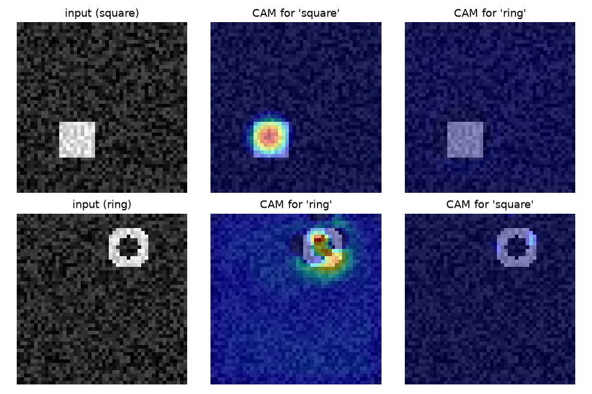

A classifier only says *what* is in an image. Often you also want to know *where* it found the evidence: to debug a model that may be cheating on background cues, to explain a prediction, or to get rough object locations without paying for box labels. Class activation maps (CAM) answer this with almost no extra work. They reuse the classifier's own weights to paint a heatmap over the image, one map per class. Grad-CAM generalizes the idea so it works on any convolutional network, not just ones with a special final layer.

## The architecture CAM needs

CAM was introduced for networks that end like this:

1. convolutional layers that produce $K$ feature maps $f_k(x, y)$ of size $h \times w$,
2. **global average pooling (GAP)**, which turns each map into one number $F_k = \frac{1}{hw}\sum_{x,y} f_k(x,y)$,
3. one linear layer that gives the score (logit) of each class $c$: $S_c = \sum_k w_k^c F_k$.

GAP was popularized by *Network In Network* as a replacement for the large fully connected layers at the end of networks like VGG. It has no parameters, works for any input size, and forces each channel to act like a "detector" whose overall strength is what matters.

## Projecting the weights back

Put the GAP formula into the score and swap the two sums:

$$
S_c = \sum_k w_k^c \frac{1}{hw}\sum_{x,y} f_k(x,y) = \frac{1}{hw}\sum_{x,y} \underbrace{\sum_k w_k^c f_k(x,y)}_{M_c(x,y)}
$$

Here $w_k^c$ is the weight that connects channel $k$ to class $c$, and $M_c(x,y)$ is the **class activation map**. It is a weighted sum of the feature maps, using the class weights. The class score is just the average of $M_c$ over all positions, so $M_c(x, y)$ tells you how much location $(x,y)$ contributes to the decision for class $c$. Nothing is trained for this: the map falls out of the trained classifier.

Because the last feature map is smaller than the input (here by a factor equal to the network's total stride), you upsample $M_c$ to the image size, normalize it, and overlay it as a heatmap.

## A tiny example you can run

To keep it self-contained, here is a small network trained on synthetic images: noise with either a bright square (class "square") or a bright ring (class "ring") at a random place. It reaches 100% accuracy within a few hundred steps on a CPU.

```python
import torch, torch.nn as nn, torch.nn.functional as F

class TinyCAMNet(nn.Module):
    def __init__(self, n_classes=2):
        super().__init__()
        self.features = nn.Sequential(            # total stride 2: 48x48 -> 24x24
            nn.Conv2d(1, 16, 3, padding=1), nn.ReLU(), nn.MaxPool2d(2),
            nn.Conv2d(16, 32, 3, padding=1), nn.ReLU(),
            nn.Conv2d(32, 32, 3, padding=1), nn.ReLU())
        self.fc = nn.Linear(32, n_classes)        # used after global average pooling

    def forward(self, x):
        f = self.features(x)                      # (B, K, h, w)
        return self.fc(f.mean(dim=(2, 3))), f     # logits, feature maps

def cam(model, x, c):
    _, f = model(x)
    w = model.fc.weight[c]                        # (K,) weights for class c
    return torch.einsum("k,khw->hw", w, f[0]).detach()
```

The figure shows the result after training. For the square, the map for "square" lights up the whole square, while the map for "ring" stays dark. For the ring, the map is strongest on part of the ring, not all of it. That is typical: CAM highlights the regions that *discriminate* between the classes, which is not always the whole object.



## Why average pooling and not max pooling

The CAM paper compared GAP with global max pooling (GMP) and found GAP gives better localization. The reason shows up in the gradients. With GAP, every position contributes to the pooled value, so training pushes the network to respond over the full extent of the object. With GMP, only the single strongest position matters, so the network only needs one discriminative spot.

```python
f = torch.rand(1, 1, 4, 4, requires_grad=True)   # one 4x4 feature map
f.mean().backward()                               # GAP
print((f.grad > 0).sum().item())                  # 16: every position gets gradient
f.grad = None
f.amax().backward()                               # GMP
print((f.grad > 0).sum().item())                  # 1: only the max position
```

The classification accuracy of both is similar. The difference is in how much of the object the maps cover.

## Mapping resolution matters

The map can only be as sharp as the last feature map. A $7 \times 7$ map for a $224 \times 224$ image means each cell covers 32 pixels, so the upsampled heatmap is blobby. The CAM authors got better localization by removing the last few layers of VGG or GoogLeNet so the final conv map was larger (about $14 \times 14$), then adding a new conv layer, GAP and a linear layer and fine-tuning. They called this the **mapping resolution**. The trade-off is that shallower features are less semantic. If you want to see what the different depths of a backbone look like, see [Tapping a CNN backbone](/notes/cnn-backbone-feature-extraction/).

## Grad-CAM: weights from gradients

CAM's weakness is the architecture rule. Most networks do not end in GAP plus one linear layer, and you do not want to retrain them. Grad-CAM removes the rule. For any differentiable model and any conv layer with feature maps $A_k$, it sets the importance of channel $k$ for class $c$ to the average gradient of the class score with respect to that channel:

$$
\alpha_k^c = \frac{1}{hw}\sum_{x,y} \frac{\partial S_c}{\partial A_k(x,y)}, \qquad
L^c_{\text{Grad-CAM}} = \mathrm{ReLU}\Big(\sum_k \alpha_k^c A_k\Big)
$$

The ReLU keeps only regions that push the score *up*. Use the score before softmax (the logit). After softmax, raising one class can come from lowering others, which muddies the gradients.

```python
def grad_cam(model, x, c):
    logits, f = model(x)
    f.retain_grad()                         # keep the gradient of a non-leaf tensor
    logits[0, c].backward()                 # d(score_c) / d(feature maps)
    alpha = f.grad[0].mean(dim=(1, 2))      # one weight per channel
    return F.relu(torch.einsum("k,khw->hw", alpha, f[0])).detach()
```

For a GAP-plus-linear network the two methods agree. The gradient of $S_c$ with respect to $f_k(x,y)$ is $w_k^c / (hw)$ at every position, so $\alpha_k^c = w_k^c/(hw)$ and Grad-CAM is exactly $\mathrm{ReLU}(M_c)/(hw)$. On the tiny model above, `torch.allclose(grad_cam(m, x, c), F.relu(cam(m, x, c)) / (h * w))` returns `True`. So CAM is a special case of Grad-CAM.

In a pretrained network you usually pick the **last convolutional layer**. It has the most semantic features and still keeps a spatial layout. Earlier layers give sharper but less class-specific maps. In Keras or PyTorch, the practical step is the same: build a model (or use a hook) that returns both that layer's activations and the logits, then differentiate.

## What CAMs can and cannot tell you

- They are coarse. They show regions, not object boundaries.
- They show what the model uses, not what is "correct". If a classifier learned that boats come with water, the CAM will highlight water. This is exactly why they are useful for debugging.
- They can be turned into rough boxes by thresholding the map (the CAM paper kept the largest connected region above 20% of the maximum). This is the basis of many weakly supervised localization methods. It also inspired counting models that read a heatmap from a network trained only on a count. See [Density maps for counting](/notes/density-maps-for-object-counting/).

## Key takeaways

- With GAP followed by one linear layer, the class score is the spatial average of $M_c = \sum_k w_k^c f_k$, so $M_c$ is a free map of where the evidence is.
- GAP gives better maps than global max pooling because every location receives gradient during training, not only the peak.
- The map's sharpness is limited by the resolution of the last feature map (the mapping resolution).
- Grad-CAM gets the channel weights from averaged gradients, works on any CNN, and reduces to CAM (up to a constant) for GAP-plus-linear heads.
- Use logits rather than softmax outputs, and usually the last conv layer.

## Resources

- Zhou, Khosla, Lapedriza, Oliva, Torralba, [Learning Deep Features for Discriminative Localization](https://arxiv.org/abs/1512.04150), CVPR 2016. The CAM paper, including GAP vs GMP and mapping resolution.
- Selvaraju et al., [Grad-CAM: Visual Explanations from Deep Networks via Gradient-based Localization](https://arxiv.org/abs/1610.02391), ICCV 2017.
- Lin, Chen, Yan, [Network In Network](https://arxiv.org/abs/1312.4400), 2013. Introduces global average pooling as a classifier head.
- François Chollet, [Grad-CAM class activation visualization](https://keras.io/examples/vision/grad_cam/), Keras code examples. The Keras recipe I first followed with a pretrained VGG16.
