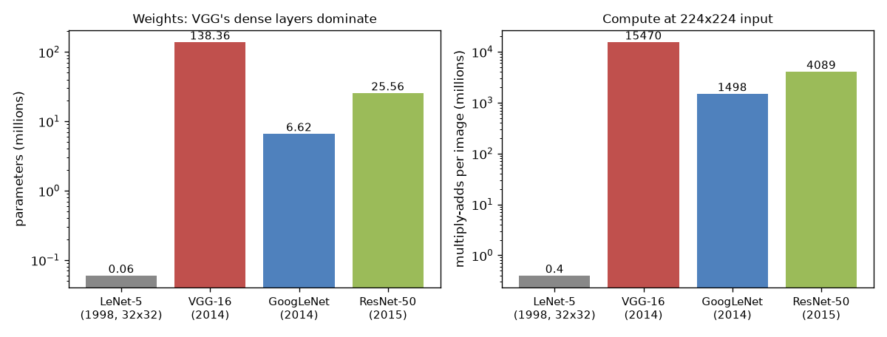

Most image backbones people use today come from four networks: LeNet, VGG, GoogLeNet and ResNet. Each one answered one question. How do you stack convolutions at all? How deep can you go with simple blocks? How do you get more capacity without paying a lot more compute? And how do you train a network with a hundred layers? Rebuilding them by hand was the quickest way for me to see why modern blocks look the way they do. This note is about the architectures. Pulling multi-scale features out of a trained one is in [CNN backbone feature extraction](/notes/cnn-backbone-feature-extraction/).

## The one formula you need: output size

Every conv and pooling layer changes the spatial size by the same rule. For input width $W$, kernel size $K$, padding $P$ and stride $S$:

$$
W_\text{out} = \left\lfloor \frac{W + 2P - K}{S} \right\rfloor + 1
$$

Height works the same way. Two cases come up all the time. With stride 1 and $P = (K-1)/2$ the size stays the same ("same" padding). With stride 2 the size roughly halves.

```python
def out_size(w, k, s=1, p=0):
    """Output width of a conv or pooling layer: floor((W + 2P - K) / S) + 1."""
    return (w + 2 * p - k) // s + 1

print(out_size(512, k=5, s=1, p=2))   # 512: 'same' padding, p = (k-1)/2
print(out_size(32, k=5))              # 28: LeNet's first conv
print(out_size(224, k=7, s=2, p=3))   # 112: ResNet/GoogLeNet stem
print(out_size(112, k=3, s=2, p=1))   # 56: the max-pool after the stem
```

You need this whenever a conv stack ends in a fully connected layer, because the linear layer has to know how many numbers are coming in. Two more counts are handy. A conv layer has $C_\text{in} \cdot K^2 \cdot C_\text{out}$ weights (plus $C_\text{out}$ biases), and it costs about $H_\text{out} W_\text{out} \cdot C_\text{in} K^2 \cdot C_\text{out}$ multiply-adds. The number of weights doesn't depend on image size, but the compute does.

## LeNet-5: the template

LeNet-5 (1998) read 32×32 handwritten digits. Its pattern is still the basic recipe: conv, nonlinearity, downsample, repeat, then a few fully connected layers.

- 5×5 conv to 6 channels: 32 → 28, pool → 14
- 5×5 conv to 16 channels: 14 → 10, pool → 5
- 5×5 conv to 120 channels: 5 → 1, so this last "conv" is really a fully connected layer
- linear 120 → 84 → 10

The whole thing has about 60,000 parameters. My version used ReLU and max-pooling. The original used scaled tanh units and trainable average-pooling ("subsampling"), which was normal back then. The idea doesn't change: early layers see small local patterns, and pooling lets later layers see bigger areas with fewer pixels.

## VGG: depth from small, identical blocks

VGG (2014) asked how far a really plain design can go. It only uses 3×3 convs with padding 1 and 2×2 max-pools, in five stages with 64, 128, 256, 512 and 512 channels. VGG-16 and VGG-19 differ only in how many convs each stage has, so the whole network fits in a short config list like `[64, 64, "M", 128, 128, "M", ...]`, where `"M"` means max-pool.

Why only 3×3? Two stacked 3×3 convs see a 5×5 area, and three see 7×7. Compared with one 7×7 conv with $C$ channels in and out, three 3×3 convs use $3 \cdot 9C^2 = 27C^2$ weights instead of $49C^2$, and you get two extra nonlinearities for free. So basically: more depth, fewer weights.

VGG's weak spot is cost. Its three fully connected layers at the end hold about 124M of its 138M parameters. And running 3×3 convs at full resolution makes it the most expensive of the four to run (about 15.5 billion multiply-adds per 224×224 image).

## GoogLeNet: going wide with 1×1 bottlenecks

GoogLeNet (2014) won ImageNet with about 6.6M parameters, roughly 20 times fewer than VGG-16. Its building block, the **Inception module**, runs four branches side by side on the same input and stacks their outputs along the channel axis:

1. a 1×1 conv
2. a 1×1 conv, then a 3×3 conv
3. a 1×1 conv, then a 5×5 conv
4. a 3×3 max-pool (stride 1), then a 1×1 conv

The branches look at the image at different scales, and the network learns how much to rely on each. (My small `1_cnn.py` experiment did a simple version of this on MNIST: 3×3, 5×5 and 7×7 convs in parallel, concatenated.) Every branch keeps the spatial size, so the outputs can be stacked: `torch.cat([b1, b2, b3, b4], dim=1)`.

The trick that took me a while to appreciate is the 1×1 conv *before* the big filters. A 1×1 conv mixes channels at each pixel without looking at neighbours. So it can squeeze 192 channels down to 16 cheaply, before the expensive 5×5 conv runs:

```python
import torch.nn as nn
n = lambda m: sum(p.numel() for p in m.parameters())
direct = nn.Conv2d(192, 32, 5, padding=2)
reduced = nn.Sequential(nn.Conv2d(192, 16, 1), nn.Conv2d(16, 32, 5, padding=2))
print(n(direct), n(reduced))   # 153632 15920: about 10x fewer weights
```

GoogLeNet also swapped the big dense layers for global average pooling (just average each channel over the whole map), which got rid of most of VGG's parameter cost. On top of that, it hung two small **auxiliary classifiers** off middle layers during training. Their losses (weighted by 0.3) push useful gradient into the middle of the 22-layer network. They're dropped at test time, which is why the model returns three outputs in training mode and one in eval mode.

## ResNet: learning a residual

By 2015 people had hit a weird problem: past a certain depth, adding layers made the *training* error worse, not just the test error. So it isn't overfitting. In theory a deeper network could copy a shallower one and turn the extra layers into the identity (output = input), but plain stacks of conv layers find that surprisingly hard to learn.

ResNet changes what each block has to learn. Instead of $y = F(x)$, a block computes

$$
y = \text{ReLU}\big(F(x) + x\big)
$$

where $F$ is a few conv-BN-ReLU layers, and $x$ goes around them unchanged on a "skip" or "shortcut" connection. The way I think about it: if doing nothing is best, $F$ just has to output zero, which is easy. In the backward pass, the addition passes the gradient straight back to earlier layers, so it doesn't have to squeeze through every layer's weights. That's what let He et al. train networks with 152 layers (and over 1,000 in experiments).

Two details make it work in practice:

- **Shape changes.** When a block halves the resolution or changes the number of channels, $x$ no longer matches $F(x)$. Then the shortcut uses a 1×1 conv with stride 2 (plus BN) to reshape it.
- **The bottleneck block.** ResNet-50 and deeper use 1×1 → 3×3 → 1×1 blocks: cut the channels by 4, do the 3×3 conv in the thin space, then expand back. It's the same 1×1 trick as Inception:

```python
basic = nn.Sequential(nn.Conv2d(256, 256, 3, padding=1), nn.Conv2d(256, 256, 3, padding=1))
bottleneck = nn.Sequential(nn.Conv2d(256, 64, 1), nn.Conv2d(64, 64, 3, padding=1),
                           nn.Conv2d(64, 256, 1))
print(n(basic), n(bottleneck))   # 1180160 70016
```

The overall layout: a 7×7 stride-2 stem, a max-pool, four stages of residual blocks (each stage after the first halves the resolution and doubles the width), global average pooling, and one linear layer.

## Side by side

Counting parameters and multiply-adds with forward hooks on every conv and linear layer gives:

| Network | Year | Parameters | Multiply-adds (224×224) |
|---|---|---|---|
| LeNet-5 | 1998 | 0.06 M | 0.4 M (32×32 input) |
| VGG-16 | 2014 | 138 M | 15.5 G |
| GoogLeNet | 2014 | 6.6 M | 1.5 G |
| ResNet-50 | 2015 | 25.6 M | 4.1 G |



This tripped me up at first: parameters and compute aren't the same thing. VGG's weights are mostly in dense layers that run once, while its compute is in convs that run at every pixel. GoogLeNet and ResNet do better on both by using 1×1 convs and global pooling.

## Key takeaways

- Output size is $\lfloor (W + 2P - K)/S \rfloor + 1$. Use it to size the first dense layer and to check every stage.
- VGG showed that stacking 3×3 convs gives a big receptive field with fewer weights than one large kernel.
- 1×1 convolutions mix channels cheaply. GoogLeNet and ResNet's bottleneck both use them to make large filters affordable.
- Skip connections let a block learn a change to its input instead of a whole new mapping, and that's what made very deep networks trainable.
- Global average pooling replaced huge fully connected heads and is now the default.

## Resources

- LeCun et al., [Gradient-Based Learning Applied to Document Recognition](http://vision.stanford.edu/cs598_spring07/papers/Lecun98.pdf), 1998 (LeNet-5).
- Simonyan and Zisserman, [Very Deep Convolutional Networks for Large-Scale Image Recognition](https://arxiv.org/abs/1409.1556), 2014 (VGG).
- Szegedy et al., [Going Deeper with Convolutions](https://arxiv.org/abs/1409.4842), 2014 (GoogLeNet / Inception).
- He et al., [Deep Residual Learning for Image Recognition](https://arxiv.org/abs/1512.03385), 2015 (ResNet).
- Aladdin Persson, [Machine-Learning-Collection](https://github.com/aladdinpersson/Machine-Learning-Collection): from-scratch PyTorch versions of these networks; my code-alongs followed its style.
- Related note: [CNN backbone feature extraction](/notes/cnn-backbone-feature-extraction/).
