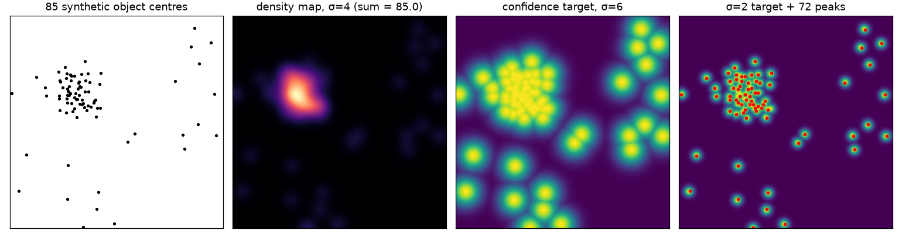

When objects are tiny and packed together (people in a stadium, cells under a microscope, birds in a flock), box detectors struggle. Boxes overlap so much that non-max suppression deletes real objects, and annotating hundreds of boxes per image is slow. A different idea works better: label each object with a single **point**, turn those points into a smooth **map**, and train a fully convolutional network to predict that map. The count, and often the positions, can then be read back from the prediction. This note explains how the target maps are built and how to decode them.

## Two kinds of target map

Both start from point annotations $p_1, \dots, p_N$ and place a 2D Gaussian kernel $G_\sigma$ at each point, but they combine the kernels differently.

A **density map** sums kernels that each integrate to one:

$$
D(x) = \sum_{i=1}^{N} G_{\sigma_i}(x - p_i), \qquad \int G_\sigma = 1 \;\Rightarrow\; \sum_x D(x) = N
$$

Here $x$ is a pixel position and $\sigma_i$ is the spread of the kernel for object $i$. The integral of the map over any region equals the number of objects in it. Counting is just summing the predicted map. This idea goes back to Lempitsky and Zisserman (2010) and is the standard target in crowd counting.

A **confidence map** uses kernels whose peak is 1 and combines them with a maximum, not a sum:

$$
C(x) = \max_i \exp\!\Big(-\frac{\lVert x - p_i\rVert^2}{2\sigma^2}\Big)
$$

Each pixel then means "how likely is an object centre here", and a sigmoid output fits it naturally. Its sum is not the count. You count by finding peaks. The MSS paper (de Arruda et al., 2021) uses this kind of map so it can return positions, not only a number.

```python
import numpy as np

def kernel_at(x, y, sigma, shape):
    yy, xx = np.mgrid[:shape[0], :shape[1]]
    return np.exp(-((xx - x)**2 + (yy - y)**2) / (2 * sigma**2))

def density_map(points, shape, sigma):
    d = np.zeros(shape)
    for x, y in points:
        g = kernel_at(x, y, sigma, shape)
        d += g / g.sum()        # normalize inside the image so edge objects still count as 1
    return d

def confidence_map(points, shape, sigma):
    c = np.zeros(shape)
    for x, y in points:
        c = np.maximum(c, kernel_at(x, y, sigma, shape))   # peak 1, overlaps do not add up
    return c
```

On 85 synthetic points in a $128 \times 128$ image, `density_map(...).sum()` returns 85.0. The common shortcut of putting a 1 at each point and calling `gaussian_filter(..., mode="constant")` returned 83.6 on the same points, because kernels near the border lose the mass that falls outside the image. Renormalizing each kernel (or using a reflecting border) fixes that.



## Choosing sigma

The kernel width is the main design choice.

- **Fixed $\sigma$.** Simple, and fine when all objects have about the same size in pixels (a top-down view at constant scale, cells at fixed magnification).
- **Size-based $\sigma$.** If you have box sizes, tie $\sigma$ to the object size, for example a fraction of the box diagonal.
- **Geometry-adaptive $\sigma$.** When there is perspective, nearby objects appear larger and farther ones smaller and denser. The multi-column CNN paper (Zhang et al., 2016) sets $\sigma_i = \beta \bar d_i$, where $\bar d_i$ is the mean distance from point $i$ to its $k$ nearest neighbours, with $\beta \approx 0.3$ and $k = 3$. Dense areas get narrow kernels and sparse areas get wide ones. Clip it to a sensible minimum, because two almost identical points give $\sigma \approx 0$.

```python
from scipy.spatial import cKDTree

def adaptive_sigmas(points, k=3, beta=0.3, min_sigma=1.0):
    dist, _ = cKDTree(points).query(points, k=k + 1)   # column 0 is the point itself
    return np.maximum(beta * dist[:, 1:].mean(1), min_sigma)
```

Too small a $\sigma$ gives the network an almost impossible, spiky target. Too large a $\sigma$ blurs neighbouring objects into one blob, which is harmless for a density sum but destroys peak-based localization.

## Matching the network's output stride

A backbone usually predicts the map at a lower resolution, for example $1/8$ of the input. The target must be brought to that size **without changing its sum**. Bilinear resizing does not preserve the sum: shrinking by 8 in each direction divides it by roughly 64. Sum-pooling does:

```python
def sum_pool(d, s):
    h, w = d.shape[0] // s, d.shape[1] // s
    return d[:h*s, :w*s].reshape(h, s, w, s).sum(axis=(1, 3))
```

The alternative is to build the target directly at the output resolution by dividing point coordinates and $\sigma$ by the stride. For confidence maps the sum does not matter, so you can build them at low resolution directly, but positions must then be multiplied back by the stride.

## Reading the count and the positions back

**Integration.** For a density map, the predicted count is $\hat N = \sum_x \hat D(x)$. It is robust, handles heavy overlap, and needs no threshold. It gives no positions, though, and a model can reach the right total for the wrong reasons.

**Peak finding.** For a confidence map, an object is a pixel that is a local maximum and above a threshold $\tau$. The MSS paper checks the 4-neighbourhood and uses $\tau = 0.35$. A $3 \times 3$ maximum filter does the same job:

```python
from scipy.ndimage import maximum_filter

def find_peaks(conf, tau=0.35):
    is_max = conf == maximum_filter(conf, size=3)   # local maximum in a 3x3 window
    ys, xs = np.nonzero(is_max & (conf > tau))
    return np.stack([xs, ys], 1)
```

This is the dense-map version of non-max suppression: a peak suppresses its neighbours. Its weakness is shown in the figure. On the ideal $\sigma = 2$ target, it finds 72 of the 85 objects, because centres closer than a couple of pixels merge into one peak. Narrower targets, higher output resolution, or a smaller minimum distance between peaks help. Integration does not suffer from this, so some systems report the integral as the count and use peaks only for locations.

## Architectures built around these maps

**Context with pyramid pooling.** Whether a small blob is an object often depends on its surroundings. The MSS model adds a pyramid pooling module (from PSPNet) after a VGG-style backbone. It pools the feature map into $1\times1$, $2\times2$, $3\times3$ and $6\times6$ grids, applies a $1\times1$ convolution to each, upsamples them back, and concatenates them with the original features. This gives every pixel a summary of the whole image and of its region (dense or sparse). (More on this in [spatial pyramid pooling](/notes/spatial-pyramid-pooling/).)

**Multi-sigma refinement.** Instead of one output, the MSS model predicts $T$ confidence maps in stages. Each stage receives the features plus the previous stage's map. The targets get sharper from stage to stage: stage 1 uses $\sigma_{\max}$, the last stage $\sigma_{\min}$, and the stages in between use evenly spaced values. Early stages learn the easy question "roughly where are objects?" and later stages refine it to exact centres. This is the same coarse-to-fine supervision used in multi-stage pose estimators. Only the last map is decoded.

**Heatmap regulation.** Aich and Stavness start from the simplest counter: a backbone, global average pooling and one linear output that regresses the count. Such a model can learn to hit the right number while looking at the wrong places, for example marking some background to make up for missed objects. Their fix is to take the class activation map that the GAP head already implies (see [class activation maps](/notes/class-activation-maps/)), and add a loss that pulls it towards a Gaussian map built from the point labels. The count head stays the same, but now it has to base its answer on the objects.

**Perspective-aware maps.** For crowds seen from an angle, Zhang et al. (2015) built the density target from a head kernel and a body kernel, scaled by a perspective map, because people are not circles and their size changes with distance. The general lesson: the target kernel should match what one object looks like in the image.

## Key takeaways

- Point labels plus a regressed map are a practical alternative to boxes when objects are small, numerous and overlapping.
- A density map (unit-mass kernels, summed) gives the count by integration. A confidence map (unit-peak kernels, max-combined) gives positions by peak finding.
- Choose $\sigma$ to match the apparent object size: fixed, size-based, or geometry-adaptive from nearest-neighbour distances.
- Keep the count exact: renormalize kernels at image borders and downsample density targets by sum-pooling, not resizing.
- Context (pyramid pooling), coarse-to-fine targets (multi-sigma stages) and supervising where the model looks (heatmap regulation) all improve dense counting.

## Resources

- Lempitsky and Zisserman, [Learning To Count Objects in Images](https://papers.nips.cc/paper/2010/hash/fe73f687e5bc5280214e0486b273a5f9-Abstract.html), NeurIPS 2010. The density-map formulation.
- Zhang et al., [Single-Image Crowd Counting via Multi-Column CNN](https://openaccess.thecvf.com/content_cvpr_2016/papers/Zhang_Single-Image_Crowd_Counting_CVPR_2016_paper.pdf), CVPR 2016. Geometry-adaptive kernels.
- Zhang et al., [Cross-scene Crowd Counting via Deep Convolutional Neural Networks](https://openaccess.thecvf.com/content_cvpr_2015/papers/Zhang_Cross-Scene_Crowd_Counting_2015_CVPR_paper.pdf), CVPR 2015. Perspective-normalized density maps.
- de Arruda et al., [Counting and locating high-density objects using convolutional neural network](https://arxiv.org/abs/2102.04366), 2021. Pyramid pooling, multi-sigma refinement and peak-based localization.
- Aich and Stavness, [Improving Object Counting with Heatmap Regulation](https://arxiv.org/abs/1803.05494), 2018.
- Zhao et al., [Pyramid Scene Parsing Network](https://arxiv.org/abs/1612.01105), CVPR 2017. The pyramid pooling module.
