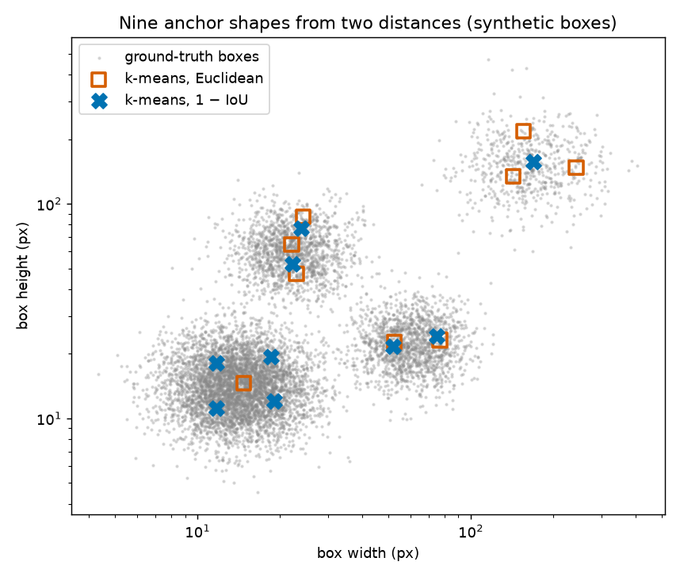

Most detectors ship with anchors tuned on COCO: everyday photos of people, cars and furniture at every size. If your objects are mostly tiny, or long and thin, or all about the same size, those defaults are a bad fit. Few anchors overlap your objects well, so training gets harder and part of the head is wasted. Anchors are just numbers in a config, so fitting them to your own data is cheap. These notes cover the usual tools for that, plus one thing the usual tools ignore: the stride of the feature map the anchors sit on. (What anchors are and how they are matched to objects is in the [anchors and RPN note](/notes/anchors-and-region-proposal-networks/).)

## Step 0: measure the boxes the way the network sees them

Grab the width and height of every ground-truth box in the training set, but **after** whatever resizing, cropping or tiling the training pipeline does. This is easy to forget. If images go from 2000 to 1000 pixels before entering the network, every box shrinks by half, and anchors fitted to the original sizes end up twice too big. Positions don't matter here, only the $(w, h)$ pairs.

To play with this I use a made-up dataset with four groups of objects: lots of small, roughly square ones, some wide and some tall ones, and a few large ones.

```python
import numpy as np

rng = np.random.default_rng(0)

def family(n, w, h, spread):          # boxes scattered log-normally around a typical (w, h)
    return np.exp(rng.normal(np.log([w, h]), spread, size=(n, 2)))

wh = np.vstack([family(5000, 14, 14, 0.30),    # small, roughly square
                family(1500, 60, 22, 0.25),    # wide
                family(1500, 22, 60, 0.25),    # tall
                family(600, 160, 150, 0.30)])  # few, large
groups = {"small": slice(0, 5000), "wide": slice(5000, 6500),
          "tall": slice(6500, 8000), "large": slice(8000, None)}
print(wh.shape, "median w, h:", np.median(wh, 0).round(1))
```

```
(8600, 2) median w, h: [18.1 17.9]
```

## The right distance: 1 − IoU of the shapes

To compare a box and an anchor by shape only, put them on the same centre and compute their IoU (overlap divided by union). Then the overlap is just $\min(w, w_a) \cdot \min(h, h_a)$:

$$
\text{IoU}_{wh} = \frac{\min(w, w_a)\,\min(h, h_a)}{w h + w_a h_a - \min(w, w_a)\,\min(h, h_a)}
$$

YOLOv2 used $d = 1 - \text{IoU}_{wh}$ as the distance in k-means. The reason is scale. With plain Euclidean distance on $(w, h)$, a big box that's 20 pixels off counts the same as a small box that's 20 pixels off. But the first is an almost perfect match and the second is terrible. So Euclidean k-means puts its centres where the absolute spread is biggest, which means among the big boxes. IoU doesn't care about scale: being 20% too wide costs the same at every size.

```python
def iou_wh(wh, anchors):                            # (N, 2), (K, 2) -> (N, K)
    inter = (np.minimum(wh[:, None, 0], anchors[None, :, 0]) *
             np.minimum(wh[:, None, 1], anchors[None, :, 1]))
    return inter / (wh.prod(1)[:, None] + anchors.prod(1)[None, :] - inter)

def kmeans(wh, k, distance="iou", iters=100, seed=0):
    r = np.random.default_rng(seed)
    dist = ((lambda a, c: 1 - iou_wh(a, c)) if distance == "iou"
            else (lambda a, c: ((a[:, None] - c[None]) ** 2).sum(-1)))
    centers = wh[[r.integers(len(wh))]]
    while len(centers) < k:                         # k-means++ seeding: spread the start points
        d = dist(wh, centers).min(1)
        centers = np.vstack([centers, wh[r.choice(len(wh), p=d / d.sum())]])
    for _ in range(iters):                          # Lloyd iterations
        assign = dist(wh, centers).argmin(1)
        new = np.array([wh[assign == j].mean(0) for j in range(k)])
        if np.allclose(new, centers):
            break
        centers = new
    return centers[np.argsort(centers.prod(1))]     # sorted by area

def best_of(wh, k, distance, restarts=5):           # k-means finds local optima: keep the best run
    runs = [kmeans(wh, k, distance, seed=s) for s in range(restarts)]
    return max(runs, key=lambda c: iou_wh(wh, c).max(1).mean())

for distance in ["euclidean", "iou"]:
    c = best_of(wh, 9, distance)
    per_group = {g: float(iou_wh(wh[s], c).max(1).mean().round(2)) for g, s in groups.items()}
    print(f"{distance:9s} mean IoU {iou_wh(wh, c).max(1).mean():.3f}", per_group)
    print("          anchors:", c.round().astype(int).tolist())
```

```
euclidean mean IoU 0.691 {'small': 0.65, 'wide': 0.74, 'tall': 0.77, 'large': 0.74}
          anchors: [[15, 15], [23, 47], [52, 23], [22, 65], [77, 23], [24, 87], [143, 134], [156, 218], [243, 148]]
iou       mean IoU 0.750 {'small': 0.77, 'wide': 0.75, 'tall': 0.74, 'large': 0.65}
          anchors: [[12, 11], [12, 18], [19, 12], [19, 19], [52, 22], [22, 52], [75, 24], [24, 77], [170, 156]]
```

Look at where the anchors went. The Euclidean version gives three of its nine anchors to the large group, which is only 7% of the boxes, and just one anchor to the small group, which is 58%. The IoU version gives the small group four anchors and the large group one. The average box gets a better match, and the per-group numbers are more even.



Two practical things. Plain k-means depends on where it starts, so seed it with k-means++ (which spreads the starting points out) and keep the best of several runs. And the mean IoU always goes up as $k$ grows, but each extra anchor adds output channels to the head and more anchors to label. So pick $k$ at the elbow of the curve, not at the top.

## Scoring a set of anchors: best possible recall and fitness

YOLOv5's AutoAnchor uses a simpler shape match than IoU. For a box and an anchor, take the width ratio and the height ratio. Flip each one into $(0, 1]$ so that "half as big" and "twice as big" score the same. Then keep the worse of the two:

$$
m(b, a) = \min\left(\frac{w}{w_a}, \frac{w_a}{w}, \frac{h}{h_a}, \frac{h_a}{h}\right), \qquad m(b) = \max_a m(b, a)
$$

$m(b) = 1$ means some anchor has exactly the box's shape. If $m(b) < 1/4$, no anchor is within a factor of 4 on both sides, and under YOLOv5's matching rule that box gets no anchor at all. From this you get two scores:

- **Best possible recall (BPR)**: the share of boxes with $m(b) > 1/4$. It's the best recall you could hope for if anchor coverage were the only limit. AutoAnchor recomputes the anchors when BPR drops below 0.98.
- **Fitness**: the mean of $m(b)$, with boxes below the threshold counted as 0. It rewards close matches, not just any match.

```python
def ratio_metric(wh, anchors):
    r = wh[:, None] / anchors[None]                 # (N, K, 2) width and height ratios
    return np.minimum(r, 1 / r).min(2).max(1)       # worse side per anchor, best anchor per box

def best_possible_recall(wh, anchors, thr=0.25):
    return (ratio_metric(wh, anchors) > thr).mean()

def fitness(wh, anchors, thr=0.25):
    m = ratio_metric(wh, anchors)
    return (m * (m > thr)).mean()

def grid(sizes, ratios):                            # FPN-style: every size with every ratio (h / w)
    s, r = np.meshgrid(sizes, ratios)
    return np.stack([s / np.sqrt(r), s * np.sqrt(r)], -1).reshape(-1, 2)

default = grid([32, 64, 128, 256, 512], [0.5, 1.0, 2.0])   # the FPN paper's anchors
print(f"default anchors: BPR {best_possible_recall(wh, default):.3f}, "
      f"fitness {fitness(wh, default):.3f}, mean IoU {iou_wh(wh, default).max(1).mean():.3f}")
```

```
default anchors: BPR 0.992, fitness 0.541, mean IoU 0.397
```

This is why BPR alone isn't enough. The default anchors "cover" 99% of the boxes within a factor of 4, but the average best IoU is only 0.40. Most small boxes get matched to a 32-pixel anchor that's twice too big on each side.

## Tweaking by random mutation

k-means maximises mean IoU with a fixed number of free $(w, h)$ centres. Often you want to optimise something else (like fitness), or keep a fixed structure (like the size × ratio grid an FPN uses). A simple search handles both: randomly scale some parameters by a factor close to 1, keep the change if the score gets better, and repeat. YOLOv5 calls this a genetic algorithm, but there's no population and no crossover. It's really a (1+1) evolution strategy, which is basically random hill climbing.

```python
def evolve(params, build, wh, gens=1000, p=0.9, sigma=0.1, seed=0):
    rng = np.random.default_rng(seed)
    best, f_best = params.copy(), fitness(wh, build(params))
    for _ in range(gens):
        mutate = rng.random(len(best)) < p                     # which parameters change
        factor = np.where(mutate, rng.normal(1.0, sigma, len(best)), 1.0).clip(0.3, 3.0)
        candidate = best * factor                              # unchanged ones keep factor 1
        f = fitness(wh, build(candidate))
        if f > f_best:
            best, f_best = candidate, f
    return best, f_best

build = lambda p: grid(p[:5], p[5:])                # 5 sizes, then 3 aspect ratios
start = np.array([32, 64, 128, 256, 512, 0.5, 1.0, 2.0])
p, f = evolve(start, build, wh)
print("sizes", p[:5].round(1), "ratios", p[5:].round(2))
print(f"fitness {f:.3f}, mean IoU {iou_wh(wh, build(p)).max(1).mean():.3f}")
```

```
sizes [  14.2   35.4  133.7  183.4 1374.6] ratios [0.46 1.02 2.4 ]
fitness 0.769, mean IoU 0.698
```

Watch the line `np.where(mutate, ..., 1.0)`. It's easy to write `normal(...) * mutate` instead, multiplying the random factors by the boolean mask. Then the parameters that should stay the same get a factor of 0, the clip turns that into 0.3, and they shrink every step.

The search moved the smallest size from 32 to 14 and stretched the ratios towards the wide and tall groups. It also shows the method's blind spot. The fifth size drifted to 1375 pixels, and the third and fourth sizes ended up close together. No box is anywhere near 1375 pixels, but the score doesn't care about anchors that match nothing. It only rewards the best anchor for each box. Starting from a good guess (for example from k-means) and putting sane limits on the parameters avoids this.

## What the shape scores ignore: the stride

This is the part that took me a while to see. Both the shape IoU and the ratio score pretend an anchor can sit exactly on every object's centre. In reality anchors sit on a grid, spaced one stride $s$ apart. An object whose centre falls between grid points is up to $s/2$ off in $x$ and in $y$ from the nearest anchor centre. For a square object and a square anchor with the same side $a = m\,s$, that worst-case shift gives

$$
\text{IoU} = \frac{(m - \tfrac12)^2}{2m^2 - (m - \tfrac12)^2}
$$

| anchor side / stride ($m$) | 2 | 3 | 4 | 6 | 8 |
|---|---|---|---|---|---|
| worst-case IoU | 0.39 | 0.53 | 0.62 | 0.73 | 0.78 |

With the usual RPN rule (an anchor counts as positive at IoU $\ge 0.7$), an anchor has to be about **6 to 8 times the stride** for every object of its size to reach that threshold. That's why the FPN anchors are $8\times$ the stride (32 on stride 4, up to 512 on stride 64).

So when you put your data-driven sizes onto a pyramid:

- **Put each size on a level where size/stride is roughly 6 to 8.** Down to about 4 can still work thanks to the "best anchor per object" rule, but below that the grid starts to hurt. One level can hold several sizes, and most frameworks allow that.
- **If your objects are smaller than about $6\times$ the finest stride**, no amount of anchor tuning fixes the grid. For the 14-pixel objects here, even stride 4 gives only $m = 3.5$. The usual fixes are to upscale the input (or tile and upscale, see the [tiling note](/notes/tiling-large-images-for-detection/)), add a finer level, or lower the positive IoU threshold and rely on the "best anchor per object" rule.
- **Levels with no matching sizes** still cost compute. If no object needs stride 64, that level is just overhead.

## Other pitfalls

- **Which way the ratio goes.** Some libraries define the aspect ratio as $h/w$, others as $w/h$. Mix them up and your tall anchors become wide. Check with one anchor before training.
- **Outliers.** A few labeling mistakes (1-pixel boxes, boxes as wide as the image) can drag a k-means centre. Look at the size histogram and drop obvious mistakes, but don't cut real shapes just because they're rare.
- **Fit on the training split** and check BPR on the validation split, like any other fitted setting.
- **Anchor-free detectors** (FCOS, CenterNet, recent YOLO versions) predict boxes from points without anchor templates. They still have a stride, though, so the small-object problem in the table above doesn't go away.

## Key takeaways

- Measure $(w, h)$ after the training resize, then cluster with $d = 1 - \text{IoU}_{wh}$. Euclidean k-means wastes anchors on the biggest boxes.
- Score anchor sets with best possible recall (covered within a factor of 4) and fitness (how close). A high BPR on its own can hide bad matches.
- Random mutation search can tweak anchors for any score and any setup, but it ignores anchors that match nothing, so start from a good guess.
- Anchors need to be roughly 6–8× the stride of their level so objects anywhere on the grid can reach IoU 0.7. Tiny objects need a finer stride or upscaling, not just smaller anchors.

## Resources

- Redmon, Farhadi, "YOLO9000: Better, Faster, Stronger", CVPR 2017, section 2 "Dimension Clusters" (k-means with 1 − IoU). [arXiv:1612.08242](https://arxiv.org/abs/1612.08242)
- Ultralytics YOLOv5 documentation (AutoAnchor, BPR threshold): [docs.ultralytics.com](https://docs.ultralytics.com/yolov5/tutorials/architecture_description/); implementation in [`utils/autoanchor.py`](https://github.com/ultralytics/yolov5/blob/master/utils/autoanchor.py)
- Ren, He, Girshick, Sun, "Faster R-CNN", NeurIPS 2015 (IoU thresholds for anchor labels). [arXiv:1506.01497](https://arxiv.org/abs/1506.01497)
- Lin et al., "Feature Pyramid Networks for Object Detection", CVPR 2017 (anchor size 8× stride per level). [arXiv:1612.03144](https://arxiv.org/abs/1612.03144)
- Arthur, Vassilvitskii, "k-means++: The Advantages of Careful Seeding", SODA 2007. [PDF](https://theory.stanford.edu/~sergei/papers/kMeansPP-soda.pdf)
- Tian, Shen, Chen, He, "FCOS: Fully Convolutional One-Stage Object Detection", ICCV 2019 (an anchor-free alternative). [arXiv:1904.01355](https://arxiv.org/abs/1904.01355)
