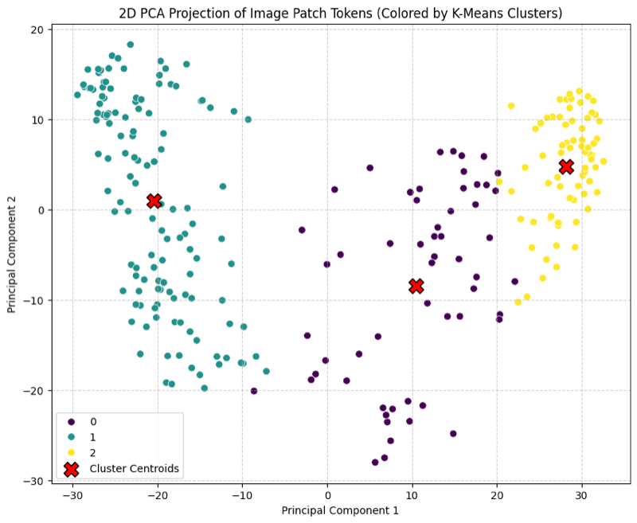

Most vision models learn from labels: someone has to say "cat" or draw a box. DINOv2 learns from raw images alone, and its features are good enough that a single linear layer on top can classify, segment or estimate depth. If you need a strong, general-purpose image backbone and you do not have labels, DINOv2 is one of the first things to try. This note explains how it is trained and how to use its outputs.

## The idea: a student copies a teacher

DINOv2 ("self-**DI**stillation with **NO** labels", version 2) uses two Vision Transformers with the same architecture:

- The **student** is trained with gradient descent.
- The **teacher** gets no gradients. Its weights are an exponential moving average (EMA) of the student's weights.

Both networks see different random views of the same image. The student must predict what the teacher outputs. Because the teacher is a smoothed, slightly older copy of the student, it gives a stable target. The game has no labels, yet it forces the network to describe images in a way that does not change when you crop, flip or recolor them.

The EMA update for each teacher weight $\theta_t$ is

$$
\theta_t \leftarrow m\,\theta_t + (1-m)\,\theta_s
$$

where $\theta_s$ is the matching student weight and $m$ is a momentum close to 1 (DINOv2 raises it from 0.992 towards 1 with a cosine schedule).

```python
@torch.no_grad()
def update_teacher(student, teacher, m=0.992):
    for p_s, p_t in zip(student.parameters(), teacher.parameters()):
        p_t.mul_(m).add_((1 - m) * p_s)
```

## Views: global and local crops

Each image becomes several crops (multi-crop augmentation):

- **2 global crops**: large crops (more than about a third of the image), resized to 224×224.
- **Several local crops** (typically 8): small crops, resized to 98×98 in DINOv2 (96×96 in the original DINO).

The teacher only sees the global crops. The student sees all of them. So the student has to infer the content of the whole scene from a small piece, which pushes it to learn "local-to-global" correspondences.

```python
import torchvision.transforms as T

norm = T.Normalize([0.485, 0.456, 0.406], [0.229, 0.224, 0.225])
global_tf = T.Compose([T.RandomResizedCrop(224, scale=(0.32, 1.0)),
                       T.RandomHorizontalFlip(), T.ColorJitter(0.4, 0.4, 0.2, 0.1),
                       T.ToTensor(), norm])
local_tf = T.Compose([T.RandomResizedCrop(98, scale=(0.05, 0.32)),
                      T.RandomHorizontalFlip(), T.ColorJitter(0.4, 0.4, 0.2, 0.1),
                      T.ToTensor(), norm])
```

## The backbone: a Vision Transformer with patch size 14

The image is cut into 14×14-pixel patches. A convolution with kernel size and stride both equal to 14 does this cut and the linear projection in one step. A learnable `[CLS]` token is put in front of the patch tokens, and positional embeddings are added. For a 224×224 input this gives $16 \times 16 = 256$ patch tokens plus one `[CLS]` token, so 257 tokens.

After the transformer:

- the **`[CLS]` token** summarizes the whole image (good for classification and retrieval);
- the **patch tokens** describe each local region (good for segmentation and depth).

## Three losses

### 1. DINO loss (image level)

The `[CLS]` outputs of student and teacher go through a projection head that produces scores over $K$ "prototypes" (e.g., $K = 65{,}536$). Each score vector becomes a probability distribution with a softmax at temperature $\tau$:

$$
P(x)^{(k)} = \frac{\exp(g(x)^{(k)}/\tau)}{\sum_{j=1}^{K} \exp(g(x)^{(j)}/\tau)}
$$

Here $g(x)^{(k)}$ is the head's score for prototype $k$. The loss is the cross-entropy $-\sum_k P_t^{(k)} \log P_s^{(k)}$ between the teacher distribution $P_t$ (from one view) and the student distribution $P_s$ (from a *different* view). The teacher uses a low temperature (sharper targets). In the original DINO, the teacher outputs are also **centered** (a running mean is subtracted) so that one prototype cannot win every time. DINOv2 replaces centering with Sinkhorn-Knopp normalization (from SwAV), which balances how often each prototype is used.

```python
import torch.nn.functional as F

def dino_loss(student_logits, teacher_logits, center, t_s=0.1, t_t=0.04):
    # student and teacher logits come from DIFFERENT views of the same image
    p_t = F.softmax((teacher_logits - center) / t_t, dim=-1).detach()
    log_p_s = F.log_softmax(student_logits / t_s, dim=-1)
    return -(p_t * log_p_s).sum(dim=-1).mean()
```

### 2. iBOT loss (patch level)

Some patches of the student's global crops are **masked**: their embeddings are replaced by a learnable mask token (they are not dropped, as in MAE). The teacher sees the same crop without masking. For every masked position, the student must predict the teacher's patch distribution at that position, using the same kind of cross-entropy. This is masked image modeling, the visual version of BERT, and it is what makes the patch features useful for dense tasks.

```python
def mask_patches(x, mask_token, ratio=0.5):
    # x: (B, N, D) patch embeddings, mask_token: (1, 1, D) learnable
    B, N, _ = x.shape
    mask = torch.rand(B, N, device=x.device) < ratio      # True = masked
    x = torch.where(mask.unsqueeze(-1), mask_token.expand(B, N, -1), x)
    return x, mask
```

DINOv2 uses **separate (untied) heads** for the DINO and iBOT losses. The paper found this works better at scale than sharing one head.

### 3. KoLeo regularizer (spread the features)

A self-supervised model can "cheat" by mapping every image to almost the same vector. The KoLeo regularizer, based on the Kozachenko-Leonenko entropy estimator, pushes features in a batch apart:

$$
\mathcal{L}_{\text{KoLeo}} = -\frac{1}{n}\sum_{i=1}^{n} \log d_{n,i}, \qquad d_{n,i} = \min_{j \neq i} \lVert x_i - x_j \rVert
$$

Here $x_i$ is the L2-normalized `[CLS]` feature of image $i$, $n$ is the batch size and $d_{n,i}$ is the distance to its nearest neighbor in the batch. If two features get close, the log of a small number is very negative, so the loss grows.

```python
def koleo(x, eps=1e-8):
    x = F.normalize(x, dim=-1)
    d = torch.cdist(x, x)
    d.fill_diagonal_(float("inf"))          # ignore distance to itself
    return -torch.log(d.min(dim=1).values + eps).mean()
```

The total loss is $\mathcal{L}_{\text{DINO}} + \mathcal{L}_{\text{iBOT}} + \lambda\,\mathcal{L}_{\text{KoLeo}}$ with a small $\lambda$ (0.1).

## What else changed from DINO to DINOv2

- **Data**: LVD-142M, 142 million images selected automatically from a large uncurated pool by retrieving images similar to curated datasets and removing near-duplicates.
- **Scale**: the largest model is ViT-g (about 1.1B parameters, with SwiGLU feed-forward layers). Smaller models (ViT-S/B/L) are *distilled* from it, not trained from scratch.
- **High-resolution finish**: for a short period at the end of training, the resolution goes up to 518×518. More pixels means more patches, so the model learns finer detail.

## Using a pretrained DINOv2

With Hugging Face Transformers, extracting features takes a few lines. I used the COCO image of two cats on a sofa.

```python
from transformers import AutoImageProcessor, AutoModel
import torch

processor = AutoImageProcessor.from_pretrained("facebook/dinov2-small")
model = AutoModel.from_pretrained("facebook/dinov2-small")

inputs = processor(images=image, return_tensors="pt")   # resize 256, center-crop 224
with torch.no_grad():
    out = model(**inputs)

tokens = out.last_hidden_state          # (1, 257, 384)
cls, patches = tokens[:, 0], tokens[:, 1:]
feature_map = patches.transpose(1, 2).unflatten(2, (16, 16))   # (1, 384, 16, 16)
```

The last line turns the 256 patch tokens back into a 16×16 grid with 384 channels. It now looks like a CNN feature map, so you can attach a segmentation head, or take tokens from several intermediate blocks to build a feature pyramid for a detector such as Mask R-CNN.

A quick check of feature quality: run k-means (3 clusters) on the 256 patch vectors and project them with PCA. The patches fall into three clearly separated groups, without any training on my side. Mapping the cluster labels back onto the 16×16 grid is a simple way to get a rough, unsupervised segmentation.



Two practical warnings from my experiments:

1. The processor **center-crops** the image. If you overlay a 16×16 attention or similarity map on the full original image, it will be misaligned. Overlay it on the cropped image, or turn off cropping.
2. Attention maps from the **first** layer mostly show low-level patterns. The object-like attention maps that DINO is known for appear in the **last** layer (`outputs.attentions[-1]`).

## Key takeaways

- DINOv2 learns by making a student match an EMA teacher across different crops of the same image; no labels are needed.
- The DINO loss works on the `[CLS]` token (global meaning); the iBOT loss works on masked patch tokens (local detail); KoLeo keeps features spread out.
- Teacher centering or Sinkhorn-Knopp normalization, sharpening and the EMA update together prevent collapse.
- The patch tokens can be reshaped into a 2D feature map and used directly for dense tasks.
- Curated data at scale and a short high-resolution phase are a large part of why DINOv2 works so well.

## Resources

- Oquab et al., "DINOv2: Learning Robust Visual Features without Supervision", TMLR 2024. [arXiv:2304.07193](https://arxiv.org/abs/2304.07193)
- Caron et al., "Emerging Properties in Self-Supervised Vision Transformers" (DINO), ICCV 2021. [arXiv:2104.14294](https://arxiv.org/abs/2104.14294)
- Zhou et al., "iBOT: Image BERT Pre-Training with Online Tokenizer", ICLR 2022. [arXiv:2111.07832](https://arxiv.org/abs/2111.07832)
- Sablayrolles et al., "Spreading vectors for similarity search" (KoLeo), ICLR 2019. [arXiv:1806.03198](https://arxiv.org/abs/1806.03198)
- Official code: [facebookresearch/dinov2](https://github.com/facebookresearch/dinov2)
- Hugging Face docs: [DINOv2](https://huggingface.co/docs/transformers/model_doc/dinov2) and the model card [facebook/dinov2-small](https://huggingface.co/facebook/dinov2-small)
