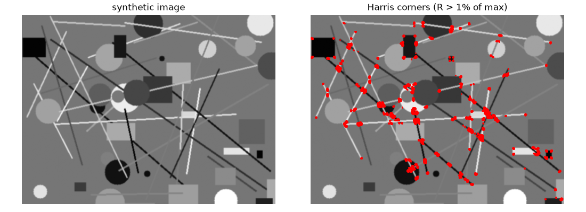
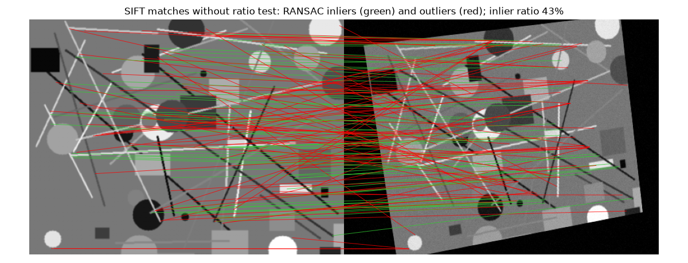

To align two photos of the same scene you need to know which point in one image is the same physical point in the other. Doing this for every pixel is hard; doing it for a few hundred distinctive points is easy and is enough to estimate a transformation such as a homography. The classic recipe has four steps: **detect** keypoints, **describe** each one with a vector, **match** the vectors, and **estimate** the transformation robustly with RANSAC, because some matches will always be wrong. I tried this with ORB and SIFT in OpenCV. Here I rebuild it on a synthetic image warped by a known homography, so the answer can be checked.

## What makes a good keypoint

A good keypoint can be found again after the image is shifted, rotated, scaled or relit. A flat region fails (it looks the same everywhere), and so does a point on a straight edge (it can slide along the edge). A **corner**, where the intensity changes in two directions, is well localised.

Harris and Stephens turned this into a formula. Shift a small window by $(\Delta x, \Delta y)$; the change in intensity is approximately $[\Delta x\ \Delta y]\,\mathbf{M}\,[\Delta x\ \Delta y]^\top$, where

$$
\mathbf{M} = \sum_{\text{window}} w(x, y) \begin{bmatrix} I_x^2 & I_x I_y \\ I_x I_y & I_y^2 \end{bmatrix}
$$

is the **structure tensor**: $I_x$ and $I_y$ are the image gradients and $w$ is a Gaussian window. Its eigenvalues $\lambda_1, \lambda_2$ say how fast the intensity changes in the two principal directions. Both small means flat, one large means edge, both large means corner. To avoid computing eigenvalues, Harris uses

$$
R = \det \mathbf{M} - k\,(\operatorname{tr} \mathbf{M})^2 = \lambda_1\lambda_2 - k(\lambda_1 + \lambda_2)^2, \qquad k \approx 0.04\text{–}0.06,
$$

which is large and positive at corners, negative on edges and near zero in flat regions.

```python
import numpy as np, cv2

def harris(gray, sigma=1.5, k=0.05):
    g = gray.astype(np.float64)
    Ix = cv2.Sobel(g, cv2.CV_64F, 1, 0, ksize=3)
    Iy = cv2.Sobel(g, cv2.CV_64F, 0, 1, ksize=3)
    Sxx = cv2.GaussianBlur(Ix * Ix, (0, 0), sigma)   # structure tensor entries,
    Syy = cv2.GaussianBlur(Iy * Iy, (0, 0), sigma)   # averaged over a Gaussian window
    Sxy = cv2.GaussianBlur(Ix * Iy, (0, 0), sigma)
    return Sxx * Syy - Sxy**2 - k * (Sxx + Syy)**2   # > 0 corner, < 0 edge, ~0 flat
```



Harris is rotation invariant (eigenvalues do not change with rotation) but not scale invariant: a corner at one zoom level can look like a smooth curve at another.

## SIFT: scale invariance and a gradient-histogram descriptor

Lowe's SIFT adds scale. It blurs the image with Gaussians of increasing $\sigma$ and subtracts neighbouring levels, giving a **Difference-of-Gaussians** (DoG) stack, a cheap approximation of the scale-normalised Laplacian. Keypoints are local extrema in $x$, $y$ and scale, so each comes with its own characteristic size. Low-contrast points and points on edges are removed.

Each keypoint then gets a **dominant orientation** from a histogram of gradient directions around it. The descriptor is computed in a patch rotated to that orientation and scaled to the keypoint size: a $4 \times 4$ grid of cells, each with an 8-bin histogram of gradient orientations, giving $4 \times 4 \times 8 = 128$ numbers. The vector is normalised (and clipped at 0.2, then renormalised) to reduce the effect of lighting changes. The result is invariant to rotation and scale and robust to moderate viewpoint and illumination changes. Its patent expired in 2020, and it is now in the main OpenCV package.

## ORB: fast binary features

ORB was designed as a free, fast alternative. It detects corners with **FAST** (a pixel is a corner if a long enough arc of the 16 pixels on a circle around it is all brighter or all darker), ranks them with the Harris score, and builds an image pyramid for scale. Orientation comes from the **intensity centroid** of the patch. The descriptor is **rotated BRIEF**: 256 binary tests of the form "is pixel $p$ brighter than pixel $q$?" on a smoothed patch, stored as 32 bytes. Comparing two binary descriptors needs only an XOR and a bit count, which is much faster than a 128-D float distance.

## Matching descriptors

For each descriptor in image 1, find the nearest descriptor in image 2. Use the right distance:

- **L2 (Euclidean)** for float descriptors such as SIFT;
- **Hamming** (number of differing bits) for binary descriptors such as ORB, BRIEF and AKAZE.

Nearest-neighbour matching alone gives many wrong matches, because every descriptor gets a partner even if its true partner is not visible. Two common filters:

- **Lowe's ratio test**: find the two nearest neighbours and keep the match only if $d_1 < r\,d_2$, with $r$ around 0.7–0.8. A correct match is usually much closer than the second-best candidate; an ambiguous one (repeated texture) is not.
- **Cross-check**: keep a match only if $a$'s nearest neighbour is $b$ *and* $b$'s nearest neighbour is $a$.

```python
def ratio_matches(d1, d2, norm, ratio=0.75):
    bf = cv2.BFMatcher(norm)                 # cv2.NORM_L2 for SIFT, cv2.NORM_HAMMING for ORB
    good = []
    for m, n in bf.knnMatch(d1, d2, k=2):
        if m.distance < ratio * n.distance:  # best clearly better than second best
            good.append(m)
    return good
```

On the synthetic pair (the second image is the first warped by a known homography plus noise), I measured how many matches were truly correct, meaning within 3 pixels of where the known homography sends the point:

| Matches | Count | Correct |
|---|---|---|
| SIFT, plain nearest neighbour | 1082 | 43% |
| SIFT, ratio test 0.75 | 440 | 86% |
| ORB, ratio test 0.8 | 489 | 92% |

The ratio test throws away more than half of the matches but most of the wrong ones. Still, even 10% wrong matches would ruin a least-squares fit. That is the job of RANSAC.

## RANSAC

RANdom SAmple Consensus (Fischler and Bolles, 1981) fits a model to data that contains many outliers:

1. Pick a **minimal sample** at random: 4 matches for a homography (see the [geometric transformations note](/notes/geometric-transformations-and-homographies/) for why 4).
2. Fit the model to that sample exactly (the DLT).
3. Count **inliers**: matches whose reprojection error $\lVert \mathbf{H}\mathbf{p}_i - \mathbf{q}_i \rVert$ is below a threshold, typically 1–5 pixels.
4. Repeat, keep the model with the most inliers, and finally refit on all its inliers by least squares.

```python
def ransac_homography(src, dst, thresh=3.0, iters=2000, rng=np.random.default_rng(0)):
    best = np.zeros(len(src), bool)
    for _ in range(iters):
        idx = rng.choice(len(src), 4, replace=False)         # minimal sample
        H = dlt(src[idx], dst[idx])                          # exact fit to 4 pairs
        err = np.linalg.norm(project(H, src) - dst, axis=1)  # reprojection error
        inliers = err < thresh
        if inliers.sum() > best.sum():
            best = inliers
    return dlt(src[best], dst[best]), best                   # refit on all inliers
```

Here `dlt` is the four-point homography solver from the geometric transformations note and `project` applies $\mathbf{H}$ and divides by the third coordinate. How many iterations are enough? If a fraction $w$ of matches are inliers, a random sample of $s$ matches is all-inlier with probability $w^s$. To find at least one clean sample with probability $p$, you need

$$
N = \frac{\log(1 - p)}{\log(1 - w^s)}.
$$

With $p = 0.99$ and $s = 4$: $w = 0.9$ needs 5 iterations, $w = 0.5$ needs 72, $w = 0.3$ needs 567, and $w = 0.1$ needs about 46,000. The cost explodes as inliers become rare, which is why cleaning matches with the ratio test first is worth it. Implementations usually update $N$ on the fly from the best inlier ratio found so far.

To stress-test it, I fed RANSAC the plain nearest-neighbour SIFT matches, with only 43% correct. It still found the right model:

```text
H_true                     H_RANSAC (own)              H_RANSAC (OpenCV)
[ 0.9     0.15   30.  ]    [ 0.8989  0.1488  30.27]    [ 0.8995  0.1505  30.04]
[-0.1     0.95   40.  ]    [-0.0999  0.9483  40.22]    [-0.1007  0.9509  40.09]
[ 0.0002  0.0001  1.  ]    [ 0.0002  0.0001   1.  ]    [ 0.0002  0.0001   1.  ]
```

The mean disagreement between the true and estimated mapping over the image was 0.15 pixels. OpenCV's `findHomography(src, dst, cv2.RANSAC, 3.0)` gives almost the same result; it also normalises the points and refines the final model with Levenberg–Marquardt, which is why it is slightly closer.



## Registering the image

With $\mathbf{H}$ in hand, `cv2.warpPerspective(img1, H, (w, h))` resamples image 1 into the frame of image 2 (by inverse mapping, as explained in the geometric transformations note). In the test, the mean absolute difference between the warped image and the target inside the overlap was 3.5 grey levels, close to the added noise.

Two limits to keep in mind. First, a single homography is only correct for a planar scene or a camera that only rotates; for a 3D scene seen from two positions you need the fundamental or essential matrix, also estimated with RANSAC. Second, RANSAC fails when inliers are very rare or when a wrong model gets more support than the right one, for example with strongly repeated texture. Variants such as PROSAC (which samples good matches first), LO-RANSAC, MAGSAC and OpenCV's `USAC_MAGSAC` flag address these cases. Learned detectors and matchers (SuperPoint, LightGlue, LoFTR) now replace hand-crafted features in hard conditions, but the RANSAC step usually remains.

## Key takeaways

- Corners are good keypoints because intensity changes in two directions; the Harris score measures this with the eigenvalues of the structure tensor.
- SIFT adds scale (DoG extrema) and a 128-D gradient-histogram descriptor; ORB is a fast binary alternative built on FAST and rotated BRIEF.
- Match float descriptors with L2 and binary ones with Hamming distance, then filter with the ratio test or cross-check.
- RANSAC fits a homography from random 4-point samples and keeps the one with the most inliers; the number of iterations grows quickly as the inlier ratio drops.
- Always refit on all inliers at the end, and remember that one homography only fits a plane or a pure rotation.

## Resources

- David G. Lowe, [Distinctive Image Features from Scale-Invariant Keypoints](https://www.cs.ubc.ca/~lowe/papers/ijcv04.pdf), IJCV 60(2), 2004.
- Ethan Rublee, Vincent Rabaud, Kurt Konolige and Gary Bradski, *ORB: An efficient alternative to SIFT or SURF*, ICCV 2011.
- Chris Harris and Mike Stephens, *A Combined Corner and Edge Detector*, Alvey Vision Conference, 1988.
- Martin A. Fischler and Robert C. Bolles, *Random Sample Consensus*, Communications of the ACM 24(6), 1981.
- Richard Szeliski, [*Computer Vision: Algorithms and Applications*](https://szeliski.org/Book/), 2nd ed., 2022: Chapter 7 and Section 8.1.
- Richard Hartley and Andrew Zisserman, *Multiple View Geometry in Computer Vision*, 2nd ed., 2004: Section 4.7 (robust estimation).
- [OpenCV feature detection and description tutorials](https://docs.opencv.org/4.x/db/d27/tutorial_py_table_of_contents_feature2d.html) and the `findHomography` documentation.
- Related notes: [2D geometric transformations and homographies](/notes/geometric-transformations-and-homographies/), [linear filters and the Gaussian blur](/notes/linear-filters-and-gaussian-blur/).
