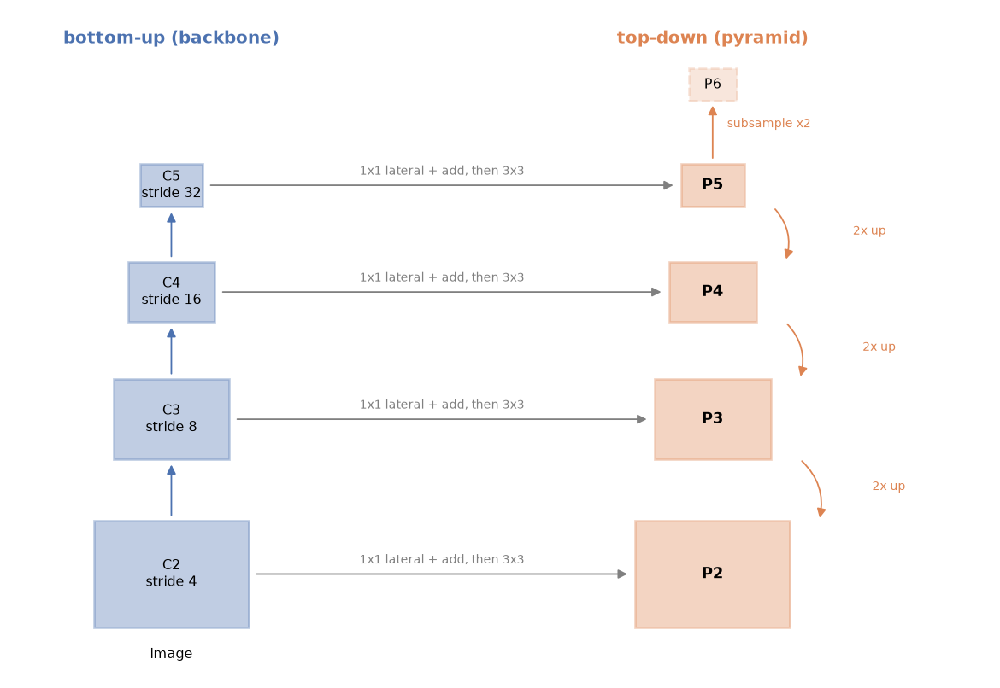

A photo can hold a 20-pixel bird and a 600-pixel bus at the same time. A detector has to find both with one set of weights. A convolutional backbone gives fine, high-resolution maps early on and coarse, semantically rich maps at the end, but no single map is good at both jobs. A Feature Pyramid Network (FPN) fixes this cheaply: it mixes the deep, meaningful features back into the high-resolution maps, so every scale gets features that are both sharp and meaningful.

## The scale problem and three older answers

Objects in real images vary in size by a factor of 30 or more. Before FPN there were three common answers, each with a cost:

1. **Image pyramid.** Resize the image to several scales and run the whole network on each. It works well, but inference time and memory grow with every extra scale.
2. **Single deep feature map.** Use only the last backbone map (stride 16 or 32), as the first Faster R-CNN did. It is fast, but a 16-pixel object covers less than one cell of a stride-32 map, so small objects are mostly lost.
3. **Predict from several backbone stages directly**, as SSD does. This is free, because the backbone already computes those maps. The problem is that the early maps have high resolution but weak semantics: they have only passed through a few layers, so they respond to edges and textures more than to "car" or "dog".

FPN keeps the cost of option 3 and removes its weakness.

## Bottom-up, top-down, and lateral connections

A backbone such as ResNet is the **bottom-up pathway**. Its stages output maps $C_2, C_3, C_4, C_5$ with strides 4, 8, 16 and 32 relative to the input. The stride is the spacing, in input pixels, between neighbouring cells of a map. (How to pull these maps out of a backbone is covered in the [backbone note](/notes/cnn-backbone-feature-extraction/).)

FPN adds a **top-down pathway**. It starts at the coarsest map and walks back down to finer resolutions:

1. A **lateral** $1\times1$ convolution maps each $C_i$ to a common width, usually 256 channels.
2. The running top-down map is **upsampled by 2** (nearest neighbour) to the size of the next finer level.
3. The two are **added** element by element.
4. A $3\times3$ convolution **smooths** the sum. The FPN paper adds it to reduce the aliasing caused by upsampling. Its output is the pyramid level $P_i$.

In symbols, with $M_5 = L_5(C_5)$:

$$
M_i = L_i(C_i) + \text{Up}_2(M_{i+1}), \qquad P_i = S_i(M_i)
$$

where $L_i$ is the lateral $1\times1$ conv, $\text{Up}_2$ is $2\times$ nearest-neighbour upsampling and $S_i$ is the $3\times3$ smoothing conv. The lateral path brings precise location (where edges are). The top-down path brings meaning (what the thing is). Each $P_i$ gets both.



Many detectors add a coarser level. Faster R-CNN with FPN makes $P_6$ by subsampling $P_5$ with stride 2, and uses it only for proposing very large boxes. RetinaNet instead makes $P_6$ and $P_7$ with stride-2 $3\times3$ convolutions starting from $C_5$.

## A minimal FPN in PyTorch

The module below is the whole idea. The backbone features are random tensors with the shapes a ResNet-50 produces for a $512\times512$ input, so the snippet runs without downloading weights.

```python
import torch, torch.nn as nn, torch.nn.functional as F

class FPN(nn.Module):
    def __init__(self, in_channels=(256, 512, 1024, 2048), out_channels=256):
        super().__init__()
        self.lateral = nn.ModuleList(nn.Conv2d(c, out_channels, 1) for c in in_channels)
        self.smooth = nn.ModuleList(nn.Conv2d(out_channels, out_channels, 3, padding=1)
                                    for _ in in_channels)

    def forward(self, feats):                      # feats = [C2, C3, C4, C5], fine -> coarse
        m = self.lateral[-1](feats[-1])            # start at the top: M5
        outs = [self.smooth[-1](m)]                # P5
        for c, lat, smooth in zip(feats[-2::-1], self.lateral[-2::-1], self.smooth[-2::-1]):
            m = lat(c) + F.interpolate(m, size=c.shape[-2:], mode="nearest")
            outs.insert(0, smooth(m))              # P4, P3, P2
        outs.append(F.max_pool2d(outs[-1], kernel_size=1, stride=2))  # P6: every 2nd cell of P5
        return outs                                # [P2, P3, P4, P5, P6]

H = W = 512
feats = [torch.randn(1, c, H // s, W // s)
         for c, s in zip((256, 512, 1024, 2048), (4, 8, 16, 32))]
with torch.no_grad():
    pyramid = FPN()(feats)
for name, p in zip(["P2", "P3", "P4", "P5", "P6"], pyramid):
    print(name, tuple(p.shape), "stride", H // p.shape[-1])
```

Output:

```
P2 (1, 256, 128, 128) stride 4
P3 (1, 256, 64, 64) stride 8
P4 (1, 256, 32, 32) stride 16
P5 (1, 256, 16, 16) stride 32
P6 (1, 256, 8, 8) stride 64
```

Two details matter in practice. First, upsampling to `c.shape[-2:]` instead of a fixed factor 2 keeps the module working when the input side is not a multiple of 32 (odd sizes round differently at each stage). Second, a max-pool with kernel 1 and stride 2 is not really pooling: it just keeps every second cell. That is exactly the "subsample $P_5$" rule from the paper.

## Same width everywhere means shared heads

Every $P_i$ has the same number of channels. This is a deliberate design choice. Because the levels look alike, one detection head can run on all of them with the **same weights**, like an image pyramid but computed inside the network. The head learns "what an object looks like relative to the cell size", and the level choice takes care of absolute size. Sharing also means the head sees training examples from every level, which helps rare sizes.

## Which level handles which object size

A pyramid is only useful if each object is handled at a suitable level. There are two places where this decision is made.

**Anchors and dense heads.** In an RPN or RetinaNet, each level gets anchors of one base size, scaled with its stride. The FPN paper uses anchor areas $32^2, 64^2, 128^2, 256^2, 512^2$ on $P_2$ to $P_6$: the anchor side is 8 times the stride. Small objects are matched to fine levels simply because only small anchors there overlap them well. This is covered in the [anchors and RPN note](/notes/anchors-and-region-proposal-networks/).

**Region features in two-stage detectors.** After proposals are made, each region of interest (RoI) of width $w$ and height $h$ is pooled from one level $k$:

$$
k = \left\lfloor k_0 + \log_2\!\left(\frac{\sqrt{wh}}{224}\right) \right\rfloor
$$

Here 224 is the ImageNet pre-training size and $k_0 = 4$, so a $224\times224$ box reads from $P_4$. Halving the box side moves it one level finer; doubling it moves one level coarser. The result is clamped to the available levels ($P_2$ to $P_5$; $P_6$ is used only for proposals).

```python
import math

def roi_level(w, h, k0=4, canonical=224, k_min=2, k_max=5):
    k = math.floor(k0 + math.log2(math.sqrt(w * h) / canonical + 1e-8))
    return min(max(k, k_min), k_max)

for side in [16, 64, 112, 160, 224, 448, 900]:
    print(f"{side:4d} px box -> P{roi_level(side, side)}")
```

```
  16 px box -> P2
  64 px box -> P2
 112 px box -> P3
 160 px box -> P3
 224 px box -> P4
 448 px box -> P5
 900 px box -> P5
```

The rule keeps the pooled grid (for example $7\times7$) at a similar number of cells per object, whatever the object size. If your objects are all small, most RoIs land on $P_2$ and the coarse levels do little work. That is worth knowing when you choose input resolution or think about removing levels.

## Trade-offs and later variants

- **Cost.** FPN adds a few convolutions, but the heads now run on many more cells. $P_2$ alone has 16 times as many cells as $P_4$. Most of the detector's time and memory on large images goes into the finest level.
- **Information flows only top-down.** Fine levels get semantics from above, but coarse levels never get precise localisation from below. PANet adds an extra bottom-up path after the FPN to fix that, and BiFPN (EfficientDet) repeats weighted top-down and bottom-up passes.
- **Nearest-neighbour upsampling** is simple and has no parameters. The $3\times3$ smoothing conv cleans up its blocky output.

## Key takeaways

- Early backbone maps are sharp but semantically weak; late maps are meaningful but coarse. FPN gives every level both.
- The recipe: $1\times1$ lateral conv, $2\times$ upsample from above, add, then $3\times3$ smoothing conv.
- All levels have the same channel count, so one head with shared weights runs on every level.
- Object size picks the level: anchor sizes grow with stride (about 8× stride), and RoIs use $k = \lfloor 4 + \log_2(\sqrt{wh}/224) \rfloor$.
- The finest level dominates compute; coarse levels may be nearly idle if all your objects are small.

## Resources

- Lin, Dollár, Girshick, He, Hariharan, Belongie, "Feature Pyramid Networks for Object Detection", CVPR 2017. [arXiv:1612.03144](https://arxiv.org/abs/1612.03144)
- Ren, He, Girshick, Sun, "Faster R-CNN: Towards Real-Time Object Detection with Region Proposal Networks", NeurIPS 2015. [arXiv:1506.01497](https://arxiv.org/abs/1506.01497)
- Lin, Goyal, Girshick, He, Dollár, "Focal Loss for Dense Object Detection" (RetinaNet, $P_6$/$P_7$ from $C_5$), ICCV 2017. [arXiv:1708.02002](https://arxiv.org/abs/1708.02002)
- Liu, Qi, Qin, Shi, Jia, "Path Aggregation Network for Instance Segmentation", CVPR 2018. [arXiv:1803.01534](https://arxiv.org/abs/1803.01534)
- `torchvision.ops.FeaturePyramidNetwork`, a ready-made implementation: [PyTorch docs](https://pytorch.org/vision/stable/generated/torchvision.ops.FeaturePyramidNetwork.html)
- Related notes: [backbone feature extraction](/notes/cnn-backbone-feature-extraction/), [panoptic segmentation](/notes/panoptic-segmentation/) (Panoptic FPN builds on this pyramid).
