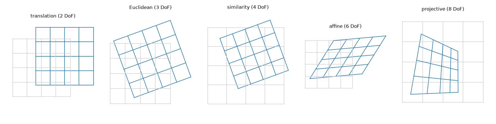
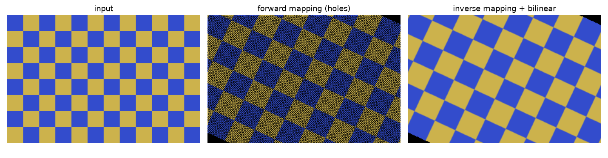
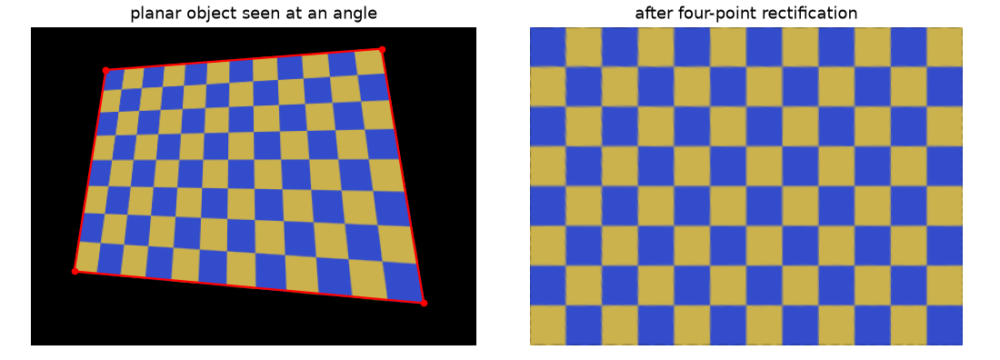

Rotating a photo, straightening a scanned page, lining up two overlapping images, or putting an image onto a map: these all turn out to be the same thing. You move every pixel with a $3 \times 3$ matrix. Once I saw all the 2D transformations as special cases of one matrix, it got much clearer how many points you need to estimate each one, and what each one does to straight lines, angles and parallel lines. I wrote small scripts for translation, rotation, affine and perspective transforms, first in plain NumPy and then with OpenCV, following the TheAILearner tutorials. The plain NumPy version taught me the most useful practical lesson, which is about which direction you warp in.

## Homogeneous coordinates

A translation $x' = x + t_x$ can't be written as a matrix times $(x, y)$, so "rotate then shift" needs two separate steps. Homogeneous coordinates are a trick to fix that. You add a third coordinate: the point $(x, y)$ becomes $(x, y, 1)$, and any scaled copy $(wx, wy, w)$ with $w \neq 0$ means the same point. To get back to normal coordinates, you divide by the last number.

With this trick, every transformation below is just one matrix product

$$
\begin{bmatrix} x' \\ y' \\ w' \end{bmatrix} = \mathbf{H} \begin{bmatrix} x \\ y \\ 1 \end{bmatrix},
\qquad (u, v) = \left(\frac{x'}{w'}, \frac{y'}{w'}\right),
$$

and doing one transformation after another is just multiplying their matrices. The same idea shows up in 3D for camera poses; see the [camera extrinsic matrix note](/notes/camera-extrinsic-matrix/).

## The ladder of 2D transformations

Each step down this table adds degrees of freedom (DoF, the number of free parameters) and gives up one geometric property:

| Transformation | Matrix | DoF | Preserves |
|---|---|---|---|
| Translation | $\begin{bmatrix}1&0&t_x\\0&1&t_y\\0&0&1\end{bmatrix}$ | 2 | orientation, lengths, angles |
| Euclidean (rigid) | $\begin{bmatrix}\mathbf{R}&\mathbf{t}\\\mathbf{0}^\top&1\end{bmatrix}$ | 3 | lengths, angles |
| Similarity | $\begin{bmatrix}s\mathbf{R}&\mathbf{t}\\\mathbf{0}^\top&1\end{bmatrix}$ | 4 | angles, ratios of lengths |
| Affine | $\begin{bmatrix}a_{11}&a_{12}&t_x\\a_{21}&a_{22}&t_y\\0&0&1\end{bmatrix}$ | 6 | parallel lines, ratios of lengths along a line |
| Projective (homography) | $\begin{bmatrix}h_{11}&h_{12}&h_{13}\\h_{21}&h_{22}&h_{23}\\h_{31}&h_{32}&h_{33}\end{bmatrix}$ | 8 | straight lines (collinearity), cross-ratio |

Here $\mathbf{R}$ is a $2 \times 2$ rotation matrix, $\mathbf{t}$ a translation vector and $s$ a scale. One thing that puzzled me: a homography has nine numbers but only eight DoF. That's because $\mathbf{H}$ and $k\mathbf{H}$ give the same mapping once you divide by $w'$. The bottom row $(h_{31}, h_{32})$ is the part that makes it "projective". It makes $w'$ depend on where the point is, so the far parts of a plane shrink. When that row is $(0, 0, 1)$ you're back to an affine map.



A homography is exactly the mapping between two photos of the **same flat surface** (a document, a building front, flat ground), or between two photos taken from the **same camera centre** (the camera only rotates). For a 3D scene seen from two different spots, no single homography fits every point.

## Rotating around the image centre

A rotation matrix turns points around the origin, and in image coordinates that's the top-left corner. To rotate around the centre $(c_x, c_y)$ instead, you shift the centre to the origin, rotate, and shift back:

$$
\mathbf{M} = \mathbf{T}(c_x, c_y)\,\mathbf{R}(\theta)\,\mathbf{T}(-c_x, -c_y).
$$

```python
import numpy as np

def rotation_about(cx, cy, deg):
    a = np.radians(deg)
    c, s = np.cos(a), np.sin(a)
    T1 = np.array([[1, 0, -cx], [0, 1, -cy], [0, 0, 1]])   # move centre to origin
    R  = np.array([[c, -s, 0], [s, c, 0], [0, 0, 1]])       # rotate
    T2 = np.array([[1, 0, cx], [0, 1, cy], [0, 0, 1]])      # move back
    return T2 @ R @ T1
```

If you multiply it out, the translation column is $\big(c_x(1-\cos\theta) + c_y\sin\theta,\ c_y(1-\cos\theta) - c_x\sin\theta\big)$, the same terms you see in OpenCV's `getRotationMatrix2D`. There's a trap here, though. Image $y$ points down, so this matrix with a positive angle turns the picture **clockwise** on screen. OpenCV's function flips the sign so a positive angle looks counter-clockwise. So `rotation_about(cx, cy, 30)` equals `getRotationMatrix2D((cx, cy), -30, 1)`.

## How many point pairs do you need?

Each matching point pair $(x, y) \to (u, v)$ gives you two equations. So you need half as many pairs as there are DoF:

- **Affine**: 6 DoF, so 3 point pairs (not all on one line). The equations are linear in the six unknowns.
- **Homography**: 8 DoF, so 4 point pairs (no three on one line).

For the homography, write $u = \frac{h_{11}x + h_{12}y + h_{13}}{h_{31}x + h_{32}y + h_{33}}$ and the same for $v$, multiply out the denominator, and you get two equations that are linear in the nine entries of $\mathbf{H}$. Stack them for all pairs and you get $\mathbf{A}\mathbf{h} = \mathbf{0}$. This is the **Direct Linear Transform** (DLT): $\mathbf{h}$ is the right singular vector of $\mathbf{A}$ with the smallest singular value.

```python
def homography_dlt(src, dst):
    A = []
    for (x, y), (u, v) in zip(src, dst):
        A.append([-x, -y, -1, 0, 0, 0, u * x, u * y, u])
        A.append([0, 0, 0, -x, -y, -1, v * x, v * y, v])
    _, _, Vt = np.linalg.svd(np.array(A))
    H = Vt[-1].reshape(3, 3)        # null vector of A
    return H / H[2, 2]
```

With exactly four pairs this gives the same result as OpenCV's `getPerspectiveTransform`, up to rounding. With more pairs, the same SVD gives a least-squares fit. For real data, normalise the points first (centre them and scale so the average distance is $\sqrt{2}$), like Hartley and Zisserman suggest. And if some pairs are wrong, you need an estimator that can ignore outliers; that's covered in the [feature matching with RANSAC note](/notes/feature-matching-with-ransac/).

## Forward vs inverse warping

My first NumPy rotation did the obvious thing. For every **input** pixel, work out where it lands, round to whole numbers, and copy the colour there. This is called **forward mapping**, and it has two problems:

- **Holes**: when the transform enlarges or rotates the image, some output pixels never get an input pixel. In my test below, a 25° rotation with 1.4× zoom left 28,960 of 59,431 output pixels empty.
- **Collisions**: when it shrinks the image, several input pixels round to the same output pixel and overwrite each other, which causes aliasing.

The fix is **inverse mapping**, and it felt backwards to me at first. You loop over the **output** pixels, apply $\mathbf{H}^{-1}$ to find where each one comes from in the input, and interpolate the input at that in-between position (nearest-neighbour, bilinear or bicubic). Every output pixel gets exactly one value.

```python
def inverse_warp(img, M):
    h, w = img.shape[:2]
    ys, xs = np.mgrid[0:h, 0:w]
    pts = np.stack([xs.ravel(), ys.ravel(), np.ones(h * w)])
    x, y, _ = np.linalg.inv(M) @ pts                # source position of each output pixel
    x0, y0 = np.floor(x).astype(int), np.floor(y).astype(int)
    fx, fy = (x - x0)[:, None], (y - y0)[:, None]   # bilinear weights
    ok = (x0 >= 0) & (x0 < w - 1) & (y0 >= 0) & (y0 < h - 1)
    x0, y0 = np.clip(x0, 0, w - 2), np.clip(y0, 0, h - 2)
    val = ((1 - fx) * (1 - fy) * img[y0, x0] + fx * (1 - fy) * img[y0, x0 + 1]
           + (1 - fx) * fy * img[y0 + 1, x0] + fx * fy * img[y0 + 1, x0 + 1])
    return np.where(ok[:, None], val, 0).reshape(img.shape)
```

(For a homography, you also divide `x` and `y` by the third coordinate.) This is what `warpAffine` and `warpPerspective` do inside: you give them the forward matrix and they invert it for you. On my test image, the NumPy version matched `warpAffine` to within $10^{-5}$. For label masks, use nearest-neighbour interpolation so you don't make up new class values.



## Flattening a photo with four points

A handy use of a homography is to "flatten" a flat object photographed at an angle: a page, a whiteboard, a sign. Click (or detect) its four corners in the order top-left, top-right, bottom-right, bottom-left. Pick the output size from the edge lengths, so the result keeps about the right resolution, then map the corners to a rectangle:

```python
import cv2

def rectify(image, pts):
    tl, tr, br, bl = pts
    width  = int(max(np.linalg.norm(tr - tl), np.linalg.norm(br - bl)))
    height = int(max(np.linalg.norm(bl - tl), np.linalg.norm(br - tr)))
    dst = np.float32([[0, 0], [width - 1, 0], [width - 1, height - 1], [0, height - 1]])
    H = cv2.getPerspectiveTransform(np.float32(pts), dst)
    return cv2.warpPerspective(image, H, (width, height), flags=cv2.INTER_LINEAR)
```

The edge lengths in the photo only roughly tell you the real aspect ratio, because perspective makes the far side look shorter. If you know the real size of the object (an A4 page is $1:\sqrt{2}$), use that instead.



## Key takeaways

- With homogeneous coordinates, translation, rotation, similarity, affine and projective transforms are all $3 \times 3$ matrices, and doing one after another is just matrix multiplication.
- Each step up adds DoF and loses a property: affine still keeps parallel lines; a homography only keeps straight lines.
- An affine map needs 3 point pairs; a homography needs 4, solved with the DLT (an SVD).
- Always warp backwards (inverse mapping plus interpolation). Forward mapping leaves holes and collisions.
- A homography links photos of a flat surface, or photos from the same camera centre. That's why four-point flattening works.

## Resources

- TheAILearner, *Understanding Geometric Transformation* series: [translation](https://theailearner.com/2020/11/01/understanding-geometric-transformation-translation-using-opencv-python/), [rotation](https://theailearner.com/2020/11/01/understanding-geometric-transformation-rotation-using-opencv-python/), affine and perspective (2020). My scripts started from these tutorials.
- Richard Hartley and Andrew Zisserman, *Multiple View Geometry in Computer Vision*, 2nd ed., Cambridge University Press, 2004: Chapter 2 (hierarchy of 2D transformations) and Section 4.1 (DLT and point normalisation).
- Richard Szeliski, [*Computer Vision: Algorithms and Applications*](https://szeliski.org/Book/), 2nd ed., 2022: Section 2.1 and Section 3.6 (forward and inverse warping).
- [OpenCV: Geometric Image Transformations](https://docs.opencv.org/4.x/da/d54/group__imgproc__transform.html).
- Related notes: [camera extrinsic matrix](/notes/camera-extrinsic-matrix/), [feature matching with RANSAC](/notes/feature-matching-with-ransac/), [radial lens distortion](/notes/radial-lens-distortion/).
