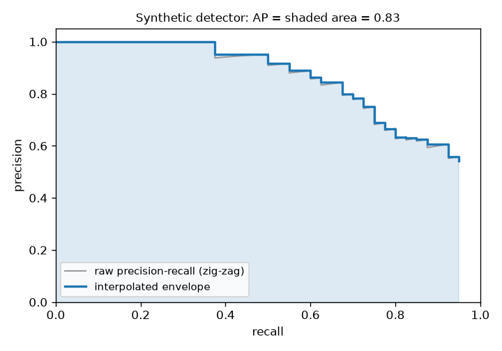

Classification accuracy is easy to define: count the right labels. Detection is harder. A detector outputs a variable number of boxes, each with a class and a score, and a box can be right, slightly off, a duplicate, or pure noise. Mean average precision (mAP) is the standard way to fold all of that into one number. It is worth understanding in detail, because small choices in how it is computed (the IoU threshold, the interpolation, the matching rule) can move the score by several points.

## First, agree on the box format

Before any matching, both predictions and ground truth must use the same box format. Four are common:

| Format | Numbers | Used by |
|---|---|---|
| corners, `xyxy` | $x_{\min}, y_{\min}, x_{\max}, y_{\max}$ in pixels | Pascal VOC, torchvision |
| `xywh` | $x_{\min}, y_{\min}$, width, height in pixels | COCO |
| `cxcywh` | centre $x$, centre $y$, width, height | many detector heads |
| YOLO | `cxcywh` divided by image width and height, so in $[0, 1]$ | YOLO label files |

A box at corners $(385, 60, 600, 357)$ is $(385, 60, 215, 297)$ in COCO format and has centre $(492.5, 208.5)$. Mixing formats silently gives near-zero IoUs and a near-zero mAP, which looks like a broken model rather than a broken evaluation. I convert everything to corners before scoring.

## Step 1: is a detection correct?

A detection counts as a **true positive (TP)** when all three hold:

1. It has the same class as a ground-truth box in the same image.
2. Its intersection over union with that box is at least a threshold $t$, usually $0.5$. IoU is the overlap area divided by the union area (details in [overlap-based losses](/notes/overlap-based-losses/)).
3. That ground-truth box has not already been claimed by a **higher-scoring** detection.

Rule 3 is what punishes duplicates. Detections are processed from highest to lowest score, so the best one claims the object and every later box on the same object becomes a **false positive (FP)**. This is why detectors run non-maximum suppression before evaluation. Ground-truth boxes that no detection claims are **false negatives**.

```python
import numpy as np

def iou(a, b):
    """a, b: boxes as (x1, y1, x2, y2)."""
    iw = max(0.0, min(a[2], b[2]) - max(a[0], b[0]))
    ih = max(0.0, min(a[3], b[3]) - max(a[1], b[1]))
    inter = iw * ih
    return inter / ((a[2]-a[0])*(a[3]-a[1]) + (b[2]-b[0])*(b[3]-b[1]) - inter)

def match(dets, gts, thr=0.5):
    """dets: list of (image_id, score, box) for ONE class; gts: dict image_id -> boxes.
    Returns TP flags (1/0) in descending-score order, and the number of ground truths."""
    dets = sorted(dets, key=lambda d: d[1], reverse=True)
    used = {k: [False] * len(v) for k, v in gts.items()}
    tp = []
    for img, score, box in dets:
        ious = [iou(box, g) for g in gts.get(img, [])]
        j = int(np.argmax(ious)) if ious else -1
        if j >= 0 and ious[j] >= thr and not used[img][j]:
            used[img][j] = True          # each ground truth can be matched once
            tp.append(1)
        else:
            tp.append(0)                 # duplicate, poor overlap, or nothing there
    return np.array(tp), sum(len(v) for v in gts.values())
```

Matching happens per image and per class. A detection in image 3 can never match a box in image 7.

## Step 2: from ranked matches to a precision-recall curve

Walk down the score-sorted list. After the top $k$ detections, with $\text{TP}_k$ true positives among them and $N$ ground-truth boxes in total:

$$
\text{precision}_k = \frac{\text{TP}_k}{k}, \qquad \text{recall}_k = \frac{\text{TP}_k}{N}
$$

Precision answers "of what I reported, how much was right?". Recall answers "of what was there, how much did I find?". Every possible score threshold corresponds to one point $k$ on this list, so the list traces a curve without having to choose a threshold.

A small example with three ground-truth boxes in two images:

```python
gts = {0: [(10, 10, 50, 50), (60, 60, 90, 100)], 1: [(20, 30, 70, 80)]}
dets = [(0, 0.95, (12, 11, 49, 52)),      # good match
        (0, 0.90, (11, 12, 51, 50)),      # duplicate of the same object
        (1, 0.80, (25, 30, 72, 85)),      # good match
        (0, 0.60, (100, 100, 130, 130)),  # background
        (0, 0.40, (62, 58, 88, 97))]      # good match, but low score
tp, n_gt = match(dets, gts)
print(tp)   # [1 0 1 0 1]
# precision: 1.00 0.50 0.67 0.50 0.60
# recall:    0.33 0.33 0.67 0.67 1.00
```

## Step 3: average precision is the area under that curve

The raw curve zig-zags: every false positive drops precision, every true positive raises it a little. The standard fix is **interpolation**: at each recall level, replace precision with the best precision reached at that recall *or higher*. That gives a monotonically decreasing envelope, and AP is the area under it.



```python
def average_precision(tp, n_gt):
    tp_cum = np.cumsum(tp)
    precision = tp_cum / np.arange(1, len(tp) + 1)
    recall = tp_cum / n_gt
    r = np.concatenate([[0], recall, [1]])
    p = np.concatenate([[1], precision, [0]])
    p = np.maximum.accumulate(p[::-1])[::-1]       # envelope: best precision to the right
    idx = np.where(r[1:] != r[:-1])[0]             # points where recall changes
    return float(np.sum((r[idx + 1] - r[idx]) * p[idx + 1]))

print(round(average_precision(tp, n_gt), 3))   # 0.756
```

Here AP $= \tfrac13 \cdot 1 + \tfrac13 \cdot 0.67 + \tfrac13 \cdot 0.6 \approx 0.756$. Notice what hurt: the duplicate at rank 2 and the background box at rank 4 both sit *above* a real object, so they lower precision at the recall levels that follow.

There are three common ways to integrate, and they give slightly different numbers:

- **VOC 2007, 11-point:** average the envelope at recall $0, 0.1, \dots, 1.0$.
- **VOC 2010+, all-point:** the exact area under the envelope, as above.
- **COCO, 101-point:** the envelope sampled at recall $0, 0.01, \dots, 1.0$.

The YOLOv1 code-along I followed integrated the raw zig-zag curve with the trapezoid rule and no envelope. That gives a lower, noisier number than any official protocol. It is fine for watching a training curve, but not for comparing with published results.

## Step 4: the "mean" in mAP

AP is computed **per class**, and mAP is the plain average over classes. A rare class counts as much as a common one. A class with no ground truth in the test set is skipped.

Pascal VOC reports mAP at a single IoU threshold of 0.5, written **mAP@0.5** or AP50. COCO's main metric, **mAP@[.5:.95]**, averages AP over ten thresholds, $0.50, 0.55, \dots, 0.95$, and then over classes. It rewards tight boxes:

```python
aps = [average_precision(*match(dets, gts, thr)) for thr in np.arange(0.5, 0.96, 0.05)]
print(round(float(np.mean(aps)), 3))   # 0.537
# per threshold: 0.76 x6, then 0.33, 0.33, 0.17, 0.0
```

Our toy detector scores 0.76 at IoU 0.5 but only 0.54 on the COCO metric, because its boxes are close but not tight. COCO also reports AP for small, medium and large objects (areas below $32^2$, between $32^2$ and $96^2$, and above $96^2$ pixels) and average recall at a fixed number of detections per image.

## Practical traps

- **Score threshold before evaluation.** mAP already sweeps all thresholds. Dropping low-score boxes first cuts the curve short and lowers recall, so keep a very low threshold (for example 0.001) when evaluating.
- **NMS settings change mAP.** Too loose and duplicates become false positives; too tight and real neighbouring objects are suppressed.
- **`>` versus `>=`.** Whether a detection with IoU exactly 0.5 counts is a convention. Official tools use `>=`.
- **Use a reference implementation** (pycocotools, torchmetrics) for numbers you will publish. Write your own once to understand it.

## Key takeaways

- A detection is a true positive only if the class matches, IoU passes the threshold, and no higher-scoring detection already claimed that object.
- Sorting by score and accumulating TP and FP gives a precision-recall curve without picking a threshold.
- AP is the area under the interpolated (monotone) precision-recall curve; mAP averages AP over classes.
- mAP@0.5 checks "found it"; COCO's mAP@[.5:.95] also checks "boxed it tightly".
- Box formats, NMS settings and the integration method all change the number, so state them with every result.

## Resources

- Everingham et al., "The PASCAL Visual Object Classes (VOC) Challenge", IJCV 2010. [Springer](https://link.springer.com/article/10.1007/s11263-009-0275-4)
- Lin et al., "Microsoft COCO: Common Objects in Context", ECCV 2014. [arXiv:1405.0312](https://arxiv.org/abs/1405.0312)
- COCO detection evaluation page: [cocodataset.org/#detection-eval](https://cocodataset.org/#detection-eval)
- Aladdin Persson, "Mean Average Precision (mAP) explained and PyTorch implementation" video and the [Machine-Learning-Collection](https://github.com/aladdinpersson/Machine-Learning-Collection) repo, which I coded along with for YOLOv1.
- `torchvision.ops.box_convert` for converting between box formats: [PyTorch docs](https://pytorch.org/vision/stable/generated/torchvision.ops.box_convert.html)
- `torchmetrics` MeanAveragePrecision: [docs](https://lightning.ai/docs/torchmetrics/stable/detection/mean_average_precision.html)
- Related notes: [YOLOv1](/notes/yolo-v1-detection-as-regression/), [anchors and NMS for proposals](/notes/anchors-and-region-proposal-networks/), [overlap-based losses](/notes/overlap-based-losses/).
