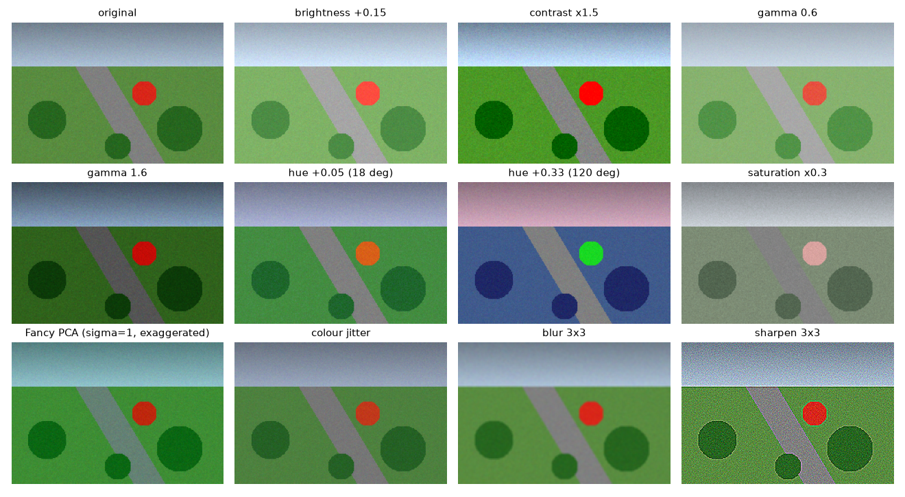

A model trained on images from one camera, one season and one time of day will learn that lighting as part of the task. Show it a darker, warmer or more washed-out image at test time and its accuracy drops, even though the objects have not changed. Photometric augmentation fights this by changing pixel *values* during training while leaving pixel *positions* alone. I tested the usual set of colour augmentations on aerial images for a segmentation model; this note explains what each one does mathematically and when it is a good idea. All examples here use a small synthetic scene.

## Photometric versus geometric augmentation

Augmentations fall into two families:

- **Geometric**: flips, 90° rotations, crops, scaling, elastic or grid distortion. They move pixels. The label must move with them.
- **Photometric**: brightness, contrast, gamma, hue, saturation, colour jitter, PCA colour noise, blur, sharpening, noise. They change pixel values in place. The label stays where it was.

This split matters most for dense tasks such as segmentation, which I come back to below.



## Brightness, contrast and gamma

With the image $I$ scaled to $[0, 1]$, the simplest model of an exposure change is linear:

$$
I' = \alpha\,(I - \mu) + \mu + \beta ,
$$

where $\mu$ is the mean intensity, $\alpha$ is the contrast factor (stretching values away from the mean) and $\beta$ is a brightness offset. Results are clipped back to $[0, 1]$, so large values of $\alpha$ or $\beta$ saturate highlights and lose information.

Gamma is non-linear: $I' = I^{\gamma}$. Black (0) and white (1) stay fixed. With $\gamma > 1$ the mid-tones get darker; with $\gamma < 1$ they get brighter. It mimics a different camera response curve or exposure better than a plain offset, because it does not push any pixel out of range. (Libraries disagree on the sign convention: some apply $I^{1/\gamma}$, so check which way "gamma 1.5" goes in yours.)

```python
import numpy as np

def brightness_contrast(img, alpha, beta):
    """alpha scales contrast around the mean, beta shifts brightness. img in [0, 1]."""
    mean = img.mean()
    return np.clip(alpha * (img - mean) + mean + beta, 0, 1)

def gamma(img, g):
    """g > 1 darkens mid-tones, g < 1 brightens them; 0 and 1 stay fixed."""
    return img ** g
```

## Hue, saturation and value

RGB mixes brightness and colour in every channel. HSV separates them: **hue** is the colour's angle on a circle (red at 0°, green at 120°, blue at 240°), **saturation** is how far the colour is from grey, and **value** is the maximum of R, G and B. The [colour spaces note](/notes/colour-spaces-for-image-processing/) covers these spaces in more detail.

Because hue is an angle, a hue shift is a *rotation* and must wrap around: hue $0.95 + 0.1$ becomes $0.05$, not $1.05$. Saturation and value are scaled and clipped.

```python
def hsv_shift(img, dh, s_scale, v_scale):
    hsv = rgb_to_hsv(img)                            # hue in [0, 1) = full circle
    hsv[..., 0] = (hsv[..., 0] + dh) % 1.0           # rotate hue, wrap around
    hsv[..., 1] = np.clip(hsv[..., 1] * s_scale, 0, 1)
    hsv[..., 2] = np.clip(hsv[..., 2] * v_scale, 0, 1)
    return hsv_to_rgb(hsv)
```

(`rgb_to_hsv` and `hsv_to_rgb` are the standard formulas; any library provides them.) Two things are visible in the figure. A shift of 0.05 (18°) only warms the scene slightly. A shift of 0.33 (120°) turns grass blue and the red disc green: no camera produces that. Grey pixels, such as the road, do not change at all under a hue shift, because a grey pixel has zero saturation and therefore no meaningful hue.

## Colour jitter

Colour jitter is not a new operation. It draws random brightness, contrast, saturation and hue factors from small ranges and applies the four operations **in random order**. The random order matters a little because the operations do not commute (clipping after a brightness boost changes what a later contrast step sees).

```python
def colour_jitter(img, rng, b=0.2, c=0.2, s=0.2, h=0.03):
    ops = [
        lambda x: brightness_contrast(x, 1, rng.uniform(-b, b)),
        lambda x: brightness_contrast(x, rng.uniform(1 - c, 1 + c), 0),
        lambda x: hsv_shift(x, 0, rng.uniform(1 - s, 1 + s), 1),
        lambda x: hsv_shift(x, rng.uniform(-h, h), 1, 1),
    ]
    for i in rng.permutation(len(ops)):
        img = ops[i](img)
    return img
```

## Fancy PCA

AlexNet introduced a colour augmentation based on the statistics of natural images. Compute the $3 \times 3$ covariance of RGB values over all pixels, and find its eigenvectors $\mathbf{p}_1, \mathbf{p}_2, \mathbf{p}_3$ and eigenvalues $\lambda_1, \lambda_2, \lambda_3$. Then add the same offset to every pixel of the image:

$$
\Delta = [\mathbf{p}_1\ \mathbf{p}_2\ \mathbf{p}_3]\,[\alpha_1 \lambda_1,\ \alpha_2 \lambda_2,\ \alpha_3 \lambda_3]^\top,
\qquad \alpha_i \sim \mathcal{N}(0, 0.1^2),
$$

with new $\alpha_i$ drawn for each image. The idea is that colour changes along the main directions of colour variation (mostly a brightness-like direction, then a warm–cool direction) look natural, while changes along rare directions do not. The original paper computed the covariance once over the whole ImageNet training set; computing it per image, as many libraries do, is a common variant.

One subtlety: $\lambda_i$ is a variance, so multiplying by it mixes units. Many implementations use $\sqrt{\lambda_i}$, the standard deviation along each axis, which keeps $\Delta$ in pixel units. With $\sigma = 0.1$ the effect is subtle; the figure uses $\sigma = 1$ so it is visible.

```python
def fancy_pca(img, sigma=0.1, rng=np.random.default_rng()):
    pixels = img.reshape(-1, 3)
    cov = np.cov(pixels - pixels.mean(0), rowvar=False)  # 3x3 RGB covariance
    eigvals, eigvecs = np.linalg.eigh(cov)               # columns are eigenvectors
    alpha = rng.normal(0, sigma, 3)                      # one draw per image
    delta = eigvecs @ (alpha * np.sqrt(eigvals))         # same RGB offset for every pixel
    return np.clip(img + delta, 0, 1)
```

## Blur and sharpening

Blur and sharpening change local contrast rather than colour. A $3 \times 3$ box blur imitates slight defocus or motion; a sharpening kernel such as $\begin{bmatrix}0&-1&0\\-1&5&-1\\0&-1&0\end{bmatrix}$ (identity plus a negative Laplacian) imitates in-camera sharpening, and also amplifies noise, as the figure shows. Both make a model less sensitive to the exact sharpness of its training camera. The [linear filters note](/notes/linear-filters-and-gaussian-blur/) explains these kernels.

## Image and mask together

For segmentation, every training sample is an image plus a label mask. The rules are simple:

- Apply **geometric** transforms with the *same random parameters* to the image and the mask. When the transform needs interpolation (rotation by arbitrary angles, scaling, elastic distortion), use **nearest-neighbour** for the mask. Bilinear interpolation would invent class IDs between two neighbouring classes (for example, 1.5 between class 1 and class 2).
- Apply **photometric** transforms to the image only. The mask holds class IDs, not colours.

```python
def augment_pair(img, mask, rng):
    k = rng.integers(4)                         # geometric: same op on both
    img, mask = np.rot90(img, k), np.rot90(mask, k)
    if rng.random() < 0.5:
        img, mask = img[:, ::-1], mask[:, ::-1]
    img = colour_jitter(img, rng)               # photometric: image only
    return img, mask
```

Augmentation libraries such as Albumentations handle this by passing `image=` and `mask=` together and only applying pixel-level transforms to the image.

## When colour augmentation helps, and when it hurts

It helps when colour differences between your training and test data come from **nuisance factors**: different cameras and white balance, sun versus overcast, morning versus evening light, haze, and seasons that change the overall tone of a scene. In those cases the model should learn shapes and textures, and colour noise teaches it not to rely too much on exact tones.

It hurts when **colour is the label**. If the task is telling healthy green vegetation from yellowed or red-brown discoloured vegetation, ripe from unripe fruit, or one kind of traffic light from another, a large hue shift turns one class into the other while the label stays the same. You are then training on wrong labels. In such tasks:

- keep hue shifts very small (a few degrees) or turn them off;
- prefer brightness, contrast and gamma, which change exposure but keep hue;
- prefer Fancy PCA with small $\sigma$, which follows natural colour variation;
- check a grid of augmented samples by eye before training: if you cannot tell the classes apart any more, neither can the model.

A good habit is to treat the augmentation strength as a hyperparameter and compare validation results with and without colour augmentation on a validation set that really covers the lighting conditions you expect.

## Key takeaways

- Photometric augmentations change pixel values, not positions; for segmentation they apply to the image only, while geometric ones apply to both image and mask (nearest-neighbour for the mask).
- Brightness/contrast is linear and can clip; gamma is a non-linear curve that keeps 0 and 1 fixed.
- Hue is an angle, so hue shifts wrap around; grey pixels do not change under a hue shift.
- Fancy PCA adds one colour offset per image along the main axes of RGB variation, so the changes look natural.
- Colour augmentation is good for lighting and sensor variation, and harmful when colour itself separates the classes.

## Resources

- Krizhevsky, Sutskever and Hinton, [ImageNet Classification with Deep Convolutional Neural Networks](https://papers.nips.cc/paper/2012/hash/c399862d3b9d6b76c8436e924a68c45b-Abstract.html), NeurIPS 2012, Section 4.1 (PCA colour augmentation).
- Shorten and Khoshgoftaar, [A survey on Image Data Augmentation for Deep Learning](https://journalofbigdata.springeropen.com/articles/10.1186/s40537-019-0197-0), Journal of Big Data, 2019.
- [Albumentations documentation](https://albumentations.ai/docs/): pixel-level versus spatial-level transforms, `HueSaturationValue`, `ColorJitter`, `FancyPCA`, `RandomGamma`.
- [torchvision transforms v2](https://pytorch.org/vision/stable/transforms.html): `ColorJitter`, `RandomAdjustSharpness`, `GaussianBlur`.
- Related notes: [colour spaces for image processing](/notes/colour-spaces-for-image-processing/), [linear filters and the Gaussian blur](/notes/linear-filters-and-gaussian-blur/).
