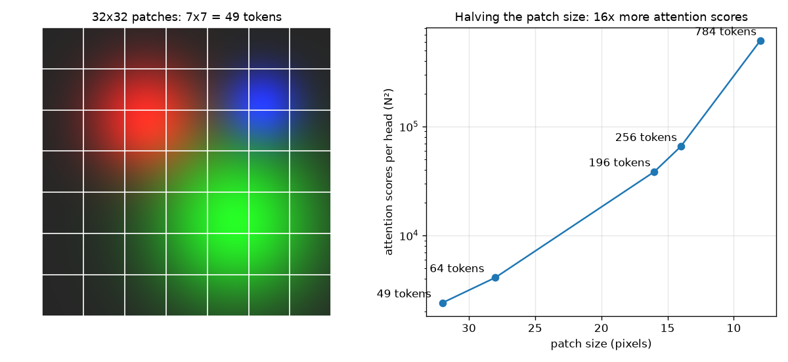

A transformer works on a sequence of vectors. An image is a grid of pixels. The Vision Transformer (ViT) connects the two in the simplest way you could think of: cut the image into square patches, turn each patch into one vector, and give that sequence to a normal transformer encoder. Almost nothing image-specific is left in the model. That's both why it's nice and why it's hard to train. Most modern vision backbones, like [DINOv2](/notes/dinov2-self-supervised-features/), and many segmentation models, like the ones in [panoptic segmentation](/notes/panoptic-segmentation/), are built on this idea.

## From pixels to tokens: the patch embedding

Take a 224×224 RGB image and a patch size of $P = 16$. The image splits into $224/16 = 14$ patches per side, so $N = 14^2 = 196$ patches. Each patch holds $3 \cdot 16 \cdot 16 = 768$ numbers. ViT flattens each patch and multiplies it by one shared weight matrix $E$ of shape $768 \times D$, where $D$ is the model width. What comes out is a sequence of 196 tokens, each of length $D$.

In code you usually see this written as a convolution whose kernel size and stride are both equal to the patch size. That confused me at first, since it looks like a "real" conv. But the kernel sees each patch exactly once and never overlaps, so it's the same linear map. The check below copies the conv weights into a linear layer and compares the outputs:

```python
import torch, torch.nn as nn
P, D = 16, 768
conv = nn.Conv2d(3, D, kernel_size=P, stride=P)
x = torch.randn(2, 3, 224, 224)
tokens = conv(x).flatten(2).transpose(1, 2)          # (B, N, D) = (2, 196, 768)

# The same thing by hand: cut patches, flatten, multiply by a matrix
patches = x.unfold(2, P, P).unfold(3, P, P)          # (B, C, 14, 14, P, P)
patches = patches.permute(0, 2, 3, 1, 4, 5).reshape(2, 196, 3 * P * P)
linear = nn.Linear(3 * P * P, D)
linear.weight.data = conv.weight.data.reshape(D, -1)
linear.bias.data = conv.bias.data
print(torch.allclose(linear(patches), tokens, atol=1e-4))   # True
```

Don't skip the `flatten(2).transpose(1, 2)` step. The conv gives `(B, D, 14, 14)`, but the transformer wants `(B, N, D)`: one row per token.

## Class token and positional embeddings

Two learned extras get added before the encoder.

**Class token.** One learned vector, `cls`, is stuck at the front of the sequence, so now there are $N+1$ tokens. At the start it holds no image content. Through attention it gathers information from all the patches, and at the end its output vector is used as the summary of the whole image. The idea comes from BERT. Many later models drop it and just average all the patch outputs (mean pooling). Both work about equally well.

**Positional embeddings.** Attention doesn't care about order. If you shuffle the tokens, every output gets shuffled the same way and nothing else changes. So on its own the model can't tell the top-left patch from the bottom-right one. ViT fixes this by adding a learned vector for each position, $z_0 = [\,x_\text{cls};\, x_1 E;\, \dots;\, x_N E\,] + E_\text{pos}$, where $E_\text{pos}$ has shape $(N+1) \times D$. The paper found that simple 1D learned embeddings work as well as 2D-aware ones. The model figures out the grid layout by itself. One side effect: if you change the input size at test time, $N$ changes, and the positional embeddings have to be interpolated to the new grid.

## The encoder block

Each block is the usual transformer encoder layer in the **pre-norm** form. That just means LayerNorm comes *before* each sub-layer, so the residual path (the skip connection) stays clean.

$$
x \leftarrow x + \text{MHA}(\text{LN}(x)), \qquad x \leftarrow x + \text{MLP}(\text{LN}(x))
$$

MHA is [multi-head self-attention](/notes/multi-head-attention/), where every patch can look at every other patch (see [self-attention](/notes/self-attention/) for how queries, keys and values work). The MLP is two linear layers with a GELU in between, usually 4× wider than $D$. Pre-norm makes deep stacks train more stably than the post-norm layout of the original transformer. One last LayerNorm goes before the classifier head.

Put it all together and you get a small but complete ViT:

```python
class Block(nn.Module):                     # pre-norm encoder block
    def __init__(self, d, heads, mlp_ratio=4.0):
        super().__init__()
        self.norm1, self.norm2 = nn.LayerNorm(d), nn.LayerNorm(d)
        self.attn = nn.MultiheadAttention(d, heads, batch_first=True)
        self.mlp = nn.Sequential(nn.Linear(d, int(d * mlp_ratio)), nn.GELU(),
                                 nn.Linear(int(d * mlp_ratio), d))
    def forward(self, x):
        h = self.norm1(x)
        x = x + self.attn(h, h, h, need_weights=False)[0]
        return x + self.mlp(self.norm2(x))

class ViT(nn.Module):
    def __init__(self, img=224, patch=16, d=192, depth=4, heads=3, classes=10):
        super().__init__()
        n = (img // patch) ** 2
        self.embed = nn.Conv2d(3, d, patch, stride=patch)
        self.cls = nn.Parameter(torch.zeros(1, 1, d))
        self.pos = nn.Parameter(torch.randn(1, n + 1, d) * 0.02)
        self.blocks = nn.Sequential(*[Block(d, heads) for _ in range(depth)])
        self.norm, self.head = nn.LayerNorm(d), nn.Linear(d, classes)
    def forward(self, x):
        x = self.embed(x).flatten(2).transpose(1, 2)            # (B, N, d)
        x = torch.cat([self.cls.expand(len(x), -1, -1), x], 1)  # (B, N+1, d)
        x = self.blocks(x + self.pos)
        return self.head(self.norm(x)[:, 0])                    # read the CLS token

print(ViT()(torch.randn(2, 3, 224, 224)).shape)   # torch.Size([2, 10])
```

## The batch_first trap

When I first wrote this block I used `nn.MultiheadAttention(embed_dim, num_heads)` with no extra flag and fed it a `(B, N, D)` tensor. It ran without errors and the shapes looked fine. It was still wrong.

For historical reasons, PyTorch's `MultiheadAttention` defaults to `batch_first=False`, which means it expects `(sequence, batch, features)`. Give it `(B, N, D)` and it reads the batch axis as the sequence. So attention runs across *images* at each patch position: patch 5 of image 0 attends to patch 5 of images 1, 2 and 3, and never to the other patches of its own image. A quick test shows it. Change only image 3 and see if image 0's output moves:

```python
B, N, D = 4, 10, 64
x = torch.randn(B, N, D)
for batch_first in (False, True):
    attn = nn.MultiheadAttention(D, num_heads=4, batch_first=batch_first).eval()
    out, _ = attn(x, x, x)
    x2 = x.clone(); x2[3] += 10.0                 # touch only image 3
    out2, _ = attn(x2, x2, x2)
    print(batch_first, (out2[0] - out[0]).abs().max().item())
# False 9.5     <- image 0 changed: images leak into each other
# True  0.0     <- correct
```

The fix is `batch_first=True`, like in the code above. I think this test is worth keeping for any model with attention: samples in a batch should never affect each other at inference time. A related slip in the same first draft was testing the block with an image tensor `(1, 3, 256, 256)` instead of tokens. Always test a block with the shape it will really get, `(B, N+1, D)`.

## Patch size and cost

Self-attention compares every token with every other token, so its cost grows with $N^2$. Since $N = (H/P)^2$, halving the patch size gives four times more tokens and sixteen times more attention scores.



| Patch size | Tokens $N$ | $N^2$ per head |
|---|---|---|
| 32 | 49 | 2,401 |
| 16 | 196 | 38,416 |
| 14 | 256 | 65,536 |
| 8 | 784 | 614,656 |

Smaller patches keep more detail, which matters for dense tasks like segmentation, but memory and time go up fast. That's why ViT-B/16 and ViT-L/14 are common choices, and why dense-prediction models often use windowed attention, or work on a coarse token grid and upsample later.

## Weak inductive bias: why ViT needs so much data

A CNN comes with strong built-in assumptions (its "inductive bias"): nearby pixels matter most (locality), and the same pattern means the same thing anywhere in the image (translation equivariance). ViT has almost none of that. Only the patch cutting and the positional embeddings know anything about 2D space. Everything else has to be learned. The original paper showed this clearly. Trained on ImageNet-1k alone, ViT did worse than a ResNet of similar size, but after pre-training on 14M to 300M images it matched or beat it. Later work (DeiT) closed much of the gap with strong augmentation, regularisation and distillation, and self-supervised methods like DINOv2 now give ViTs very good features without labels. So basically: start from pre-trained weights unless you have a really big dataset.

## Key takeaways

- A ViT cuts the image into $P \times P$ patches and maps each one linearly to a $D$-dimensional token. A conv with kernel = stride = $P$ does exactly this.
- A learned class token collects a summary of the whole image, and learned positional embeddings tell the model where each patch came from.
- Each encoder block is pre-norm: $x + \text{MHA}(\text{LN}(x))$, then $x + \text{MLP}(\text{LN}(x))$.
- `nn.MultiheadAttention` defaults to `batch_first=False`. Feeding it `(B, N, D)` quietly mixes images together. Test that changing one sample never changes another.
- Attention cost grows with $N^2$, so patch size is a direct trade-off between detail and compute. And because of the weak inductive bias, ViTs need large-scale or self-supervised pre-training.

## Resources

- Dosovitskiy et al., [An Image is Worth 16x16 Words: Transformers for Image Recognition at Scale](https://arxiv.org/abs/2010.11929), ICLR 2021. The original ViT paper.
- Vaswani et al., [Attention Is All You Need](https://arxiv.org/abs/1706.03762), 2017. The transformer encoder that ViT reuses.
- Touvron et al., [Training data-efficient image transformers & distillation through attention (DeiT)](https://arxiv.org/abs/2012.12877), 2021. Training ViTs on ImageNet-1k only.
- PyTorch docs, [torch.nn.MultiheadAttention](https://pytorch.org/docs/stable/generated/torch.nn.MultiheadAttention.html), for the `batch_first` argument.
- Related notes: [self-attention](/notes/self-attention/), [multi-head attention](/notes/multi-head-attention/), [DINOv2](/notes/dinov2-self-supervised-features/), [panoptic segmentation](/notes/panoptic-segmentation/).
