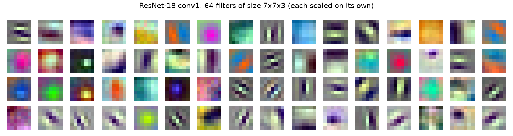

When a segmentation or detection network works on one dataset and fails on another, all you get is a number that went down. That doesn't tell you much. Looking inside the network is the first step toward a reason. The two simplest things to look at are the **filters** (the learned weights) and the **feature maps** (what those weights produce for a given image). I used both to poke at a VGG19-based segmentation model, and to check whether the network "saw" rendered synthetic images the same way it saw real photos. Here I show the same tools on a public ResNet-18 and a synthetic test image.

## Filters: only the first layer is easy to read

A convolution layer stores a weight tensor of shape (out channels, in channels, kernel height, kernel width). In the first layer the input channels are R, G and B, so each filter is basically a tiny colour image, and you can draw it as one.

```python
import torch, torchvision

net = torchvision.models.resnet18(weights="IMAGENET1K_V1").eval()
w = net.conv1.weight.detach()            # (64, 3, 7, 7)

# scale each filter on its own to [0, 1] so it can be drawn as an RGB patch
lo = w.amin(dim=(1, 2, 3), keepdim=True)
hi = w.amax(dim=(1, 2, 3), keepdim=True)
patches = ((w - lo) / (hi - lo)).permute(0, 2, 3, 1).numpy()   # (64, 7, 7, 3)
```



You see the same pattern in almost every network trained on natural images: edge and bar detectors at different angles, centre-surround blobs, and colour-opponent filters (red against green, blue against yellow). Many of them look like the [Gabor filters](/notes/gabor-filters/) from classical vision. If your own first layer looks like noise instead, the network is undertrained, the learning rate was too high, or the layer isn't really being used.

Two practical things:

- **Scale each filter on its own.** If you scale all filters together with one global min and max, the weak ones just look flat grey.
- **Small kernels don't show much.** VGG uses 3×3 kernels. I first plotted each of them channel by channel in grey, and nine pixels per channel just don't show much structure. Networks with 7×7 or 11×11 first layers (ResNet, AlexNet) are much easier to read.

Deeper filters have 64, 256 or 512 input channels. They're weights over feature maps, not over colours, so drawing them as images doesn't mean anything. For deeper layers you look at their outputs instead.

## Feature maps: grab any layer with a hook

A feature map is what a layer outputs for one input, with shape (channels, height, width). The way I think about it: each channel is a 2D map of "how much of this pattern is here".

In Keras I did this by building a second model that shares the input but outputs the layer I wanted (`Model(inputs=model.inputs, outputs=model.layers[i].output)`). In PyTorch the clean way is a **forward hook**: a function that runs every time a module finishes its forward pass, and gets that module's output.

```python
fmaps = {}

def save_to(name):
    def hook(module, inputs, output):
        fmaps[name] = output.detach()
    return hook

for name in ["relu", "layer1", "layer2", "layer3", "layer4"]:
    getattr(net, name).register_forward_hook(save_to(name))

with torch.no_grad():
    net(x)              # x: one normalised image, shape (1, 3, 224, 224)

for k, v in fmaps.items():
    print(k, tuple(v.shape))
# relu   (1, 64, 112, 112)
# layer1 (1, 64, 56, 56)
# layer2 (1, 128, 28, 28)
# layer3 (1, 256, 14, 14)
# layer4 (1, 512, 7, 7)
```

The input has to be preprocessed exactly like during training (here, ImageNet mean and standard deviation). If you feed raw 0–255 values or the wrong channel order, you still get maps, and that's the tricky part: they look fine, but they describe a network that's being used wrong.

With hundreds of channels per layer you can't look at them all. A simple way to pick is to show the channels with the highest mean activation:


The figure shows the usual progression:

- **Early layers** (stride 2–4) still look like images. Some channels react to flat colour (the red disc goes dark in one channel and bright in another), some to edges at one angle, some to the fine stripes.
- **Middle layers** (stride 8) react to combinations: corners, the ring around the disc, the texture in the noise patch.
- **Late layers** (stride 16–32) are coarse, and their channels don't match anything you can name from one synthetic image. They're useful as a group, not one by one.

You can't directly compare maps across channels, because each channel has its own scale. Normalise each map for display, or use a shared colour scale on purpose when you actually want to compare strengths.

## Comparing two inputs layer by layer

The most useful thing I did with feature maps was comparing two inputs that should mean the same thing: a real photo and a rendered image of a similar scene, or an image and a resized copy of it. If the network treats them the same at the decision layers, the difference doesn't matter. If the maps split apart early, the network probably won't transfer between the two.

Side-by-side plots of every channel get tiring fast. One number per layer is easier to read. Here are two: the cosine similarity of the full maps (which keeps the spatial layout) and the cosine similarity of the channel means after global average pooling (which throws the layout away).

```python
import torch.nn.functional as F

def spatial_cosine(a, b):
    return {k: F.cosine_similarity(a[k].flatten(), b[k].flatten(), dim=0).item() for k in a}

def pooled_cosine(a, b):
    return {k: F.cosine_similarity(a[k].mean(dim=(2, 3)), b[k].mean(dim=(2, 3))).item() for k in a}
```

For the synthetic image against three variants:

| Variant | Measure | relu | layer1 | layer2 | layer3 | layer4 |
|---|---|---|---|---|---|---|
| Gaussian noise, σ = 0.08 | spatial | 0.97 | 0.85 | 0.82 | 0.81 | 0.78 |
| | pooled | 1.00 | 0.93 | 0.95 | 0.94 | 0.88 |
| Shifted 8 pixels | spatial | 0.75 | 0.72 | 0.71 | 0.85 | 0.89 |
| | pooled | 1.00 | 1.00 | 1.00 | 0.99 | 0.98 |
| Flipped upside down | spatial | 0.67 | 0.60 | 0.47 | 0.60 | 0.60 |
| | pooled | 1.00 | 0.99 | 0.97 | 0.99 | 0.94 |

Three things I took from this small table:

- **Noise hurts more the deeper you go.** The first layer barely notices pixel noise, but every layer adds a bit more disagreement. So a domain gap in texture or sensor noise isn't "just low-level". It spreads through the network.
- **Spatial similarity is mostly about alignment.** An 8-pixel shift is a big change for a stride-2 map and a small one for a stride-32 map, so spatial similarity goes up with depth. Comparing spatial maps only makes sense for pairs that line up pixel for pixel.
- **Pooled statistics ignore layout.** The flipped image has the same parts, so its pooled features stay close. This is also why channel means and Gram-matrix statistics are used to measure style and domain differences, no matter where things are in the image.

For a real domain-gap study, use many image pairs (or two whole datasets) and compare the distributions of pooled features, for example with a Fréchet distance like in FID. Don't trust a single pair.

## Beyond plotting outputs

Filters and feature maps show what a layer computes for a given input. Two other families of methods answer different questions:

- **Activation maximisation** asks "what input would make this channel fire the most?" You start from noise and run gradient ascent on the input, with regularisers (blur, jitter, frequency penalties) so you don't just get adversarial noise. Olah et al.'s *Feature Visualization* article is the best intro I found.
- **Attribution maps** ask "which pixels drove this prediction?" Saliency maps take the gradient of the class score with respect to the input. Grad-CAM weights the last convolutional feature maps by the spatially averaged gradient of the class score and sums them, which gives a coarse heat map of where the evidence is. For segmentation you can do the same thing with the sum of one class's logits over a region.

These need a real prediction to explain, so they make more sense on real images with a trained head, not on a synthetic test pattern.

## Key takeaways

- Only first-layer filters are worth drawing as images. Scale each one separately. Healthy ones look like oriented edges, blobs and colour-opponent pairs.
- Forward hooks (PyTorch) or a sub-model with intermediate outputs (Keras) give you the feature map of any layer without changing the network.
- Preprocess inputs exactly like in training, and normalise each channel for display.
- To compare two inputs, boil each layer down to one number: spatial cosine similarity for aligned pairs, pooled statistics when layout shouldn't matter.
- For "why this prediction?", move on to attribution methods like Grad-CAM. For "what does this channel like?", try activation maximisation.

## Resources

- Zeiler, M. D. and Fergus, R. (2014). *Visualizing and Understanding Convolutional Networks*. ECCV. https://arxiv.org/abs/1311.2901
- Simonyan, K., Vedaldi, A. and Zisserman, A. (2014). *Deep Inside Convolutional Networks: Visualising Image Classification Models and Saliency Maps*. https://arxiv.org/abs/1312.6034
- Olah, C., Mordvintsev, A. and Schubert, L. (2017). *Feature Visualization*. Distill. https://distill.pub/2017/feature-visualization/
- Selvaraju, R. R. et al. (2017). *Grad-CAM: Visual Explanations from Deep Networks via Gradient-based Localization*. ICCV. https://arxiv.org/abs/1610.02391
- Brownlee, J. *How to Visualize Filters and Feature Maps in Convolutional Neural Networks*. Machine Learning Mastery (the Keras sub-model recipe I started from). https://machinelearningmastery.com/how-to-visualize-filters-and-feature-maps-in-convolutional-neural-networks/
- PyTorch documentation: `torch.nn.Module.register_forward_hook`. https://docs.pytorch.org/docs/stable/generated/torch.nn.Module.html#torch.nn.Module.register_forward_hook
- Related notes: [Class activation maps](/notes/class-activation-maps/), [Tapping a CNN backbone](/notes/cnn-backbone-feature-extraction/), [Gabor filters](/notes/gabor-filters/).
