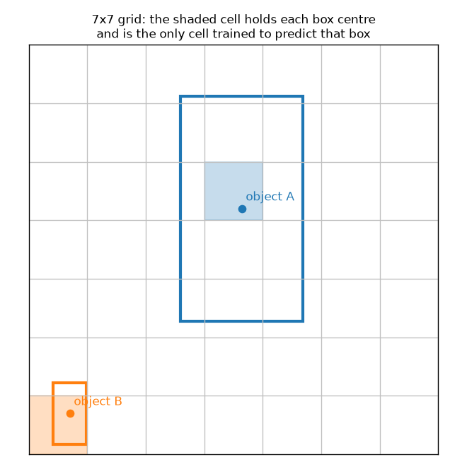

Before YOLO, the best detectors worked in two stages: first propose a few thousand candidate regions, then classify each one. That is accurate but slow, because the network runs many times per image. YOLOv1 (2015) asked a simpler question: can one network look at the whole image once and directly output every box and its class? The answer was yes, at 45 frames per second. Almost every modern real-time detector still follows the idea it introduced: a grid of cells, each predicting boxes from the features at its location.

## The grid idea

YOLOv1 resizes the image to 448×448 and splits it into an $S \times S$ grid, with $S = 7$. Each object is assigned to exactly one cell: the cell that contains the **centre** of its box. That cell is "responsible" for the object. All other cells must learn to say "nothing here".



Each cell predicts:

- $B$ boxes (the paper uses $B = 2$). Each box has five numbers: $x, y, w, h$ and a **confidence**.
- $C$ class probabilities (20 for Pascal VOC), shared by the cell's boxes.

So the whole output is one tensor of shape $S \times S \times (5B + C) = 7 \times 7 \times 30$. Detection has become regression: the network fills a fixed-size tensor, and a loss compares it with a target tensor of the same layout.

The coordinates are chosen so that every number lives in a small, predictable range:

- $x, y$ are the box centre **relative to the cell**, in $[0, 1)$. A value of $(0.5, 0.5)$ means the centre of the cell.
- $w, h$ are the box width and height **relative to the whole image**, in $[0, 1]$.
- The confidence is trained towards $P(\text{object}) \times \text{IoU}(\text{pred}, \text{truth})$. It is zero for empty cells and equals the IoU of the predicted box with the ground truth for the responsible box.

## Encoding the targets

Training data usually comes as normalised $(c_x, c_y, w, h)$ boxes per image (the "YOLO format"). Turning them into the grid target is a few lines:

```python
import torch

S, B, C = 7, 2, 20          # grid size, boxes per cell, classes

def encode_target(boxes, S=7, C=20):
    """boxes: list of (class_id, cx, cy, w, h), all normalised to [0, 1]."""
    target = torch.zeros(S, S, C + 5)
    for cls, cx, cy, w, h in boxes:
        row, col = int(cy * S), int(cx * S)          # cell that holds the centre
        x_cell, y_cell = cx * S - col, cy * S - row  # centre offset inside that cell, in [0, 1)
        if target[row, col, C] == 0:                 # one object per cell in YOLOv1
            target[row, col, cls] = 1.0              # one-hot class
            target[row, col, C] = 1.0                # "an object lives here"
            target[row, col, C+1:C+5] = torch.tensor([x_cell, y_cell, w, h])
    return target

t = encode_target([(11, 0.52, 0.40, 0.30, 0.55), (14, 0.10, 0.90, 0.08, 0.15)])
print(t.shape)                       # torch.Size([7, 7, 25])
print(t[..., C].nonzero().tolist())  # [[2, 3], [6, 0]]: cells that own an object
```

The target stores only one box per cell, while the prediction has $B = 2$. During training, the predicted box with the higher IoU against the ground truth becomes the responsible one. Over time the two box slots specialise: one tends to handle tall objects, the other wide ones.

Notice the `if` line. If two object centres fall into the same cell, the second one is simply dropped. This is a real limit of YOLOv1, not a coding shortcut.

## The network

The backbone is a GoogLeNet-inspired stack of 24 convolutional layers. It alternates $1\times1$ "reduction" convolutions with $3\times3$ convolutions, followed by two fully connected layers. The last layer outputs $7 \cdot 7 \cdot 30 = 1470$ numbers, which are reshaped into the grid. Because the head is fully connected, every cell's prediction can use information from the whole image. Later YOLO versions replaced the fully connected head with convolutions (see [dense detection heads](/notes/dense-detection-heads/)).

## The loss, term by term

Everything is trained with sum-squared error, but with weights that fix three problems. Let $\mathbb{1}_{ij}^{\text{obj}}$ be 1 when box $j$ of cell $i$ is responsible for an object, and $\mathbb{1}_{ij}^{\text{noobj}}$ be 1 otherwise. Hats mark predictions.

$$
\begin{aligned}
\mathcal{L} = {} & \lambda_{\text{coord}} \sum_{i,j} \mathbb{1}_{ij}^{\text{obj}} \left[(x_i - \hat{x}_i)^2 + (y_i - \hat{y}_i)^2\right] \\
& + \lambda_{\text{coord}} \sum_{i,j} \mathbb{1}_{ij}^{\text{obj}} \left[\left(\sqrt{w_i} - \sqrt{\hat{w}_i}\right)^2 + \left(\sqrt{h_i} - \sqrt{\hat{h}_i}\right)^2\right] \\
& + \sum_{i,j} \mathbb{1}_{ij}^{\text{obj}} (C_i - \hat{C}_i)^2
 + \lambda_{\text{noobj}} \sum_{i,j} \mathbb{1}_{ij}^{\text{noobj}} (C_i - \hat{C}_i)^2 \\
& + \sum_{i} \mathbb{1}_{i}^{\text{obj}} \sum_{c} \left(p_i(c) - \hat{p}_i(c)\right)^2
\end{aligned}
$$

Here $C_i$ is the confidence, $p_i(c)$ the probability of class $c$, and $\mathbb{1}_i^{\text{obj}}$ is 1 if any object's centre is in cell $i$.

1. **Empty cells dominate.** In a typical image only a handful of the 98 box slots hold an object. Their confidence errors would swamp the gradient and push all confidences to zero. So the "no object" term is scaled down with $\lambda_{\text{noobj}} = 0.5$.
2. **Localisation needs more weight.** Coordinate errors are scaled up with $\lambda_{\text{coord}} = 5$, so the network does not trade box quality for classification.
3. **Big and small boxes are not equal.** A 10-pixel error is a disaster for a 20-pixel box and nothing for a 400-pixel one. Taking the square root of $w$ and $h$ before the squared error makes the same absolute error cost more for small boxes.

In code, the square root of a raw network output needs care: early in training $w$ can be negative. A common trick is $\text{sign}(w)\sqrt{|w| + \epsilon}$, which keeps the gradient finite and the sign intact. Many implementations, including the one I followed, also use 1 instead of the IoU as the confidence target. That is a simplification of the paper, and it works fine in practice.

## From grid to boxes at inference

At test time each cell gives $B$ boxes. A box's class-specific score is its confidence times the cell's class probability. Converting back to image coordinates just reverses the encoding:

```python
def decode(pred, S=7, C=20, B=2):
    """pred: (S, S, C + 5B) raw network output for one image -> list of boxes."""
    out = []
    for row in range(S):
        for col in range(S):
            cell = pred[row, col]
            cls_prob = cell[:C]
            for b in range(B):
                conf, x, y, w, h = cell[C + 5*b : C + 5*b + 5]
                score = conf * cls_prob.max()          # class-specific confidence
                cx, cy = (col + x) / S, (row + y) / S  # back to image coordinates
                out.append((int(cls_prob.argmax()), float(score), float(cx), float(cy), float(w), float(h)))
    return out

torch.manual_seed(0)
print(len(decode(torch.rand(S, S, C + 5*B))))   # 98 candidate boxes
```

That gives $7 \times 7 \times 2 = 98$ candidates. Low-score boxes are thrown away, and non-maximum suppression removes duplicates where neighbouring cells both found the same large object. Detections are then scored with mean average precision (see [mAP](/notes/mean-average-precision/)).

## Strengths and limits

YOLOv1 was very fast and made fewer background false positives than R-CNN, because it sees the whole image as context. Its weaknesses all come from the coarse grid:

- **Crowds of small objects.** Each cell can predict at most $B$ boxes and only one class. A flock of birds in one cell is mostly lost.
- **Coarse localisation.** Boxes are regressed from a 7×7 grid after many downsampling steps, so they are less precise than two-stage detectors.
- **Unusual aspect ratios.** Box shapes are learned from scratch, with no prior. YOLOv2 fixed this by adding anchor boxes (see [anchors](/notes/anchors-and-region-proposal-networks/) and [designing anchors](/notes/designing-anchors-for-your-dataset/)), and YOLOv3 added predictions at three scales.

## Key takeaways

- YOLOv1 treats detection as filling one $S \times S \times (5B + C)$ tensor in a single forward pass.
- The cell that contains an object's centre is responsible for it; box centres are encoded relative to that cell, sizes relative to the image.
- The loss is plain squared error with three fixes: down-weight empty cells, up-weight coordinates, and take $\sqrt{w}, \sqrt{h}$ so small boxes matter.
- The grid limits it to a few objects per cell, which hurts on small, crowded objects; anchors and multi-scale heads in later versions address this.

## Resources

- Redmon, Divvala, Girshick, Farhadi, "You Only Look Once: Unified, Real-Time Object Detection", CVPR 2016. [arXiv:1506.02640](https://arxiv.org/abs/1506.02640)
- Aladdin Persson, "YOLOv1 from scratch" video and the [Machine-Learning-Collection](https://github.com/aladdinpersson/Machine-Learning-Collection) repo. I coded along with it; the snippets above are my own rewrites.
- Pascal VOC dataset: [host.robots.ox.ac.uk/pascal/VOC](http://host.robots.ox.ac.uk/pascal/VOC/)
- Related notes: [anchors and RPNs](/notes/anchors-and-region-proposal-networks/), [dense detection heads](/notes/dense-detection-heads/), [mean average precision](/notes/mean-average-precision/), [overlap-based losses](/notes/overlap-based-losses/).
