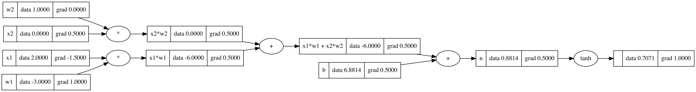

Backpropagation is how a neural network figures out which way to move each weight. The name sounds scary, but it's really just the chain rule, applied one node at a time on a computational graph. Here I do it once by hand for a single neuron, then put the same logic into a tiny autograd engine (code that computes gradients for you) and check the answer against PyTorch.

## The chain rule in one sentence

If $o$ depends on $n$, and $n$ depends on $w$, then

$$
\frac{\partial o}{\partial w} = \frac{\partial o}{\partial n}\cdot\frac{\partial n}{\partial w}.
$$

The first part is the gradient that has already reached $n$ coming back from the output. The second part is the *local* derivative of just one operation. So basically, backpropagation starts at the output with $\partial o/\partial o = 1$ and keeps multiplying by local derivatives, step by step, until it reaches the inputs.

## Simple rules for each operation

Each operation only has to know how to hand a gradient back to its own inputs. Nothing else. Write $\bar{v}$ for $\partial o/\partial v$, the gradient of the final output with respect to node $v$.

| Operation | Local rule |
|---|---|
| $c = a + b$ | $\bar a \mathrel{+}= \bar c$, $\bar b \mathrel{+}= \bar c$ (addition copies the gradient to both inputs) |
| $c = a \cdot b$ | $\bar a \mathrel{+}= b\,\bar c$, $\bar b \mathrel{+}= a\,\bar c$ (each input gets the *other* input times the gradient) |
| $c = \tanh(a)$ | $\bar a \mathrel{+}= (1 - c^2)\,\bar c$ |
| $c = a^k$ ($k$ a constant) | $\bar a \mathrel{+}= k\,a^{k-1}\,\bar c$ |
| $c = e^a$ | $\bar a \mathrel{+}= c\,\bar c$ |

The `+=` is important, and it's an easy bug to miss. If a value is used in more than one place, its gradient is the *sum* of what comes back from each use (that's the multivariable chain rule). Plain `=` would overwrite one part with another, so `b = a + a` would give $\bar a = 1$ instead of 2.

## Doing it by hand for one neuron

Take the neuron from the previous note: $n = x_1w_1 + x_2w_2 + b$ and $o = \tanh(n)$, with $x_1=2$, $x_2=0$, $w_1=-3$, $w_2=1$ and $b \approx 6.8814$. Then $n \approx 0.8814$ and $o \approx 0.7071$.

1. $\bar o = 1$.
2. $\bar n = 1 - o^2 = 1 - 0.5 = 0.5$.
3. The two additions copy the gradient: $\bar b = 0.5$, and the terms $x_1w_1$ and $x_2w_2$ each get $0.5$.
4. The multiplications swap: $\bar x_1 = w_1 \cdot 0.5 = -1.5$, $\bar w_1 = x_1 \cdot 0.5 = 1.0$, $\bar x_2 = w_2 \cdot 0.5 = 0.5$, $\bar w_2 = x_2 \cdot 0.5 = 0$.

$\bar w_2 = 0$ makes sense: $x_2 = 0$, so wiggling $w_2$ does nothing to the output right now.



## Automating it

Each operation saves a small function, `_backward`, that applies its local rule. The tricky part is the order. A node can only pass its gradient back once it has received everything from all the nodes that use it. A topological sort (an ordering where every node comes after its inputs) gives exactly that, and then we just walk it backwards.

```python
import math

class Value:
    def __init__(self, data, _children=(), _op=''):
        self.data, self.grad = data, 0.0
        self._prev, self._op = set(_children), _op
        self._backward = lambda: None          # leaf nodes do nothing

    def __add__(self, other):
        other = other if isinstance(other, Value) else Value(other)
        out = Value(self.data + other.data, (self, other), '+')
        def _backward():
            self.grad += out.grad
            other.grad += out.grad
        out._backward = _backward
        return out

    def __mul__(self, other):
        other = other if isinstance(other, Value) else Value(other)
        out = Value(self.data * other.data, (self, other), '*')
        def _backward():
            self.grad += other.data * out.grad
            other.grad += self.data * out.grad
        out._backward = _backward
        return out

    def tanh(self):
        t = math.tanh(self.data)
        out = Value(t, (self,), 'tanh')
        def _backward():
            self.grad += (1 - t**2) * out.grad
        out._backward = _backward
        return out

    def backward(self):
        topo, visited = [], set()
        def build(v):                     # children first, then the node
            if v not in visited:
                visited.add(v)
                for child in v._prev:
                    build(child)
                topo.append(v)
        build(self)
        self.grad = 1.0
        for v in reversed(topo):          # output first, inputs last
            v._backward()
```

```python
x1, x2, w1, w2 = Value(2.0), Value(0.0), Value(-3.0), Value(1.0)
b = Value(6.8813735870195432)
o = (x1*w1 + x2*w2 + b).tanh()
o.backward()
print(x1.grad, w1.grad, x2.grad, w2.grad)   # -1.5  1.0  0.5  0.0
```

## Growing the engine

A few more methods make the engine actually usable:

- `__radd__` and `__rmul__` so that `2 * v` and `1 + v` work.
- `__neg__` as `self * -1`, and `__sub__` as `self + (-other)`.
- `__pow__` for a constant exponent, and `__truediv__` as `self * other**-1`.
- `exp()` with the local rule $\bar a \mathrel{+}= e^a\,\bar c$.

A nice test is to build `tanh` out of smaller pieces, $\tanh(n) = (e^{2n} - 1)/(e^{2n} + 1)$, and backpropagate through that bigger graph. The gradients on $x_1, w_1, x_2, w_2$ come out the same. That was a good moment for me: how big or small you make each operation is up to you, as long as each one knows its local derivative.

## Checking against PyTorch

PyTorch does the same thing, just on tensors. Use double precision so the numbers match closely:

```python
import torch

x1 = torch.tensor([2.0], dtype=torch.double, requires_grad=True)
x2 = torch.tensor([0.0], dtype=torch.double, requires_grad=True)
w1 = torch.tensor([-3.0], dtype=torch.double, requires_grad=True)
w2 = torch.tensor([1.0], dtype=torch.double, requires_grad=True)
b = torch.tensor([6.8813735870195432], dtype=torch.double, requires_grad=True)

o = torch.tanh(x1*w1 + x2*w2 + b)
o.backward()
print(x1.grad.item(), w1.grad.item(), x2.grad.item(), w2.grad.item())
# about -1.5, 1.0, 0.5, 0.0
```

Same numbers as micrograd. The only real difference is size: in PyTorch each node is a whole tensor and the operations run on many numbers at once, but the bookkeeping is the same.

## Key takeaways

- Backpropagation is just the chain rule: multiply the incoming gradient by each operation's local derivative.
- Addition copies the gradient to its inputs. Multiplication gives each input the *other* input times the gradient.
- Use `+=` for gradients, because a value used in several places collects gradient from each use.
- Walking a topological order backwards makes sure a node's gradient is complete before it's passed further back.
- PyTorch's autograd gives the same numbers as a 40-line engine that works on single numbers.

## Resources

- Andrej Karpathy, "The spelled-out intro to neural networks and backpropagation: building micrograd", *Neural Networks: Zero to Hero* (video): https://www.youtube.com/watch?v=VMj-3S1tku0. The `Value` engine here is adapted from this lecture.
- Andrej Karpathy, micrograd (repository): https://github.com/karpathy/micrograd
- PyTorch, "A Gentle Introduction to torch.autograd": https://pytorch.org/tutorials/beginner/blitz/autograd_tutorial.html
