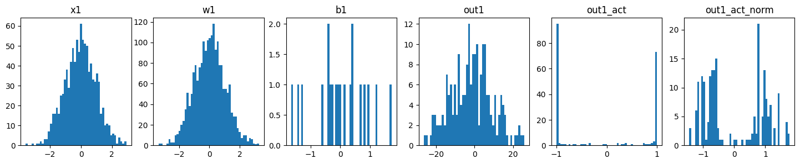
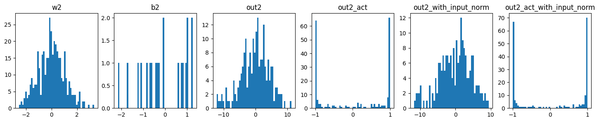

BatchNorm shows up in almost every network, and it's easy to add it without knowing why. What made it click for me was looking at the numbers inside a tiny $\tanh$ network with random weights: almost every activation was stuck at $-1$ or $+1$. Stuck activations pass almost no gradient back, so the network barely learns, and you end up using a tiny learning rate so nothing blows up. Batch normalization keeps the scale of each layer's inputs under control during training. That's why networks with it train faster, put up with bigger learning rates, and care less about how the weights were initialized.

## The problem: activations that drift and get stuck

During training, each layer gets its inputs from all the layers before it. When those earlier weights change, the inputs change too, so the later layers are always chasing a moving target. Ioffe and Szegedy called this *internal covariate shift*. ("Covariate shift" is the old name for when a model's input distribution changes between training and use.)

One clear symptom is saturation, which just means the activation is pinned at its flat part. Take a layer $z = g(Wu + b)$ with a sigmoid or $\tanh$ activation $g$. When $|Wu + b|$ is large, $g'$ is almost zero, so almost no gradient flows back to $u$ or to the weights below. And large pre-activations (the values before the activation) happen easily: with random weights, the variance of a sum grows with the number of inputs, called the fan-in.

I checked this with a small experiment: a batch of 10 inputs with 100 features, random normal weights to a 20-unit $\tanh$ layer, then a second 20-unit $\tanh$ layer.



With fan-in 100 and unit-variance weights, the pre-activations have a standard deviation of about 10. Almost every $\tanh$ output is stuck at $\pm 1$. This is the part that tripped me up: normalizing the *outputs* afterwards barely helps. It just moves the two clusters back to around $\pm 1$.



The second layer saturates either way, because its own weights are again too big for its fan-in. So what you need to control is the input to the nonlinearity, layer by layer. That's exactly where the original paper puts BatchNorm: after the linear layer and before the activation.

## The formula

For one feature, take its values over a mini-batch of size $m$, $x_1, \dots, x_m$. BatchNorm computes

$$
\mu_B = \frac{1}{m}\sum_{i=1}^{m} x_i, \qquad
\sigma_B^2 = \frac{1}{m}\sum_{i=1}^{m} (x_i - \mu_B)^2,
$$

$$
\hat x_i = \frac{x_i - \mu_B}{\sqrt{\sigma_B^2 + \epsilon}}, \qquad
y_i = \gamma\,\hat x_i + \beta .
$$

- $\mu_B$ and $\sigma_B^2$ are the batch mean and (biased) batch variance of that feature.
- $\epsilon$ is a small constant (PyTorch uses $10^{-5}$) so you don't divide by zero when the variance is tiny.
- $\hat x_i$ has zero mean and unit variance over the batch.
- $\gamma$ (scale) and $\beta$ (shift) are learned per feature. They give back the freedom that normalizing took away. With $\gamma = \sqrt{\sigma_B^2+\epsilon}$ and $\beta = \mu_B$, the layer could even undo the normalization if that turned out to be best.

So basically: standardize, then let the network pick its own scale and offset. Every feature (every channel, for convolutions) gets its own $\mu$, $\sigma^2$, $\gamma$ and $\beta$. Since $\beta$ already shifts the output, the bias of the linear or conv layer before it is useless, so that layer is usually created with `bias=False`.

## Training vs. test time

During training the statistics come from the current batch. That has two side effects. Each example's output depends a bit on which other examples are in its batch, which adds noise and works as a mild regularizer. And you can't use it like that at test time, where you might have a single example and want the same answer every time.

So BatchNorm keeps running estimates of the mean and variance, updated at every training step:

$$
\hat\mu \leftarrow (1-\alpha)\,\hat\mu + \alpha\,\mu_B, \qquad
\hat\sigma^2 \leftarrow (1-\alpha)\,\hat\sigma^2 + \alpha\,\sigma_B^2,
$$

where $\alpha$ is the momentum (0.1 by default in PyTorch). At test time the layer uses $\hat\mu$ and $\hat\sigma^2$ instead of batch statistics, so it's just a fixed scale-and-shift per feature. (A small detail: PyTorch normalizes with the biased batch variance but stores the unbiased one, with $m-1$ in the denominator, in the running estimate.)

```python
import numpy as np

def batchnorm(x, gamma, beta, state, training, momentum=0.1, eps=1e-5):
    """x: (batch, features). state holds running 'mean' and 'var'."""
    if training:
        mu, var = x.mean(axis=0), x.var(axis=0)            # biased variance
        m = x.shape[0]
        state['mean'] = (1 - momentum) * state['mean'] + momentum * mu
        state['var'] = (1 - momentum) * state['var'] + momentum * var * m / (m - 1)
    else:
        mu, var = state['mean'], state['var']
    x_hat = (x - mu) / np.sqrt(var + eps)
    return gamma * x_hat + beta

x = np.random.randn(32, 20) * 10 + 3            # badly scaled pre-activations
state = {'mean': np.zeros(20), 'var': np.ones(20)}
y = batchnorm(x, np.ones(20), np.zeros(20), state, training=True)
print(y.mean(axis=0)[:3].round(3), y.std(axis=0)[:3].round(3))   # ~0 and ~1
```

In PyTorch this is `nn.BatchNorm1d(num_features)` for (batch, features) data and `nn.BatchNorm2d(channels)` for images. You switch between the two modes with `model.train()` and `model.eval()`. Forgetting `model.eval()` before evaluating is a really common bug: predictions then depend on the batch, and the running statistics keep changing on test data.

## Why it helps (and what people still argue about)

What's clear in practice:

- Pre-activations stay in a sensible range, so activations like $\tanh$ keep passing useful gradients.
- Gradients depend less on the scale of the weights, so higher learning rates stay stable and initialization matters less.
- The batch noise gives a small regularization effect, so you often need less dropout.

Why it works is less clear than the original paper made it sound. Santurkar et al. (2018) showed that BatchNorm still helps even when you deliberately add noise after it to bring the distribution shift back. Their explanation is that it makes the loss surface smoother, so gradients are more reliable and bigger steps are safe. The way I think about it: "reducing internal covariate shift" is a good story for why people tried it, but probably not the main reason it works.

## Limits and alternatives

BatchNorm needs fairly large batches. With very small batches, $\mu_B$ and $\sigma_B^2$ are noisy and training and test behaviour drift apart. It's also awkward for sequence models with different lengths. The first two alternatives below normalize over other axes, so they behave the same in training and at test time:

- **Layer Normalization**: normalizes over the features of each single example. It's the standard choice in Transformers.
- **Group Normalization**: normalizes over groups of channels per example. It's popular in detection and segmentation with small batches.
- **Batch Renormalization**: keeps the batch axis, but adds a correction towards the running statistics so training and test behaviour match better with small batches.

## Key takeaways

- BatchNorm standardizes each feature over the mini-batch, then applies a learned scale $\gamma$ and shift $\beta$. $\epsilon$ keeps the division safe.
- Put it on the input to the nonlinearity. Normalizing after a saturated activation is too late.
- Training uses batch statistics and test time uses running averages, so always call `model.eval()` before evaluating.
- It allows higher learning rates and makes initialization matter less. The deeper reason is probably a smoother loss surface.
- For small batches or sequences, use LayerNorm or GroupNorm instead.

## Resources

- Sergey Ioffe, Christian Szegedy, "Batch Normalization: Accelerating Deep Network Training by Reducing Internal Covariate Shift" (2015): https://arxiv.org/abs/1502.03167
- Shibani Santurkar et al., "How Does Batch Normalization Help Optimization?" (2018): https://arxiv.org/abs/1805.11604
- Johan Bjorck et al., "Understanding Batch Normalization" (2018): https://arxiv.org/abs/1806.02375
- Xavier Glorot, Yoshua Bengio, "Understanding the difficulty of training deep feedforward neural networks" (2010): https://proceedings.mlr.press/v9/glorot10a/glorot10a.pdf
- Yann LeCun et al., "Efficient BackProp" (1998), on why whitened inputs train faster: https://cseweb.ucsd.edu/classes/wi08/cse253/Handouts/lecun-98b.pdf
- Jimmy Lei Ba, Jamie Ryan Kiros, Geoffrey Hinton, "Layer Normalization" (2016): https://arxiv.org/abs/1607.06450
- Yuxin Wu, Kaiming He, "Group Normalization" (2018): https://arxiv.org/abs/1803.08494
- Sergey Ioffe, "Batch Renormalization" (2017): https://arxiv.org/abs/1702.03275
- Yuxin Wu, Justin Johnson, "Rethinking 'Batch' in BatchNorm" (2021): https://arxiv.org/abs/2105.07576
- Lei Huang et al., "Normalization Techniques in Training DNNs: Methodology, Analysis and Application" (2020): https://arxiv.org/abs/2009.12836
- Andrej Karpathy, "Building makemore Part 3: Activations & Gradients, BatchNorm" (video): https://www.youtube.com/watch?v=P6sfmUTpUmc
- PyTorch docs, `torch.nn.BatchNorm1d`: https://pytorch.org/docs/stable/generated/torch.nn.BatchNorm1d.html
