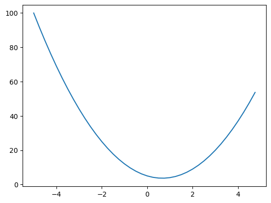
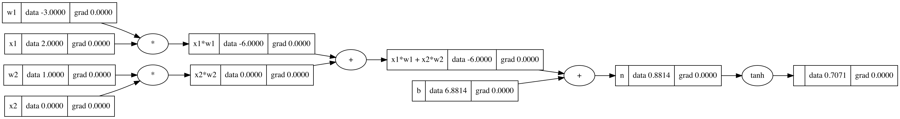

Every deep learning framework does the same trick. It writes down your calculation as a graph, then walks that graph backwards to get the gradients. Before I could understand backpropagation, I needed to see that graph clearly. So this note is about three things: what a derivative actually tells you, how a formula turns into a graph, and how to build and draw that graph with a few lines of Python.

## What a derivative tells you

A derivative answers one simple question: if I push $x$ a tiny bit (by $h$), how much does $f$ move, compared to that push?

$$
f'(x) = \lim_{h \to 0} \frac{f(x+h) - f(x)}{h}
$$

$h$ is just the size of the push. If you pick a small but real $h$ instead of taking the limit, you get a numerical estimate. That's a handy way to check your gradients later.

```python
def f(x):
    return 3*x**2 - 4*x + 5

h = 1e-6
x = -3.0
print((f(x + h) - f(x)) / h)   # about -22.0; exact: f'(x) = 6x - 4 = -22
```



At $x=-3$ the curve drops fast as $x$ grows, so the slope is big and negative. At $x = 2/3$ the slope is zero. That's the bottom of the curve.

It works the same with more than one input. Take $d = a \cdot b + c$ and push one input at a time. That gives the partial derivatives (the slope with respect to one input while the others stay fixed): $\partial d/\partial a = b$, $\partial d/\partial b = a$ and $\partial d/\partial c = 1$. The numbers agree: with $a=2$, $b=3$, $c=10$ the estimates come out at about 3, 2 and 1.

## Turning a formula into a graph

A computational graph is just a diagram with arrows and two kinds of boxes:

- **Value nodes** hold numbers: inputs, parameters, in-between results and the output.
- **Operation nodes** (`+`, `*`, `tanh`, ...) take values in and spit out a new value.

The arrows (edges) show which values go into which operation. For $z = (x + y)\cdot w$, $x$ and $y$ go into `+`, then that result and $w$ go into `*`, and `*` gives $z$. Numbers flow left to right. Later, gradients will flow right to left along the same arrows.

I first drew these graphs by hand with the `graphviz` package:

```python
from graphviz import Digraph

g = Digraph(graph_attr={'rankdir': 'LR'})          # left-to-right layout
for name in ['x', 'y', 'w', 'z']:
    g.node(name, name)
g.node('add', '+', shape='circle')
g.node('mul', '*', shape='circle')
g.edges([('x', 'add'), ('y', 'add'), ('add', 'mul'), ('w', 'mul'), ('mul', 'z')])
g   # renders in a notebook
```

I also tried building the graph automatically by reading strings like `"z = ((x + y) - (p + r)) * w"` one character at a time. That's fine for tiny examples, but it falls apart fast once you have nested brackets and operator order to deal with. Still, it taught me something: you don't need a parser at all. If every operation remembers its own inputs while it runs, the graph builds itself.

## Letting the code build the graph

The micrograd way is to wrap each number in a small `Value` object. The `+` and `*` operators are overloaded so they compute the result and also remember which values made it.

```python
import math

class Value:
    def __init__(self, data, _children=(), _op='', label=''):
        self.data = data
        self._prev = set(_children)   # the values this one was computed from
        self._op = _op                # the operation that produced it
        self.label = label
        self.grad = 0.0               # filled in later by backpropagation

    def __add__(self, other):
        return Value(self.data + other.data, (self, other), '+')

    def __mul__(self, other):
        return Value(self.data * other.data, (self, other), '*')

    def tanh(self):
        return Value(math.tanh(self.data), (self,), 'tanh')
```

Now a normal-looking expression builds a graph on the side. Here's a single neuron with two inputs, $o = \tanh(x_1 w_1 + x_2 w_2 + b)$:

```python
x1, x2 = Value(2.0, label='x1'), Value(0.0, label='x2')
w1, w2 = Value(-3.0, label='w1'), Value(1.0, label='w2')
b = Value(6.8813735870195432, label='b')
n = x1*w1 + x2*w2 + b
o = n.tanh()
print(o.data)   # 0.7071...
```

The weird bias value is picked on purpose: it makes $n \approx 0.8814$ and $o = \tanh(n) \approx 1/\sqrt{2}$, so the numbers come out nice later.

## Walking the graph

To draw or process the graph, start at the output and keep following the `_prev` links, collecting nodes and edges as you go:

```python
def trace(root):
    nodes, edges = set(), set()
    def build(v):
        if v not in nodes:
            nodes.add(v)
            for child in v._prev:
                edges.add((child, v))
                build(child)
    build(root)
    return nodes, edges
```

Give these sets to `graphviz` (one box per value showing its label, data and grad, plus a small node for each operation) and you get the picture below.



All the `grad` fields are still zero. Filling them in is what backpropagation does, and that's the next note: [backpropagation with micrograd](/notes/backpropagation-micrograd/). The thing to notice here is that the graph already has everything we need. Each node knows its inputs and the operation that combined them, and each operation has a simple local derivative.

## Key takeaways

- A derivative tells you how much the output moves when you nudge one input a little. A finite-difference estimate is a good quick check.
- A computational graph breaks a formula into value nodes and operation nodes, connected by arrows.
- You don't need to parse formulas. If each operation remembers its inputs, just running the code builds the graph.
- Walking back from the output through the stored inputs gives you the whole graph. That's the starting point for automatic differentiation.

## Resources

- Andrej Karpathy, "The spelled-out intro to neural networks and backpropagation: building micrograd", *Neural Networks: Zero to Hero* (video): https://www.youtube.com/watch?v=VMj-3S1tku0. The `Value` class, `trace` function and the neuron example are adapted from this lecture.
- Andrej Karpathy, micrograd (repository): https://github.com/karpathy/micrograd
- Graphviz Python package documentation: https://graphviz.readthedocs.io/
