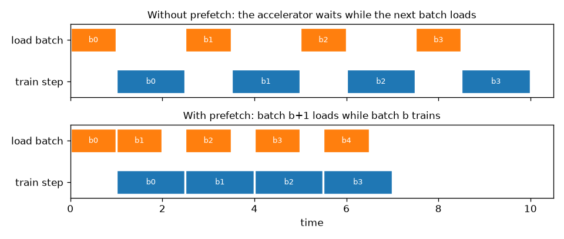

A training step on a GPU can take a few milliseconds. Reading a JPEG from disk, decoding it, resizing it and augmenting it can take longer. If those two things happen one after the other, the expensive accelerator spends much of its time idle. An input pipeline fixes this by streaming data: it loads lazily, does the CPU work in parallel, and prepares the next batch while the current one trains. The same pipeline is also where several silent bugs live, so this note covers both speed and correctness. The examples use `tf.data`, with the PyTorch equivalent at the end; the ideas are the same in both.

## The stages

Almost every pipeline has the same stages, in roughly this order:

1. **List** the samples, usually file paths, which are cheap to hold in memory.
2. **Split** into training and validation sets, once, before anything random happens.
3. **Shuffle** the training set.
4. **Load and decode** each sample (read bytes, decode the image, resize). This step is slow and runs in parallel.
5. **Cache** the decoded samples, if they fit in memory or on a fast disk.
6. **Augment** (random flips, crops, colour changes). This must run *after* the cache, or every epoch will see the same "random" version.
7. **Batch.**
8. **Prefetch**, so the next batch is ready before the model asks for it.

```python
import tensorflow as tf
AUTOTUNE = tf.data.AUTOTUNE

def make_pipeline(paths_ds, load_fn, augment_fn, batch_size, training):
    ds = paths_ds
    if training:
        ds = ds.shuffle(buffer_size=10_000)                  # shuffle paths: cheap, small buffer
    ds = ds.map(load_fn, num_parallel_calls=AUTOTUNE)        # read + decode on several CPU cores
    ds = ds.cache()                                          # decoded once, reused every epoch
    if training:
        ds = ds.map(augment_fn, num_parallel_calls=AUTOTUNE) # new random augmentation each epoch
    return ds.batch(batch_size).prefetch(AUTOTUNE)           # overlap loading with training
```

Shuffling paths before loading is cheap, because the shuffle buffer holds strings, not images. Note that `shuffle` only mixes within its buffer: with a buffer of 100 and a dataset sorted by class, the first batches will still contain only the first class. Use a buffer at least as large as the dataset when you can, or shuffle the file list once up front.

## Why prefetch and parallel map matter

`map(..., num_parallel_calls=AUTOTUNE)` decodes several samples at once on different CPU cores. `prefetch` runs the pipeline in the background, so batch $b+1$ is prepared while batch $b$ trains.



A small benchmark with a fake 10 ms "decode" and a fake 20 ms "training step" shows the effect:

```python
import time

def slow_load(i):                      # stands in for reading and decoding one image: 10 ms
    return tf.py_function(lambda x: (time.sleep(0.01), x)[1], [i], tf.int64)

def run(ds, train_step_s=0.02):
    t = time.perf_counter()
    for _ in ds:
        time.sleep(train_step_s)       # stands in for one training step: 20 ms
    return time.perf_counter() - t

base = tf.data.Dataset.range(256)
naive = base.map(slow_load).batch(8)
fast = base.map(slow_load, num_parallel_calls=AUTOTUNE).batch(8).prefetch(AUTOTUNE)
print(f"naive: {run(naive):.2f} s, parallel map + prefetch: {run(fast):.2f} s")
# naive: 3.20 s, parallel map + prefetch: 0.79 s
```

The naive version pays $32 \times (8 \times 10 + 20)$ ms $\approx 3.2$ s. The fast one is close to the pure training time of $32 \times 20$ ms $= 0.64$ s. Once loading is fully hidden, the model is the bottleneck, which is where you want it to be.

## Bug 1: a split that changes every epoch

My first segmentation pipeline listed the image files and then split them with `take` and `skip`:

```python
files = tf.data.Dataset.from_tensor_slices([f"img_{i:02d}.jpg" for i in range(10)])
shuffled = files.shuffle(10, reshuffle_each_iteration=True)   # what list_files() does by default
train, val = shuffled.take(8), shuffled.skip(8)

seen_in_val = set()
for epoch in range(5):
    seen_in_val |= {v.decode() for v in val.as_numpy_iterator()}
print(len(seen_in_val), "different files appeared in 'validation' over 5 epochs")   # several, e.g. 4 to 7
```

`Dataset.list_files` shuffles by default, and the shuffle is redone every epoch. So `take` and `skip` pick a *different* subset each time, and over a few epochs the model trains on every validation image. The validation score then looks far better than reality. The fix is to make the order fixed (`shuffle=False`, or one shuffle with `reshuffle_each_iteration=False`), split, and only then shuffle the training part. Better still, split the file lists on disk before building any pipeline, and split by group when samples are correlated (see [grouped cross-validation](/notes/grouped-cross-validation/)).

## Bug 2: interpolated masks

A segmentation mask stores class IDs, not intensities. Resizing it like an image invents labels that do not exist:

```python
mask = tf.constant([[0, 0, 3, 3]] * 4, dtype=tf.float32)[..., None]   # labels 0 and 3 only
print(sorted(set(tf.image.resize(mask, [4, 8], method="bilinear").numpy().ravel())))
# [0.0, 0.75, 2.25, 3.0]   <- 0.75 and 2.25 are not classes
print(sorted(set(tf.image.resize(mask, [4, 8], method="nearest").numpy().ravel())))
# [0.0, 3.0]
```

After casting to integers, the boundary between class 0 and class 3 gains a thin band of classes 0 to 2. Always resize masks, and apply geometric augmentation to them, with **nearest-neighbour** interpolation. I had used the same `decode_and_resize` function for images and masks; the masks needed their own.

## Bug 3 and 4: augmentation that is misaligned or not random

For segmentation and detection, every geometric change to the image must be applied identically to the label. Colour changes go to the image only. The clean way is a stateless random op with one shared seed per sample:

```python
def augment_pair(image, mask):
    seed = tf.random.uniform([2], maxval=2**31 - 1, dtype=tf.int32)  # a TF op: new value per element
    image = tf.image.stateless_random_flip_left_right(image, seed)
    mask = tf.image.stateless_random_flip_left_right(mask, seed)     # same seed, same flip
    image = tf.image.stateless_random_brightness(image, 0.2, seed)  # colour: image only
    return image, mask
```

My first version made the seed with NumPy: `seed = tf.constant([rng.integers(0, 100), ...])`. That looks random, but `Dataset.map` traces the function into a graph **once**. Python and NumPy code runs only during that trace, so the seed became a constant, and every sample got the same "random" flip:

```python
import numpy as np
rng = np.random.default_rng()

def augment_wrong(x):
    seed = tf.constant([rng.integers(0, 100), rng.integers(0, 100)])   # runs once, at trace time
    return tf.image.stateless_random_flip_left_right(x, seed), seed

ds = tf.data.Dataset.from_tensors(tf.zeros([2, 2, 1])).repeat(4).map(augment_wrong)
print([tuple(s.numpy()) for _, s in ds])   # the same seed four times
```

The general rule: inside anything that is traced into a graph (`Dataset.map`, `tf.function`, and also `torch.compile` in many cases), randomness must come from the framework's own random ops. Python-side randomness is frozen at trace time.

## The same ideas in PyTorch

PyTorch splits the job between a `Dataset`, which knows how to load sample $i$, and a `DataLoader`, which handles shuffling, batching and parallelism:

| tf.data | PyTorch |
|---|---|
| `map(load, num_parallel_calls=AUTOTUNE)` | `DataLoader(num_workers=k)`: $k$ worker processes call `__getitem__` |
| `prefetch(n)` | `prefetch_factor` batches per worker, ready in advance |
| `shuffle(buffer)` | `shuffle=True` (a full permutation of indices each epoch) |
| `cache()` | keep decoded tensors in the `Dataset`, or pre-decode to fast storage |
| — | `pin_memory=True` for faster host-to-GPU copies |

With the same fake 10 ms load and 20 ms step, four workers cut the time from 3.9 s to 2.4 s on my laptop. Most of the rest was the cost of starting worker processes on macOS, which `persistent_workers=True` pays only once across epochs. Because PyTorch workers run ordinary Python, NumPy randomness *does* change per sample. Each worker needs its own seed, though, or older setups can give identical augmentations in every worker (see `worker_init_fn` in the docs).

## Key takeaways

- Stream the data: list paths, decode in parallel, cache decoded samples, augment after the cache, batch, and prefetch.
- Prefetching overlaps loading with training; when it works, epoch time approaches pure compute time.
- Split once, before any shuffling. A reshuffled source followed by `take`/`skip` silently leaks validation data into training.
- Resize and warp masks with nearest-neighbour interpolation, and apply geometric augmentations to image and label with the same random parameters.
- In traced code, randomness must come from framework ops; Python or NumPy random calls run once, at trace time.

## Resources

- TensorFlow guide, "tf.data: Build TensorFlow input pipelines": [tensorflow.org/guide/data](https://www.tensorflow.org/guide/data)
- TensorFlow guide, "Better performance with the tf.data API" (prefetch, parallel map, cache ordering): [tensorflow.org/guide/data_performance](https://www.tensorflow.org/guide/data_performance)
- TensorFlow tutorial, "Data augmentation" (stateless random ops): [tensorflow.org/tutorials/images/data_augmentation](https://www.tensorflow.org/tutorials/images/data_augmentation)
- PyTorch docs, `torch.utils.data` (workers, prefetch_factor, pin_memory, worker seeding): [pytorch.org/docs/stable/data.html](https://pytorch.org/docs/stable/data.html)
- Murray, Simsa, Klimovic, Indyk, "tf.data: Fast, Flexible, and Easy-to-Use Input Pipelines for Machine Learning", VLDB 2021. [arXiv:2101.12127](https://arxiv.org/abs/2101.12127)
- Related notes: [grouped cross-validation](/notes/grouped-cross-validation/), [photometric colour augmentation](/notes/photometric-colour-augmentation/), [tiling large images](/notes/tiling-large-images-for-detection/).
