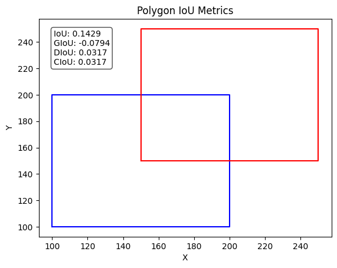
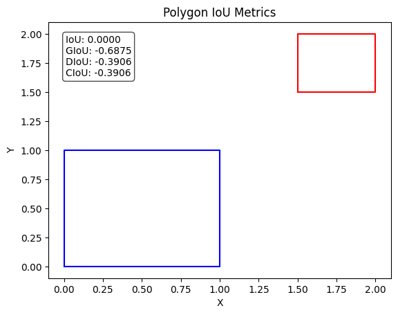

Detection and segmentation models get scored on overlap: does the predicted box or mask cover the same area as the ground truth? But the classic training losses look at something else, like L1/L2 errors on each coordinate or cross-entropy on each pixel. Overlap-based losses close that gap by training on the overlap itself. Here I go through the IoU family for boxes first, then Dice and Tversky for masks.

## IoU and where it falls short

For a predicted region $A$ and a ground-truth region $B$, Intersection over Union is

$$
\text{IoU} = \frac{|A \cap B|}{|A \cup B|},
$$

where $|\cdot|$ means area (or pixel count). It's 1 for a perfect match and 0 for no overlap. It also doesn't care about scale: a 5-pixel error matters much more on a small box than on a big one, which is exactly how detection is scored. The obvious loss is $\mathcal{L}_{\text{IoU}} = 1 - \text{IoU}$.

The catch: when the boxes don't overlap at all, IoU is 0 no matter how far apart they are. The loss is flat, so the gradient is zero and tells the model nothing about which way to move the box. And early in training, that happens a lot.

## GIoU: count the empty space in the enclosing box

Generalized IoU (Rezatofighi et al., 2019) uses $C$, the smallest box that contains both $A$ and $B$:

$$
\text{GIoU} = \text{IoU} - \frac{|C| - |A \cup B|}{|C|}.
$$

The second term is the part of $C$ that neither box covers. When the boxes are far apart, $C$ is mostly empty and GIoU gets close to $-1$. As they move closer the penalty shrinks, so there's a useful gradient even with zero overlap. GIoU lies in $(-1, 1]$, and the loss is $1 - \text{GIoU}$.

## DIoU: pull the centres together directly

GIoU tends to first grow the predicted box until it touches the target, then shrink it again, which is slow. Distance-IoU (Zheng et al., 2020) just penalizes the distance between the centres instead:

$$
\text{DIoU} = \text{IoU} - \frac{\rho^2(\mathbf{b}, \mathbf{b}^{gt})}{c^2},
$$

where $\rho$ is the straight-line distance between the two box centres and $c$ is the diagonal of the enclosing box $C$. Dividing by $c^2$ keeps the term between 0 and 1 and makes it independent of scale.

## CIoU: match the shape too

Complete IoU (same paper) adds a term for the aspect ratio (width vs. height):

$$
\text{CIoU} = \text{DIoU} - \alpha v, \qquad
v = \frac{4}{\pi^2}\Big(\arctan\frac{w^{gt}}{h^{gt}} - \arctan\frac{w}{h}\Big)^2, \qquad
\alpha = \frac{v}{(1 - \text{IoU}) + v}.
$$

Here $w, h$ are the width and height of the predicted box and $w^{gt}, h^{gt}$ are those of the ground truth. $v$ is 0 when the aspect ratios match. One thing I got wrong at first: $\alpha$ isn't a constant you pick. It's computed from IoU and $v$, so the shape term matters more once the boxes already overlap well. My original notebook used a fixed $\alpha = 0.5$, which isn't the published definition. CIoU loss is the default box loss in several YOLO versions.

```python
import math

def box_ious(a, b):
    """a, b: boxes as (x1, y1, x2, y2). Returns IoU, GIoU, DIoU, CIoU."""
    area = lambda r: max(r[2] - r[0], 0) * max(r[3] - r[1], 0)
    inter = area((max(a[0], b[0]), max(a[1], b[1]), min(a[2], b[2]), min(a[3], b[3])))
    union = area(a) + area(b) - inter
    iou = inter / union
    c = (min(a[0], b[0]), min(a[1], b[1]), max(a[2], b[2]), max(a[3], b[3]))  # enclosing box
    giou = iou - (area(c) - union) / area(c)
    rho2 = ((a[0] + a[2] - b[0] - b[2]) ** 2 + (a[1] + a[3] - b[1] - b[3]) ** 2) / 4
    c2 = (c[2] - c[0]) ** 2 + (c[3] - c[1]) ** 2
    diou = iou - rho2 / c2
    v = 4 / math.pi**2 * (math.atan((b[2] - b[0]) / (b[3] - b[1]))
                          - math.atan((a[2] - a[0]) / (a[3] - a[1]))) ** 2
    alpha = v / ((1 - iou) + v) if v > 0 else 0.0
    return iou, giou, diou, diou - alpha * v

print(box_ious((100, 100, 200, 200), (150, 150, 250, 250)))  # 0.143, -0.079, 0.032, 0.032
print(box_ious((0, 0, 1, 1), (1.5, 1.5, 2, 2)))              # 0.0, -0.688, -0.391, -0.391
```



For the two offset squares, the union is 17,500 and the enclosing box is 22,500, so GIoU subtracts $5{,}000/22{,}500 \approx 0.22$ from IoU. Both are squares, so $v = 0$ and CIoU is the same as DIoU.



For the pair that doesn't overlap, IoU is stuck at 0, while GIoU and DIoU are negative and would go up as the boxes get closer. That's exactly the signal plain IoU loss is missing.

## Dice and Tversky for masks

For masks it's the same overlap idea, just counted over pixels. With a ground-truth mask $y_i \in \{0,1\}$ and predicted probabilities $p_i \in [0,1]$, the "soft" counts are

$$
TP = \sum_i p_i y_i, \qquad FP = \sum_i p_i (1 - y_i), \qquad FN = \sum_i (1 - p_i) y_i .
$$

TP, FP and FN are true positives, false positives and false negatives. Using probabilities instead of a thresholded 0/1 mask keeps everything differentiable, so you can train on it.

**Soft Jaccard (IoU)**: $J = TP / (TP + FP + FN)$, loss $1 - J$.

**Dice** (basically the F1 score of the mask):

$$
\text{Dice} = \frac{2\,TP}{2\,TP + FP + FN} = \frac{2|A\cap B|}{|A| + |B|}.
$$

Dice and Jaccard rank predictions the same way ($\text{Dice} = 2J/(1+J)$), but Dice gives a higher number for the same partial overlap. Both are popular for medical and aerial segmentation, where the foreground can be a tiny part of the image. There, pixel-wise cross-entropy gets dominated by the background, while Dice only looks at the foreground.

**Tversky** extends Dice by weighting the two kinds of error separately:

$$
\text{TI} = \frac{TP}{TP + \alpha\,FP + \beta\,FN}.
$$

With $\alpha = \beta = 0.5$ it's Dice, and with $\alpha = \beta = 1$ it's Jaccard. Setting $\beta > \alpha$ (for example $\alpha = 0.3$, $\beta = 0.7$) punishes missed foreground more than false alarms, which helps recall on small structures.

```python
import numpy as np

def overlap_losses(y, p, alpha=0.3, beta=0.7, smooth=1e-7):
    y, p = y.ravel(), p.ravel()
    tp, fp, fn = np.sum(p * y), np.sum(p * (1 - y)), np.sum((1 - p) * y)
    jaccard = (tp + smooth) / (tp + fp + fn + smooth)
    dice = (2 * tp + smooth) / (2 * tp + fp + fn + smooth)
    tversky = (tp + smooth) / (tp + alpha * fp + beta * fn + smooth)
    return 1 - jaccard, 1 - dice, 1 - tversky

y = np.array([[1, 0, 1], [0, 1, 0]])
p = np.array([[0.8, 0.1, 0.6], [0.2, 0.7, 0.3]])
print(overlap_losses(y, p))   # about (0.417, 0.263, 0.278)
```

The small `smooth` term avoids $0/0$ on empty masks. In practice these losses are often added to cross-entropy or focal loss. The pixel-wise term gives steady gradients early in training, and the overlap term matches how the model is scored.

## Key takeaways

- Overlap losses train on the same thing detection and segmentation are scored on, and they don't depend on object size.
- Plain IoU loss has zero gradient when boxes don't overlap. GIoU fixes this with the enclosing box.
- DIoU adds a centre-distance penalty so boxes move into place faster. CIoU adds an aspect-ratio term whose weight $\alpha$ is computed, not fixed.
- Dice and Jaccard work on soft pixel counts and handle tiny foregrounds well. Tversky weights false positives and false negatives separately.

## Resources

- Hamid Rezatofighi et al., "Generalized Intersection over Union: A Metric and A Loss for Bounding Box Regression" (CVPR 2019): https://arxiv.org/abs/1902.09630
- Zhaohui Zheng et al., "Distance-IoU Loss: Faster and Better Learning for Bounding Box Regression" (AAAI 2020), source of DIoU and CIoU: https://arxiv.org/abs/1911.08287
- Fausto Milletari, Nassir Navab, Seyed-Ahmad Ahmadi, "V-Net: Fully Convolutional Neural Networks for Volumetric Medical Image Segmentation" (2016), Dice loss: https://arxiv.org/abs/1606.04797
- Seyed Sadegh Mohseni Salehi, Deniz Erdogmus, Ali Gholipour, "Tversky loss function for image segmentation using 3D fully convolutional deep networks" (2017): https://arxiv.org/abs/1706.05721
- torchvision docs, box losses (`generalized_box_iou_loss`, `distance_box_iou_loss`, `complete_box_iou_loss`): https://pytorch.org/vision/stable/ops.html
