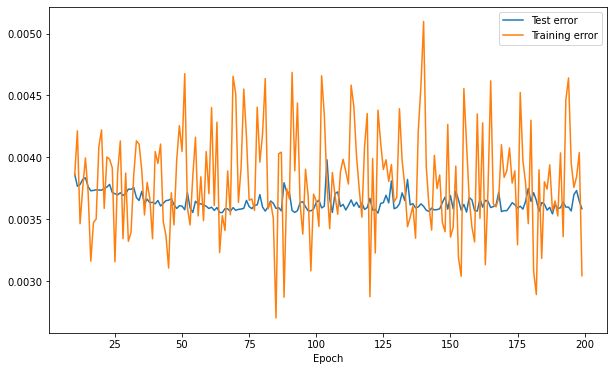

Most RNN tutorials train on many short sequences, like sentences. Time series forecasting often gives you the opposite: *one* long sequence. Then "how do I make batches?" becomes a real modelling choice. In a course lab I trained a small Keras RNN to predict the monthly sunspot number (about 3,250 months, 70% for training) and compared three ways of feeding it the data. The general RNN mechanics are in [my RNN note](/notes/recurrent-neural-networks/). This note is about the time-series setup and the training choices.

## Set up the problem before the model

**Baselines first.** The naive forecast $\hat y_t = y_{t-1}$ costs nothing, and an [AR model](/notes/autoregressive-models-and-order-selection/) is cheap too. On the test part, the naive forecast had an MSE of about 709 and an AR(30) about 590. Any RNN has to beat those numbers to be worth it.

**Predict the change, not the level.** Instead of predicting $y_t$ directly, the target is the residual $\tilde y_t = y_t - y_{t-1}$, and the prediction is $\hat y_t = y_{t-1} + \hat{\tilde y}_t$. That's a skip connection from input to output. The network starts from the naive forecast and only has to learn a correction. For a slowly varying series this is much easier than learning the identity map from scratch.

**Scale the data.** The values ranged roughly from 0 to 400, so we divided by 400. Errors were reported back on the original scale.

## The model

A simple (Elman) RNN with hidden size $d$, input $y_{t-1}$ and a linear output:

$$
\mathbf{h}_t = \tanh(W\mathbf{h}_{t-1} + U y_{t-1} + \mathbf{b}), \qquad \hat{\tilde y}_t = C\mathbf{h}_t + c.
$$

$\mathbf{h}_t$ is the hidden state ($d \times 1$), $W$ is $d \times d$, $U$ is $d \times 1$ (one input feature), $\mathbf{b}$ is $d \times 1$, $C$ is $1 \times d$ and $c$ is a scalar. With $d = 10$ that's $100 + 10 + 10 = 120$ parameters in the recurrent layer and $10 + 1 = 11$ in the output layer, which matches the Keras summary. Keras wants input of shape `(batch, time, features)`, so our single series is `(1, n, 1)`.

```python
import numpy as np
from tensorflow import keras
from tensorflow.keras import layers

y = np.sin(np.arange(3000) / 20) + 0.1 * np.random.randn(3000)  # stand-in series
x_in = y[:-1].reshape(1, -1, 1)               # inputs y_{t-1}
target = (y[1:] - y[:-1]).reshape(1, -1, 1)   # residual targets y_t - y_{t-1}

model = keras.Sequential([
    keras.Input(shape=(None, 1)),
    layers.SimpleRNN(10, return_sequences=True),   # one output per time step
    layers.Dense(1),
])
model.compile(loss="mse", optimizer="rmsprop")
model.fit(x_in, target, epochs=20, batch_size=1, verbose=0)
y_hat = model.predict(x_in, verbose=0).ravel() + y[:-1]   # add back y_{t-1}
```

`return_sequences=True` matters: we want a prediction at every time step, not just the last one.

## Three ways to train

**1. Whole sequence.** Feed the full training series as one sample (`batch_size=1`, one sequence). Each gradient step does backpropagation through all ~2,275 time steps. You get the exact gradient, but only *one* step per epoch, and long backprop chains can have vanishing or exploding gradients. My training and test curves were smooth and slowly decreasing.

**2. Random windows.** Each step, pick a random window (I used 100 time steps), start the hidden state at zero, and take a gradient step on that window. With 22 windows per epoch, the cost per epoch is about the same as option 1, but you get 22 updates instead of one. This is truncated backpropagation through time plus stochastic gradients.



**3. Consecutive stateful windows.** Cut the training series into consecutive windows and feed them in order, with `stateful=True` so the final hidden state of one window becomes the start of the next. Reset the state at the end of each epoch, so the end of the series doesn't leak into its start. This keeps the long-range context that random windows throw away, while still doing many cheap updates.

## What the curves really meant

In my report I explained the jumpy training curve of option 2 by saying the gradient steps were "not linked to the previous iteration" and that more iterations wouldn't help. That's not quite right. Each step still starts from the previous weights, and stochastic gradients do improve the model on average. The jumpiness has more ordinary causes:

- Each update uses a small random window, so the gradient is a noisy estimate of the full one.
- The training loss Keras reports is the average over the windows seen *during* that epoch, and they're different random windows each epoch. Sunspot cycles vary a lot in amplitude, so a batch of windows from big cycles has a much larger error than one from quiet cycles.
- The test loss is computed on the same full test sequence every time, so it looks much calmer.

And it worked: random windowing gave the best test MSE of the three (about 570, versus about 574 for the whole sequence).

For option 3 the training curve was smooth. That's mostly because the same windows are seen in the same order every epoch, so the epoch average doesn't jump around. But the updates are *correlated*: consecutive steps see neighbouring parts of the series, which is the opposite of what SGD assumes. Also, the hidden state carried into each window was computed with slightly older weights. In my run its test error drifted up in the middle of training and it ended worst, at about 615. That's one run on one series, so I wouldn't read it as a general rule. One small bug I'd fix too: I computed the number of windows with integer division, so the last ~75 training points were never used. Rounding up (and setting `steps_per_epoch` to match) covers the whole series.

## How it compared

All three simple RNNs landed close to the AR(30) baseline (test MSE about 570–615 against 590). An optional stacked model with three LSTM layers got about 579, still no real win. On a single, fairly short, noisy series, that's a common outcome. A well-chosen linear model is a strong baseline, and an RNN's flexibility doesn't help much without more data.

## Key takeaways

- With one long series, the batching scheme is a modelling choice: whole sequence, random windows (zero initial state), or consecutive stateful windows.
- Predict the residual $y_t - y_{t-1}$ and add $y_{t-1}$ back; it's a cheap, effective skip connection.
- Always compare against naive and AR baselines.
- Noisy training curves under random windows come from stochastic gradients and changing windows, not from training "forgetting" earlier steps.
- Stateful training needs ordered windows and a state reset each epoch; make sure the windows cover all the data.

## Resources

- 732A80 Time Series and Sequence Learning, Linköping University (course lab 4, autumn 2020).
- Goodfellow, Bengio & Courville, *Deep Learning*, MIT Press, 2016, Chapter 10. https://www.deeplearningbook.org/contents/rnn.html
- Keras documentation, SimpleRNN layer (input shape, `return_sequences`, `stateful`). https://keras.io/api/layers/recurrent_layers/simple_rnn/
- Sunspots dataset on Kaggle. https://www.kaggle.com/robervalt/sunspots
