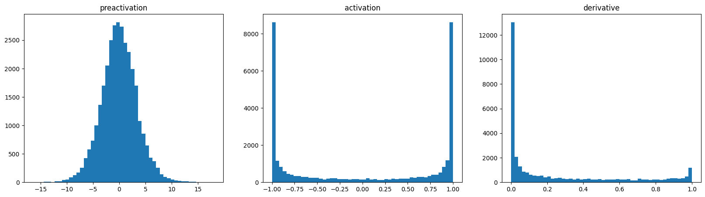
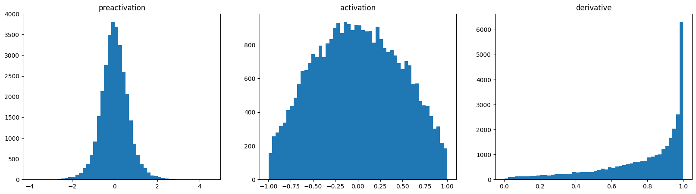

My [MLP language model](/notes/mlp-language-model/) did train. But two things about it bugged me. Its very first loss was around 34, when it should be about 3.3. And lots of its hidden units barely learned anything. Both problems turned out to come from how the weights start out. A two-layer network forgives you for that. A deep one doesn't. So here I track both problems down with a few histograms and fix them with simple scaling rules.

## Know the loss you should expect at step 0

Start with a simple question: what loss should an untrained network have? Before training, it has no reason to prefer any of the 27 characters. So the most honest thing it can do is give them all the same probability. That gives a loss of

$$
-\log\frac{1}{27} = \log 27 \approx 3.30 .
$$

My first run started at about 34. So the network wasn't unsure. It was **confidently wrong**. Some logits (the raw scores before softmax) were big, so softmax put almost all the probability on a few characters, and the right character usually got almost nothing.

A tiny example with 8 classes made it click for me. If all logits are 0, every class gets probability 1/8, and the loss for any target is $\log 8 \approx 2.08$. Now make one wrong logit 5. That class grabs 95% of the probability, every other class gets 0.6%, and the loss on a typical target jumps to about 5. With logits like 10 or 9, the loss for most targets goes above 10.

The logits are `h @ W2 + b2`. To start close to uniform, just make them small: set `b2` to zero and scale `W2` down.

```python
W2 = torch.randn((n_hidden, vocab_size), generator=g) * 0.01
b2 = torch.zeros(vocab_size)
```

With that change the first loss became **3.28**, right where it should be. The loss curve also lost its "hockey stick" shape. Before, the network spent its first thousand steps just shrinking the logits. Now that time goes into learning actual patterns. In my 10,000-step runs, the final training-split loss went from 2.81 to 2.44.

One catch: don't set `W2` exactly to zero. With zero weights, every hidden unit gets the same gradient, so they all stay identical forever. A small random scale keeps them different from each other.

## The second problem: saturated tanh units

The hidden layer is `h = tanh(hpreact)`. The derivative of tanh is

$$
\frac{d}{dx}\tanh(x) = 1 - \tanh^2(x).
$$

So when $|\tanh(x)|$ is close to 1, the derivative is close to 0. Why does that matter? In backprop, the gradient coming into the unit gets multiplied by this local derivative. A **saturated** unit (one stuck near -1 or +1) passes almost no gradient back to its weights or to the layers below. If a unit is saturated for every example in a batch, it doesn't learn at all. It's a **dead neuron**.

The culprit was the pre-activations (the values going into tanh). Their standard deviation was about 5, so most of them landed far out in the flat tails of tanh.



Scaling `W1` by 0.2 and `b1` by 0.01 shrinks the pre-activations into the range where tanh is still roughly a straight line:



Now almost every unit passes a healthy gradient back. In this shallow network the effect on the final loss was small and noisy across my short runs. But in a ten-layer net the same mistake piles up, layer after layer.

## A proper rule instead of magic numbers

Guessing 0.2 stops working when you have many layers of different sizes. So I looked at what a linear layer does to the variance. Say $x$ has $n$ independent inputs with variance 1, and the weights also have variance 1. Then each output $y = \sum_{i=1}^{n} x_i w_i$ is a sum of $n$ terms with variance 1, so

$$
\operatorname{Var}(y) = n \quad\Rightarrow\quad \operatorname{std}(y) = \sqrt{n}.
$$

Here $n$ is the **fan-in**, which just means the number of inputs to each unit. A quick check with 10 inputs gives an output standard deviation of about 3.1, close to $\sqrt{10}$. Divide the weights by $\sqrt{n}$ and the output standard deviation goes back to about 1.

```python
x = torch.randn(1000, 10)
w = torch.randn(10, 200) / 10**0.5   # divide by sqrt(fan_in)
y = x @ w
print(x.std(), y.std())              # both close to 1
```

Nonlinearities like tanh squash the signal, so each one needs a **gain**, an extra factor that makes up for the shrinking. That's the idea behind Kaiming (He) initialization:

$$
W \sim \mathcal{N}\!\left(0,\; \frac{\text{gain}^2}{\text{fan\_in}}\right),
$$

with gain $\sqrt{2}$ for ReLU and $5/3$ for tanh. For the MLP with 10-dimensional embeddings and a context of 3, the fan-in is 30:

```python
W1 = torch.randn((n_embd * block_size, n_hidden), generator=g) \
     * (5/3) / (n_embd * block_size) ** 0.5
```

PyTorch has the same rule built in as `torch.nn.init.kaiming_normal_`. One trap: it assumes the `nn.Linear` layout, (out, in), and reads the fan-in from the second dimension. Our `W1` is stored the other way round, (in, out). So here you need `kaiming_normal_(W1, mode="fan_out", nonlinearity="tanh")`. With the default mode it would divide by $\sqrt{200}$ instead of $\sqrt{30}$.

## Checking a deeper network

Does the rule actually hold up in a deeper network? To find out, I stacked five `Linear` + `Tanh` layers of width 100. Every linear weight started as `randn / sqrt(fan_in) * 5/3`, and the last layer was scaled by 0.1. Then I tracked four things.

1. **Activation histograms per layer.** The tanh outputs had a standard deviation of about 0.7 in every layer, and 8-9% of units were saturated ($|h| > 0.97$), except the first layer at about 20%. Without the 5/3 gain, the activations shrink towards 0 layer by layer. With a much bigger gain, they saturate.
2. **Gradient histograms per layer.** The gradients at the tanh outputs had a similar spread in all layers (standard deviation about $1$ to $2 \times 10^{-3}$). If gradients grow or shrink a lot as you go deeper, something's wrong.
3. **Gradient-to-data ratio** for each weight matrix: `p.grad.std() / p.std()`. It was around 0.02-0.03 for the hidden layers. The last layer was much higher (0.65). That's expected right after scaling its weights down by 0.1, and it calms down during training.
4. **Update-to-data ratio** over time: the standard deviation of `lr * p.grad` divided by that of `p`, plotted on a log10 scale. A rough rule of thumb is that it should sit around $10^{-3}$. Much lower means the learning rate is too small. Much higher means the updates are too big and jumpy.

```python
with torch.no_grad():
    for p in parameters:
        if p.ndim == 2:
            ratio = ((lr * p.grad).std() / p.data.std()).log10().item()
            print(tuple(p.shape), f"{ratio:.2f}")   # aim for about -3
```

These plots are cheap to make. What I like about them: "training feels slow" turns into something you can actually see and fix.

## The easier way out

Careful initialization works, but it breaks easily. Change the architecture and you have to redo the maths. Normalization layers make networks much less sensitive to the starting scale, because they rescale the pre-activations directly during training. Batch normalization was the first popular one and has its own note in Deep Learning Foundations ([Batch normalization](/notes/batch-normalization/)). Transformers use layer normalization instead, which shows up in the GPT note. Even with normalization, a sensible starting scale and an output layer that starts near uniform still help.

A similar network, with batch norm in it, is the one I later took apart in [Backprop by hand](/notes/manual-backprop-language-model/), writing every gradient myself.

## Key takeaways

- Work out the loss you should see at the start ($\log$ of the vocabulary size for a uniform guess). If the first loss is much higher, the softmax is confidently wrong.
- Start the output layer small (zero bias, small weights) so the first predictions are close to uniform.
- Big pre-activations push tanh into its flat parts, kill its gradient and can leave units dead. Look at the activation histogram.
- Scale weights by $\text{gain}/\sqrt{\text{fan\_in}}$ (Kaiming), with gain 5/3 for tanh and $\sqrt{2}$ for ReLU, so activations keep about the same scale as you go deeper.
- Watch the activation and gradient statistics per layer, and the update-to-data ratio (around $10^{-3}$), to catch problems early.

## Resources

- Andrej Karpathy, "Building makemore Part 3: Activations & Gradients, BatchNorm", *Neural Networks: Zero to Hero* (video): https://www.youtube.com/watch?v=P6sfmUTpUmc. The diagnostics and the deep-MLP experiment follow this lecture.
- Xavier Glorot and Yoshua Bengio, "Understanding the difficulty of training deep feedforward neural networks", AISTATS 2010: https://proceedings.mlr.press/v9/glorot10a/glorot10a.pdf
- Kaiming He et al., "Delving Deep into Rectifiers", 2015: https://arxiv.org/abs/1502.01852
- PyTorch documentation, `torch.nn.init` (including `calculate_gain` and `kaiming_normal_`): https://pytorch.org/docs/stable/nn.init.html
