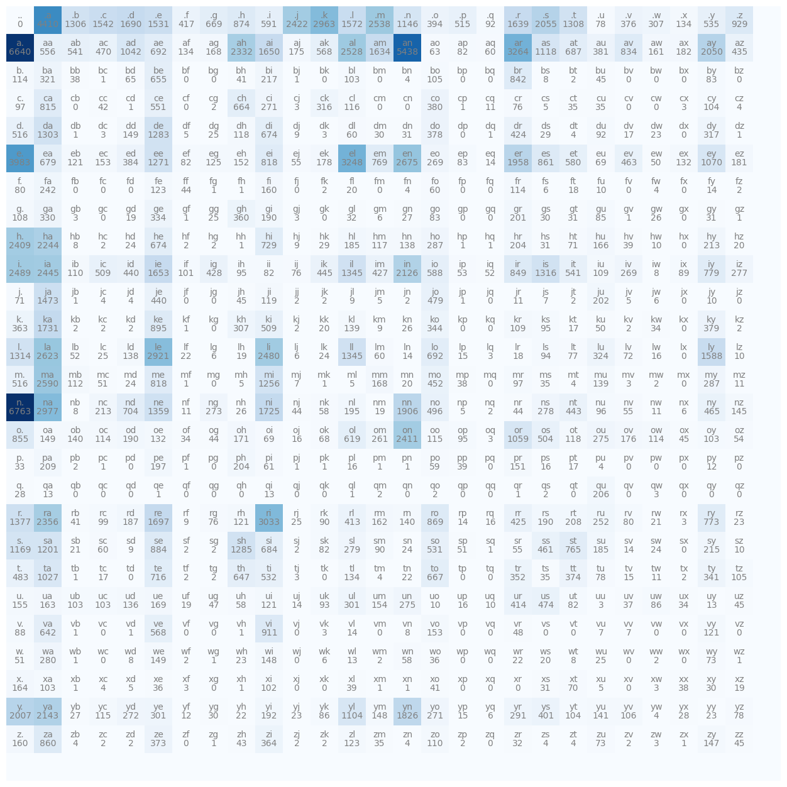

Everyone says a language model "just predicts the next token". Fine, but what does that look like when you build one yourself? Before attention, transformers and billions of parameters, I wanted the tiniest version possible: look at one character, guess the next one. This bigram model is weak. But it already has every piece the big models reuse: a vocabulary, a probability table, sampling, and a loss that tells you how good the model is.

## The data and the vocabulary

The data is a list of 32,033 first names (`names.txt`), one per line. The vocabulary is the 26 lowercase letters plus one special token, `.`, that marks both the start and the end of a name. So 27 tokens.

That special token matters more than it looks. The name `emma` becomes `. e m m a .`, so the model also learns which letters tend to start a name (the pair `.e`) and which tend to end one (`a.`). My first try used two separate tokens, `<S>` and `<E>`. That wastes a whole row and a whole column of the table, because nothing ever comes after `<E>` and nothing ever comes before `<S>`. One shared token does the job.

A bigram is just two tokens sitting next to each other. Across all the names there are 228,146 of them.

## Model 1: just count

The simplest idea: count. Build a 27 x 27 table `N`, where `N[i, j]` is how often token `j` comes right after token `i`. Divide each row by its sum, and each row becomes a probability distribution for the next token, $P(x_{t+1} = j \mid x_t = i)$.

```python
import torch

words = open("names.txt").read().splitlines()
chars = sorted(set("".join(words)))
stoi = {c: i + 1 for i, c in enumerate(chars)}
stoi["."] = 0
itos = {i: c for c, i in stoi.items()}

N = torch.zeros((27, 27), dtype=torch.int32)
for w in words:
    seq = ["."] + list(w) + ["."]
    for a, b in zip(seq, seq[1:]):
        N[stoi[a], stoi[b]] += 1

P = (N + 1).float()               # add-one smoothing: no zero probabilities
P /= P.sum(1, keepdim=True)       # each row is p(next | current)
```



You can already read things off the table. Lots of names end in `n` or `a`, and lots start with `a`, `k` or `m`.

## Sampling names

How do you make up a name with this? Start at `.`. Pick the next token at random, using that row of `P` as the odds. Jump to the row of the token you picked. Repeat until you pick `.` again.

```python
g = torch.Generator().manual_seed(2147483647)
for _ in range(5):
    ix, out = 0, []
    while True:
        ix = torch.multinomial(P[ix], num_samples=1, generator=g).item()
        if ix == 0:
            break
        out.append(itos[ix])
    print("".join(out))
```

In my notebook the samples were `junide`, `janasah`, `p`, `cony`, `ksahnaauranilevias`. A few could pass as names. Most can't. The model only remembers one character, so it has no idea it already wrote `ksahnaau` and should probably stop.

## How good is the model? The negative log-likelihood

Next question: how do you put a number on "good"? A good model gives high probability to what actually happens. So take every bigram in the data, look up the probability the model gives it, and multiply them all together. That product is the **likelihood**.

The trouble is that multiplying thousands of numbers below 1 gives something too tiny for the computer to store. So take the log. The log only goes up when its input goes up, so a bigger log-likelihood means a bigger likelihood. Flip the sign, take the average, and you have a loss to make small:

$$
\mathcal{L} = -\frac{1}{n}\sum_{t=1}^{n} \log P(x_{t+1} \mid x_t)
$$

Here $n$ is the number of bigrams, $x_t$ is the current token and $x_{t+1}$ is the token that really came next. A perfect model gets $\mathcal{L} = 0$. A model that guesses evenly over 27 tokens gets $\mathcal{L} = \log 27 \approx 3.30$. I kept that 3.30 in my head as a baseline in every later note.

```python
nll, n = 0.0, 0
for w in words:
    seq = ["."] + list(w) + ["."]
    for a, b in zip(seq, seq[1:]):
        nll -= torch.log(P[stoi[a], stoi[b]])
        n += 1
print(f"{nll / n:.4f}")  # about 2.45
```

The counting model gets about **2.454**. The raw counts (no smoothing) are the best any bigram model can do on this training set, and add-one smoothing changes that number only in the fourth decimal.

### Why smoothing matters

Without smoothing, a pair that never shows up in the data gets probability 0, and $\log 0 = -\infty$. I found this out by scoring the made-up name `jagqcob`. The pairs `gq` and `qc` never occur, so the loss became infinite. The usual fix is **add-one (Laplace) smoothing**: add 1 to every count before dividing, like in the code above. Bigger constants make the model smoother and less sure of itself.

## Model 2: the same thing as a neural network

Now forget counting. Can a network learn the same table on its own?

1. Turn the input character into a one-hot vector of length 27 (all zeros except a 1 at the character's index).
2. Multiply by a weight matrix $W$ of shape 27 x 27. You get 27 numbers called **logits**.
3. Turn the logits into probabilities with the softmax: take the exponential, then divide each row by its sum.
4. Use the same negative log-likelihood as the loss and update $W$ with gradient descent.

This is where it clicked for me. A one-hot vector times $W$ just picks out one row of $W$. So row $i$ of $W$ does the same job as row $i$ of the count table, only in log space. $\exp(W)$ behaves like a table of counts, which is why logits are sometimes called "log-counts".

```python
import torch.nn.functional as F

xs, ys = [], []
for w in words:
    seq = ["."] + list(w) + ["."]
    for a, b in zip(seq, seq[1:]):
        xs.append(stoi[a]); ys.append(stoi[b])
xs, ys = torch.tensor(xs), torch.tensor(ys)

W = torch.randn((27, 27), generator=g, requires_grad=True)
xenc = F.one_hot(xs, num_classes=27).float()
for step in range(200):
    logits = xenc @ W                          # (228146, 27)
    loss = F.cross_entropy(logits, ys) + 0.01 * (W**2).mean()
    W.grad = None
    loss.backward()
    W.data -= 50 * W.grad
print(loss.item())
```

`F.cross_entropy` does the softmax and the negative log-likelihood in one call, and it avoids the overflow problems you can hit doing it by hand. My first version did the `exp`, the row sums and the log by hand. Same number.

The loss settles at about **2.48**, and that includes the small regularization term. The data part alone is basically the 2.45 of the counting model. When I sampled from the trained network with the same random seed, I got almost the same names as from the count table (`junide`, `janasah`, `p`, ...). Two very different methods, one model. That makes sense: both maximize the likelihood of the same data, with the same amount of freedom.

The extra term $0.01 \cdot \text{mean}(W^2)$ is L2 regularization. It pulls the weights towards zero. That pushes the logits towards equal values, and the probabilities towards uniform. Which is exactly what add-one smoothing does in the counting model. A stronger penalty means more smoothing.

## Why bother with the neural version?

Because counting doesn't scale. With two characters of context the table has $27^2$ rows. With three it has $27^3 \approx 20{,}000$ rows, and most of them are empty. I built a 27 x 27 x 27 trigram table in the notebook to see this for myself. The neural version grows much more gracefully. You can feed in more context and swap the single matrix for a deeper network, and the loss, the training loop and the sampling loop all stay the same. My [MLP language model note](/notes/mlp-language-model/) does exactly that.

## Key takeaways

- A bigram model is just a table of probabilities $P(\text{next} \mid \text{current})$, built from counts.
- The average negative log-likelihood is the standard loss for language models. Lower is better, and $\log(\text{vocab size})$ is what pure guessing gets.
- Zero counts give an infinite loss. Add-one smoothing fixes that, and L2 regularization does the same job in the neural version.
- A one-hot input times a weight matrix is a table lookup, so one linear layer plus softmax can learn the bigram table with gradient descent.
- Both methods reach the same loss (about 2.45 on this data). The neural one is the one that scales to longer context.

## Resources

- Andrej Karpathy, "The spelled-out intro to language modeling: building makemore", *Neural Networks: Zero to Hero* (video): https://www.youtube.com/watch?v=PaCmpygFfXo. The dataset and the overall structure of this note follow this lecture.
- Andrej Karpathy, makemore (repository, includes `names.txt`): https://github.com/karpathy/makemore
- PyTorch documentation, `torch.nn.functional.cross_entropy`: https://pytorch.org/docs/stable/generated/torch.nn.functional.cross_entropy.html
