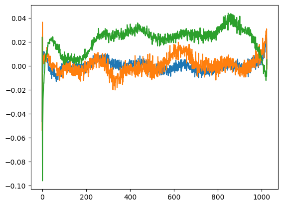

After building a small GPT from scratch, I wanted to know how far it was from a real one. Turns out, not that far. GPT-2, released by OpenAI in 2019, uses the same decoder-only blocks, just bigger and with a few specific choices. Its smallest version has 124 million parameters and the weights are public. So you can open it up, look at every tensor, and write your own version that matches it name for name. That's what I did here.

## Loading the real model

The Hugging Face `transformers` library comes with the OpenAI weights.

```python
from transformers import GPT2LMHeadModel
model_hf = GPT2LMHeadModel.from_pretrained("gpt2")   # "gpt2" is the 124M model
sd_hf = model_hf.state_dict()
for name, tensor in list(sd_hf.items())[:16]:
    print(name, tuple(tensor.shape))
```

The state dict is just the full list of learned tensors. For the 124M model it reads like a blueprint:

| tensor | shape | role |
|---|---|---|
| `transformer.wte.weight` | (50257, 768) | token embeddings, one row per token |
| `transformer.wpe.weight` | (1024, 768) | learned position embeddings, one row per position |
| `transformer.h.{0..11}.ln_1.weight/bias` | (768,) | layer norm before attention |
| `transformer.h.{i}.attn.c_attn.weight` | (768, 2304) | queries, keys and values for all 12 heads, fused |
| `transformer.h.{i}.attn.c_proj.weight` | (768, 768) | attention output projection |
| `transformer.h.{i}.ln_2.weight/bias` | (768,) | layer norm before the MLP |
| `transformer.h.{i}.mlp.c_fc.weight` | (768, 3072) | MLP expansion, 4 x 768 |
| `transformer.h.{i}.mlp.c_proj.weight` | (3072, 768) | MLP projection back to 768 |
| `transformer.ln_f.weight/bias` | (768,) | final layer norm |
| `lm_head.weight` | (50257, 768) | output layer: logits over the vocabulary |

What I liked is that you can read all the settings straight off the shapes: a vocabulary of 50,257 tokens (256 bytes + 50,000 BPE merges + `<|endoftext|>`, see the [tokenization note](/notes/tokenization-bpe/)), a context of 1,024 tokens, a width of 768, 12 layers, and 12 heads of size 64 (768 / 12). The `c_attn` output of 2,304 is 3 x 768: query, key and value packed side by side in one layer.

`lm_head.weight` has the same shape as `wte.weight`, and in GPT-2 they're actually the **same tensor**. This is called weight tying. The matrix that turns a token into a vector gets reused (transposed) to turn the final vector back into token scores. That saves 38.6 million parameters, about 30% of the model.

## Where the 124M parameters live

| part | parameters |
|---|---|
| token embeddings (shared with the output layer) | 38,597,376 |
| position embeddings | 786,432 |
| one block (attention 2,362,368 + MLP 4,722,432 + layer norms 3,072) | 7,087,872 |
| 12 blocks | 85,054,464 |
| final layer norm | 1,536 |
| **total** | **124,439,808** |

Two things surprised me here. In each block the MLP has about twice as many parameters as attention. And almost a third of the whole model is just the embedding table.

## What the position embeddings learned

GPT-2 doesn't use the fixed sine and cosine position codes from the original transformer. Instead it learns one 768-dimensional vector per position. If you show the (1024, 768) table as a grey-scale image, you see faint vertical stripes, which is a first hint that there's some structure. Plotting single columns (one feature, across all 1,024 positions) makes it clearer:



The curves are smooth waves over position. They look a lot like the sine waves the original transformer used on purpose, even though GPT-2 started from random noise and found this on its own. I found that pretty cool. Different features react to different ranges of positions. The jagged noise on top hints that the table isn't fully trained: neighbouring positions should have almost the same embedding, so a fully trained model would probably give smoother curves. Other ways to encode position, like rotary embeddings, go in a separate note.

## Rebuilding it in code

If my parameter names match the Hugging Face ones, I can load the official weights into my model later. Compared with the [small GPT](/notes/gpt-from-scratch/), the differences are: one combined layer for Q, K and V, GELU instead of ReLU, a final layer norm, and an output layer without bias.

```python
from dataclasses import dataclass
import math, torch, torch.nn as nn, torch.nn.functional as F

@dataclass
class GPTConfig:
    block_size: int = 1024   # maximum context length
    vocab_size: int = 50257  # 50,000 merges + 256 bytes + <|endoftext|>
    n_layer: int = 12
    n_head: int = 12
    n_embd: int = 768

class CausalSelfAttention(nn.Module):
    def __init__(self, cfg):
        super().__init__()
        self.n_head = cfg.n_head
        self.c_attn = nn.Linear(cfg.n_embd, 3 * cfg.n_embd)   # q, k, v for all heads
        self.c_proj = nn.Linear(cfg.n_embd, cfg.n_embd)

    def forward(self, x):
        B, T, C = x.shape
        q, k, v = self.c_attn(x).split(C, dim=2)
        q, k, v = [t.view(B, T, self.n_head, C // self.n_head).transpose(1, 2)
                   for t in (q, k, v)]                        # (B, nh, T, hs)
        y = F.scaled_dot_product_attention(q, k, v, is_causal=True)
        return self.c_proj(y.transpose(1, 2).contiguous().view(B, T, C))
```

`F.scaled_dot_product_attention` computes $\operatorname{softmax}(QK^\top/\sqrt{d_k} + M)V$ with the causal mask $M$ in one go (one fused GPU kernel). It gives the same result as the step-by-step version in the [multi-head attention note](/notes/multi-head-attention/), but it never keeps the full (T, T) matrix in memory. At T = 1,024 that really matters.

```python
class MLP(nn.Module):
    def __init__(self, cfg):
        super().__init__()
        self.c_fc = nn.Linear(cfg.n_embd, 4 * cfg.n_embd)
        self.gelu = nn.GELU(approximate="tanh")
        self.c_proj = nn.Linear(4 * cfg.n_embd, cfg.n_embd)
    def forward(self, x):
        return self.c_proj(self.gelu(self.c_fc(x)))

class Block(nn.Module):
    def __init__(self, cfg):
        super().__init__()
        self.ln_1, self.attn = nn.LayerNorm(cfg.n_embd), CausalSelfAttention(cfg)
        self.ln_2, self.mlp = nn.LayerNorm(cfg.n_embd), MLP(cfg)
    def forward(self, x):
        x = x + self.attn(self.ln_1(x))
        return x + self.mlp(self.ln_2(x))

class GPT(nn.Module):
    def __init__(self, cfg):
        super().__init__()
        self.cfg = cfg
        self.transformer = nn.ModuleDict(dict(
            wte=nn.Embedding(cfg.vocab_size, cfg.n_embd),
            wpe=nn.Embedding(cfg.block_size, cfg.n_embd),
            h=nn.ModuleList([Block(cfg) for _ in range(cfg.n_layer)]),
            ln_f=nn.LayerNorm(cfg.n_embd)))
        self.lm_head = nn.Linear(cfg.n_embd, cfg.vocab_size, bias=False)
        self.lm_head.weight = self.transformer.wte.weight   # weight tying

    def forward(self, idx):                                  # (B, T)
        pos = torch.arange(idx.shape[1], device=idx.device)
        x = self.transformer.wte(idx) + self.transformer.wpe(pos)
        for block in self.transformer.h:
            x = block(x)
        return self.lm_head(self.transformer.ln_f(x))         # (B, T, vocab)

print(sum(p.numel() for p in GPT(GPTConfig()).parameters()))  # 124439808
```

A few things I want to remember:

- **GELU** is a smooth version of ReLU, $\text{GELU}(x) = x\,\Phi(x)$ with $\Phi$ the standard normal CDF. GPT-2 used a tanh-based approximation of it, so you need `approximate="tanh"` to get exactly the same outputs.
- **Names matter.** My first version called the layer norms `ln1` and `ln2`. The model ran fine, but its state dict keys didn't match `ln_1` and `ln_2` in the official checkpoint, so loading the weights by name would have failed.
- **Transposed weights.** This one confused me at first. OpenAI's code used a `Conv1D` module that stores its weight as (in, out), while `nn.Linear` stores (out, in). That's why `c_attn.weight` shows up as (768, 2304) in the table above. So when you copy the official weights into `nn.Linear` layers, you have to transpose the `c_attn`, `c_proj` and `c_fc` matrices.

## Sampling from the real thing

With the Hugging Face pipeline, getting the trained model to continue a prompt takes a couple of lines:

```python
from transformers import pipeline, set_seed
generator = pipeline("text-generation", model="gpt2")
set_seed(42)
print(generator("Hello, I'm a language model,", max_length=40)[0]["generated_text"])
```

The output is fluent, grammatical English that drifts off topic. That's normal for a 124M base model: it just continues documents, it doesn't answer questions.

## Key takeaways

- GPT-2 small is 12 pre-norm transformer blocks (layer norm comes before attention and the MLP) of width 768, with 12 heads, a 1,024-token context and a 50,257-token BPE vocabulary. That's 124.4M parameters.
- Its state dict maps one-to-one onto the architecture, and the shapes tell you every setting.
- The output layer shares its weights with the token embedding table, which saves about 30% of the parameters.
- The position embeddings are learned, and they end up as smooth wave-like curves over position.
- To load the official weights into your own code: match the parameter names, use the tanh version of GELU, and transpose the `Conv1D` weights.

## Resources

- Andrej Karpathy, "Let's reproduce GPT-2 (124M)", *Neural Networks: Zero to Hero* (video): https://www.youtube.com/watch?v=l8pRSuU81PU. The structure of the model code follows this lecture.
- Andrej Karpathy, build-nanogpt (repository accompanying the lecture): https://github.com/karpathy/build-nanogpt
- Alec Radford et al., "Language Models are Unsupervised Multitask Learners", OpenAI 2019: https://cdn.openai.com/better-language-models/language_models_are_unsupervised_multitask_learners.pdf
- OpenAI, gpt-2 (official code and weights): https://github.com/openai/gpt-2
- Hugging Face, Transformers documentation for GPT-2: https://huggingface.co/docs/transformers/model_doc/gpt2
- Dan Hendrycks and Kevin Gimpel, "Gaussian Error Linear Units (GELUs)", 2016: https://arxiv.org/abs/1606.08415
