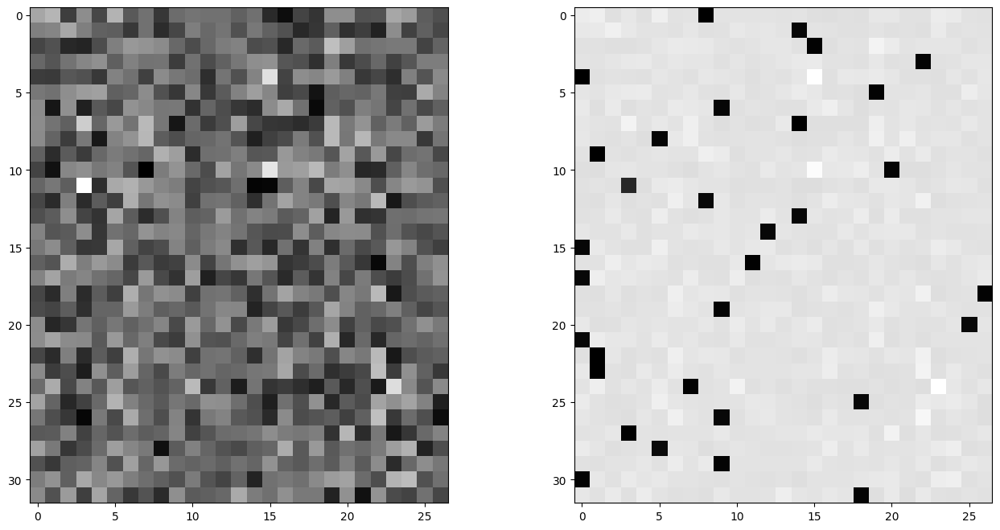

`loss.backward()` hides a lot. When training goes wrong (dead units, exploding gradients, a shape bug that doesn't throw an error), it helps to know what actually flows backwards through each line of the forward pass. So in this exercise I threw out autograd and wrote the backward pass for the MLP language model by hand, one tensor at a time, checking each gradient against PyTorch. The chain rule for single numbers is in the [micrograd note](/notes/backpropagation-micrograd/). Here it's all about tensors, shapes and broadcasting.

## The forward pass, cut into small steps

The model turns 3 characters into 10-dimensional vectors, then runs a linear layer, batch normalization and tanh, then an output layer. I wrote the cross-entropy loss out step by step so every in-between result has a name.

```python
emb = C[Xb]                                  # (32, 3, 10)
embcat = emb.view(emb.shape[0], -1)          # (32, 30)
hprebn = embcat @ W1 + b1                    # (32, 64)
# ... batch norm produces hpreact ...
h = torch.tanh(hpreact)                      # (32, 64)
logits = h @ W2 + b2                         # (32, 27)
logit_maxes = logits.max(1, keepdim=True).values
norm_logits = logits - logit_maxes           # for numerical stability
counts = norm_logits.exp()
counts_sum = counts.sum(1, keepdim=True)
counts_sum_inv = counts_sum ** -1
probs = counts * counts_sum_inv
logprobs = probs.log()
loss = -logprobs[range(n), Yb].mean()
```

Each in-between tensor gets `retain_grad()`, so I can compare my hand-computed gradient `dX` with PyTorch's `X.grad`.

## Two rules that sort out most of the shapes

**1. A gradient has the same shape as the thing it belongs to.** `dW2` has to be (64, 27) because `W2` is. Just this often tells you where a transpose goes.

**2. Broadcasting and summing are mirror images.** This was the most useful thing I took from the exercise.
- If a tensor was **broadcast** (copied) in the forward pass, **sum** its gradient over the copied dimension in the backward pass. Example: `b2` of shape (27,) is added to every row of the (32, 27) logits, so `db2 = dlogits.sum(0)`.
- If a tensor was **summed** in the forward pass, **broadcast** the gradient back. Example: `counts_sum = counts.sum(1, keepdim=True)`, so every element in a row of `counts` gets the gradient of that row's sum.

If a variable is used in two places, it collects gradient from both, and you add them up. `counts` feeds both `probs` and `counts_sum`, so `dcounts` has two parts.

## Walking backwards

Below, `n` is the batch size (32). The loss only averages $-\log p$ at the target positions. So `dlogprobs` is $-1/n$ at those 32 entries and 0 everywhere else.

```python
dlogprobs = torch.zeros_like(logprobs)
dlogprobs[range(n), Yb] = -1.0 / n
dprobs = (1.0 / probs) * dlogprobs                       # d log(x) = 1/x
dcounts_sum_inv = (counts * dprobs).sum(1, keepdim=True) # was broadcast
dcounts = counts_sum_inv * dprobs
dcounts_sum = -counts_sum**-2 * dcounts_sum_inv
dcounts += torch.ones_like(counts) * dcounts_sum          # second use
dnorm_logits = counts * dcounts                          # d exp(x) = exp(x)
dlogits = dnorm_logits.clone()
dlogit_maxes = (-dnorm_logits).sum(1, keepdim=True)
dlogits += F.one_hot(logits.max(1).indices, 27) * dlogit_maxes
```

`dlogit_maxes` comes out as basically zero. That makes sense once you think about it: subtracting the same number from every logit in a row doesn't change the softmax, so the loss can't depend on it. Subtracting the max is only there to stop `exp` from overflowing.

For a linear layer $Y = XW + b$ the rules are

$$
\frac{\partial L}{\partial X} = \frac{\partial L}{\partial Y} W^\top, \qquad
\frac{\partial L}{\partial W} = X^\top \frac{\partial L}{\partial Y}, \qquad
\frac{\partial L}{\partial b} = \sum_{\text{rows}} \frac{\partial L}{\partial Y}.
$$

You don't need to memorize these. Just write the matrix product whose shapes give the shape you need.

```python
dh = dlogits @ W2.T          # (32,27) @ (27,64) -> (32,64)
dW2 = h.T @ dlogits          # (64,32) @ (32,27) -> (64,27)
db2 = dlogits.sum(0)
dhpreact = (1.0 - h**2) * dh # tanh'(x) = 1 - tanh(x)^2
```

## The gradient of cross-entropy in one line

All eight steps from `logits` to `loss` boil down to a short formula. For one example with logits $z$, softmax probabilities $p = \text{softmax}(z)$ and target $y$, the loss is $-\log p_y$ and

$$
\frac{\partial L}{\partial z_j} = p_j - \mathbb{1}[j = y].
$$

Averaging over a batch of $n$ examples just divides by $n$:

```python
dlogits = F.softmax(logits, 1)
dlogits[range(n), Yb] -= 1
dlogits /= n
```

This matched PyTorch to about $10^{-9}$. I also like how easy it is to read: every wrong class gets pushed down in proportion to the probability the model gave it, and the correct class gets pulled up by $1 - p_y$. Each row of `dlogits` adds up to zero, so the pushing and the pulling balance out.



## Through batch norm, and into the embedding table

Batch normalization ties all the examples in a batch together through the mean and variance, so its backward pass has several paths. This was the trickiest part. Doing it step by step and then simplifying on paper gives one expression. Here $\hat{x}$ is the normalized pre-activations, $\gamma$ the gain, $\sigma^{-1} = (\text{var} + \epsilon)^{-1/2}$, and the variance is the unbiased one (divide by $n-1$):

$$
\frac{\partial L}{\partial x} = \frac{\gamma\,\sigma^{-1}}{n}\left(n\,\frac{\partial L}{\partial y} - \sum_{i}\frac{\partial L}{\partial y_i} - \frac{n}{n-1}\,\hat{x}\sum_{i}\frac{\partial L}{\partial y_i}\,\hat{x}_i\right)
$$

The sums go over the batch, separately for each of the 64 features. I'm just writing it down here; the layer itself is explained in the [batch normalization note](/notes/batch-normalization/).

The last step is the embedding lookup `emb = C[Xb]`. Each row of `C` got copied into `emb` once for every time its character showed up in the batch. So the gradient of a row of `C` is the **sum** of the gradients at all the positions that used it. That's called a scatter-add:

```python
demb = dembcat.view(emb.shape)                 # undo the flatten
dC = torch.zeros_like(C)
dC.index_add_(0, Xb.view(-1), demb.view(-1, C.shape[1]))
```

My first version used two nested Python loops over batch and position. Same result, but `index_add_` does it in one fast call.

## Training with only my own gradients

With every gradient in place, I removed `loss.backward()`, wrapped the loop in `torch.no_grad()`, and trained the network for 200,000 steps using only my hand-written backward pass. The loss went from 3.77 to around 1.9-2.0 on the minibatches, the same as with autograd. That was a satisfying moment. A final check of all parameter gradients against PyTorch showed differences below $2 \times 10^{-8}$. Those tiny differences come from floating-point rounding when the math is done in a different order, not from mistakes.

## Key takeaways

- A tensor's gradient always has the same shape as the tensor. Matching shapes tells you where transposes and sums go.
- Broadcast in the forward pass means sum in the backward pass, and sum in the forward pass means broadcast in the backward pass.
- The gradient of softmax cross-entropy with respect to the logits is $(\text{softmax} - \text{one\_hot})/n$. It's cheap, stable and easy to understand.
- Subtracting the max logit has zero gradient. It's only there to avoid overflow.
- The gradient of an embedding table is a scatter-add: each row adds up the gradients from every position that used it.

## Resources

- Andrej Karpathy, "Building makemore Part 4: Becoming a Backprop Ninja", *Neural Networks: Zero to Hero* (video): https://www.youtube.com/watch?v=q8SA3rM6ckI. The exercise structure and the step-by-step forward pass come from this lecture.
- Andrej Karpathy, "Yes you should understand backprop" (blog post): https://karpathy.medium.com/yes-you-should-understand-backprop-e2f06eab496b
- Sergey Ioffe and Christian Szegedy, "Batch Normalization", 2015: https://arxiv.org/abs/1502.03167
- PyTorch documentation, `Tensor.index_add_`: https://pytorch.org/docs/stable/generated/torch.Tensor.index_add_.html
