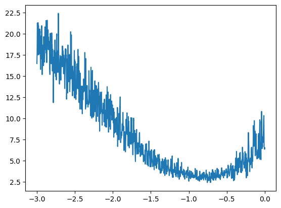
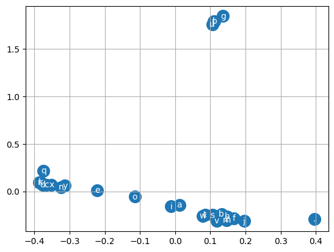

A bigram model only sees one character, and a count table cannot grow to longer contexts because the number of rows explodes. The fix, proposed by Bengio and colleagues in 2003, is to give every token a small learned vector (an **embedding**), concatenate the vectors of the last few tokens, and let a neural network map them to a distribution over the next token. This note builds that model at the character level and covers the training habits that come with it.

## The dataset: a sliding context window

Pick a context length, `block_size = 3`. For every position in every name, the input is the three previous characters and the target is the next one. Names are padded on the left with the special token `.` (index 0).

```python
block_size = 3

def build_dataset(words):
    X, Y = [], []
    for w in words:
        context = [0] * block_size
        for ch in w + ".":
            ix = stoi[ch]
            X.append(context)
            Y.append(ix)
            context = context[1:] + [ix]   # slide the window by one
    return torch.tensor(X), torch.tensor(Y)
```

For `emma` this gives five examples: `...` → `e`, `..e` → `m`, `.em` → `m`, `emm` → `a`, `mma` → `.`. Over all names there are 228,146 examples, each a row of 3 integers.

## The model

The network has three parts.

1. **Embedding table** `C` of shape (27, d). Row $i$ is the vector for token $i$. Indexing `C[X]` turns a (batch, 3) tensor of integers into a (batch, 3, d) tensor of vectors. This is the same as multiplying one-hot vectors by `C`, but much cheaper.
2. **Hidden layer**: flatten the three vectors into one vector of length $3d$, apply a linear map and a $\tanh$.
3. **Output layer**: a linear map to 27 logits, followed by softmax inside the cross-entropy loss.

$$
h = \tanh\big(\,[e_{t-3}; e_{t-2}; e_{t-1}]\, W_1 + b_1\big), \qquad \text{logits} = h\,W_2 + b_2
$$

Here $e_{t-k}$ is the embedding of the token $k$ steps back, $[\,;\,]$ means concatenation, $W_1$ has shape $(3d, H)$ for $H$ hidden units, and $W_2$ has shape $(H, 27)$.

```python
g = torch.Generator().manual_seed(2147483647)
d, H = 2, 100
C  = torch.randn((27, d), generator=g)
W1 = torch.randn((block_size * d, H), generator=g)
b1 = torch.randn(H, generator=g)
W2 = torch.randn((H, 27), generator=g)
b2 = torch.randn(27, generator=g)
parameters = [C, W1, b1, W2, b2]
for p in parameters:
    p.requires_grad = True

def forward(X):
    emb = C[X]                                   # (B, 3, d)
    h = torch.tanh(emb.view(-1, block_size * d) @ W1 + b1)
    return h @ W2 + b2                           # (B, 27) logits
```

`emb.view(-1, 6)` flattens the last two dimensions without copying memory. A PyTorch tensor is a flat block of storage plus a shape and **strides** that say how far to jump in memory along each dimension. `view` only changes that metadata, which is why it is so cheap. Concatenating `emb[:, 0]`, `emb[:, 1]` and `emb[:, 2]` with `torch.cat` gives the same result but allocates new memory and hard-codes the context length.

Use `F.cross_entropy(logits, Y)` rather than writing softmax and log by hand. It gives the same value, uses less memory, and is numerically safe: it subtracts the maximum logit before exponentiating, so large logits do not overflow to `inf`.

## Minibatches

The full dataset forward pass is slow, and you do not need the exact gradient. Sampling 32 random rows per step gives a noisy but useful gradient estimate, and you can take many more steps in the same time.

```python
for step in range(15000):
    ix = torch.randint(0, Xtr.shape[0], (32,))
    loss = F.cross_entropy(forward(Xtr[ix]), Ytr[ix])
    for p in parameters:
        p.grad = None
    loss.backward()
    lr = 0.1 if step < 10000 else 0.01        # step decay near the end
    for p in parameters:
        p.data -= lr * p.grad
```

## Finding a learning rate

A quick way to choose the learning rate: for 1,000 steps, increase it exponentially from $10^{-3}$ to $10^{0}$ and record the loss at each step. Plot the loss against the exponent.



The loss falls fastest and is lowest around $10^{-1}$, then becomes unstable as the rate approaches 1. So 0.1 is a good starting value. Late in training, dropping it by a factor of 10 lets the model settle into a lower loss.

## Train, dev and test splits

A big model can memorize its training set. A low training loss then says nothing about how it behaves on new names. The standard remedy is to shuffle the words and split them:

- **train (80%)** to fit the parameters,
- **dev or validation (10%)** to choose hyperparameters such as embedding size, hidden size and learning rate,
- **test (10%)** to report a final number, used only rarely.

```python
random.seed(42)
random.shuffle(words)
n1, n2 = int(0.8 * len(words)), int(0.9 * len(words))
Xtr, Ytr = build_dataset(words[:n1])     # 182,625 examples
Xdev, Ydev = build_dataset(words[n1:n2]) # 22,655
Xte, Yte = build_dataset(words[n2:])     # 22,866
```

If train and dev losses are about equal, the model is **underfitting**: it is too small, or the bottleneck is elsewhere. If train loss is clearly below dev loss, it is **overfitting**. With 2-dimensional embeddings and 500 hidden units, my train and dev losses stayed close and the test loss was about **2.52**. That is no better than the bigram model (about 2.45), so the model was underfitting. The 2-dimensional embedding table was the bottleneck: 3 characters x 2 numbers is very little information for the hidden layer to work with. In the follow-up notebook, 10-dimensional embeddings with 200 hidden units and a better initialization brought the dev and test losses down to about **2.25**.

## What the embeddings learn

With $d = 2$ you can plot the embedding table directly.



Nobody told the network that vowels are similar, yet they end up close together, because they appear in similar contexts and are interchangeable for prediction. The start/end token sits on its own. This is the core promise of embeddings: tokens that behave alike get similar vectors, so what the model learns about one transfers to the others.

## Sampling

Generation works as before, except the model now keeps a window of three tokens.

```python
for _ in range(5):
    out, context = [], [0] * block_size
    while True:
        probs = F.softmax(forward(torch.tensor([context])), dim=1)
        ix = torch.multinomial(probs, num_samples=1, generator=g).item()
        context = context[1:] + [ix]
        if ix == 0:
            break
        out.append(itos[ix])
    print("".join(out))
```

Samples such as `kay`, `karin`, `renly` and `zayed` look much more name-like than the bigram's output.

## Key takeaways

- An embedding table maps each token to a learned vector. Indexing `C[X]` is the efficient form of one-hot times matrix.
- Concatenating the embeddings of the last few tokens and feeding them to an MLP lets the context grow without a table that explodes in size.
- Use `F.cross_entropy` for stability and speed, minibatches for fast steps, and a learning-rate sweep to pick a starting rate.
- Always judge a model on data it has not trained on. Use the dev split for decisions and the test split for the final number.
- Tiny embeddings can be the bottleneck. Moving from 2 to 10 dimensions gave the largest improvement here.

## Resources

- Andrej Karpathy, "Building makemore Part 2: MLP", *Neural Networks: Zero to Hero* (video): https://www.youtube.com/watch?v=TCH_1BHY58I. The model and training loop here are adapted from this lecture.
- Yoshua Bengio et al., "A Neural Probabilistic Language Model", JMLR 3 (2003): https://www.jmlr.org/papers/volume3/bengio03a/bengio03a.pdf
- Edward Z. Yang, "PyTorch internals" (strides, storage and views): http://blog.ezyang.com/2019/05/pytorch-internals/
- Andrej Karpathy, makemore (repository): https://github.com/karpathy/makemore
