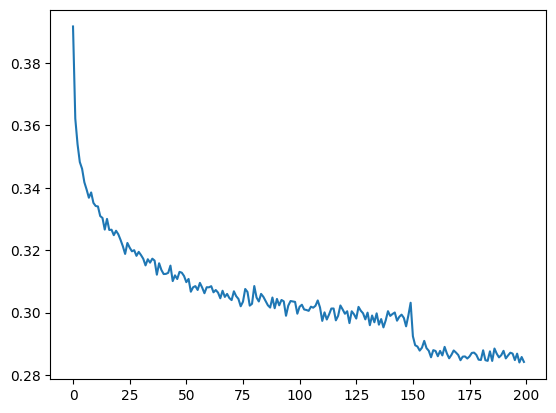

My [MLP language model](/notes/mlp-language-model/) glues all the context characters together and pushes them through one hidden layer in a single step. That's fine for 3 characters. With a longer context it feels wasteful: eight characters of information get squashed together all at once. WaveNet, a 2016 model for raw audio, does it differently. It mixes inputs bit by bit, in a tree: neighbours first, then pairs of pairs, and so on. Here I build that idea for character-level names, and tidy the code into small PyTorch-like modules along the way.

## From a flat MLP to a tree

With a context of 8 characters and 10-dimensional embeddings, the flat model does

```
(B, 8, 10) --flatten--> (B, 80) --Linear--> (B, 200) --> ... --> (B, 27)
```

The tree-shaped (hierarchical) model merges two neighbours at a time instead:

```
(B, 8, 10) -> (B, 4, 20) -> Linear -> (B, 4, 68)    # pairs of characters
           -> (B, 2, 136) -> Linear -> (B, 2, 68)   # pairs of pairs
           -> (B, 136)    -> Linear -> (B, 68)      # whole context
           -> Linear -> (B, 27)
```

The way I picture it: each level looks at a slightly bigger piece of the context and writes a better summary of it. So the last layer gets a summary of all eight characters that was built up step by step, not in one jump.

## Two tensor tricks that make it easy

How much reshaping code does this need? Not much, thanks to two tricks.

**Matrix multiplication only touches the last dimension.** A linear layer works on the last dimension and just repeats itself over all the ones in front:

```python
(torch.randn(4, 5, 6, 80) @ torch.randn(80, 200)).shape   # (4, 5, 6, 200)
```

So a `Linear` layer on a (B, 4, 20) tensor handles the 4 pairs in parallel, with the same weights for every pair.

**`view` can group neighbours.** For a (B, 8, 10) tensor stored in one block of memory, `x.view(B, 4, 20)` puts characters 0 and 1 side by side, then 2 and 3, and so on. I didn't believe this at first, so I checked it. It's exactly the same as concatenating the even and odd positions:

```python
e = torch.randn(4, 8, 10)
explicit = torch.cat([e[:, ::2, :], e[:, 1::2, :]], dim=2)
print((e.view(4, 4, 20) == explicit).all())   # tensor(True)
```

With that, the merge layer is tiny:

```python
class FlattenConsecutive:
    def __init__(self, n):
        self.n = n                       # how many neighbours to merge
    def __call__(self, x):
        B, T, C = x.shape
        x = x.view(B, T // self.n, C * self.n)
        if x.shape[1] == 1:              # last level: drop the time axis
            x = x.squeeze(1)
        self.out = x
        return x
    def parameters(self):
        return []
```

## Tidying the code to look like `torch.nn`

Until now the MLP was a pile of loose tensors. I rewrote it as small classes that work like PyTorch modules: `Embedding`, `FlattenConsecutive`, `Linear`, `BatchNorm1d`, `Tanh` and a `Sequential` container. Each one has a `__call__` for the forward pass and a `parameters()` method. After that, the whole model reads just like its diagram:

```python
n_embd, n_hidden = 10, 68
model = Sequential([
    Embedding(27, n_embd),
    FlattenConsecutive(2), Linear(n_embd * 2, n_hidden, bias=False),
    BatchNorm1d(n_hidden), Tanh(),
    FlattenConsecutive(2), Linear(n_hidden * 2, n_hidden, bias=False),
    BatchNorm1d(n_hidden), Tanh(),
    FlattenConsecutive(2), Linear(n_hidden * 2, n_hidden, bias=False),
    BatchNorm1d(n_hidden), Tanh(),
    Linear(n_hidden, 27),
])
```

The linear layers before batch norm have no bias. Batch norm subtracts the mean anyway and has its own learned shift, so a bias there would do nothing. Why 68 hidden units? It gives the model about 22,400 parameters, roughly the same as the flat 8-character model with 200 hidden units (about 22,100). That way the comparison is fair.

## The batch-norm bug that 3D inputs cause

This was the sneaky part. My `BatchNorm1d` computed its statistics with `x.mean(0)` and `x.var(0)`. That's right for 2D input of shape (B, C). But in the tree model, the first batch-norm layer gets (B, 4, 68). Averaging only over dimension 0 gives statistics of shape (1, 4, 68): a separate mean and variance for each of the 4 pair positions. Nothing crashes, because broadcasting makes the shapes fit. But each statistic is estimated from fewer numbers, and the running averages end up with the wrong shape.

The 4 positions are really just more examples of "a pair of characters". So the statistics should be averaged over both the batch and the position dimension:

```python
dim = 0 if x.ndim == 2 else (0, 1)
xmean = x.mean(dim, keepdim=True)    # (1, 1, 68)
xvar = x.var(dim, keepdim=True)
```

That's what `torch.nn.BatchNorm1d` does for 3D input too, except PyTorch expects the channel dimension in the middle, (B, C, L), not last. Bugs like this, which don't throw any error, are a good reason to print the output shape of every layer once:

```python
for layer in model.layers:
    print(layer.__class__.__name__, tuple(layer.out.shape))
```

## Results

Trained for 200,000 steps with batch size 32 and a learning rate of 0.1, dropped to 0.01 after 150,000 steps:

| model | context | train loss | val loss |
|---|---|---|---|
| hierarchical (this note) | 8 | 1.91 | 2.03 |

That's clearly better than the 3-character MLP from the earlier notes, whose validation loss was around 2.1 to 2.25 depending on size and initialization. Some of the gain comes from the longer context and some from the tree structure. One thing not to forget: before evaluating, switch every layer to evaluation mode (`layer.training = False`), so batch norm uses its running statistics and not the statistics of the current batch.



The per-batch loss is very noisy, so averaging it over windows of 1,000 steps makes the curve readable. The step down at 150,000 is where the learning rate drops.

And the samples finally look like real names: `lyncia`, `audlyn`, `kimber`, `erisha`, `ella`, `roni`.

## How this compares to the real WaveNet

The real WaveNet uses **dilated causal convolutions**. A convolution with kernel size 2 is just the same small linear layer slid along the sequence. Dilation means each level skips further ahead, so the receptive field (how much of the input one output can see) doubles at every layer. My model computes the same tree, but only for one output position. A convolutional version would compute outputs for every position at once and reuse the shared middle results, which is much faster for training. WaveNet also has gated activations and residual and skip connections, which I left out here.

## Key takeaways

- A tree-shaped model mixes context bit by bit (pairs, then pairs of pairs) instead of flattening everything into one layer.
- `Linear` layers work on the last dimension and repeat over all the others, and `view` can group neighbouring time steps without copying.
- With 3D activations, batch norm has to average over both the batch and time dimensions. If it doesn't, broadcasting hides the mistake.
- Wrapping layers in small module classes makes the model easier to read and shape bugs easier to find.
- At about the same parameter count, the 8-character tree model got a validation loss of about 2.03.

## Resources

- Andrej Karpathy, "Building makemore Part 5: Building a WaveNet", *Neural Networks: Zero to Hero* (video): https://www.youtube.com/watch?v=t3YJ5hKiMQ0. The model and module classes are adapted from this lecture.
- Aäron van den Oord et al., "WaveNet: A Generative Model for Raw Audio", 2016: https://arxiv.org/abs/1609.03499
- PyTorch documentation, `torch.nn.BatchNorm1d` (input shapes): https://pytorch.org/docs/stable/generated/torch.nn.BatchNorm1d.html
