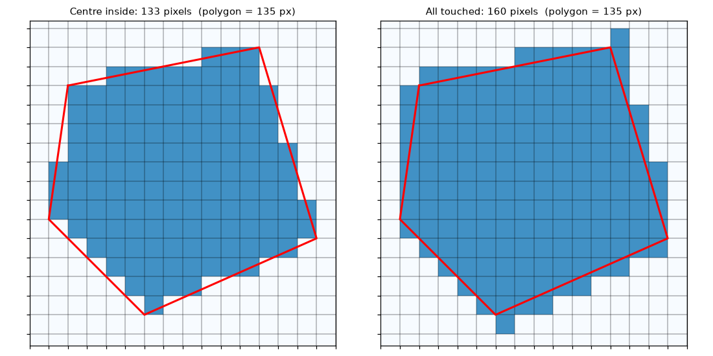

Clipping sounds trivial: keep what is inside the polygon, drop the rest. In practice it is where many silent geospatial bugs come from. The polygon is in a different coordinate system, the output is shifted by half a pixel, the clipped area has a different size than the polygon, real zeros become "no data", or points on a tile border appear twice. This note goes through what a clip actually does, first for rasters (orthomosaics, elevation models) and then for point clouds. All examples use synthetic data.

## Step 0: put both in the same CRS

A polygon and a raster can only be compared in one coordinate reference system. Reproject the **polygon** to the raster's CRS, not the other way round. Reprojecting a vector moves a few vertices exactly. Reprojecting a raster resamples every pixel and changes the data. Check the CRS of every input explicitly. A GeoJSON file is in WGS 84 longitude and latitude by definition, while the raster is often in a metric projection such as UTM. Clipping without reprojecting usually gives an empty result, or an error that the shapes do not overlap.

## Rasters: a window plus a mask

A georeferenced raster is an array plus an **affine transform** that maps pixel indices to map coordinates. For a north-up image with square pixels of size $\rho$ and top-left corner $(x_0, y_0)$:

$$
x = x_0 + (\text{col} + 0.5)\,\rho, \qquad y = y_0 - (\text{row} + 0.5)\,\rho
$$

gives the **centre** of pixel $(\text{row}, \text{col})$. The minus sign is there because rows go down while $y$ goes up.

A clip has two parts.

1. **Crop to a window.** Convert the polygon's bounding box to pixel rows and columns, and cut out that sub-array. The cropped raster has a new top-left corner, so its transform must be updated. Writing the cropped array with the old transform puts it back at the original corner, and the result lands in the wrong place on the map.
2. **Mask.** Inside the window, set every pixel that is "outside" the polygon to the nodata value.

```python
import numpy as np, shapely

def clip_raster(img, x0, y0, res, poly, nodata=0):
    """Crop to the polygon's bounds, then blank pixels whose centre is outside."""
    minx, miny, maxx, maxy = poly.bounds
    c0, c1 = int(np.floor((minx - x0) / res)), int(np.ceil((maxx - x0) / res))
    r0, r1 = int(np.floor((y0 - maxy) / res)), int(np.ceil((y0 - miny) / res))
    win = img[r0:r1, c0:c1].copy()
    cols, rows = np.meshgrid(np.arange(c0, c1), np.arange(r0, r1))
    xc, yc = x0 + (cols + 0.5) * res, y0 - (rows + 0.5) * res   # pixel centres
    win[~shapely.contains_xy(poly, xc, yc)] = nodata
    new_origin = (x0 + c0 * res, y0 - r0 * res)                 # new top-left corner
    return win, new_origin
```

On a synthetic 0.5 m raster this gives exactly the same window, origin and pixel count as `rasterio.mask.mask(..., crop=True)`. The library does the same thing with a rasterised polygon and a proper `Affine` object. With rasterio you then copy the source metadata and update `height`, `width` and `transform` (and `nodata`) before writing.

## Which pixels are inside?

A pixel is a square, and a polygon edge can cut through it. There are two common rules:

- **Centre inside** (the default in GDAL and rasterio): a pixel counts if its centre is inside. Over a long edge, the pixels that are half in and half out roughly balance, so the pixel count is close to the true area.
- **All touched**: a pixel counts if the polygon touches it at all. Nothing inside is ever lost, but the result is always larger than the polygon.



The difference is about one ring of pixels along the boundary, so it matters most for small polygons and coarse pixels. On the 0.5 m example (polygon area 13,500 pixels) the counts were 13,460 and 13,741. For **zonal statistics**, such as mean height per stand, centre-inside is the honest choice. For **making sure a model sees every object** in a polygon, use all-touched, or buffer the polygon by a pixel first.

## Choosing nodata

Masked pixels need a value, and readers need to know that value means "no data". Two traps:

- **Collision with real data.** If the nodata value is 0 and the image has real black pixels, those pixels vanish from every later statistic. Use a value that cannot occur (for example $-9999$ for elevations, or NaN in a float raster), or store a separate mask or alpha band for 8-bit imagery.
- **Forgetting to declare it.** The value must be written to the file's metadata. Otherwise the masked area is just more zeros, and averages and colour stretches include it.

## Several polygons

If the vector file holds several polygons, decide what you want. Passing all geometries clips to their union, in one window covering all of them. Looping over them gives one output per polygon. Code that takes only the first geometry (`geometry[0]`) silently ignores the rest. That is fine for a file you know has one boundary, but it is worth an explicit check.

## Point clouds: a bounding-box test, then point-in-polygon

Points have no grid, so a clip is a filter: keep the points whose $(x, y)$ is inside the polygon. Testing millions of points against a complex polygon is the slow part, so cut the candidates first with a cheap bounding-box test:

```python
minx, miny, maxx, maxy = poly.bounds
inbox = (x >= minx) & (x <= maxx) & (y >= miny) & (y <= maxy)   # cheap test first
keep = np.zeros(len(x), bool)
keep[inbox] = shapely.contains_xy(poly, x[inbox], y[inbox])     # exact test
```

On 200,000 random points over a 100 m square, the box kept about 98,000 candidates and the polygon test kept 67,426, matching the expected share of the area. Dedicated tools (PDAL's `filters.crop`, lidR's `clip_roi`, WhiteboxTools, LAStools) do the same with spatial indexes over the file. After clipping, the header's bounding box and point counts must be updated. Good writers do this for you.

## Cutting big data into tiles

Country-wide LiDAR and large orthomosaics are delivered and processed as tiles. Clipping a dataset into a regular grid adds three concerns.

- **Find candidates by intersection.** Build the grid as polygons, then use a spatial join (or an [STRtree](/notes/polygon-overlaps-with-strtree/)) between each source file's footprint and the grid. Only the intersecting pairs need clipping.
- **No duplicates, no gaps.** A point exactly on a shared edge is "inside" both tiles with a closed test. Use half-open intervals, $x_{\min} \le x < x_{\max}$, so each point belongs to exactly one tile. For rasters, align the grid to the pixel grid so that tile borders fall on pixel edges.
- **Buffers for neighbourhood operations.** Ground filtering, interpolation and smoothing all look at neighbours. A tile clipped exactly to its border has no neighbours on one side, so results are wrong near the edges. Clip with a buffer (for example 10–20 m for LiDAR), process, then trim back to the exact tile. The same idea for images is described in [tiling large images for detection](/notes/tiling-large-images-for-detection/).

## Key takeaways

- Reproject the polygon to the data's CRS, never the raster to the polygon's.
- A raster clip is a window plus a mask. The window needs a new transform with the new top-left corner.
- "Centre inside" matches the polygon area. "All touched" never misses anything but always over-selects.
- Choose a nodata value that cannot occur in the data, and declare it in the file.
- For points, run a bounding-box test before point-in-polygon. For tiles, use half-open borders and process with buffers.

## Resources

- Rasterio documentation, [Masking a raster using a shapefile](https://rasterio.readthedocs.io/en/stable/topics/masking-by-shapefile.html), and the topics on windows and georeferencing.
- GDAL, [Raster data model](https://gdal.org/en/stable/user/raster_data_model.html): the geotransform and nodata.
- Shapely, [`contains_xy`](https://shapely.readthedocs.io/en/stable/reference/shapely.contains_xy.html) for vectorised point-in-polygon tests.
- PDAL, [`filters.crop`](https://pdal.io/en/stable/stages/filters.crop.html) for clipping point clouds by polygons and bounds.
