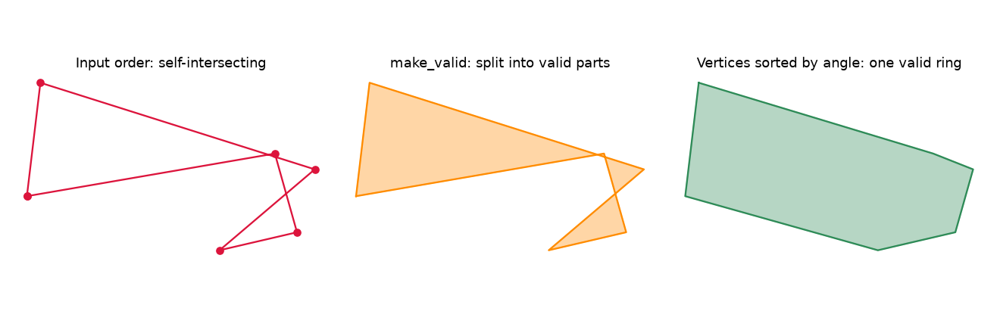

When a segmentation or detection model's output is turned into map polygons, a few shapes always come out broken: the outline crosses itself and GIS tools reject it. And once the polygons are valid, you often want to filter them by shape, for example to drop long thin slivers from a class that should be round. This note covers both steps with Shapely.

## What makes a polygon invalid

A polygon is valid when its outer ring is closed, does not cross itself, and any holes sit inside it without touching each other in more than single points. The most common failure is a **self-intersection**: the vertices are fine, but they are listed in the wrong order, so the ring folds over itself like a bow tie.

```python
import numpy as np
from shapely.geometry import Polygon

vs = np.array([[-54.76, -102.86], [-51.95, -79.22], [5.17, -97.27],
               [-14.65, -114.13], [1.47, -110.38], [-3.14, -93.98]])
bad = Polygon(vs)
print(bad.is_valid)   # False: the ring crosses itself
```



## Three ways to "fix" it, and what each one really does

**1. `buffer(0)`.** The classic trick. It rebuilds the geometry and often returns something valid, but it can silently throw away part of the area. On the shape above it keeps about 610 square units.

**2. `make_valid`.** The safer choice. It keeps every part of the original area and returns valid pieces, here a `MultiPolygon` of about 680 square units. Use it when you must not lose area, and then decide what to do with the pieces (keep the largest, or keep them all).

**3. Re-ordering the vertices.** If you know the points belong to one simple outline and only their order is wrong, sort them by angle around their centre:

```python
c = vs.mean(axis=0)
order = np.argsort(-np.arctan2(vs[:, 1] - c[1], vs[:, 0] - c[0]))
good = Polygon(vs[order])
print(good.is_valid)  # True
```

This only works for **star-shaped** polygons: shapes where the centre can "see" every vertex. For shapes like an L or a U, angle sorting creates a different, wrong outline. Use it for compact blobs, not in general.

A common mix-up: `shapely.ops.orient` does **not** repair a polygon. It only sets the direction of the ring (counter-clockwise for the outside), which some file formats expect. A self-intersecting polygon is still invalid after `orient`.

## Four numbers that describe a shape

Once polygons are valid, a handful of cheap measures tell you a lot about their shape.

**Eccentricity** measures how elongated the shape is. Take the minimum rotated rectangle around it, with long side $a$ and short side $b$:

$$
e = \sqrt{1 - \left(\tfrac{b}{a}\right)^2}
$$

It is 0 for a square-like footprint and close to 1 for a long, thin one. This is the ellipse eccentricity formula applied to the bounding rectangle, so it is an approximation, but a robust and fast one.

**Circularity** (the Polsby–Popper score) compares the area $A$ with the perimeter $P$:

$$
C = \frac{4\pi A}{P^2}
$$

A perfect circle scores 1. Jagged or stretched outlines have a long perimeter for their area and score lower.

**Solidity** is the area divided by the area of the convex hull. It is 1 for convex shapes and drops for shapes with dents or arms, like an L.

**Vertex count** is a rough measure of how detailed or noisy an outline is. It is useful for spotting over-segmented, jagged results before simplifying them.

```python
def eccentricity(g):
    r = g.minimum_rotated_rectangle
    x, y = r.exterior.coords.xy
    b, a = sorted([np.hypot(x[1]-x[0], y[1]-y[0]), np.hypot(x[2]-x[1], y[2]-y[1])])
    return float(np.sqrt(1 - (b / a) ** 2)) if a > 0 else 0.0

circularity = lambda g: 4 * np.pi * g.area / g.length ** 2
solidity    = lambda g: g.area / g.convex_hull.area
```

What these give for a few simple shapes:

| Shape | Eccentricity | Circularity | Solidity |
|---|---|---|---|
| Circle | 0.00 | 1.00 | 1.00 |
| Square | 0.00 | 0.79 | 1.00 |
| Rectangle 6 × 1 | 0.99 | 0.38 | 1.00 |
| L-shape | 0.00 | 0.44 | 0.71 |

The measures complement each other. The L-shape fits a square bounding rectangle, so its eccentricity is 0, but solidity and circularity expose that it is not compact.

## Using them in practice

With GeoPandas, compute the metrics as columns, then look at their distributions per class before choosing thresholds:

```python
import geopandas as gpd
gdf = gpd.read_file("predictions.gpkg")
gdf["geometry"] = gdf.geometry.make_valid()
gdf["eccentricity"] = gdf.geometry.apply(eccentricity)
gdf["circularity"]  = gdf.geometry.apply(circularity)
gdf["solidity"]     = gdf.geometry.apply(solidity)
```

Objects that are naturally round, such as tree crowns seen from above, should have low eccentricity and high solidity. A crown polygon with eccentricity above 0.95 is almost always an artefact, such as two crowns merged into a strip. Objects that are naturally long, such as fallen trunks, need their own thresholds, so filter per class rather than globally.

## Key takeaways

- Invalid polygons usually come from vertex order, not bad coordinates.
- Prefer `make_valid` over `buffer(0)` when area matters; `orient` does not repair anything.
- Sorting vertices by angle fixes only star-shaped outlines.
- Eccentricity, circularity, solidity and vertex count are cheap and together describe elongation, compactness and concavity.
- Set shape thresholds per class after looking at the distributions.

## Resources

- Shapely documentation: [`make_valid`](https://shapely.readthedocs.io/en/stable/reference/shapely.make_valid.html), [`orient`](https://shapely.readthedocs.io/en/stable/manual.html#shapely.ops.orient), [`minimum_rotated_rectangle`](https://shapely.readthedocs.io/en/stable/reference/shapely.minimum_rotated_rectangle.html).
- Open Geospatial Consortium, *Simple Features Access* ([OGC 06-103r4](https://www.ogc.org/standard/sfa/)): the formal rules for valid polygons.
- Polsby, D. & Popper, R. (1991), *The Third Criterion: Compactness as a Procedural Safeguard Against Partisan Gerrymandering*, Yale Law & Policy Review: origin of the circularity score.
