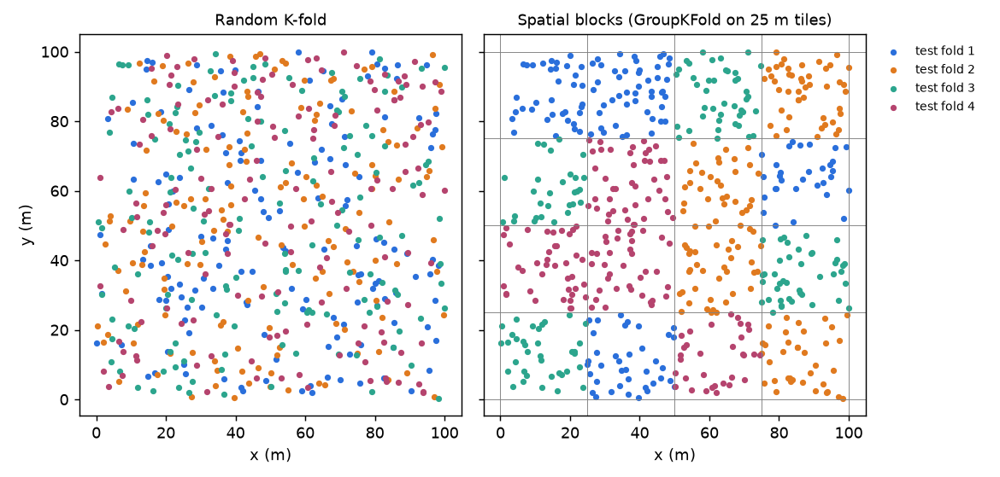

Cross-validation is how we guess a model's error on data it has never seen. That guess is only honest if the test fold is as "new" to the model as real future data will be. When samples come in groups (many rows per patient, per field, per city, per sensor) or sit close together in space, a random split puts near-copies of each test row into the training set. The score then measures memory, not generalization, and it can be wildly too good.

## The hidden assumption in random K-fold

K-fold cross-validation shuffles the rows, cuts them into $K$ folds, trains on $K-1$ folds and tests on the last one. The average test error estimates the prediction error

$$
\text{Err} = \mathbb{E}\big[L(Y, \hat f(X))\big],
$$

where $L$ is the loss (for example squared error), $\hat f$ is the fitted model and $(X, Y)$ is a fresh sample. "Fresh" is the key word. The estimate is unbiased only when test rows are independent of training rows, just like future data will be.

Grouped data breaks this. Rows from the same group share things the features may not fully describe: the same instrument, the same weather, the same soil, the same person. Their errors are correlated. If one row of a group is in training and its sibling is in test, the model can score well on the sibling simply by recognizing the group. In production you will usually predict for a *new* group, where that shortcut does not exist.

Spatial data has the same problem without explicit groups. Tobler's "first law of geography" says near things are more related than distant things. A test point 5 m from a training point is not a fresh sample; it is almost a duplicate.

## A small experiment

The synthetic data below has 30 groups of 40 rows. The target depends on one real feature plus a group offset. Two extra features are a group "signature": they are almost constant within a group and carry no causal information, but they identify the group.

```python
import numpy as np
from sklearn.ensemble import RandomForestRegressor
from sklearn.model_selection import KFold, GroupKFold, cross_val_score

rng = np.random.default_rng(0)
n_groups, per_group = 30, 40
groups = np.repeat(np.arange(n_groups), per_group)

# Each group has a shared offset in the target and a shared signature in two features
offset = rng.normal(0, 3, n_groups)[groups]
signature = rng.normal(0, 1, (n_groups, 2))[groups]

x_real = rng.uniform(0, 10, len(groups))           # the feature that truly matters
X = np.column_stack([x_real, signature + rng.normal(0, 0.05, signature.shape)])
y = 2.0 * x_real + offset + rng.normal(0, 1, len(groups))

model = RandomForestRegressor(n_estimators=200, random_state=0)
random_cv = KFold(n_splits=5, shuffle=True, random_state=0)
group_cv = GroupKFold(n_splits=5)

rmse = "neg_root_mean_squared_error"
r_random = -cross_val_score(model, X, y, cv=random_cv, scoring=rmse)
r_group = -cross_val_score(model, X, y, cv=group_cv, groups=groups, scoring=rmse)
print(f"random K-fold RMSE: {r_random.mean():.2f}")   # 1.63
print(f"group K-fold RMSE:  {r_group.mean():.2f}")    # 3.01
```

Random K-fold reports an RMSE of 1.63. Group K-fold, which keeps every group entirely in train or entirely in test, reports 3.01. The second number is the one you would see on a new group.

The more dangerous effect shows up when you use cross-validation to *choose* features. Drop the signature features and rerun:

```python
X_real = X[:, :1]
print(-cross_val_score(model, X_real, y, cv=random_cv, scoring=rmse).mean())  # 3.13
print(-cross_val_score(model, X_real, y, cv=group_cv, groups=groups,
                       scoring=rmse).mean())                                 # 3.05
```

Under random K-fold, the signature features look like a huge win (3.13 down to 1.63). Under group K-fold they do nothing useful (3.05 versus 3.01). A feature search driven by random K-fold would happily keep features that only help the model memorize groups. Model selection and hyperparameter tuning inherit the same bias: leaky validation rewards flexible models that memorize best.

## Leave-group-out and its variants

The fix is to split by group, not by row. Common choices:

- **Group K-fold**: assign whole groups to $K$ folds, trying to balance fold sizes.
- **Leave-one-group-out**: one fold per group. Most faithful when you have few groups, but expensive and noisy when groups are small.
- **Stratified group K-fold**: whole groups per fold, while also trying to keep the target (or class) distribution similar across folds.
- **Nested grouped CV**: when you also tune hyperparameters, the inner tuning loop must be grouped too. Otherwise the tuning step leaks and the outer score is still optimistic.

Pick the group to match the deployment question. If the model will be used on new patients, group by patient. If it will be used on new regions, group by region, even if that makes the score look worse. The score should answer "how well will this work where I will actually use it?"

## Spatial blocking

With spatial data there may be no natural group label. Roberts et al. (2017) recommend *block cross-validation*: cut space into blocks and treat each block as a group. The blocks should be larger than the range over which residuals are correlated. You can estimate that range from a variogram of the residuals, or simply try several block sizes and watch the error stop changing.

```python
import numpy as np
from sklearn.model_selection import GroupKFold

rng = np.random.default_rng(1)
xy = rng.uniform(0, 100, (600, 2))              # sample locations in metres

# Cut the map into 25 m x 25 m tiles and use the tile id as the group
block = 25.0
tile_id = (xy[:, 1] // block).astype(int) * 100 + (xy[:, 0] // block).astype(int)

for train_idx, test_idx in GroupKFold(n_splits=4).split(xy, groups=tile_id):
    print(len(train_idx), len(test_idx), np.unique(tile_id[test_idx]).size, "tiles held out")
```



In the left panel every test point has training neighbours a few metres away. In the right panel a test point's nearest training neighbour is usually in another tile. Variants include a buffer zone (drop training points within some distance of the test block) and checkerboard or systematic block layouts so every fold covers the whole range of conditions.

Ploton et al. (2020) showed how much this matters in practice. A large-scale biomass map looked accurate under random cross-validation, but spatial cross-validation showed that its predictive skill far from training data was close to none.

## Costs and caveats

Grouped and blocked CV are not free:

- **Higher variance.** With few groups, each fold's score depends a lot on which groups landed there. Report the spread across folds, not just the mean, and consider repeating with different group-to-fold assignments.
- **Possible pessimism.** If blocks are much larger than needed, test folds can fall outside the range of the training data, so you measure extrapolation instead of the interpolation you will actually do.
- **Unbalanced folds.** Groups differ in size. Check how many rows and groups each fold has.
- **Preprocessing leaks too.** Scaling, imputation, target encoding and feature selection must be fitted inside each training fold. Wrap them in a pipeline so the grouped split covers them.

## Key takeaways

- Random K-fold assumes test rows are independent of training rows. Grouped or spatially clustered data breaks that assumption.
- Leaky validation is not just optimistic; it also picks the wrong features and the wrong models.
- Split by the unit you will meet in deployment: group K-fold, leave-one-group-out, or spatial blocks.
- Make blocks larger than the residual correlation range, and report the spread across folds.
- Every data-dependent step (tuning, scaling, encoding) must sit inside the grouped split.

## Resources

- David R. Roberts et al., "Cross-validation strategies for data with temporal, spatial, hierarchical, or phylogenetic structure", *Ecography* 40 (2017): https://doi.org/10.1111/ecog.02881
- Pierre Ploton et al., "Spatial validation reveals poor predictive performance of large-scale ecological mapping models", *Nature Communications* 11 (2020): https://doi.org/10.1038/s41467-020-18321-y
- Hanna Meyer et al., "Improving performance of spatio-temporal machine learning models using forward feature selection and target-oriented validation", *Environmental Modelling & Software* 101 (2018): https://doi.org/10.1016/j.envsoft.2017.12.001
- Alexandre M. J.-C. Wadoux et al., "Spatial cross-validation is not the right way to evaluate map accuracy", *Ecological Modelling* 457 (2021), a useful counterpoint on when design-based validation is better: https://doi.org/10.1016/j.ecolmodel.2021.109692
- Shachar Kaufman et al., "Leakage in data mining: formulation, detection, and avoidance", *ACM TKDD* 6(4) (2012): https://doi.org/10.1145/2382577.2382579
- Trevor Hastie, Robert Tibshirani, Jerome Friedman, *The Elements of Statistical Learning*, 2nd ed., Section 7.10: https://hastie.su.domains/ElemStatLearn/
- scikit-learn User Guide, "Cross-validation iterators for grouped data": https://scikit-learn.org/stable/modules/cross_validation.html#group-k-fold
