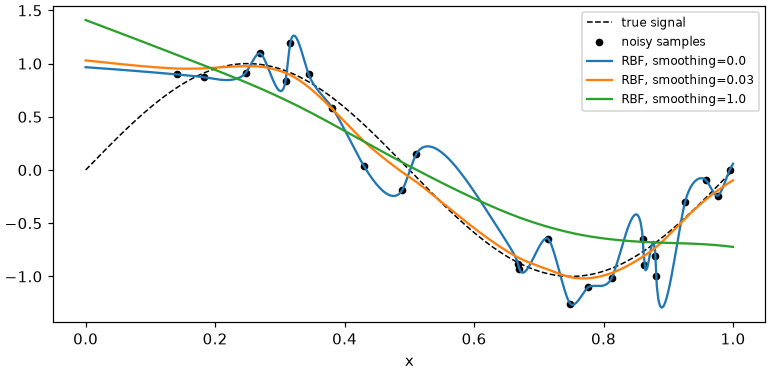

A lot of measurements come as scattered points: weather stations, soil samples, GPS tracks, LiDAR ground returns, or a few hand-picked control values. But most tools want a regular grid. Interpolation fills that grid from the points, and the thing that took me a while to get is that every method makes its own guess about what happens *between* the samples. I compared the standard methods in early 2023 while playing with smooth 2-D weight surfaces built from a few control values. This note keeps the general lessons, using a synthetic example.

## What we're actually trying to do

We have $n$ samples $(\mathbf{x}_i, z_i)$, where $\mathbf{x}_i = (x_i, y_i)$ is a location and $z_i$ is the value measured there. We want a function $\hat z(\mathbf{x})$ that goes through (or close to) the samples and gives a value at every grid node. There's no single right answer, because the data alone don't say what happens between points. So picking a method is really picking a belief about the surface: "it's flat in patches", "it's made of flat triangles", "it's as smooth as possible", or "it's a weighted average of the neighbours".

For the comparison below I sampled a smooth function at 80 random points in $[0.05, 0.95]^2$ and interpolated onto a $200 \times 200$ grid covering $[0, 1]^2$. I kept the samples away from the edges on purpose, to see what each method does outside the data.

```python
import numpy as np
from scipy.interpolate import griddata, RBFInterpolator

def f(x, y):                                    # smooth synthetic truth
    return np.sin(3*x) * np.cos(4*y) + 0.5*np.exp(-((x-0.7)**2 + (y-0.3)**2) / 0.02)

rng = np.random.default_rng(0)
pts = rng.uniform(0.05, 0.95, size=(80, 2))     # scattered sample locations
vals = f(pts[:, 0], pts[:, 1])
gx, gy = np.meshgrid(np.linspace(0, 1, 200), np.linspace(0, 1, 200))

z_lin = griddata(pts, vals, (gx, gy), method="linear")   # also "nearest", "cubic"
z_rbf = RBFInterpolator(pts, vals, kernel="thin_plate_spline")(
    np.column_stack([gx.ravel(), gy.ravel()])).reshape(gx.shape)
```


## Nearest neighbour

The simplest one: each grid node just copies the value of the closest sample. You get a mosaic of **Voronoi cells**, where each cell is the area that's closer to one sample than to any other. It's fast, it never makes up values outside the range you measured, and it works for categories too (land-cover classes, labels). The downside is that it's blocky, with jumps at the cell borders. It's defined everywhere, so it never gives NaN.

## Linear: triangles and barycentric weights

Linear interpolation first joins the samples into triangles using a **Delaunay triangulation**. That's the triangulation that avoids long, thin triangles: no sample is allowed inside another triangle's circumcircle (the circle through its three corners). Inside a triangle with corners $\mathbf{p}_1, \mathbf{p}_2, \mathbf{p}_3$, any point can be written as

$$
\mathbf{x} = \lambda_1 \mathbf{p}_1 + \lambda_2 \mathbf{p}_2 + \lambda_3 \mathbf{p}_3, \qquad \lambda_1 + \lambda_2 + \lambda_3 = 1,\ \lambda_k \ge 0,
$$

where the $\lambda_k$ are the **barycentric coordinates**. The way I think about them: they say how much the point "belongs" to each corner. The interpolated value just reuses those weights: $\hat z = \lambda_1 z_1 + \lambda_2 z_2 + \lambda_3 z_3$. So the surface is a set of flat triangular facets, called a TIN (triangulated irregular network). It's continuous, but the slope jumps at triangle edges. And since the value is always a mix of the three corners, linear interpolation never overshoots.

## Cubic: Clough–Tocher

The `cubic` option in SciPy's `griddata` uses the **Clough–Tocher** scheme on the same triangles. Each triangle gets split into three smaller ones, and a cubic polynomial is fitted on each so that both the values *and* the first derivatives match across edges. The slopes at the samples are estimated from the data. The result is smooth ($C^1$, so the slope is continuous too) and it was the most accurate method in my test. The catch: unlike linear, it can overshoot. Near a sharp peak it can give values higher than the highest sample.

## Outside the data: NaN

This one surprised me the first time. Linear and cubic only know about triangles, and the triangles only cover the **convex hull** of the samples: the smallest convex polygon that contains all of them (picture a rubber band stretched around the points). Grid nodes outside it get `NaN` (or whatever `fill_value` you pass). In my test 26.6% of the grid was outside the hull; that's the blank border in the figure. Honestly, this is fair behaviour, since anything out there would be extrapolation. Common fixes:

- add known values at the domain corners or edges, if you really know them;
- fill the NaNs with a nearest-neighbour pass;
- use a method that extrapolates (RBF, IDW), and treat those values with care.

## Radial basis functions

An RBF interpolant is basically a weighted sum of identical bumps, one centred on each sample:

$$
\hat z(\mathbf{x}) = \sum_{i=1}^{n} w_i\, \varphi\big(\lVert \mathbf{x} - \mathbf{x}_i \rVert\big) + P(\mathbf{x}),
$$

Here $\varphi$ is the **kernel** (a function that only depends on distance), the $w_i$ are weights, and $P$ is a low-degree polynomial (for example a plane) that picks up the overall trend. You get the weights by solving an $n \times n$ linear system that forces $\hat z(\mathbf{x}_i) = z_i$. Common kernels:

- **thin-plate spline**, $\varphi(r) = r^2 \log r$: it minimises bending energy, like a thin metal sheet pinned at the samples. A good default, and there's no shape parameter to tune.
- **multiquadric** $\sqrt{1 + (\varepsilon r)^2}$, **inverse multiquadric**, and **Gaussian** $e^{-(\varepsilon r)^2}$: these have a shape parameter $\varepsilon$ that has to suit the spacing of your data. Too large and you get isolated spikes; too small and the linear system becomes ill-conditioned (numerically unstable).
- **linear** $\varphi(r) = r$ and **cubic** $r^3$: simple polyharmonic kernels.

RBFs fill the whole grid, including outside the hull, where they fall back to the polynomial trend. On my example the thin-plate RBF did as well as cubic inside the hull (RMSE 0.011) and still had a low error (0.024) over the whole square.

### Smoothing for noisy data

If the samples are noisy, exact interpolation is a bad idea, because the surface is forced through every noisy value. The `smoothing` parameter $\lambda$ loosens this: the system becomes $(\Phi + \lambda I)\mathbf{w} = \mathbf{z}$, where $\Phi$ is the matrix of kernel values between samples and $I$ is the identity. Bigger $\lambda$ means a less exact fit and a smoother surface. It's the same trade-off as in ridge regression.



On 25 noisy samples of a sine wave, the RMSE against the true curve was 0.26 with no smoothing, 0.065 with $\lambda = 0.03$, and 0.28 with $\lambda = 1$. So there's a sweet spot, and you should find it with cross-validation, not by eye.

## Inverse distance weighting

IDW (Shepard's method) is the most intuitive one to me: each node is a weighted average of nearby samples, and closer samples get more weight:

$$
\hat z(\mathbf{x}) = \frac{\sum_i w_i z_i}{\sum_i w_i}, \qquad w_i = \frac{1}{d(\mathbf{x}, \mathbf{x}_i)^p},
$$

where $d$ is the distance and $p$ is the power (2 is common). Bigger $p$ makes it more local. It's easy to write yourself with a k-d tree:

```python
from scipy.spatial import cKDTree

def idw(pts, vals, query, k=8, p=2):
    d, i = cKDTree(pts).query(query, k=k)       # k nearest samples per query point
    w = 1.0 / np.maximum(d, 1e-12)**p           # avoid dividing by zero at a sample
    return (w * vals[i]).sum(1) / w.sum(1)

z_idw = idw(pts, vals, np.column_stack([gx.ravel(), gy.ravel()])).reshape(gx.shape)
```

IDW never overshoots, because every estimate is an average of samples. Its known weakness is the **bull's-eye** effect you can see in the figure: little plateaus around each sample, because the gradient goes to zero there. Far from all samples it flattens out towards a local mean. On my smooth surface it was less accurate than RBF or cubic (RMSE 0.078 inside the hull), but it's simple, cheap and hard to break.

## Watch your units (anisotropy)

Every method here uses plain Euclidean distance, so the units of $x$ and $y$ matter. Sometimes the field changes much faster in one direction (rows in a field, a river valley, or $x$ in metres and $y$ in kilometres); that's called anisotropy. Rescale the coordinates first so that "one unit" means about the same amount of change in both directions. On a synthetic field that changed ten times faster in $y$ than in $x$, shrinking $x$ by 10 before a thin-plate RBF dropped the RMSE from 0.142 to 0.012. Kriging handles this more formally with an anisotropic variogram.

## How slow is each one?

- **Nearest, linear, cubic**: one Delaunay triangulation, $O(n \log n)$, then finding the right triangle for each query point. With 4,000 samples and 250,000 query points, linear `griddata` took 0.4 s on my laptop.
- **Global RBF**: solving the dense $n \times n$ system costs $O(n^3)$, and every query touches all $n$ samples. The same job took 15 s. Passing `neighbors=50` to `RBFInterpolator` fits a small local RBF per query instead. That took 6.7 s and scales to large $n$.
- **IDW** with a k-d tree: $O(\log n)$ per query, so very fast.

## Old API: `interp2d` is gone

Older tutorials use `scipy.interpolate.interp2d` and the `Rbf` class. If you copy that code today, it breaks: `interp2d` was deprecated in SciPy 1.10 and removed in 1.14, and now it raises `NotImplementedError`. It also behaved badly on scattered data anyway. Use `griddata` (or `LinearNDInterpolator`, `CloughTocher2DInterpolator`) for scattered points, `RBFInterpolator` instead of `Rbf`, and `RegularGridInterpolator` or `RectBivariateSpline` when the input is already on a grid. One small gotcha: `RBFInterpolator` takes the points as one `(n, d)` array, not separate `x`, `y` arguments.

If you want to grid LiDAR ground points into a terrain model, where TIN and IDW are the usual choices, see [airborne LiDAR: DTM, DSM and CHM](/notes/airborne-lidar-dtm-dsm-chm/).

## Key takeaways

- Every interpolator bakes in a guess about the surface between samples. There's no neutral choice.
- Linear (Delaunay + barycentric weights) is safe and never overshoots. Cubic (Clough–Tocher) and thin-plate RBF are smoother and more accurate on smooth fields, but they can overshoot.
- Triangle-based methods give NaN outside the convex hull. RBF and IDW do fill it in, but filling in isn't the same as being right.
- For noisy data, use RBF smoothing (pick it with cross-validation). For anisotropic fields, rescale the coordinates first.
- `interp2d` doesn't exist in SciPy anymore; use `griddata`, `RBFInterpolator` or `RegularGridInterpolator`.

## Resources

- SciPy documentation, "Scattered data interpolation (griddata)" and `RBFInterpolator`: https://docs.scipy.org/doc/scipy/tutorial/interpolate/ND_unstructured.html
- SciPy documentation, "Interpolate transition guide" (replacing `interp2d`): https://docs.scipy.org/doc/scipy/tutorial/interpolate/interp_transition_guide.html
- Donald Shepard, "A two-dimensional interpolation function for irregularly-spaced data", ACM National Conference (1968): https://doi.org/10.1145/800186.810616
- Holger Wendland, *Scattered Data Approximation*, Cambridge University Press (2004), chapters on RBFs and conditionally positive definite kernels.
- Martin D. Buhmann, *Radial Basis Functions: Theory and Implementations*, Cambridge University Press (2003).
- R. W. Clough and J. L. Tocher, "Finite element stiffness matrices for analysis of plates in bending" (1965), origin of the Clough–Tocher element.
