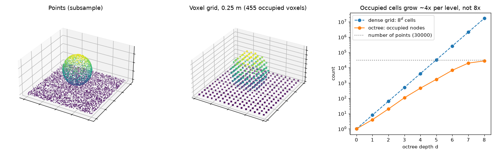

A photo is always a grid of pixels. 3D data isn't like that. A laser scanner gives you a bag of points, a game engine wants triangles, a neural network may want a regular grid, and an RGB-D camera gives you an image where each pixel holds a distance. Each form makes some things easy and other things hard. So the first choice in any 3D project is which form to work in. I went through these while coding along with Chapters 3 and 4 of Florent Poux's *3D Data Science with Python*, and wrote this note to keep the ideas straight without tying them to one library.



## Raw points

A point cloud is just an $N \times 3$ array of coordinates. Often each point has extra columns too: colour, intensity, a class label, a normal vector (the direction the surface faces). Two things about it took me a while to really feel:

- **There's no order.** Row 17 and row 18 don't have to be close in space. Any algorithm has to give the same answer if you shuffle the rows.
- **There's no regular spacing.** How dense the points are depends on the distance to the sensor, the scan angle and what's blocking the view. There are no "pixels" and no fixed set of neighbours.

So even a simple question like "which points are near this one?" needs a spatial index, such as a k-d tree or one of the grids below.

File formats differ in small ways that can bite you. Plain text (`.xyz`, `.txt`, `.csv`) is easy to read but big and slow. PLY stores points, and optionally faces, as text or binary. LAS/LAZ, the standard for airborne LiDAR, stores coordinates as **scaled integers**: the real value is $x = X \cdot s_x + o_x$, where $X$ is the stored integer, $s_x$ is the scale (for example 0.01 m) and $o_x$ is the offset from the header. Readers usually do this for you, but if you read the raw integer fields you have to apply it yourself. Also, LAS colours are 16-bit, so divide by 65,535, not 255, to get values in $[0, 1]$.

## Voxel grids

A voxel is a 3D pixel: a little cube. A voxel grid cuts space into cubes of side $s$ and puts each point into the cube that contains it:

$$
\mathbf{i} = \left\lfloor \frac{\mathbf{p} - \mathbf{p}_{\min}}{s} \right\rfloor,
$$

where $\mathbf{p}$ is the point, $\mathbf{p}_{\min}$ is the grid origin and $\mathbf{i}$ is the integer index of its voxel. So basically it's integer division of the coordinates. Once points share an index, you can store whatever you want per voxel: occupied or not, a count, a mean colour, or the centroid. Keeping one centroid per voxel is the usual way to **downsample** a cloud so it has even density.

```python
import numpy as np

def voxel_downsample(points, size):
    """Replace all points in each occupied voxel by their centroid."""
    idx = np.floor((points - points.min(0)) / size).astype(np.int64)
    keys, inverse = np.unique(idx, axis=0, return_inverse=True)
    sums = np.zeros((len(keys), 3))
    np.add.at(sums, inverse, points)             # sum the points per voxel
    counts = np.bincount(inverse)[:, None]
    return sums / counts, keys                    # centroids, voxel indices
```

How much memory a voxel grid takes depends on how you store it. A **dense** 3D array has $(L/s)^3$ cells for a scene of size $L$, so halving the voxel size means eight times the memory. And most of those cells are empty, because scanners see surfaces, not solid volumes. On the synthetic scene in the figure (a 4 m plane with a sphere), only 5% of the cells in the bounding box are occupied at 5 cm. A **sparse** grid, like a hash map from index to value or the `unique` call above, only stores the occupied cells.

Voxels make sense when you need a regular structure: 3D convolutions, occupancy maps for robot navigation, volume estimates, or quick neighbour lookups ("the 26 voxels around this one").

## Octrees

An octree is a voxel grid built one level at a time. Start with one cube around the whole cloud. Split it into eight children with half the side length, and keep only the children that have points in them. Repeat until a maximum depth $d$. At depth $d$ the cell size is $L / 2^d$.

The nice part is that empty space never gets split. A dense grid at depth $d$ has $8^d$ cells. But when the points lie on surfaces, the number of occupied nodes grows roughly four times per level, the same way the area of a surface grows when you halve your measuring unit. That's what made it click for me. In the figure, at depth 8 the dense grid would have 16.8 million cells, while the octree has about 28,000 occupied leaves, close to the number of points. Once each leaf holds about one point, going deeper adds nothing.

The same tree also gives you every resolution at once. You can stop at a shallow level for a rough preview (point cloud viewers and streaming formats like Entwine Point Tiles do this), or go deeper only where you need detail. Octrees also make neighbour search and collision tests fast, since whole empty branches get skipped.

## Meshes

A triangle mesh stores vertices ($V$, an $n \times 3$ array) and faces ($F$, an $m \times 3$ array of vertex indices). Unlike points, a mesh describes a **surface**. It knows what's between the samples, it has a clear area and normals, and it renders with proper shading. Normals aren't always in the file, though. Compute them before rendering, or the mesh looks flat and unlit.

Going from a mesh to points is easy. To sample a mesh **uniformly**, pick each triangle with probability proportional to its area, then pick a random point inside it using barycentric coordinates (weights that say how much of each corner the point is made of):

```python
def sample_mesh(V, F, n, rng=np.random.default_rng(0)):
    a, b, c = V[F[:, 0]], V[F[:, 1]], V[F[:, 2]]
    area = 0.5 * np.linalg.norm(np.cross(b - a, c - a), axis=1)
    tri = rng.choice(len(F), n, p=area / area.sum())   # big triangles get more points
    u, v = rng.random(n), rng.random(n)
    flip = u + v > 1                                   # fold the square onto the triangle
    u[flip], v[flip] = 1 - u[flip], 1 - v[flip]
    return a[tri] + u[:, None] * (b - a)[tri] + v[:, None] * (c - a)[tri]
```

If you picked triangles uniformly instead of by area, you'd crowd points into the small triangles. Going the other way, from points to a mesh, is the hard direction. It's called surface reconstruction (for example Poisson or ball pivoting), and it needs good normals and even density.

## Depth maps and RGB-D images

A depth map is an image where pixel $(u, v)$ holds the distance $Z$ along the camera's viewing axis. Put it together with a colour image and you get an RGB-D image, which is what sensors like the Kinect or many phone cameras give you. People often call it **2.5D**: one depth per pixel, so anything hidden behind the first surface is just missing.

With the camera intrinsics (focal lengths $f_x, f_y$ in pixels and principal point $c_x, c_y$, roughly the image centre), each pixel turns back into a 3D point in the camera's frame:

$$
X = \frac{(u - c_x)\,Z}{f_x}, \qquad Y = \frac{(v - c_y)\,Z}{f_y}.
$$

```python
Z = depth_u16.astype(float) / 1000.0          # stored in millimetres -> metres
u, v = np.meshgrid(np.arange(Z.shape[1]), np.arange(Z.shape[0]))
X, Y = (u - cx) * Z / fx, (v - cy) * Z / fy
cloud = np.stack([X, Y, Z], -1).reshape(-1, 3)[Z.ravel() > 0]   # 0 = no reading
```

Keep depth in its original 16-bit form and convert it with the sensor's **depth scale**. This is a mistake I made: in my code-along I divided a 16-bit depth image by 256 to squeeze it into 8 bits so it would display. Fine for a picture, but then each grey level spans 25.6 cm, so the depth is useless for 3D. To place the points in a world frame, apply the camera pose afterwards (see [the camera extrinsic matrix](/notes/camera-extrinsic-matrix/)).

Depth maps are compact and go straight into 2D CNNs. That's why many networks work on depth or range images instead of raw points. Turning a full cloud into such an image is covered in [projecting point clouds to images](/notes/projecting-point-clouds-to-images/).

## So which one should I use?

| Representation | Stores | Good for | Weak at |
|---|---|---|---|
| Points | samples + attributes | raw sensor data, measurement, classification per point | neighbourhoods, surfaces, rendering |
| Voxel grid | values on a regular 3D grid | downsampling, occupancy maps, 3D CNNs, volumes | memory at fine resolution (if dense), loses detail below $s$ |
| Octree | adaptive grid, empty space pruned | multi-resolution viewing, streaming, fast search | more complex to update |
| Mesh | surface (vertices + triangles) | rendering, area, simulation, CAD/BIM | creating it from noisy points |
| Depth / RGB-D | one depth per pixel from one viewpoint | 2D networks, real-time sensing | occluded parts, only one view |

In practice you move between them: scan to points, voxel-downsample, index with an octree or k-d tree, maybe build a mesh for display, or render depth images for a network.

## Key takeaways

- A point cloud has no order and uneven density, so finding neighbours needs a spatial structure.
- Voxelizing is just integer division of coordinates. Keeping one centroid per voxel evens out the density.
- Dense voxel grids grow as $8^d$. Octrees and sparse grids only store occupied cells, which grow about $4^d$ for surface data.
- Meshes describe surfaces. Sample them by triangle area to get evenly spread points.
- Depth maps turn into points with the pinhole model, but only if you keep the full-precision depth and the right depth scale.

## Resources

- Florent Poux, *3D Data Science with Python* (O'Reilly, 2025), Chapter 3 (point cloud basics) and Chapter 4 (3D data representations). My code-along followed this chapter; the code above is my own rewrite.
- Open3D documentation: [point clouds, voxelization, octrees, meshes and RGBD images](https://www.open3d.org/docs/release/).
- ASPRS, [LAS Specification 1.4](https://www.asprs.org/wp-content/uploads/2019/07/LAS_1_4_r15.pdf) (scaled integer coordinates, 16-bit colour).
- D. Meagher, "Octree encoding: a new technique for the representation, manipulation and display of arbitrary 3-D objects by computer", Rensselaer Polytechnic Institute technical report, 1980.
