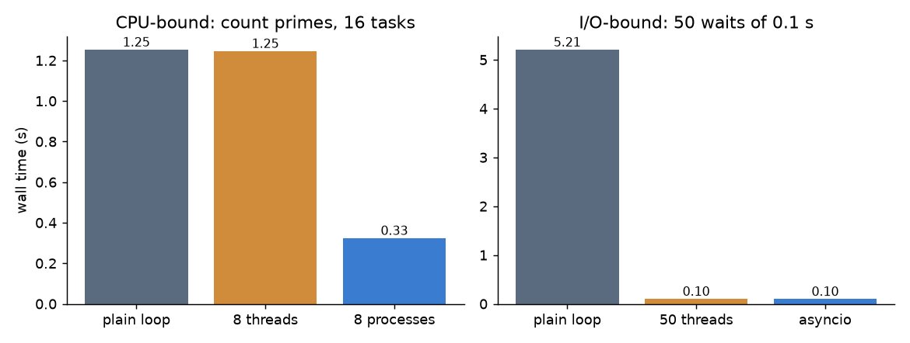

Python offers three ways to do several things at once: threads, processes and asyncio. Picking the wrong one gives no speed-up at all, or even makes the code slower. I learned this the hard way: my first benchmark sent a trivial function through a process pool and it ran much slower than a plain `for` loop. This note explains why, and gives a simple rule for choosing.

## Two kinds of slow code

First ask what your program is waiting for.

- **CPU-bound** code spends its time computing: parsing, numeric loops, image processing in pure Python. It gets faster only if more CPU cores work on it.
- **I/O-bound** code spends its time waiting: for a web server, a disk, a database or a queue. The CPU is idle during the wait. It gets faster if other work can run during the wait. Extra cores do not help.

## The GIL

CPython, the standard interpreter, has a **Global Interpreter Lock (GIL)**. Only the thread that holds the lock can run Python bytecode. So in a normal CPython build, two threads never run Python code at the same moment, even on an 8-core machine.

The GIL is released while a thread waits for I/O (`time.sleep`, socket reads, file reads) and inside many C extensions (NumPy, OpenCV and similar libraries release it during heavy loops). That is why threads still help with I/O and with code that spends its time inside such libraries.

Since Python 3.13 there is also an experimental **free-threaded** build (PEP 703, installed as `python3.13t`) where the GIL can be turned off. It is still a separate build, and many extension packages are not yet ready for it, so the advice below is about the standard build.

## The three tools

| Tool | What runs in parallel | Good for | Cost |
|---|---|---|---|
| `threading` / `ThreadPoolExecutor` | Threads in one process, sharing memory; Python code takes turns because of the GIL | I/O-bound work, calls into C code that releases the GIL | Cheap to start; shared state needs locks |
| `multiprocessing` / `ProcessPoolExecutor` | Separate interpreters, each with its own GIL, on separate cores | CPU-bound pure-Python work | Process start-up; every argument and result is pickled and sent between processes |
| `asyncio` | One thread; tasks hand over control at each `await` | Many concurrent I/O waits (thousands of connections) | Every library in the chain must be async |

## A benchmark on my laptop

I ran the same three cases on an 8-core machine with Python 3.13: a CPU-bound task (count primes below 60,000, 16 times) and an I/O-bound task (50 waits of 0.1 s each).

```python
import time, math, asyncio
from concurrent.futures import ThreadPoolExecutor, ProcessPoolExecutor

def count_primes(n):          # CPU-bound: pure Python arithmetic
    return sum(all(k % d for d in range(2, math.isqrt(k) + 1)) for k in range(2, n))

def fake_io(_):               # I/O-bound: just waits
    time.sleep(0.1)

async def fake_io_async(_):
    await asyncio.sleep(0.1)

if __name__ == "__main__":    # needed for process pools on macOS and Windows
    jobs = [60_000] * 16
    with ThreadPoolExecutor(8) as ex:  list(ex.map(count_primes, jobs))   # ~1.25 s
    with ProcessPoolExecutor(8) as ex: list(ex.map(count_primes, jobs))   # ~0.33 s
    with ThreadPoolExecutor(50) as ex: list(ex.map(fake_io, range(50)))   # ~0.10 s
    async def main(): await asyncio.gather(*(fake_io_async(i) for i in range(50)))
    asyncio.run(main())                                                    # ~0.10 s
```



The results match the theory:

- For the CPU-bound task, threads gave **no speed-up** (1.25 s vs 1.25 s for the loop), because of the GIL. Processes gave about 3.9× on 8 cores. It is not 8× because of start-up, pickling, and because the machine's cores are not all equal.
- For the I/O-bound task, the loop took 5.2 s (50 × 0.1 s). Threads and asyncio both overlapped the waits and finished in about 0.1 s. Here processes would work too, but they are the most expensive tool for the job.

## Why my process pool was slower than a loop

My original benchmark looked like this:

```python
def multiplier(coef=3):
    return coef * 2

with Pool() as p:
    result = p.map(multiplier, range(100_000))
```

The loop version took about 0.007 s. The pool version took about 0.14 s, twenty times slower. The work per item is one multiplication, a few nanoseconds. For each item the pool has to pickle the argument, send it through a pipe to a worker process, unpickle it, run the function, and send the result back the same way. That overhead is far larger than the work. On top of that, starting the worker processes costs tens of milliseconds.

Two things control this overhead:

1. **`chunksize`**. `Pool.map` sends items to workers in chunks. With `chunksize=1`, every item is a separate message: mapping 200,000 trivial items took 5.2 s on my machine. With the default (the pool splits the input into about four chunks per worker), one million items took 0.06 s, about the same as the loop (0.08 s). Larger chunks mean fewer messages.
2. **Task size**. Parallelism pays off only when each task does much more work than it costs to send it. Make tasks coarse: give each worker a whole file, a whole image tile or a block of rows, not a single number. Also avoid sending large objects as arguments; send a path or an index and let the worker load the data itself.

Third-party wrappers such as `joblib` (with the `loky` backend) and `mpire` add progress bars, better error messages and reuse of workers, but they pay the same overhead. They do not change the rule.

## Map-reduce on top of `Pool.map`

Map-reduce is a way to structure a computation so that most of it can run in parallel. It has three steps:

1. **Map**: turn each input record into `(key, value)` pairs, independently.
2. **Shuffle**: group all values that share a key.
3. **Reduce**: combine the values of each key into one result, independently per key.

Map and reduce are embarrassingly parallel, so they can use `Pool.map`. The shuffle needs to see all pairs, so here it stays in the main process. Here is the classic word count, written as a small function that runs either serially or with a pool:

```python
from collections import defaultdict
from multiprocessing import Pool

def mapper(word):                 # map: one record -> (key, value)
    return word.lower(), 1

def reducer(item):                # reduce: (key, [values]) -> (key, result)
    key, values = item
    return key, sum(values)

def map_reduce(records, mapper, reducer, pool=None):
    run = pool.map if pool else map
    shuffled = defaultdict(list)          # shuffle: group values by key
    for key, value in run(mapper, records):
        shuffled[key].append(value)
    return dict(run(reducer, shuffled.items()))

if __name__ == "__main__":
    words = "Python is great Python rocks".split()
    with Pool(4) as pool:
        print(map_reduce(words, mapper, reducer, pool))
        # {'python': 2, 'is': 1, 'great': 1, 'rocks': 1}
```

For five words the pool is pure overhead, for the reasons above. The value of the pattern is that the same mapper and reducer scale up: frameworks like Hadoop, Spark and Dask run the map and reduce steps on many machines and do the shuffle over the network. Note that `mapper` and `reducer` are named functions, not lambdas: functions sent to a process pool must be picklable, and lambdas are not.

## A simple decision rule

1. Measure first (see [profiling Python code](/notes/profiling-python-time-and-memory/)). Maybe the slow part can be vectorized with NumPy, which is often a bigger win than any pool.
2. Waiting on I/O? Use threads (`ThreadPoolExecutor`). If you need thousands of concurrent connections and your libraries are async, use asyncio.
3. Pure-Python CPU work? Use processes (`ProcessPoolExecutor` or `multiprocessing.Pool`) with coarse tasks and a sensible `chunksize`.
4. Heavy work inside NumPy or another C library that releases the GIL? Threads can be enough, and they avoid copying data between processes.

## Key takeaways

- Decide first whether the code is CPU-bound or I/O-bound; that decides the tool.
- In standard CPython, the GIL stops threads from running Python code in parallel, so threads do not speed up pure-Python computation. Free-threaded builds (3.13+) are experimental.
- Process pools pay for start-up and for pickling every argument and result; tiny tasks or `chunksize=1` can make them far slower than a loop.
- Threads and asyncio both overlap waiting; asyncio scales to more concurrent tasks but needs async libraries.
- Map-reduce splits work into independent map and reduce steps that a pool (or a cluster) can run in parallel, with a shuffle in between.

## Resources

- Tiago Rodrigues Antão, *Fast Python: High Performance Techniques for Large Datasets*, Manning, 2023, chapter 3 (the naive map-reduce word count is adapted from there). https://www.manning.com/books/fast-python
- Python documentation: `multiprocessing` (including `Pool.map` and `chunksize`), `concurrent.futures`, `asyncio`. https://docs.python.org/3/library/concurrency.html
- Sam Gross, PEP 703: Making the Global Interpreter Lock Optional in CPython. https://peps.python.org/pep-0703/
- Python docs, "Free-threaded CPython" HOWTO. https://docs.python.org/3/howto/free-threading-python.html
- Jeffrey Dean and Sanjay Ghemawat, "MapReduce: Simplified Data Processing on Large Clusters", OSDI 2004.
