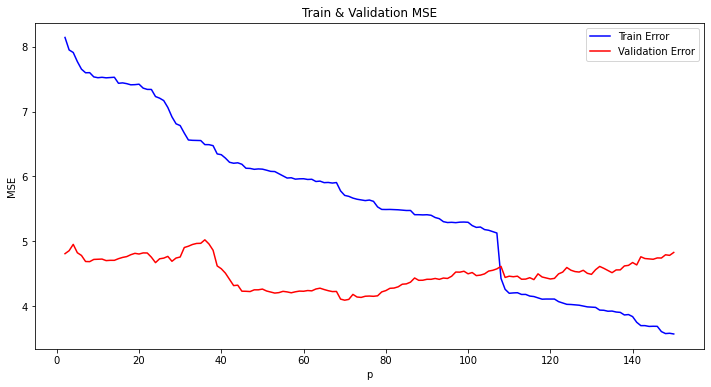

An autoregressive (AR) model predicts the next value of a series from its own last few values. It's the first model you reach for with a time series, and the nice surprise is that fitting it is plain linear regression. The hard part isn't the fitting. It's deciding how many past values to use. I worked through this in a course lab on NASA's global mean sea level data.

## The model

An AR model of order $p$, written AR($p$), says

$$
y_t = a_1 y_{t-1} + a_2 y_{t-2} + \dots + a_p y_{t-p} + \varepsilon_t,
$$

where $y_t$ is the value at time $t$, $a_1, \dots, a_p$ are the coefficients we learn, and $\varepsilon_t$ is white noise: independent, zero mean, constant variance $\sigma^2$. There's no intercept here because we assume the series has mean zero (more on that below).

The way I picture it: each new value is a weighted sum of the recent past plus a fresh random kick.

## Remove the trend first

The model above assumes the series is *stationary*: its mean, variance and correlations don't change over time. A series with a clear upward trend (like sea level) breaks this, because its mean keeps growing. So before fitting, I fit a straight line $\mu_t = \theta_0 + \theta_1 t$ by least squares and subtracted it. What's left wobbles around zero, and that's what the AR model sees.

One small trap: if the second part of the data will be used to judge the final model, the trend should be fitted on the training part only. Otherwise information from the future leaks into the preprocessing.

## Fitting is regression on lagged values

Stack the equation for $t = p+1, \dots, n$:

$$
\underbrace{\begin{bmatrix} y_{p+1} \\ \vdots \\ y_n \end{bmatrix}}_{\mathbf{y}} = \underbrace{\begin{bmatrix} y_p & \cdots & y_1 \\ \vdots & & \vdots \\ y_{n-1} & \cdots & y_{n-p} \end{bmatrix}}_{\Phi} \underbrace{\begin{bmatrix} a_1 \\ \vdots \\ a_p \end{bmatrix}}_{\theta} + \boldsymbol{\varepsilon}.
$$

Each row of $\Phi$ holds the $p$ values just before the target in that row, newest first. The least-squares estimate is

$$
\hat\theta = (\Phi^\top \Phi)^{-1} \Phi^\top \mathbf{y}.
$$

We lose the first $p$ observations as targets because they don't have $p$ values before them.

## One-step-ahead prediction

A one-step-ahead prediction of $y_t$ uses the *true* past values:

$$
\hat y_{t|t-1} = \hat a_1 y_{t-1} + \dots + \hat a_p y_{t-p}.
$$

On the validation part we still plug in the real observed values, never our own earlier predictions. That makes this an easy test. Predicting far ahead, where you must feed predictions back in, is a different problem (see [the note on long-range AR forecasts](/notes/ar-forecasts-and-stability/)).

```python
import numpy as np

def lag_matrix(y, p):
    """Row i holds (y[t-1], ..., y[t-p]) for target t = p + i."""
    n = len(y)
    return np.column_stack([y[p - j - 1 : n - j - 1] for j in range(p)])

def fit_ar(y, p):
    theta, *_ = np.linalg.lstsq(lag_matrix(y, p), y[p:], rcond=None)
    return theta

def predict_1step(y, theta):
    return lag_matrix(y, len(theta)) @ theta    # predictions of y[p:]

rng = np.random.default_rng(0)
y = np.zeros(1000)
for t in range(2, 1000):                        # toy AR(2) series
    y[t] = 0.6 * y[t - 1] + 0.3 * y[t - 2] + rng.normal()

n_train = 700
for p in [1, 2, 5, 20, 80]:
    theta = fit_ar(y[:n_train], p)              # fit on training data only
    err = (y[p:] - predict_1step(y, theta)) ** 2
    print(p, err[: n_train - p].mean().round(3), err[n_train - p :].mean().round(3))
```

One bug I had in my own lab code: inside my fitting function I built the lag matrix from the global training array instead of the function's argument `y`. It gave the right answer only because I always called it with the training data. Small thing, but it's the kind of bug that bites later.

## Choosing $p$ with a validation set

Training error can only go down as $p$ grows, because a bigger model can always set the extra coefficients to zero. So training error can't pick $p$. Instead I fitted models for $p = 2, \dots, 150$ on the first 700 points and computed the one-step MSE on the remaining 297.



The training curve falls steadily. The validation curve drops clearly around $p \approx 40$, stays low for a while, and then rises again for large $p$, which is overfitting. I picked $p = 45$. There's no single right answer here. A reasonable rule is to take the smallest $p$ whose validation error is close to the minimum, since a smaller model is cheaper and less likely to overfit.

## Check the residuals with the ACF

If the model has captured the structure, the one-step residuals $e_t = y_t - \hat y_{t|t-1}$ should look like white noise. The *autocorrelation function* (ACF) at lag $k$ is

$$
\hat\rho(k) = \frac{\sum_{t=k+1}^{n} (e_t - \bar e)(e_{t-k} - \bar e)}{\sum_{t=1}^{n} (e_t - \bar e)^2},
$$

the correlation between the residual series and itself shifted by $k$ steps. For white noise, $\hat\rho(k)$ for $k \ge 1$ should mostly stay inside $\pm 1.96/\sqrt{n}$, the approximate 95% band. Spikes outside it mean there's still predictable structure left that a better model could use. With $p = 45$ the validation residual ACF had fewer spikes outside the band than with $p = 10$, mainly around lags 30–40, which an AR(10) model simply can't reach. But both still had a clear spike at lag 1 (around 0.25). In my report I took "most bars inside the band" as good enough. Looking again, that lag-1 spike says the residuals aren't white noise yet: the next residual is still partly predictable from the current one.

In the same lab I also tried a nonlinear AR model, a small MLP that takes the same $p$ lagged values as input. It's the same idea with $f_\theta(y_{t-1}, \dots, y_{t-p})$ in place of the linear sum. It overfit quickly as I made the network bigger, which fits the general picture: on a short, noisy series a linear AR model is a hard baseline to beat.

## Key takeaways

- AR($p$) is linear regression where the inputs are the $p$ previous values of the series.
- Remove trends (and other non-stationary parts) first; fit the detrending on training data if the rest will be used for evaluation.
- One-step-ahead prediction uses real past values, so it's an easier task than multi-step forecasting.
- Pick $p$ on validation error, not training error, and prefer the smallest $p$ near the minimum.
- Residuals should look like white noise; their ACF tells you if structure is left.

## Resources

- 732A80 Time Series and Sequence Learning, Linköping University (course lab 1, autumn 2020).
- Shumway & Stoffer, *Time Series Analysis and Its Applications*, 4th ed., Chapter 3. https://www.stat.pitt.edu/stoffer/tsa4/
- Hyndman & Athanasopoulos, *Forecasting: Principles and Practice*, 3rd ed., Chapter 9. https://otexts.com/fpp3/
- NASA Global Mean Sea Level data. https://climate.nasa.gov/vital-signs/sea-level/
