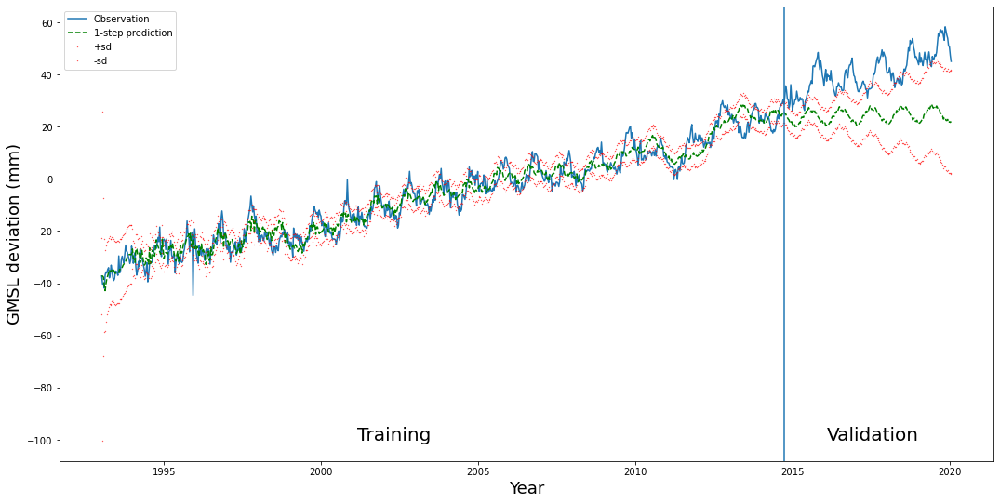

Once a time series is written as a [linear Gaussian state space model](/notes/structural-time-series-models/), the question is: given the observations so far, what is the hidden state now? The Kalman filter answers it exactly, one time step at a time, by keeping a Gaussian belief (a mean and a covariance) and updating it with each new observation. I implemented it in a course lab, and what surprised me was how much one short loop gives you: state estimates, one-step predictions, long-range forecasts, missing-data handling and the likelihood.

## The model

$$
\alpha_{t+1} = T\alpha_t + R\eta_t, \quad \eta_t \sim N(0, Q), \qquad y_t = Z\alpha_t + \varepsilon_t, \quad \varepsilon_t \sim N(0, H).
$$

$\alpha_t$ is the hidden state, $y_t$ the (here scalar) observation, $T, R, Z$ known matrices, $Q$ the state noise covariance and $H$ the observation noise variance. The start is $\alpha_1 \sim N(a_1, P_1)$.

Because everything is linear and Gaussian, the belief about $\alpha_t$ stays Gaussian forever. So we only ever need to track a mean vector and a covariance matrix.

## Two steps per time point

Notation: $a_{t|t-1}, P_{t|t-1}$ are the mean and covariance of $\alpha_t$ given $y_{1:t-1}$ (the *prediction*). $a_{t|t}, P_{t|t}$ are the same given $y_{1:t}$ (the *filtered* estimate).

**Predict (time update).** Push the last belief through the dynamics:

$$
a_{t|t-1} = T a_{t-1|t-1}, \qquad P_{t|t-1} = T P_{t-1|t-1} T^\top + R Q R^\top.
$$

The covariance grows: the old uncertainty is carried forward, and new noise is added.

**Predict the observation.** The predicted $y_t$ and its variance are

$$
\hat y_{t|t-1} = Z a_{t|t-1}, \qquad F_t = Z P_{t|t-1} Z^\top + H.
$$

**Correct (measurement update).** Compare with the actual $y_t$. The surprise $v_t = y_t - \hat y_{t|t-1}$ is called the *innovation*. Then

$$
K_t = P_{t|t-1} Z^\top F_t^{-1}, \qquad a_{t|t} = a_{t|t-1} + K_t v_t, \qquad P_{t|t} = (I - K_t Z) P_{t|t-1}.
$$

$K_t$ is the *Kalman gain*. The way I think about it: it's a ratio of "how unsure am I about the state" to "how unsure am I about the next observation". If the state is very uncertain and the observation noise is small, $K_t$ is large and we move a lot toward the data. If the observation is noisy, $K_t$ is small and we mostly trust the prediction.

## Missing data: just skip the correction

If $y_t$ is missing, there's nothing to correct with. So set $a_{t|t} = a_{t|t-1}$ and $P_{t|t} = P_{t|t-1}$ and move on. That's all. No imputation, no special model.

This also gives long-range forecasting for free. To forecast $m$ steps past the end of the training data, append $m$ missing values and run the filter. The "predictions" at those times are exactly the $h$-step forecasts $\hat y_{n+h|n}$, and $F_t$ gives their variance. In the lab I did both training-time one-step predictions and validation forecasts with a single call this way.

## The likelihood comes out of the same pass

By the chain rule, $p(y_{1:n}) = \prod_t p(y_t \mid y_{1:t-1})$, and each factor is the Gaussian $N(\hat y_{t|t-1}, F_t)$ the filter already computed. So

$$
\log p(y_{1:n}) = -\frac{1}{2}\sum_{t=1}^{n}\left( \log(2\pi) + \log F_t + \frac{v_t^2}{F_t} \right).
$$

This is called the *prediction error decomposition*. It's what you maximize when learning the noise variances (see [EM for state space models](/notes/em-for-state-space-models/)). Missing time points simply drop out of the sum. In my lab code I left out the constant $\log 2\pi$ term, which is fine for comparing parameter settings, but it means my numbers aren't the full log-likelihood.

## A compact implementation

```python
import numpy as np

def kalman_filter(y, T, R, Q, Z, H, a1, P1):
    """Scalar observations; y may contain np.nan for missing values."""
    n, d = len(y), len(a1)
    a, P = a1.reshape(d, 1), P1.copy()
    y_pred, F, a_filt = np.zeros(n), np.zeros(n), np.zeros((n, d))
    loglik = 0.0
    for t in range(n):
        if t > 0:                                   # predict
            a = T @ a
            P = T @ P @ T.T + R @ Q @ R.T
        y_pred[t] = (Z @ a).item()
        F[t] = (Z @ P @ Z.T).item() + H
        if not np.isnan(y[t]):                      # correct
            v = y[t] - y_pred[t]
            K = P @ Z.T / F[t]
            a = a + K * v
            P = P - K @ Z @ P
            loglik += -0.5 * (np.log(2 * np.pi * F[t]) + v**2 / F[t])
        a_filt[t] = a.ravel()
    return y_pred, F, a_filt, loglik
```

## What it looked like on the sea-level data



During training the one-step predictions follow the data closely with a narrow band. After the split, the forecast keeps the seasonal wiggle but the band widens steadily, because no new observations come in to shrink it. In my run the forecast trend came out too flat, and the data drifted above the forecast in the last years. A forecast of a local trend model extrapolates the *slope at the end of training*, so a dip just before the split can bend the whole forecast down. That's worth remembering before trusting a long-range forecast.

## Key takeaways

- The Kalman filter keeps a Gaussian belief (mean, covariance) about the hidden state and updates it in two steps: predict, then correct.
- The Kalman gain balances state uncertainty against observation noise.
- Missing observation: skip the correction. Forecasting: append missing values.
- The innovations $v_t$ and their variances $F_t$ give the exact log-likelihood.

## Resources

- 732A80 Time Series and Sequence Learning, Linköping University (course lab 2, autumn 2020).
- Durbin & Koopman, *Time Series Analysis by State Space Methods*, 2nd ed., Oxford University Press, 2012, Chapter 4 (filtering, missing observations, forecasting, likelihood).
- Särkkä, *Bayesian Filtering and Smoothing*, Cambridge University Press, 2013, Chapter 4. https://users.aalto.fi/~ssarkka/pub/cup_book_online_20131111.pdf
